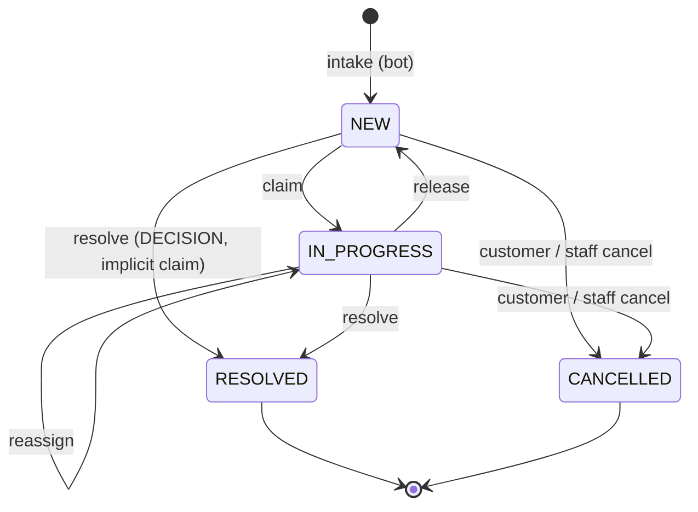

# Chatbot request inbox: data model

Human-intervention unit 2. Contract: `docs/proposals/human-intervention-backend-proposal.md` §2, §6.2, §6.5, §10.1 and §12. Migration: `prisma/migrations/20261110000000_chatbot_requests`. Pure state machine: `src/chatbot-requests/domain/chatbot-request.commands.ts`.

## Tables

| Table | What it holds |
| --- | --- |
| `chatbot_requests` | One row per human request from the bot. It records how the request is handled: inbox status, assignee, deadlines, scheduling and closing. The legacy flows wrap into it through a nullable unique FK: `humanDecisionId` (RESTOCK, EXPIRATION), `deliveryZoneRequestId` (DELIVERY_ZONE) or `receiptEvidenceId` (TRANSFER_RECEIPT). The wrapped table still records *what* was decided. |
| `chatbot_request_events` | Append-only audit (§6.2): type, actor kind/id/copied name, from/to status, the request version after the change, and small `data` that never contains customer text. |
| `chatbot_customer_groups` | One row per `(tenantId, customerKey)` with open requests: `mostUrgentAt`, `openCount`, `hasOverdue`. It is updated in the same transaction as every command, so the grouped inbox needs no `GROUP BY` (§10.1). |
| `chatbot_request_folio_counters` | Per-tenant counter behind `folio`, shown as `S-000123`. |
| `staff_command_receipts` | Staff command idempotency (§6.5, §12.12): one row per `(tenantId, actorId, idempotencyKey)` with `commandHash` and `responseSnapshot`. Migration `20261110010000_chatbot_request_staff_receipts`. |

Actor columns (`assigneeUserId`, `resolvedByActorId`, `actorId`) are plain ids paired with a copied display name. They have no user FK, so the audit survives user deletion and the migration takes no lock on `users`.

## States

- **`displayStatus`** is derived, not stored: `EXPIRED` means an open request whose `overdueAt` is set; otherwise it equals `status`.
- **Commands** (`claim`, `release`, `reassign`, `resolve`, `cancelByStaff`, `cancelByCustomer`) return either the column patch plus the event to append, or a typed error: `VERSION_CONFLICT`, `REQUEST_CLAIMED_BY_OTHER` or `REQUEST_CLOSED` (409); `ALREADY_RESOLVED` (409, customer cancel); `NOT_ASSIGNEE` (403); `ACTION_NOT_ALLOWED` (422); `CANCEL_NOT_ALLOWED`; or `VALIDATION_ERROR` (400). Every error carries `current {version, status, claimedBy}`.
- **Concurrent claims:** a second claimer gets `REQUEST_CLAIMED_BY_OTHER` before the version is compared (§4.3). Re-claiming a request you already hold (a second tab) gets 409 `VERSION_CONFLICT`, whose `current.claimedBy` lets that tab catch up.
- **Staff cancel** (§12.11, §12.14): it is allowed for CLARIFICATION, and for TALK_TO_HUMAN/COMPLAINT while the session is `WAITING`. Otherwise it fails with `CANCEL_NOT_ALLOWED`: 409 while the session is `STARTING`/`ACTIVE`/`ENDING`, 422 once it is `ENDED`/`CANCELLED`, and 422 for wrapped decisions, which close with their negative action instead. `OTHER` requires a note. Cancelling a request held by someone else requires `update:ChatbotRequestAssignment` (`actorCanReassign`), as release does; otherwise 403 `NOT_ASSIGNEE`.
- **Release** of someone else's request without `update:ChatbotRequestAssignment` answers 403 `NOT_ASSIGNEE` before the version is compared. Release of a live conversation (`STARTING`/`ACTIVE`/`ENDING`) is rejected here, because the return-to-bot path belongs to the live-session unit (§4.2).
- **R4:** claim, release and reassign patch only `chatbot_requests` columns. The wrapped row's version (`human_decisions` is fixed at 1 → 2) is never touched by them.

## Staff commands (slice 2b)

Routes: `POST /chatbot-requests/:id/{claim,release,reassign,cancel}` (`src/chatbot-requests/presentation`), FE handoff `docs/frontend-handoff/11-chatbot-request-commands.md`. `ChatbotRequestCommandsService` runs each command in one transaction:

1. `pg_advisory_xact_lock(hashtextextended('chatbot-staff:<tenant>:<actor>:<key>', 0))`, then the receipt. It is one bigint key in its own text namespace, so it cannot collide with the cash `(hashtext(tenant), hashtext(key))` two-int keys. Same hash → the stored response, even if the request changed since. Another hash → 409 `IDEMPOTENCY_CONFLICT`. The advisory lock makes a concurrent retry of the same key wait and replay instead of failing with `VERSION_CONFLICT`.
2. Reassign only: the target must be an active member whose role grants both `read` and `update` on `ChatbotRequest` (a `manage` grant or subject `all` counts, as in CASL), else 422 `USER_NOT_ASSIGNABLE`.
3. `SELECT … FOR UPDATE` on the request, filtered by tenant. A missing or foreign id is 404 `NOT_FOUND`.
4. The pure state machine decides. A rejection throws, so the transaction rolls back and stores no receipt.
5. `UPDATE … WHERE id AND version = expected` (`version + 1`), event insert, customer-group refresh, receipt insert.

`resolve` has its own route since unit 3 (see "Wrapping the legacy flows"). Until the live-session table exists (unit 11), `liveSessionState` is `null` for every request.

**Customer group refresh** (`refreshCustomerGroup`): an `INSERT … ON CONFLICT DO UPDATE` first locks (or creates) the group row; only then does an aggregate over the open requests run. Under READ COMMITTED each statement takes a new snapshot, so the aggregate sees every command that held the group lock before it. Computing the aggregate before the lock loses updates (the 20-parallel integration test fails if the order is swapped). Lock order is always request row, then group row (see "Lock order rules").

**Isolation rule:** this refresh is correct only under READ COMMITTED. `refreshCustomerGroup` runs `SHOW transaction_isolation` first and throws if the level is anything else, so a creator or command wrapped in a REPEATABLE READ or SERIALIZABLE transaction fails instead of writing a stale count (integration test "refuses to run above READ COMMITTED"). Never open these transactions with an explicit isolation level. The row is deleted when no open request remains. `mostUrgentAt` = the nearest current deadline (`claimDeadlineAt` while NEW, `resolveDeadlineAt` while IN_PROGRESS), or NULL while no SLA is set (unit 7). `hasOverdue` = any open request with `overdueAt`.

**Folio** (`allocateFolio`): `INSERT … ON CONFLICT DO UPDATE SET lastNumber + 1 RETURNING`, in the creator's transaction. The counter row lock serializes allocations per tenant.

**Receipts retention:** kept, like `cash_commands` and the editorial receipts; `(tenantId, createdAt)` serves a future purge.

**`canonicalPhone(cc, phone)`** (`domain/canonical-phone.ts`, R1): `customerKey` as E.164 digits without `+`. A country code of `521` or `+521` counts as `52`. For `52`, `521` + 10, `52` + 10 and `1` + 10 reduce to the 10-digit national number; for `1`, a leading `1` is dropped. For both, the national number must be 10 digits not starting with 0 or 1, so `521` + 9 digits is rejected. Other countries keep their digits. Letters, wrong lengths and bad country codes return `null`.

## Lock order rules

Every transaction that touches these tables takes locks in this order, so concurrent commands cannot deadlock. Later units (intake, wrapping, resolve, sweep) must follow it.

1. **Request rows before group rows, and the folio counter last.** Lock the existing `chatbot_requests` rows first, then the `chatbot_customer_groups` row (`refreshCustomerGroup` locks it). Allocate the folio after every lock on an existing row (dedup, open limit, wrapped rows) and as late as possible: the only things a creator does after `allocateFolio` are inserting the new request row and refreshing its group. Commands (claim, release, reassign, cancel, resolve) never touch the counter, so nothing waits on it while holding a group lock, and the counter cannot join a cycle. Never lock a group row and then wait for a request row.
2. **Intake dedup and the open-limit check** lock request rows first (the open dedup lookup and the count of open requests, with `FOR UPDATE` where they need a stable view) and touch the group last.
3. **More than one group in a transaction** (for example link-customer, which moves several requests, or merge): refresh the groups in sorted `customerKey` order, after all request rows are locked. When more than one request row is locked, lock them in `id` order (§12.11).
4. **Wrapped resolve runs in READ COMMITTED**, like every command here. It locks the common request row, calls the wrapped repository, and only then refreshes the group; it must not set an isolation level.
5. **A delivery zone takes the postal-code advisory lock first** (`lockZipCode`, the lock the bot intake and the legacy zone resolve already take), then the request rows, then the validation and zone rows, then the groups. The staff `resolve` therefore locks the zip before its own request row. Every legacy hook (`lockLegacy`) locks the open wrapping requests before the old code touches the wrapped row, so request, wrapped row and group are always locked in that order from both entry points.

## Wrapping the legacy flows (unit 3, slice 3a)

Contract §2.1, §2.3, §2.4, R1, R4, R9. Code: `infrastructure/chatbot-request-wrapper.ts` (hooks), `infrastructure/wrapped-request-resolver.ts` (the `resolve` adapter), `presentation/chatbot-request-resolve.body.ts` (flat body parser). No migration: everything fits the tables of slice 2a. Existing routes, payloads and responses are unchanged (S4). Handoff for the FE: `docs/frontend-handoff/12-chatbot-request-resolve.md`.

**Creation hooks.** The existing intake paths call `ChatbotRequestWrapper` right after inserting the wrapped row, on the same transaction, so a rollback of the wrapped insert leaves no request (and no folio gap):

| Wrapped row | Hook (inside) | Customer |
| --- | --- | --- |
| RESTOCK / EXPIRATION `HumanDecision` | `PrismaRestockIntakeRepository.submit`, `PrismaExpirationIntakeRepository.submit` | None (§2.3): `customerKey = unknown:<decisionId>`, one group per decision |
| `DeliveryZoneRequest` waiting for a human | `PrismaDeliveryZoneBotRepository.submit`, only the branch that joins a PENDING validation. A requester born `RESOLVED` by an existing zone is not wrapped | `customerKey = canonicalPhone(cc, phone)` |
| `ReceiptEvidence` | `ReceiptUploadService.createWithReviewRequest` (both the multipart upload and the legacy URL) | `Sale.customerId`; the key comes from that customer's phone, else `unknown:<receiptId>` |

Wrapper rows use `source = WRAP:HUMAN_DECISION | WRAP:DELIVERY_ZONE_REQUEST | WRAP:RECEIPT_EVIDENCE` and the wrapped id as `sourceRequestId`; the backfill (next slice) must use the same values with `ON CONFLICT DO NOTHING` on the wrapped FK. The summary is a short Spanish label with no customer text (`Stock: <product>`, `Caducidad: <product>`, `Zona de entrega <zip>`, `Comprobante de transferencia <folio>`) and `context` holds ids only. A zone request also stores `conversationRef`, `lastCustomerMessageAt` and the 24 h window. The `CREATED` event is `SYSTEM`. Order inside the transaction: wrapped insert, customer lookup, `assertTenantLinks` (M3), folio, request insert, event, group.

**R1 customer link.** A zone requester links a `Customer` only when its canonical key maps to exactly one customer in the tenant (`phoneLookupVariants` builds an indexed `IN` over the stored forms `52`/`521`, `10`/`11`/`12`/`13` digits, then each hit is compared with `canonicalPhone`). With more than one, the request keeps `customerId = NULL` and `ambiguousCustomer = true`. A receipt uses `Sale.customerId` as is: the sale names its customer, so it is not an inference. Customers stored without a country code are not matched.

**`ChatbotRequestWrapper` is an `@Optional()` constructor dependency of the five flow classes.** Their own specs (and the specs of other modules that provide them) build them without it, which keeps them unchanged; the production modules import `ChatbotRequestWrapperModule` and `chatbot-requests.module.spec.ts` plus `chatbot-requests-wiring.integration.spec.ts` prove the hook is injected in the real graph.

**Legacy routes close the request (§2.4).** `lockLegacy` runs before the old code touches the wrapped row and `closeLegacy` after it succeeded, in the same transaction: `HumanDecision` resolve (`resolveInAmbientTransaction` is the new entry of that use case for the staff command; `resolve` keeps its "outside a transaction" guard), `PrismaDeliveryZoneValidationRepository.resolve` (closes every open request of the validation) and `ReceiptReviewService.confirm/reject`. The request becomes `RESOLVED` with `resolution = {action, via: 'LEGACY_ROUTE', …}`, an implicit claim when it was `NEW`, a `RESOLVED` event `{action, via}` and a refreshed group. It takes no `expectedVersion` and ignores who holds it: the legacy route never knew about claims. A request that is already closed is left alone.

**Common `resolve`** (`POST /chatbot-requests/:id/resolve`, §3.8, §12.6). Inside one READ COMMITTED transaction: idempotency receipt, postal-code lock (zones only), `FOR UPDATE` on the request, state machine (`REQUEST_CLOSED`, `REQUEST_CLAIMED_BY_OTHER`, `VERSION_CONFLICT`, implicit claim), action/subtype check (`ACTION_NOT_ALLOWED`), for zones the sibling lock and `ZONE_SET_CHANGED` check, request and sibling patches plus events, the existing use case with its own `expectedVersion = 1` (R4) and the staff `Idempotency-Key` as its `resolutionRequestId` (run under `suppressLegacyClose`, because the application already closed the requests), and the group refreshes in sorted `customerKey` order. The old use case's errors become the staff envelope (`ALREADY_RESOLVED` → `REQUEST_CLOSED`, `RECEIPT_NOT_ACTIONABLE` → `REQUEST_CLOSED`, `SALE_NOT_REVIEWABLE` → `ACTION_NOT_ALLOWED`, `FORBIDDEN` → 403). Any failure rolls the request, siblings, events and the wrapped row back together.

**Zone fan-out (R9, D15).** Resolving one `DELIVERY_ZONE` request settles the shared validation, which settles every requester, and closes every other open request of the validation as `RESOLVED` with `resolution = {action: 'SIBLING_RESOLVED', viaRequestId}` and a `RESOLVED` event with the same data, resolved by the staff member who acted. `zoneImpact = {requests, customers, setVersion}` counts the open requests and their distinct customers. `setVersion` needs no column: it is every request that ever joined the validation plus every one that left by cancelling (`count(*) + count(CANCELLED)`), so it only grows and any join or leave after the preview changes it. `expectedZoneSetVersion` is checked after the postal-code lock and the sibling locks, so nothing can join between the check and the write: a mismatch is `409 ZONE_SET_CHANGED` with `current.zoneImpact`. `GET /chatbot-requests/:id/zone-impact` serves the preview.

**Customer cancel of a wrapped decision (unit 5, not in this slice).** The wrapped tables have no cancelled state, so unit 5 will cancel the common request only (`CANCELLED / CUSTOMER_WITHDREW`, state machine `cancelByCustomer`, taking `lockZoneOf`, then the request row, then the group) and leave the wrapped row `PENDING`: a RESTOCK/EXPIRATION decision then stays a harmless pending row that a later resolve of the same row (legacy route) still closes with `closeLegacy`, which skips already closed requests; a cancelled zone requester still gets the zone outcome when its validation is resolved, but is no longer part of `zoneImpact.requests` and bumps `setVersion`; a cancelled receipt is not confirmed or rejected by staff. The §2.1 invariant check in the tests therefore excludes `CANCELLED` requests, and unit 5 must add the same exclusion to any production check.

## Invariants (CHECK constraints)

| Constraint | Rule |
| --- | --- |
| `kind_subtype_chk` | DECISION ⇔ RESTOCK/EXPIRATION/DELIVERY_ZONE/TRANSFER_RECEIPT/DISCOUNT; CLARIFICATION ⇔ UNKNOWN_QUESTION; CONVERSATION ⇔ TALK_TO_HUMAN/COMPLAINT |
| `wrapped_link_chk` | Exactly the wrapped FK its subtype requires, so at most one |
| `assignee_state_chk` | IN_PROGRESS has an assignee and `claimedAt`; NEW has neither; the id and the name are set together |
| `assignee_claimed_at_chk` | `assigneeUserId` ⇔ `claimedAt` in every status; every command sets or clears them together |
| `ambiguous_customer_chk` | `ambiguousCustomer` ⇒ `customerId IS NULL`; staff links the customer by hand (R1) |
| `resolved_state_chk` | `status = RESOLVED` ⇔ `resolvedAt`; the resolver id and name are set together |
| `cancelled_state_chk` | `status = CANCELLED` ⇔ `cancelledAt`; `cancelledAt` ⇔ `cancelReason` |
| `staff_cancel_reason_chk` | `cancelReason = STAFF` ⇔ `staffCancelReason` |
| `closed_at_chk` | `closedAt = COALESCE(resolvedAt, cancelledAt)` |
| `sla_sweep_open_chk` | `nextSlaCheckAt` only on open requests |
| `whatsapp_window_chk` | `whatsappWindowClosesAt` and `lastCustomerMessageAt` are both NULL or both set. The window is normally the message + 24 h, but any value Meta reports can be stored (§4.5) |
| `scheduling_chk` | `scheduledFor` only on conversations; `requiresTemplateAtStart`/`needsReschedule` require `scheduledFor` |
| `positive_chk`, `phone_pair_chk` | `version`, `folio` ≥ 1, non-empty `customerKey`; country code and phone set together |
| `chatbot_request_events_actor_chk` | SYSTEM ⇔ no actor id; SYSTEM has no name; USER has a name; `version` ≥ 1 |
| `chatbot_customer_groups_open_count_chk` | `openCount > 0`: the row is deleted when the last open request closes |

Requests are kept forever (D4). The trigger `chatbot_requests_keep_forever` runs `BEFORE DELETE`, for each row, and rejects a direct `DELETE` (`pg_trigger_depth() = 1`). It allows the tenant cascade, which runs inside PostgreSQL's referential-integrity trigger (depth > 1). Rejecting the parent row also protects its audit.

`chatbot_request_events` is append-only in the database (§6.2). The trigger `chatbot_request_events_append_only` runs `BEFORE UPDATE OR DELETE`, for each row:

- **Every `UPDATE`** is rejected.
- **A direct `DELETE`** is rejected. Here the trigger runs at `pg_trigger_depth() = 1`.
- **A `DELETE` from the FK cascade is allowed.** Deleting a tenant cascades to `chatbot_requests` and then to the events, which removes the audit with its tenant. The cascade runs inside PostgreSQL's referential-integrity trigger, so this trigger sees a depth greater than 1.
- **A direct `DELETE` of a `chatbot_requests` row** never reaches the events: `chatbot_requests_keep_forever` rejects it first.
- **`TRUNCATE`** fires no row trigger. The integration test reset (`TRUNCATE tenants CASCADE`) keeps working.

Events reference their request through `(tenantId, requestId)`, so an event cannot point into another tenant.

## Indexes and the query each one serves

| Index | Query |
| --- | --- |
| `chatbot_customer_groups (tenantId, mostUrgentAt, customerKey)` | Grouped inbox page: `ORDER BY mostUrgentAt, customerKey` with the opaque cursor `(mostUrgentAt, customerKey)`. Overdue groups have the oldest deadline, so they sort first |
| `chatbot_requests (tenantId, customerKey, status)` | Up to 10 requests per group, and the flat per-customer list `GET /chatbot-requests?customerKey=` (§12.3) |
| `(nextSlaCheckAt) WHERE nextSlaCheckAt IS NOT NULL` | SLA sweep: `nextSlaCheckAt <= now() FOR UPDATE SKIP LOCKED LIMIT 100`. The `<=` comparison implies `IS NOT NULL`, so the planner uses the index without repeating the predicate. `sla_sweep_open_chk` keeps closed rows out of it |
| `(tenantId, closedAt DESC, id DESC) WHERE status IN (RESOLVED, CANCELLED)` | History list (§3.8), newest first, cursor `(closedAt, id)` |
| `(tenantId, subtype, closedAt DESC)` | History filtered by subtype |
| `(tenantId, resolvedByActorId, closedAt DESC)` | History filtered by `resolvedBy` |
| `(tenantId, status) WHERE open` | Counters `new` and `inProgress` |
| `(tenantId, assigneeUserId) WHERE status = IN_PROGRESS` | Counter `mine` |
| `(tenantId) WHERE open AND overdueAt IS NOT NULL` | Counter `overdue` |
| `(tenantId, whatsappWindowClosesAt) WHERE open` | Counter `windowClosingSoon` (window closes within the warning threshold) |
| `(tenantId, scheduledFor) WHERE open AND scheduledFor IS NOT NULL` | Counter `scheduled` and the "Scheduled" tab |
| `(tenantId) WHERE open AND needsReschedule` | Counter `needsReschedule` |
| unique `(tenantId, customerKey, dedupKey) WHERE open AND dedupKey IS NOT NULL` | Intake merge (§3.5): at most one open request per customer and dedup key |
| unique `(tenantId, source, sourceRequestId)` | Idempotent intake (`X-Idempotency-Key`) |
| unique `(tenantId, folio)` | Folio lookup and uniqueness |
| unique `humanDecisionId` / `deliveryZoneRequestId` / `receiptEvidenceId` | A wrapped row is wrapped once; backfill uses `ON CONFLICT DO NOTHING` |
| `(customerId)` | `ON DELETE SET NULL` from `customers` without a sequential scan |
| `chatbot_request_events (tenantId, requestId, createdAt DESC, id DESC)` | Audit page, newest first (`GET /chatbot-requests/:id/audit`) |

## Deploy safety

The migration is additive: it creates four tables, their indexes and their CHECKs, and it does not alter or rewrite any existing table. Each FK briefly takes a `SHARE ROW EXCLUSIVE` lock on its referenced table (`tenants`, `customers`, `human_decisions`, `delivery_zone_requests`, `receipt_evidences`) until the migration commits. That lock blocks writes to those tables. Validation scans the empty new table, so the lock lasts milliseconds, but it must wait for open transactions on those tables to finish.

`SET LOCAL lock_timeout = '5s'` at the top bounds that wait. Prisma applies the file as one transaction, so a timeout leaves nothing applied.

- **Deploy at low traffic.**
- **If the deploy fails on a lock timeout**, run `prisma migrate resolve --rolled-back 20261110000000_chatbot_requests` and redeploy.

`20261110010000_chatbot_request_staff_receipts` is also additive: one new table, its index and one FK to `tenants` (brief `SHARE ROW EXCLUSIVE` on `tenants`), with the same `SET LOCAL lock_timeout = '5s'` and the same recovery (`migrate resolve --rolled-back 20261110010000_chatbot_request_staff_receipts`).

## Known deviations from the contract

- **`conversationRef`** is plain TEXT. The contract's `conversationId` FK to `ChatbotConversation` (§3.6) will be added when the conversation mirror table exists (unit 9).
- **Wrapped zone requests** have no cancelled state, so a customer cancel (unit 5) leaves `delivery_zone_requests` `PENDING`; see "Customer cancel of a wrapped decision".
- **Cross-tenant links** to `customers` and to the wrapped tables use single-column FKs, because those tables have no `(tenantId, id)` unique key and this migration must not alter them. The application checks that a linked customer or wrapped row belongs to the request's tenant (M3) with `assertTenantLinks` (`infrastructure/chatbot-request-writes.ts`, 404 `NOT_FOUND` for a foreign id). Every creator must call it (units 3 and 5). Events, by contrast, use a tenant-qualified FK.
