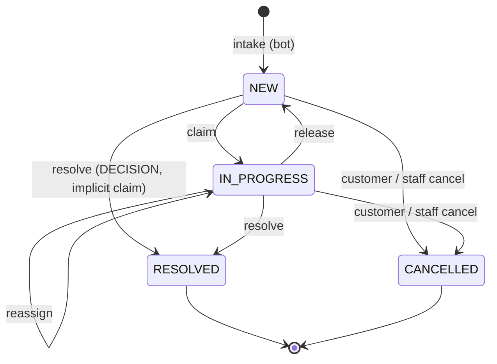

# Chatbot request inbox: data model

Human-intervention unit 2. Contract: `docs/proposals/human-intervention-backend-proposal.md` §2, §6.2, §6.5, §10.1 and §12. Migration: `prisma/migrations/20261110000000_chatbot_requests`. Pure state machine: `src/chatbot-requests/domain/chatbot-request.commands.ts`.

## Tables

| Table | What it holds |
| --- | --- |
| `chatbot_requests` | One row per human request from the bot. It records how the request is handled: inbox status, assignee, deadlines, scheduling and closing. The legacy flows wrap into it through a nullable unique FK: `humanDecisionId` (RESTOCK, EXPIRATION), `deliveryZoneRequestId` (DELIVERY_ZONE) or `receiptEvidenceId` (TRANSFER_RECEIPT). The wrapped table still records *what* was decided. |
| `chatbot_request_events` | Append-only audit (§6.2): type, actor kind/id/copied name, from/to status, the request version after the change, and small `data` that never contains customer text. |
| `chatbot_customer_groups` | One row per `(tenantId, customerKey)` with open requests: `mostUrgentAt`, `openCount`, `hasOverdue`. It is updated in the same transaction as every command, so the grouped inbox needs no `GROUP BY` (§10.1). |
| `chatbot_request_folio_counters` | Per-tenant counter behind `folio`, shown as `S-000123`. |
| `staff_command_receipts` | Staff command idempotency (§6.5, §12.12): one row per `(tenantId, actorId, idempotencyKey)` with `commandHash` and `responseSnapshot`. Migration `20261110010000_chatbot_request_staff_receipts`. |
| `chatbot_bot_receipts` | Bot idempotency for the writes that leave no request row to replay from (§3.1): a create that **merged**, and every customer **cancel**. One row per `(tenantId, kind CREATE\|CANCEL, idempotencyKey)`. Migration `20261110030000_chatbot_request_bot_intake`. |
| `service_rate_buckets` | Bot route budgets (R2): one row per `(credentialId, routeClass)`, no tenant and no FK, reset in place like `auth_rate_buckets`. Same migration; it also adds `service_credentials.rateLimits JSONB` (per-class overrides). |

| `chatbot_feed_items` | The bot feed (slice 5b, §3.3): one row per delivery the chatbot pulls with a cursor (`cursor` bigserial primary key, `deliveryId` uuid unique), plus its last outcome (`outcome`, `attemptId`, `evidenceHash`, `attemptedAt`, `providerMessageId`, `ackedAt`). Migration `20261110050000_chatbot_feed`. |
| `chatbot_feed_retention` | Per tenant, the highest cursor the retention purge removed (`purgedThroughCursor`): a cursor below it answers `410 CURSOR_EXPIRED`. Same migration. |

Actor columns (`assigneeUserId`, `resolvedByActorId`, `actorId`) are plain ids paired with a copied display name. They have no user FK, so the audit survives user deletion and the migration takes no lock on `users`.

## States

- **`displayStatus`** is derived, not stored: `EXPIRED` means an open request whose `overdueAt` is set; otherwise it equals `status`.
- **Commands** (`claim`, `release`, `reassign`, `resolve`, `cancelByStaff`, `cancelByCustomer`) return either the column patch plus the event to append, or a typed error: `VERSION_CONFLICT`, `REQUEST_CLAIMED_BY_OTHER` or `REQUEST_CLOSED` (409); `ALREADY_RESOLVED` (409, customer cancel); `NOT_ASSIGNEE` (403); `ACTION_NOT_ALLOWED` (422); `CANCEL_NOT_ALLOWED`; or `VALIDATION_ERROR` (400). Every error carries `current {version, status, claimedBy}`.
- **Concurrent claims:** a second claimer gets `REQUEST_CLAIMED_BY_OTHER` before the version is compared (§4.3). Re-claiming a request you already hold (a second tab) gets 409 `VERSION_CONFLICT`, whose `current.claimedBy` lets that tab catch up.
- **Staff cancel** (§12.11, §12.14): it is allowed for CLARIFICATION, and for TALK_TO_HUMAN/COMPLAINT while the session is `WAITING`. Otherwise it fails with `CANCEL_NOT_ALLOWED`: 409 while the session is `STARTING`/`ACTIVE`/`ENDING`, 422 once it is `ENDED`/`CANCELLED`, and 422 for wrapped decisions, which close with their negative action instead. `OTHER` requires a note. Cancelling a request held by someone else requires `update:ChatbotRequestAssignment` (`actorCanReassign`), as release does; otherwise 403 `NOT_ASSIGNEE`.
- **Release** of someone else's request without `update:ChatbotRequestAssignment` answers 403 `NOT_ASSIGNEE` before the version is compared. Release of a live conversation (`STARTING`/`ACTIVE`/`ENDING`) is rejected here, because the return-to-bot path belongs to the live-session unit (§4.2).
- **R4:** claim, release and reassign patch only `chatbot_requests` columns. The wrapped row's version (`human_decisions` is fixed at 1 → 2) is never touched by them.

## Staff commands (slice 2b)

Routes: `POST /chatbot-requests/:id/{claim,release,reassign,cancel}` (`src/chatbot-requests/presentation`), FE handoff `docs/frontend-handoff/11-chatbot-request-commands.md`. `ChatbotRequestCommandsService` runs each command in one transaction:

1. `pg_advisory_xact_lock(hashtextextended('chatbot-staff:<tenant>:<actor>:<key>', 0))`, then the receipt. It is one bigint key in its own text namespace, so it cannot collide with the cash `(hashtext(tenant), hashtext(key))` two-int keys. Same hash → the stored response, even if the request changed since. Another hash → 409 `IDEMPOTENCY_CONFLICT`. The advisory lock makes a concurrent retry of the same key wait and replay instead of failing with `VERSION_CONFLICT`.
2. Reassign only: the target must be an active member whose role grants both `read` and `update` on `ChatbotRequest` (a `manage` grant or subject `all` counts, as in CASL), else 422 `USER_NOT_ASSIGNABLE`.
3. `SELECT … FOR UPDATE` on the request, filtered by tenant. A missing or foreign id is 404 `NOT_FOUND`.
4. The pure state machine decides. A rejection throws, so the transaction rolls back and stores no receipt.
5. `UPDATE … WHERE id AND version = expected` (`version + 1`), event insert, customer-group refresh, receipt insert.

`resolve` has its own route since unit 3 (see "Wrapping the legacy flows"). `liveSessionState` is `null` for a request that never had a live session (unit 11, see "Live conversation").

**Customer group refresh** (`refreshCustomerGroup`): an `INSERT … ON CONFLICT DO UPDATE` first locks (or creates) the group row; only then does an aggregate over the open requests run. Under READ COMMITTED each statement takes a new snapshot, so the aggregate sees every command that held the group lock before it. Computing the aggregate before the lock loses updates (the 20-parallel integration test fails if the order is swapped). Lock order is always request row, then group row (see "Lock order rules").

**Isolation rule:** this refresh is correct only under READ COMMITTED. `refreshCustomerGroup` runs `SHOW transaction_isolation` first and throws if the level is anything else, so a creator or command wrapped in a REPEATABLE READ or SERIALIZABLE transaction fails instead of writing a stale count (integration test "refuses to run above READ COMMITTED"). Never open these transactions with an explicit isolation level. The row is deleted when no open request remains. `mostUrgentAt` = the nearest current deadline (`claimDeadlineAt` while NEW, `resolveDeadlineAt` while IN_PROGRESS), or NULL while the subtype has no deadline of that kind (unit 7a fills them, see "SLA deadlines"). `hasOverdue` = any open request with `overdueAt`.

**Folio** (`allocateFolio`): `INSERT … ON CONFLICT DO UPDATE SET lastNumber + 1 RETURNING`, in the creator's transaction. The counter row lock serializes allocations per tenant.

**Receipts retention:** kept, like `cash_commands` and the editorial receipts; `(tenantId, createdAt)` serves a future purge.

**`canonicalPhone(cc, phone)`** (`domain/canonical-phone.ts`, R1): `customerKey` as E.164 digits without `+`. A country code of `521` or `+521` counts as `52`. For `52`, `521` + 10, `52` + 10 and `1` + 10 reduce to the 10-digit national number; for `1`, a leading `1` is dropped. For both, the national number must be 10 digits not starting with 0 or 1, so `521` + 9 digits is rejected. Other countries keep their digits. Letters, wrong lengths and bad country codes return `null`.

## Lock order rules

Every transaction that touches these tables takes locks in this order, so concurrent commands cannot deadlock. Later units (intake, wrapping, resolve, sweep) must follow it.

1. **Request rows before group rows, and the folio counter last.** Lock the existing `chatbot_requests` rows first, then the `chatbot_customer_groups` row (`refreshCustomerGroup` locks it). Allocate the folio after every lock on an existing row (dedup, open limit, wrapped rows) and as late as possible: the only things a creator does after `allocateFolio` are inserting the new request row and refreshing its group. Commands (claim, release, reassign, cancel, resolve) never touch the counter, so nothing waits on it while holding a group lock, and the counter cannot join a cycle. Never lock a group row and then wait for a request row.
2. **Intake dedup and the open-limit check** lock request rows first (the open dedup lookup and the count of open requests, with `FOR UPDATE` where they need a stable view) and touch the group last.
3. **More than one group in a transaction** (for example link-customer, which moves several requests, or merge): refresh the groups in sorted `customerKey` order, after all request rows are locked. When more than one request row is locked, lock them in `id` order (§12.11).
4. **Wrapped resolve runs in READ COMMITTED**, like every command here. It locks the common request row, calls the wrapped repository, and only then refreshes the group; it must not set an isolation level.
5. **A delivery zone takes the postal-code advisory lock first** (`lockZipCode`, the lock the bot intake and the legacy zone resolve already take), then the request rows, then the validation and zone rows, then the groups. The staff `resolve` therefore locks the zip before its own request row. Every legacy hook (`lockLegacy`) locks the open wrapping requests before the old code touches the wrapped row, so request, wrapped row and group are always locked in that order from both entry points.
   **Zone exception to "request rows in id order".** A zone resolve locks its own request row first and then its siblings in id order. Two such transactions could lock rows in opposite order, so this is safe **only because every multi-row zone locker holds the zip lock first**, which serializes them per postal code. Any future code that locks several requests of one zone (a `link-customer` that moves requests, a merge, the customer cancel of unit 5, the SLA sweep) must call `lockZoneOf` (zip lock) before it locks any of those request rows. A locker that skips it can deadlock with `resolve`.
   **Backfill window (deadlock, 40P01).** A legacy resolve that finds no wrapper cannot lock a request first: `lockLegacy` locks nothing, then the old code waits on the wrapped row. If the backfill (which holds that wrapped row `FOR UPDATE`) commits a `NEW` request R for it, and staff then resolves R through the common route, that route locks R and waits for the wrapped row while the legacy transaction, which now holds the wrapped row, waits for R in `closeLegacy`. PostgreSQL detects the cycle and aborts one of the two with 40P01; the aborted transaction rolls back completely and nothing is corrupted (the caller can retry). The window exists only while wrappers are missing, so **the backfill must run to completion before the inbox is announced or used** (a hard precondition, repeated in `docs/chatbot-requests-backfill.md`); after it, every pending row has its wrapper and the order request, wrapped row, group holds from both entry points.

6. **The feed enqueue** (slice 5b) sits **after the state change and the wrapped-row write, before the group refresh**, inside the same transaction. It takes one more lock, the per-tenant feed advisory lock (`pg_advisory_xact_lock(hashtextextended('chatbot-feed:<tenant>', 0))`), which is held to the commit. Why it cannot deadlock: only enqueuers ever wait for it (claim, release, reassign, customer cancel, intake and the ACK never take it); every enqueuer takes it **before** any group row, so none holds a group lock while waiting for it, and the holder waits for nothing except group rows that a non-enqueuer holds and releases without needing the feed lock. Request rows and wrapped rows are already locked by then (rule 1 and 5), so the order stays request, wrapped row, feed lock, group. The staff `resolve` enqueues after the wrapped use case ran (it reads the answer from the wrapped row), the legacy hooks inside `closeLegacy` after the old code wrote it, and the staff cancel after `applyPatch`. Any new enqueuer must keep that place. See "Bot feed" below.

## Wrapping the legacy flows (unit 3, slice 3a)

Contract §2.1, §2.3, §2.4, R1, R4, R9. Code: `infrastructure/chatbot-request-wrapper.ts` (hooks), `infrastructure/wrapped-request-resolver.ts` (the `resolve` adapter), `presentation/chatbot-request-resolve.body.ts` (flat body parser). No migration: everything fits the tables of slice 2a. Existing routes, payloads and responses are unchanged (S4). Handoff for the FE: `docs/frontend-handoff/12-chatbot-request-resolve.md`.

**Creation hooks.** The existing intake paths call `ChatbotRequestWrapper` right after inserting the wrapped row, on the same transaction, so a rollback of the wrapped insert leaves no request (and no folio gap):

| Wrapped row | Hook (inside) | Customer |
| --- | --- | --- |
| RESTOCK / EXPIRATION `HumanDecision` | `PrismaRestockIntakeRepository.submit`, `PrismaExpirationIntakeRepository.submit` | None (§2.3): `customerKey = unknown:<decisionId>`, one group per decision |
| `DeliveryZoneRequest` waiting for a human | `PrismaDeliveryZoneBotRepository.submit`, only the branch that joins a PENDING validation. A requester born `RESOLVED` by an existing zone is not wrapped | `customerKey = canonicalPhone(cc, phone)` |
| `ReceiptEvidence` | `ReceiptUploadService.createWithReviewRequest` (both the multipart upload and the legacy URL) | `Sale.customerId`; the key comes from that customer's phone, else `unknown:<receiptId>` |

Wrapper rows use `source = WRAP:HUMAN_DECISION | WRAP:DELIVERY_ZONE_REQUEST | WRAP:RECEIPT_EVIDENCE` and the wrapped id as `sourceRequestId`; the backfill (slice 3b, below) writes the same values with `ON CONFLICT DO NOTHING` on the wrapped FK. The summary is a short Spanish label with no customer text (`Stock: <product>`, `Caducidad: <product>`, `Zona de entrega <zip>`, `Comprobante de transferencia <folio>`) and `context` holds ids only. A zone request also stores `conversationRef`, `lastCustomerMessageAt` and the 24 h window. The `CREATED` event is `SYSTEM`. Order inside the transaction: wrapped insert, customer lookup, `assertTenantLinks` (M3), folio, request insert, event, group.

**R1 customer link.** A zone requester links a `Customer` only when its canonical key maps to exactly one customer in the tenant (`phoneLookupVariants` builds an indexed `IN` over the stored forms `52`/`521`, `10`/`11`/`12`/`13` digits, then each hit is compared with `canonicalPhone`). With more than one, the request keeps `customerId = NULL` and `ambiguousCustomer = true`. A receipt uses `Sale.customerId` as is: the sale names its customer, so it is not an inference. Customers stored without a country code are not matched.

**`ChatbotRequestWrapper` is an `@Optional()` constructor dependency of the five flow classes.** Their own specs (and the specs of other modules that provide them) build them without it, which keeps them unchanged; the production modules import `ChatbotRequestWrapperModule` and `chatbot-requests.module.spec.ts` plus `chatbot-requests-wiring.integration.spec.ts` prove the hook is injected in the real graph.

**Legacy routes close the request (§2.4).** `lockLegacy` runs before the old code touches the wrapped row and `closeLegacy` after it succeeded, in the same transaction: `HumanDecision` resolve (`resolveInAmbientTransaction` is the new entry of that use case for the staff command; `resolve` keeps its "outside a transaction" guard), `PrismaDeliveryZoneValidationRepository.resolve` (closes every open request of the validation) and `ReceiptReviewService.confirm/reject`. The request becomes `RESOLVED` with `resolution = {action, via: 'LEGACY_ROUTE', …}`, an implicit claim when it was `NEW`, a `RESOLVED` event `{action, via}` and a refreshed group. It takes no `expectedVersion` and ignores who holds it: the legacy route never knew about claims. A request that is already closed is left alone.

**Resolve permission (owner decision).** Besides `read` + `update:ChatbotRequest` (route guard), `resolve` needs the permission the old route of the subtype always required: RESTOCK/EXPIRATION `update:HumanDecision`, DELIVERY_ZONE `validate:DeliveryZone`, TRANSFER_RECEIPT `update:ReceiptEvidence` (`domain/resolve-permissions.ts`: `legacyResolvePermission`, `canResolveSubtype`, the helper unit 4's `allowedActions` must reuse for `RESOLVE`). The controller hands the service a predicate over the JWT ability (`actorCanResolveSubtype`); the service asks it right after the request row is loaded and before any state check, so a missing permission is `403 INSUFFICIENT_PERMISSIONS` with no write and no request state in the answer, and an unknown id is still 404. A caller that gives no predicate is denied (fail closed).

**Replay writes nothing.** A legacy human-decision resolve that replays an already resolved decision reports it and performs no write, also none on the wrapping request. Only the first resolve closes the request. (A request left open by a decision resolved behind its back is a backfill or data repair matter, not something a replay fixes silently.)

**Actor names.** `User.name` can be empty and the USER-event CHECK needs a name, so the legacy hooks that only know a user id (receipt confirm/reject) copy `actorDisplayName(user)`: the trimmed name, else the email local part, else `Usuario`. Never empty.

**Common `resolve`** (`POST /chatbot-requests/:id/resolve`, §3.8, §12.6). Inside one READ COMMITTED transaction: idempotency receipt, postal-code lock (zones only), `FOR UPDATE` on the request, the subtype permission above, state machine (`REQUEST_CLOSED`, `REQUEST_CLAIMED_BY_OTHER`, `VERSION_CONFLICT`, implicit claim), action/subtype check (`ACTION_NOT_ALLOWED`), for zones the sibling lock and `ZONE_SET_CHANGED` check, request and sibling patches plus events, the existing use case with its own `expectedVersion = 1` (R4) and the staff `Idempotency-Key` as its `resolutionRequestId` (run under `suppressLegacyClose`, because the application already closed the requests), and the group refreshes in sorted `customerKey` order. The old use case's errors become the staff envelope (`ALREADY_RESOLVED` → `REQUEST_CLOSED`, `RECEIPT_NOT_ACTIONABLE` → `REQUEST_CLOSED`, `SALE_NOT_REVIEWABLE` → `ACTION_NOT_ALLOWED`, `FORBIDDEN` → 403). Any failure rolls the request, siblings, events and the wrapped row back together.

**Zone fan-out (R9, D15).** Resolving one `DELIVERY_ZONE` request settles the shared validation, which settles every requester, and closes every other open request of the validation as `RESOLVED` with `resolution = {action: 'SIBLING_RESOLVED', viaRequestId}` and a `RESOLVED` event with the same data, resolved by the staff member who acted. `zoneImpact = {requests, customers, setVersion}` counts the open requests and their distinct customers. `setVersion` needs no column: it is every request that ever joined the validation plus every one that left by cancelling (`count(*) + count(CANCELLED)`), so it only grows and any join or leave after the preview changes it. `expectedZoneSetVersion` is checked after the postal-code lock and the sibling locks, so nothing can join between the check and the write: a mismatch is `409 ZONE_SET_CHANGED` with `current.zoneImpact`. `GET /chatbot-requests/:id/zone-impact` serves the preview.

**Customer cancel of a wrapped decision (unit 5, slice 5a, implemented).** The wrapped tables have no cancelled state, so the cancel closes the common request only (`CANCELLED / CUSTOMER_WITHDREW` or `AUTO_RESOLVED`, state machine `cancelByCustomer`, taking the key lock, `lockZoneOf`, then the request row, then the group) and leave the wrapped row `PENDING`: a RESTOCK/EXPIRATION decision then stays a harmless pending row that a later resolve of the same row (legacy route) still closes with `closeLegacy`, which skips already closed requests; a cancelled zone requester still gets the zone outcome when its validation is resolved, but is no longer part of `zoneImpact.requests` and bumps `setVersion`; a cancelled receipt is not confirmed or rejected by staff. The §2.1 invariant check in the tests therefore excludes `CANCELLED` requests; `checkInvariant` (`--check`) already does (a `PENDING` wrapped row whose request is `CANCELLED` is not a mismatch), and the 5a integration spec runs it after a cancel of a decision and of a zone requester. Any future production check must keep the exclusion.

## Bot intake (unit 5, slice 5a)

Contract §3.1–§3.5, §6.4, §10.1 R2. Handoff for the chatbot: `docs/chatbot-handoff/chatbot-requests-bot-contract.md`. Code: `application/bot-request-intake.service.ts` (idempotency, retries, merge, cancel), `infrastructure/prisma-bot-intake.store.ts` (direct create, merge, cancel writes), `infrastructure/chatbot-request-intake-writes.ts` (shared: customer lock, dedup lookup, limits, the `ON CONFLICT` insert, merge event), `infrastructure/legacy-intake.adapter.ts` (the old intake repositories behind one port), and the envelope mode of `ChatbotRequestWrapper`.

**Two creators, one set of steps.** CLARIFICATION / TALK_TO_HUMAN / COMPLAINT are inserted directly. RESTOCK / EXPIRATION / DELIVERY_ZONE run the old intake repositories inside `wrapper.withEnvelope(...)`; the unit-3 hook then adds the envelope (customer link, summary, `needs`, context, `dedupKey`, the bot's hash and credential) to the wrapper row and runs the same customer lock, dedup and limits. Nothing of those flows is duplicated; their routes and bodies are unchanged (S4).

**Lock order of an intake transaction** (rule 2 made concrete). Two entry orders exist, because a wrapped create runs the old intake code first; from the customer lock on they are identical:

- **Direct create** (CLARIFICATION / TALK_TO_HUMAN / COMPLAINT) and **merge recovery**: (1) idempotency advisory lock, then steps 3-6.
- **Wrapped create**: (2) the legacy intake's own locks first (for a zone, the postal-code lock, then the wrapped row insert), then (1) the idempotency lock, taken by the unit-3 hook (`assertKeyFree`) after the wrapped row exists, then steps 3-6. A legacy replay of the same key never reaches the hook (the old unique `(tenantId, source, sourceRequestId)` and its recovery answer first), so the bot's hash is compared on the wrapper afterwards. No cycle: only creators take the `CREATE` key lock and none of them waits for a postal-code lock while holding it.
- **Cancel**: (1) idempotency lock (`CANCEL` namespace), (2) postal-code lock for a zone, then the request row, then the group.
- **A zone requester resolved by an existing zone** has no request row: after the legacy transaction committed, the service takes (1) and stores the receipt.

1. Idempotency advisory lock `chatbot-bot:<tenant>:CREATE|CANCEL:<key>`, so a concurrent retry waits and replays.
2. For a zone: the postal-code lock (the legacy intake takes it first, before anything else).
3. Customer advisory lock `chatbot-intake:<tenant>:<customerKey>`: creators of one customer queue here, so the open count and the hourly count are exact. Commands, resolve and cancel never take it, so it cannot be part of a cycle. It is taken after the zip lock and before every request row.
4. The open request with the same `(customerKey, dedupKey)`, `FOR UPDATE` (a hit merges; the limits are skipped, so a repeated question works at the limit).
5. Limits (one aggregate over the customer's rows): `CUSTOMER_OPEN_LIMIT` at 20 open requests of any subtype (`{limit, open}`), checked first; `CUSTOMER_RATE_LIMITED` at 10 requests created in the last hour (`createdAt`, so closed and cancelled ones count, merges do not), 429 whose `Retry-After` is the time until the count is back under the limit: the oldest creation of the window when the customer is at the limit, the `(count − limit + 1)`-th oldest when over it (rows created outside this check, or a lowered limit). Both limits are constructor options for tests; the window is `CREATION_WINDOW_MS` in `chatbot-request-intake-writes.ts`.
6. Folio (after every lock on an existing row; a rejected create burns none), then the insert, the `CREATED` event (`SERVICE`, the credential id) and the group refresh last.

**Merge recovery key.** `PrismaBotIntakeStore.mergeOpen` derives the `customerKey` with `linkByPhone`, the call the creators use for the key the partial unique index holds, on the phone the request is inserted under: the envelope customer, or for a zone requester the phone of its own `detail` (the envelope customer is only checked against it). A recovery that derived the key another way could never find the open request and would exhaust its three attempts with `VERSION_CONFLICT`; the phone-format cases (`521`, `+52`, spaced numbers) in `bot-request-intake.integration.spec.ts` guard it.

**Dedup is decided by the partial unique index too.** The insert is `INSERT … ON CONFLICT ("tenantId","customerKey","dedupKey") WHERE "status" IN ('NEW','IN_PROGRESS') AND "dedupKey" IS NOT NULL DO NOTHING RETURNING "id"`; the conflict target repeats the index predicate or PostgreSQL does not infer the index. No row back means a creator skipped the lock and lost the race: the transaction throws `IntakeMergeSignal`, the service retries (at most 3 attempts) and the next attempt finds the open request and merges. Under the customer lock this never happens; the index is the backstop.

**Merge of a wrapped subtype.** The hook finds the open request after the wrapped row was inserted, so it throws `IntakeMergeSignal`. The legacy repositories rethrow anything that is not a unique violation, so the whole legacy transaction (wrapped row, folio) rolls back; the service then merges in its own transaction (key lock, customer lock, dedup row, `MERGED` event) and stores a `chatbot_bot_receipts` row. If the open request closed in between, it delegates again.

**`lastCustomerMessageAt`** is bounded by the parser (at most 5 minutes ahead, at most 30 days old, `400` otherwise); a merge reuses the parsed envelope, so it is bounded too.

**Merge** appends a `MERGED` event (`SERVICE`, `{sourceRequestId, triggerWaMessageId}`) at the request's current version and does **not** bump `version`: a merge is not a staff command and must not fail the CAS of someone about to claim. A newer `lastCustomerMessageAt` moves the window (`+24 h`).

**Idempotent replay.** Every successful create (direct, merged or wrapped) stores a `chatbot_bot_receipts` row `(tenant, CREATE, key)` with the envelope hash, in the same transaction; the wrapped one is written by the hook, which first takes the key lock and refuses (409) when a receipt exists, because a legacy replay of the same key never reaches the hook. So one key reused on the other path, or with another body, is `IDEMPOTENCY_CONFLICT` on both orders, never a second request. A direct create replays from the receipt (same hash → 200 `REPLAYED`; a stored merge answers as it did), falling back to its own row (`source = houndfe-chatbot`, `canonicalRequestHash`) for rows older than the receipts. A merge replays even after the target closed. A wrapped create replays through the legacy identity, then the hash on the wrapper is compared (a wrapper created by the old route has none and is not compared). The cancel replays from its receipt (the response is stored, so a replay answers the same although the request has since changed). Failed attempts store nothing.

**Not wrapped.** A zone requester that an approved zone already answers is born `RESOLVED` and never wrapped (§2.3): the response has `id: null` and carries the legacy answer. There is no request row to hold the bot's hash, so the service stores a `chatbot_bot_receipts` row with `requestId = null` (key lock, then receipt), and the same key with another body is `409 IDEMPOTENCY_CONFLICT` there too. The early receipt check of a wrapped create runs outside any lock only to skip the legacy call for a stored merge; every race is decided under the key lock (the hook, merge recovery, this receipt) or by the hash compared on the replayed wrapper.

**Live sessions.** `cancelByCustomer` already rejects `STARTING`/`ACTIVE`/`ENDING` with `CANCEL_NOT_ALLOWED`, and since unit 11 `liveSessionState` is real (`STARTING`/`ACTIVE`/`ENDING` are refused with the sessions table behind them, proven in `live-conversation.integration.spec.ts`).

**R2 route budgets.** `PostgresRouteRateLimiter` (`src/chatbot-api/presentation/guards/route-rate-limiter.ts`) upserts one `service_rate_buckets` row per `(credentialId, routeClass)` in a single statement that also reads `service_credentials.rateLimits`; the upsert's row lock makes concurrent checks exact across replicas. `ServiceAuthGuard` takes it as an optional dependency and falls back to the per-process limiter only when none is wired (unit specs); `BotRateLimitModule` is `@Global` so every module that uses the guard gets the shared one (proved against the real application graph in `chatbot-requests-wiring.integration.spec.ts`). Routes without `@BotRouteClass` stay in class `default` with the credential's `rateLimit`; the three human-decision bot controllers use class `humanDecisions` (owner decision M1): the same budget (the credential's `rateLimit`) in its own bucket. Every instant is the database's (`now() AT TIME ZONE 'UTC'` inside the upsert, which also computes the time left), so replica clocks never enter a decision. `rateLimits` may override any class, `default` and `humanDecisions` included.

## Bot feed (unit 5, slice 5b)

Contract §3.3, §3.9, §4.5, §6.4, §10.1 R2/R7, §12.14, performance row "Feed del bot". Handoff for the chatbot: `docs/chatbot-handoff/chatbot-requests-bot-contract.md`, "The feed". Code: `domain/chatbot-feed.ts` (pure: cursor, query, outcome parser and hash, `classifyOutcome`, payload builders), `infrastructure/chatbot-feed-writes.ts` (enqueue), `application/chatbot-feed.service.ts` (long-poll, slots, pending, outcome), `infrastructure/prisma-chatbot-feed.store.ts` (reads, outcome transaction, purge), `infrastructure/feed-wakeup.ts` and `src/shared/realtime/pg-notification-listener.ts` (R7), `presentation/bot-feed.controller.ts`.

**Same transaction as the state change.** `enqueueAnswered` (staff `resolve`, every request of a zone fan-out, and the legacy routes through `closeLegacy`) and `enqueueCancelled` (staff cancel) run on the caller's transaction; a rollback leaves no item and no `NOTIFY`. Both resolve paths read the answer from the **wrapped row**, the one record of what staff decided, so the staff command and the old routes (which pass fewer details to `closeLegacy`) produce the same `request.answered`. A wrapped row that is not in the resolved state fails the transaction (fail closed) instead of losing the answer. The backfill creates resolved requests with `createMany`, so it enqueues nothing. A customer cancel enqueues nothing (it has its own receipt; `request.cancel_ack` belongs to a later unit). Both paths exist until unit 13: the legacy bot poll is untouched.

**Cursor order is commit order.** `cursor` is a global sequence, so without care two transactions could take 5 and 6 and commit 6 first; a reader that saw 6 would skip 5 for good. The per-tenant advisory lock above is taken before the insert and held to the commit, which makes cursor order equal commit order within a tenant (the lock is released only after the commit is visible), so `cursor > after` never skips an item. The price is that enqueues of one tenant serialize for the rest of their transaction. The integration test "cursor order is commit order" holds one enqueuer open and shows the second one waiting.

**The feed read is always answered by `(tenantId, cursor)` (slice 5c).** `cursor` is a global sequence and the primary key is `cursor` alone, so for `WHERE tenantId = $1 AND cursor > $2 ORDER BY cursor LIMIT n` the planner may use the primary key as an ordered path, filtered by tenant. It then reads every other tenant's rows between `after` and this tenant's next item. Measured: 77.7 ms and 21 852 buffers for a tenant with 40 000 items idle behind 270 000 foreign rows, and 65 ms and 17 898 buffers for a mid-share tenant (15 % of the table) whose next item is behind a gap of 225 000 foreign rows. A first fix, bounding the range with the tenant's own highest cursor, only helped the caught-up bot (it left the gap case at 65 ms), so it was replaced. `readAfter` now gives the planner no primary-key path: the tenant is not compared with `=` (a constant would drop it from the ordering) and the range is two row comparisons, `("tenantId", "cursor") > ($1, $after) AND ("tenantId", "cursor") <= ($1, 9223372036854775807) ORDER BY "tenantId", "cursor" LIMIT n`, which is exactly `tenantId = $1 AND cursor > $after`. Only the composite index can serve that without sorting the table, and both bounds are index conditions. The same case now reads 7 buffers in 0.03 ms, and the load test's EXPLAIN shows `(tenantId, cursor)` for every tenant shape. A unit test pins the query shape; the load test (`docs/perf/chatbot-feed-load-results.md`) proves the plan. `tenantHeadCursor` (the tenant's highest cursor, also forced onto the composite index) remains for the recovery route's `nextCursor`.

**Long-poll without a pool connection (R7).** `GET /chatbot-api/feed` arms a waiter, **then** reads with one short query (the connection goes back to the pool), and when the page is empty waits on the waiter. Arming first means a `NOTIFY` between the read and the wait is not lost. `pg_notify('chatbot_feed', <tenantId>)` is sent by the enqueue (payload: the tenant id only); one dedicated `pg.Client` per replica (`PgNotificationListener`, outside the Prisma pool, opened on the first long-poll, keepAlive on) fans it out to the waiters of that tenant. It notices a silently dead socket (a partition or a proxy timeout raises no error) two ways: TCP keepalive with the first probe after 10 s (`pgClientConfig`, which also bounds the connect at 10 s) and a heartbeat, a `SELECT 1` every 30 s that must answer within 10 s or the connection is treated as lost. It reconnects with exponential backoff and jitter (200 ms to 10 s); **every (re)connect wakes every waiter**, and a woken poll re-reads from its own cursor, so a `NOTIFY` lost while the connection was down costs nothing. If the listener cannot connect at all, polls still answer on the next bot request (each one reads first); there is no database polling while idle. The integration spec runs the app on a Prisma pool with ONE connection while long-polls wait, kills the listener's backend with `pg_terminate_backend`, and checks the item still arrives. `pg` was already a direct dependency (`package.json`, with `@types/pg`); nothing was added. LISTEN needs a session connection, so `DATABASE_URL` must not go through a transaction-pooling proxy.

**Limits.** At most 2 *waiting* long-polls per credential (R2); the counter is in memory, so it is **per replica** (with R replicas the cap is 2R) and a request answered at once never takes a slot. The `feed` route class budget is spent once when the request opens. Query values out of range are 400, never clamped.

**Shutdown.** `main.ts` calls `app.enableShutdownHooks()`, so SIGTERM runs the destroy hooks instead of killing the process with 25 s long-polls open. Only `PrismaService` (`$disconnect`) and the feed (`PgFeedWakeup`, `PgNotificationListener`) have hooks, so nothing else changes. `PgFeedWakeup.onModuleDestroy` wakes every waiter and marks itself `closing`; a woken poll sees it, answers an empty page and does not arm or read again (the same exit as a client that hung up). Caveat: Nest runs the destroy hooks *before* it stops the HTTP server, so an in-flight request that needs the database at that moment (not the feed's, which return at once) can fail on the Prisma disconnect; before this change those requests were killed outright, so it is not worse.

**Pending deliveries by conversation or by request (L2).** A request created without a `conversationRef` (a stock or expiration request, or one created by the old routes) has no conversation to ask by, and it has no customer phone to derive a `wa:` reference from, so `pending-deliveries` accepts `?requestId=` as the other filter (exactly one of the two). The `(tenantId, requestId)` index serves it.

**Outcome history (L4).** The item row keeps the last attempt only, but every applied attempt wrote a `DELIVERY_OUTCOME` event with its `attemptId`, `evidenceHash` and `ackReceivedAt`. An `attemptId` that differs from the stored one is looked up in those events: found with the same hash it is a replay, answered `200` with that attempt's own state and no write (an old deferral replayed after a later attempt must not overwrite the current state); found with another hash it is `IDEMPOTENCY_CONFLICT`; not found it follows the normal rules. Events are append-only and scoped to the request, so the lookup reads a handful of rows.

**Outcome.** `POST /chatbot-api/deliveries/:id/outcome` locks the item (`SELECT … FOR UPDATE`), classifies it with the pure `classifyOutcome` (same semantics as `HumanDecisionBotOutcome`: same attempt and evidence replays, same attempt other evidence is `IDEMPOTENCY_CONFLICT`, another attempt after a terminal outcome is `OUTCOME_ALREADY_RECORDED`), writes the outcome and appends a `DELIVERY_OUTCOME` event (`SERVICE`, `{deliveryId, feedType, outcome, attemptId, needsReconciliation}`) at the request's current version. A deferral (`DEFERRED_WINDOW_CLOSED`, or `DEFERRED_HUMAN_SESSION` since slice 5c: the conversation is in HUMAN mode and the bot holds the delivery) records `outcome` but leaves `ackedAt` NULL, so the item stays pending for `pending-deliveries` (partial index `(tenantId, conversationRef, cursor) WHERE outcome IN ('DEFERRED_WINDOW_CLOSED', 'DEFERRED_HUMAN_SESSION') AND ackedAt IS NULL`), which names the reason in `deferredReason` (`WINDOW_CLOSED` or `HUMAN_SESSION`); a later attempt ends it or defers again. Both are refused for `request.cancelled` (`422 OUTCOME_NOT_ALLOWED`, §12.14: a cancellation notice that arrives late only annoys the customer, whatever made it wait). The outcome set lives in `domain/chatbot-feed.ts` (`DEFERRED_OUTCOMES`, `deferredReasonOf`) and in two CHECKs of `chatbot_feed_items`, which migration `20261110060000_chatbot_feed_recovery` widened. The event insert's FK takes a share lock on the request row; no command waits for a feed row, so no cycle includes it. `DELIVERY_UNKNOWN` is the "to reconcile" mark (a derived `needsReconciliation` in the event); the staff detail that shows it belongs to unit 4. The enum already has `DELIVERY_OUTCOME`, so no enum change was needed.

**Retention (30 days).** The feed keeps every item 30 days, acknowledged or not. `PrismaChatbotFeedStore.purgeExpired(now, batch = 1000)` deletes one batch (`FOR UPDATE SKIP LOCKED`, oldest first) and raises `chatbot_feed_retention.purgedThroughCursor` for each tenant in the same statement (the marks are upserted `ORDER BY "tenantId"`, so two replicas that deleted rows of the same tenants lock the mark rows in the same order and cannot deadlock, 40P01); a cursor below the watermark answers `410 CURSOR_EXPIRED`, a missing cursor starts at the oldest retained item. **`ChatbotFeedPurgeScheduler` schedules the purge** (unit 7b): hourly, batch 1000, at most 20 batches per tick (a capped run keeps draining on the next tick), `FOR UPDATE SKIP LOCKED` so replicas never double-delete, no in-memory cursor (R11). The table no longer only grows. Items have no `expiresAt` or `notBefore`: both are served as `null` (§3.3).

## Recovery route (unit 5, slice 5c)

Contract §3.3 (`410 CURSOR_EXPIRED` → `GET /chatbot-api/requests?status=open&updatedSince=`), §3.9. Handoff for the chatbot, with the 410 → recovery → resume procedure: `docs/chatbot-handoff/chatbot-requests-bot-contract.md`, "Recovery after `410 CURSOR_EXPIRED`". Code: `domain/chatbot-recovery.ts` (query and page cursor), `application/chatbot-recovery.service.ts`, `infrastructure/prisma-chatbot-recovery.store.ts`, `presentation/bot-recovery.controller.ts`.

**What it returns.** Every open request of the credential's tenant plus, with `updatedSince`, the requests closed at or after that instant (so the bot can drop them), as the bot-facing projection: id, folio, kind, subtype, status, `conversationRef`, `legacyId`, the window, `cancelReason`, times, and the latest 5 undelivered feed items of each request (`outcome` NULL or a deferral, with `deferredReason`), plus `undeliveredTruncated` and `undeliveredResumeAfter` when a request has more undelivered items than the 5 listed (see below). No customer, phone, assignee or staff data and no free text. Scope `requests:read`, route class `read`, tenant from the credential.

**Keyset pages by `(updatedAt, id)`.** One statement per page: the open branch and the closed branch (only with `updatedSince`) are each an ordered index range scan with `LIMIT`, merged by `Merge Append`; the page asks for `limit + 1` rows to know whether there is a next page. Indexes: partial `chatbot_requests (tenantId, updatedAt, id) WHERE status IN ('NEW', 'IN_PROGRESS')` and partial `chatbot_requests (tenantId, updatedAt, id) WHERE status IN ('RESOLVED', 'CANCELLED')`. Without them the open branch reads all of the tenant's open requests and sorts them on every page, and the closed branch sorts every request closed since `updatedSince`; a bot that comes back from a 30-day gap would read tens of thousands of rows per page. The closed branch ranges on `updatedAt >= since` for the index and filters `closedAt >= since` for the rule (`updatedAt >= closedAt` always holds). Cost: one more index entry per request update on the open index (it already changes `updatedAt` on every command) and one per closure on the closed index. The pending items of the page come from one `LATERAL` probe of `(tenantId, requestId)` per request.

**More than 5 undelivered items.** The list is capped at 5 per request (the latest). One extra grouped probe per page on `(tenantId, requestId)` counts the undelivered items of the page's requests and finds the oldest; when the count exceeds 5 the request carries `undeliveredTruncated: true` and `undeliveredResumeAfter` (its oldest undelivered cursor minus one: the feed `after` that serves it again). The bot resumes the feed from the smallest of those values and `nextCursor`, and dedupes by `deliveryId`. `pending-deliveries` is not the way: it serves deferred items only, not the ones never attempted.

**Clock skew.** `updatedAt` and `closedAt` are stamped by whichever replica writes (the ORM clock, not the database's), and the bot's `updatedSince` comes from its own clock or from an earlier answer. Instead of moving every write to `now()`, the closed branch reaches `RECOVERY_LIMITS.clockSkewMs` (5 s) before `updatedSince`, so a request closed by a replica whose clock runs behind is not missed; the bot dedupes by request id. Open requests are always returned whole, so they are unaffected.

**`nextCursor` is the feed position.** It is the tenant's highest feed cursor (never below the retention watermark), read **before** the first page of requests, and carried inside the page cursor, so every page of one walk answers the same value. Whatever commits during the walk is after that position in the feed; whatever committed before it is in the pages. The feed accepts it (a cursor at the watermark is not expired), so the bot resumes cleanly. A request touched during the walk may be seen twice; none is skipped.

**Validation.** `status` must be `open`; `updatedSince` is a canonical UTC instant with milliseconds; `limit` 1..50; the page cursor is opaque and strictly validated (base64url JSON with exactly the keys `u`, `i`, `f`). Anything else, an unknown key included, is `400 VALIDATION_ERROR`. A page cursor cannot cross tenants: every statement is filtered by the credential's tenant.

**Measured** in `docs/perf/chatbot-feed-load-results.md`: a full walk of 5 000 open requests is 100 pages in about 0.5 s (about 5 ms per page over HTTP, flat along the walk), and 400 pages (20 000 requests) in under 3 s with `updatedSince` = 30 days ago. The plans have no `Sort` node.

## Staff reads (unit 4, slice 4a)

Routes (`src/chatbot-requests/presentation/chatbot-request-reads.controller.ts`), FE handoff `docs/frontend-handoff/14-chatbot-request-inbox.md`: `GET /chatbot-requests/{groups,counts,history}`, `GET /chatbot-requests?customerKey=`, `GET /chatbot-requests/:id` and `:id/{audit,merge-candidates}`. No migration: the indexes of 2a and 2b serve every read (`docs/perf/chatbot-inbox-load-results.md`).

- **Grouped inbox, no `GROUP BY` at read time.** A page of groups is an index range of `chatbot_customer_groups (tenantId, mostUrgentAt, customerKey)` with `LIMIT n+1`; each group's rows (up to 10, plus the matching total through a window count for `moreRequests`) come from one `LATERAL` scan of `(tenantId, customerKey, status)`. Filters (`subtype`, `assignee`, `overdue`, `windowClosingSoon`, the `scheduled` tab) become an `EXISTS` on `chatbot_requests` plus the same predicate on the rows. The keyset cursor is `(mostUrgentAt, customerKey)` with `NULL` last (a group with no deadline sorts after every dated one). Row order inside a group, and in `?customerKey=`: `(CASE status WHEN 'NEW' THEN claimDeadlineAt ELSE resolveDeadlineAt END) ASC NULLS LAST, createdAt, id`; overdue rows come first because their deadline is in the past.
- **Counts** are one statement with a scalar subquery per count, each on its own partial index (`open_status`, `open_assignee`, `open_overdue`, `open_window`, `open_scheduled`, `open_needs_reschedule`, and `open_unassigned` for `unassigned`: migration `20261112060000_chatbot_requests_counts_index`, an index-only scan; `open_status` alone made that subquery a heap filter whose Bitmap-vs-Seq choice hung on ~10 cost units and flipped to a Seq Scan with the table's size). `windowClosingSoon` is `whatsappWindowClosesAt` in `(now, now + windowWarningMinutes]` of the tenant's `ChatbotAttentionSettings` (120 without a row; S11). The filter and the count read the minutes with one primary-key lookup of `chatbot_attention_settings` per request (only when the filter is on, always for counts) and pass concrete instants to the `open_window` index range: no join, no per-row lookup. Every row (groups, by-customer, history, detail, merge candidates, realtime) also carries a boolean `windowClosingSoon` computed by the same rule (`src/chatbot-requests/domain/window-closing-soon.ts`, shared with the filter and the count, T7g): only open requests can match, so the filter on a closed tab returns nothing.
- **7-day boundary (D17).** One `now` per call: inbox tabs `resolved`/`cancelled` keep `closedAt >= now - 7 days`, `history` takes `closedAt < now - 7 days`. History uses `chatbot_requests_history_idx` (`closedAt DESC, id DESC`, partial on `RESOLVED`/`CANCELLED`), cursor `(closedAt, id)`, with `(tenantId, subtype, closedAt)` and `(tenantId, resolvedByActorId, closedAt)` for the filters. `from`/`to` go together and span at most 92 days (`RANGE_TOO_LARGE`).
- **The one aggregate.** The `resolved`/`cancelled` group tabs have no group table, so they `GROUP BY customerKey` over the bounded 7-day window (single-digit milliseconds in the load test). This is the only documented exception to "no `GROUP BY` at read time"; the open tabs never aggregate.
- **R12: one phone serializer.** `toStaffPhone` (`domain/staff-phone.ts`) is the only place a phone leaves this module: `55 **** 5678` without `read:CustomerPhone`, `+525512345678` with it. **`customerKey` is never returned raw** because it is the E.164 phone: `CustomerKeySealer` (`domain/customer-key-sealer.ts`) returns a deterministic, tenant-bound, authenticated token (`k1.…`, AES-256-GCM with a synthetic IV, keys from HKDF of `JWT_SECRET`) for every caller, and the same token (also inside cursors) is accepted back in `?customerKey=`. Contract §12.4 shows the raw key in the row; the R12 rule (no full number without the permission, proved by a walk of every route) wins, and a role-dependent key would break grouping across roles. Rotating `JWT_SECRET` only turns old tokens into `400`. **Unit 8's SSE rows must be built with the same `CustomerKeySealer`** (`customerKey` and `previousCustomerKey`), recorded as a v1.2 deviation in proposal §3.8 and §12.4. The command responses of 2b and 3a carry neither phone nor `customerKey`.
- **R12 test.** `chatbot-request-reads.integration.spec.ts` enumerates the routes of both staff controllers by reflection and fails if one is missing from its walk, then calls each with roles without `read:CustomerPhone` and asserts no 10-digit or E.164 number appears in any body (success or error); with the permission the full number appears only in `customer.phone`. Mutating `toStaffPhone` to always unmask makes it fail.
- **`allowedActions`** replays the pure state machine (`claim`, `release`, `reassign`, `resolve`, `cancelByStaff`) against the row with the caller's ability, and uses `canResolveSubtype` for `RESOLVE`. Only the actions whose routes exist are offered (`CLAIM`, `RELEASE`, `REASSIGN`, `RESOLVE`, `MERGE`, `LINK_CUSTOMER`, `CANCEL`; the last three of that list came with slice 4b, see "Relations").
- **Cursors are validated before the store sees them.** `decodeCursor(raw, kinds)` takes the kind of each part (`date`, `date?`, `uuid`, `text`): a well-formed cursor whose date is not a real `toISOString` instant between years 1900 and 9999, or whose id is not a UUID, is a `400 VALIDATION_ERROR`, never a database error. History `from`/`to` get the same year bounds.
- **`zoneImpact`** is `{validationId, requests, customers, setVersion}`; `requests`/`customers` count the open requesters. `decision.requesterCount` of a zone counts every requester of the validation, as the legacy projection does (`statsFor`), including resolved and cancelled ones. A zone request without a validation (only possible for a requester resolved at intake by an existing zone) has no `zoneImpact` and is not offered `RESOLVE`, matching the resolve route's `404`.
- **Detail.** The row is read with raw SQL; the customer card, the last five non-draft sales (`sales (customerId)`), the audit page, the feed deliveries and the wrapped decision are separate short reads run in parallel. `decision.resolution` comes from the request row (`resolution`, `resolvedBy*`, `resolvedAt`), the same for every subtype.

## Relations: `q`, assignable users, merge, link-customer (unit 4, slice 4b)

Contract §3.8, §3.10, §12.3, §12.11, §12.12, R1. Code: `domain/inbox-search.ts` (parsing of `q`), `domain/chatbot-request.commands.ts` (`merge`, `linkCustomer`, pure), `application/chatbot-request-relations.service.ts` + `infrastructure/prisma-chatbot-request-relation.store.ts` (the two commands), `infrastructure/assignable-users.ts`, `presentation/chatbot-request-relations.controller.ts`. FE: handoffs 11 (commands) and 14 (reads). **No migration:** the existing indexes serve folio and phone, and the name search cannot be indexed without `pg_trgm` (below).

**`q` on `groups`.** `parseInboxSearch` picks the mode: a folio (`^S-0*\d{1,9}$`, exact), digits and phone separators only (phone), anything else (name, at most 4 words, accents and case folded, `%` `_` `\` escaped). The store adds one predicate on the request rows (so it goes through the same `EXISTS` as every other filter and keeps ordering and cursor): folio is `folio = n` on the `(tenantId, folio)` unique; phone is `customerKey LIKE '%digits%'` (never an `unknown:` key); name is `customerId IN (customers of the tenant whose folded "firstName lastName" contains every word)`. The fold is `lower(translate(name, accented, plain))`, built-in and immutable. **Phone-oracle rule (R12):** without `read:CustomerPhone` a digits-only `q` is `none`: the service answers `{items: [], nextCursor: null}` without touching the store, so it is indistinguishable from a miss. Mixed letters and digits is a name search, never matched against a phone. Only requests linked to a customer can match by name. `history` still rejects `q` (400).

**Measured** (`docs/perf` harness, 5,000 open + 20,000 closed requests, 20,000 customers per tenant, two noise tenants; `PERF=1`, p95 of 100 samples after warm-up): folio 1.6 ms, phone (full or suffix) 4.3–5.7 ms, digits without permission 0 ms, name prefix `mar` (3,753 matching customers) 123 ms, name contains / two words / accent-folded 89–94 ms, a name miss 80 ms; the first page without `q` stays at 8.7 ms and the full walk at 9.1 ms (target < 200 ms for every mode: PASS). The folio plan is two unique-index lookups (0.07 ms); the phone plan a bitmap scan of the open partial index with the `LIKE` as a filter (1.9 ms). The name plan is the only expensive one: a bitmap scan of `customers_tenantId_idx` evaluating the fold on every customer of the tenant (~4 µs each, 78 ms for 20,000), then a hash join to the open requests. **No index was added**: a *contains* match needs a trigram GIN index (`pg_trgm` is not installed or used anywhere in the migrations), and the alternative (a stored folded column on `customers`) rewrites a large shared table. The cost is linear in the customers of one tenant; re-measure past ~100,000 customers and then decide between `pg_trgm` and a prefix-only search on an expression index.

**`GET /chatbot-requests/assignable-users`** and the reassign target check are one rule, `assignableUserWhere(tenantId, userId?)`: active user with a membership in the tenant, `read` and `update` on `ChatbotRequest` (`manage` / subject `all` count), each grant its own condition over **all** the user's memberships, i.e. merged across roles exactly like `CaslAbilityFactory` and the notification recipients. **This changes the 2b reassign check:** it used to require both grants on one membership (`findFirst` on a membership); a user with `read` from one role and `update` from another is now assignable, in the picker and in `reassign` alike (the 2b code comment already said "each grant may come from any"). Integration test: the picker equals the set `reassign` accepts, user by user. The route returns `{id, displayName}` only, sorted, and needs `update:ChatbotRequestAssignment`.

**Merge** (`POST :id/merge {expectedVersion, intoRequestId, intoExpectedVersion}`), contract §12.11:
- Rules (`merge` / `canMergeSource`): same `customerKey`, same subtype, both open, subtype in `UNKNOWN_QUESTION` / `TALK_TO_HUMAN` / `COMPLAINT`, no started session (`liveSessionState` null or `WAITING`), and **the same non-null `conversationRef`** (the `request.merged` item names one conversation; a mismatch is `409 MERGE_NOT_ALLOWED`, checked on the peek before any lock and again under the lock). The `merge-candidates` query and the `MERGE` entry of `allowedActions` use the same predicate (`mergeCandidateWhere`, which compares `conversationRef` to the source's by subselect, so a NULL matches nothing; when unit 11 adds sessions, add the session condition there too).
- **Who may merge (owner decision «Sí, la misma regla que cancelar»).** A source held by someone other than the actor needs `update:ChatbotRequestAssignment`, else `403 NOT_ASSIGNEE`. Check order: before any lock, `404` → `422 MERGE_NOT_ALLOWED` (wrapped subtype) → `409 MERGE_NOT_ALLOWED` (different or missing conversation, reported on the target); then under the lock, as `cancelByStaff` (M5): closed → `NOT_ASSIGNEE` → version → rules → target version. The holder of the target does not matter. `computeAllowedActions` applies the same condition to `MERGE`.
- **`intoExpectedVersion` is required**, a deviation from §12.11 (`{expectedVersion, intoRequestId}`), kept on purpose and recorded in the proposal (v1.2) and handoff 11.
- The source closes as `CANCELLED` with `cancelReason = SUPERSEDED` (no staff reason; the CHECKs allow it) and `version + 1`. Both requests get a `MERGED` event (`data.role` `SOURCE`/`TARGET` and the other id and folio); the **target keeps its version** (like the bot's merge, it must not fail a claim), but `intoExpectedVersion` is still checked. Errors carry `current` of the failing side and a target-side `409` also `intoRequestId`.
- Notice: `enqueueClosedNotice` with the new cause `MERGED` ("Otra persona la unió con otra solicitud del cliente"), to the source's assignee unless that is the actor, through the existing hook in `applyPatch` (`closedCause`: event type `MERGED`).
- **Lock order.** (1) An unlocked peek of both rows: the subtype never changes, so a wrapped one (a zone included) is refused with `422` **before any lock**. (2) Both request rows in one `ORDER BY id FOR UPDATE` statement (rule 3: two merges in opposite directions cross nowhere). (3) The group refresh last, once. Merge is not allowed for wrapped subtypes, so no postal-code lock is needed; the locked rows are asserted to have no wrapped link (an invariant error, not a user error).
- Races proven in `chatbot-request-relations.integration.spec.ts` (12 rounds of A→B with B→A: always one `200`, one `422 MERGE_NOT_ALLOWED`, no deadlock; two sources into one target both win; merge vs claim of the source: one winner on the version).
- **Feed: `request.merged`** (agreed with the chatbot; v1.2 in the proposal, §3.3 and §3.5). `enqueueMerged` writes one item for the source on the same transaction, **after** `applyPatch(source)` and `recordEvent(target)` and **before** the group refresh (feed lock rule 6: request rows, then the feed lock, then the group). Payload `{requestId: source, intoRequestId: target, conversationRef}`, item `conversationRef` = the same. Outcomes: informational, **only `STALE`**; `PROVIDER_ACCEPTED`, `DELIVERY_UNKNOWN` and both `DEFERRED_*` are `422 OUTCOME_NOT_ALLOWED` (`classifyOutcome`, same pattern as `request.cancelled`; replay and `OUTCOME_ALREADY_RECORDED` are decided first). **No fan-out:** when the target is answered only the target gets `request.answered`; §3.5's "salen entregas para las dos" is a recorded v1.2 deviation. A rejected merge rolls back, so it leaves no item. `type` is free TEXT in `chatbot_feed_items` and `STALE` is already in the outcome CHECK: **no migration**. A bot waiting on the source learns about the merge only from this item (or, after a `410`, from recovery, where the source shows as `CANCELLED`).

**Link-customer** (`POST :id/link-customer {expectedVersion, customerId}`), R1 and §3.8:
- Permission is `read` + `update:ChatbotRequest` as §3.10 says; it does **not** need `read:CustomerPhone` (the task brief allowed asking for it "unless the contract says otherwise"). The user picks among `customer.candidates[]` of the detail (masked for them) and the server proves the phone, so no number reaches a user who may not see it. There is no `GET …/customer-candidates` route: §3.8 does not list one, so the candidates are derived inside the detail (open request, no customer, at most 10, oldest first). **The match is exact in SQL:** `phoneLookupPairs` lists every `(phoneCountryCode, phone)` form whose `canonicalPhone` is the key (`521…`, a leading `1`, a repeated `52`), and the lookup is `(cc, phone) IN (pairs) ORDER BY createdAt, id LIMIT 10`, so a loose hit never occupies a page and an exact one is never cut before the cap (an earlier version took 30 loose rows first and filtered after). `LINK_CUSTOMER` in `allowedActions` also needs at least one candidate, because without one the route could only answer `CUSTOMER_PHONE_MISMATCH`.
- Checks, in order: request exists (404) → open (409 `REQUEST_CLOSED`) → `expectedVersion` (409) → no customer yet and a phone key (422 `ACTION_NOT_ALLOWED`; an `unknown:<id>` key has no phone to match, so legacy RESTOCK/EXPIRATION rows without customer cannot be linked) → the customer exists **in this tenant** (404; another tenant's id answers like a missing one, M3) → its phone is the key (422 `CUSTOMER_PHONE_MISMATCH`).
- It links the request (`version + 1`, `CUSTOMER_LINKED` event) **and** every other request of the tenant with the same `customerKey` and no customer, open or closed (§3.8 "vincula también las demás"), clearing `ambiguousCustomer`; those keep their version (one `UPDATE` plus one event each). **The `customerKey` never changes** (the phone is already the key), so no group row is touched and there is no group refresh. The "customerKey changes" case of the brief cannot happen under these rules.
- **Lock order.** (1) Unlocked peek for the key. (2) The postal-code locks of every zone request of that key, sorted (rule 5's zone exception: any locker of several requests of a zone takes the zip first). (3) One `ORDER BY id FOR UPDATE` over the key's unlinked requests plus the anchor (rule 3). **Residual and its handling.** A zone request of the same key created and committed between (1) and (3) is locked in step 3 without its zip lock, which is exactly what rule 5 forbids. That can form a cycle with a `resolve` of that zip (the resolve holds the zip and its own row and waits for the siblings in `id` order, while the link holds some rows of the key in `id` order and wants the new one), so it is **not** safe to say it cannot close a cycle. `lockZonesOfKey` now returns the zips it locked and `lockLinkSet` returns each row's `zipCode`; if any locked row's zip is missing from that set the service throws an internal `LinkZoneRaceSignal`, the transaction **rolls back** (nothing written, no receipt), and `linkCustomer` runs the **whole** operation once more from the peek, which now takes the new zip lock first. A second miss answers `409 VERSION_CONFLICT` with the anchor's current row. What this does and does not give: detection happens after the row was locked, so in the narrow window where a `resolve` already holds the zip and the new row, PostgreSQL can still abort one of the two with `40P01` before the check runs (a 500 for that one call; retrying the same `Idempotency-Key` works, as for the backfill window of rule 5). The check turns every non-deadlocking occurrence into a correct retry instead of a lock taken out of order. Tested with a store that creates a zone request between the zip locks and the row lock (`chatbot-request-relations.integration.spec.ts`: one injection links the new request too after the retry; two injections answer `409` and write nothing) and with unit tests of the detection. The customer row is not locked: its phone is verified at link time.
- Races: link vs claim of the **same** request: exactly one `200` (the CAS on the anchor; the loser gets `409` with the new version). Link vs claim of a **sibling**: both succeed and both effects stay (siblings are updated by column, not by CAS). Two links of one key from different anchors with different customers: one `200`, the other `422 ACTION_NOT_ALLOWED`, never a deadlock.

**Idempotency.** Both commands use `withStaffReceipt` (extracted from `execute`, same behavior): the key lock, the receipt, the work, the receipt. The hash includes the command name, so a key cannot be replayed on another route.

## Backfill of existing rows (unit 3, slice 3b)

Contract §2.4. Runbook: `docs/chatbot-requests-backfill.md`. Code: `infrastructure/chatbot-request-backfill.ts` (core: `runBackfill`, `checkInvariant`) and `scripts/ops/backfill-chatbot-requests.cjs` (CLI: dry run by default, `--apply`, `--check`, `--tenant`, `--batch-size`). It is an ops script, not a SQL migration, because it needs `canonicalPhone`, the R1 linking and the 3a request builder, and it must stay re-runnable.

- **What is wrapped.** Per tenant, rows without a request: PENDING `HumanDecision` (RESTOCK/EXPIRATION), PENDING `DeliveryZoneRequest` that wait on a validation, PENDING `ReceiptEvidence` become `NEW`; rows RESOLVED in the last 7 days become `RESOLVED` with `resolvedAt` (and the actor, when the wrapped row keeps one) copied and `closedAt = resolvedAt`. The request keeps the wrapped row's `createdAt`. A zone requester born resolved by an existing zone (no validation) is never wrapped, as in the 3a hook. Unit 7a computes the SLA columns of the OPEN rows in the same insert, from the tenant's settings (defaults, version 0, if it has none) and the wrapped row's own `createdAt`; rows born resolved keep them NULL.
- **Same code as the hooks.** `requestCreateData` (folio, `customerKey`, R1 `ambiguousCustomer`, summary, source `WRAP:<TABLE>`, 24 h window) and `linkByPhone` are shared with `ChatbotRequestWrapper`, so a backfilled request equals a hook-created one.
- **Batches and locks.** One READ COMMITTED transaction per batch of 100 (`--batch-size`), oldest first. Order inside it: the zip advisory locks of the batch (zones only, sorted; rule 5), the wrapped rows `FOR UPDATE` in id order, re-reading their state and re-checking in a new statement that no request wraps them (a 3a hook, a legacy resolve or a second backfill may have got there first), the folio block (`allocateFolios`, one statement for the whole batch, after every read), the request rows with `createMany … skipDuplicates` (`ON CONFLICT DO NOTHING` on the unique wrapped FK), the events, and the customer groups in sorted `customerKey` order last. The groups are refreshed only after the folio block, so a batch never holds a group lock while waiting for the counter (rule 1); a hook takes counter then group, the backfill takes the same order. A row that is wrapped or no longer qualifies under the lock is skipped and counted (`changedUnderLock`).
- **Events.** One `SYSTEM` event per request, `CREATED` with `data.backfilled = true` (and `resolvedAt` for resolved ones). The event enum has no `BACKFILLED` member and adding one needs a migration, so the marker lives in `data` (constant `BACKFILL_EVENT_TYPE`); see "Known deviations".
- **`--check` (§2.1).** Read-only, one REPEATABLE READ snapshot: every PENDING wrapped row has a request (`MISSING_REQUEST`), a row resolved in the last 7 days has one (`RESOLVED_UNWRAPPED`), a wrapped row and its request agree on open/resolved (`STATE_DISAGREES`; a customer-cancelled request is excluded, see "Customer cancel of a wrapped decision"), and every customer group matches the open requests (`GROUP_MISMATCH`, key masked to at most 4 digits like the count script). Only decisions of the chatbot source (`houndfe-chatbot`, as the legacy tray) are wrapped and checked. It exits 1 on any mismatch (2 if the script crashes) and prints counts and ids only, no phone numbers; a crash prints the error class and Prisma/PostgreSQL code, never the raw message. The dry run also reports the age of the oldest pending row per subtype (unit 7 sizes the SLA burst from it).

## SLA deadlines and chatbot settings (unit 7a)

Contract §5.4, §5.5, §4.9. Code: `domain/business-hours-calendar.ts`, `domain/chatbot-sla.ts`, `infrastructure/chatbot-sla-policy.ts`, `infrastructure/chatbot-sla-recompute.ts`, `src/chatbot-settings/**`. Frontend: `docs/frontend-handoff/16-chatbot-settings.md`.

**Settings.** `chatbot_attention_settings` (one row per tenant, `version` CAS, CHECKs in the migration) and an audit table `chatbot_attention_settings_events` (one row per tenant and write: `UPDATED` by `PUT`, `APPLIED_TO_ALL` by apply-to-all, with the changed field names and the source tenant). No row means the defaults at version 0: Monday to Saturday 09:00-19:00 in `America/Mexico_City`, the design's SLA table, margin 60 min. The model and the audit table are not yet in `TENANT_SCOPED_MODELS` (see Open questions): every statement carries an explicit `tenantId` and runs on the root client.

**Business-hours calendar (pure).** Works on local dates of the IANA zone and converts each open/close time to a real instant per date, so DST never shifts a wall-clock deadline and business minutes are real minutes (a range with the spring-forward gap is an hour shorter; a repeated wall time uses its first occurrence; a time inside the gap moves forward). `closedDates` have no intervals. A deadline that lands exactly on a close is that close. The walk is bounded (800 days) and fails with `BusinessCalendarError` instead of looping; `computeSla` turns that into null deadlines so creating a request never fails on settings. `addBusinessMinutes(from, 0)` is `from` inside hours, else the next opening.

**Receipt rule** (`receiptDeadline`): count the business minutes still ahead on the arrival's local date (before the opening, inside a range or during a midday break alike). MORE than `receiptCloseMarginMinutes`: that day's last close. Otherwise (margin or less left, after the close, closed day or holiday): the last close of the first business date AFTER the arrival's local date. Owner decisions 2026-11-11, both «Al cierre de ese mismo día (Recomendado)»: arriving before the opening, or during the midday break, is due that same day when enough business time is left.

**Clocks.** Two, from the clock start (creation, or `scheduledFor` when later, §4.9): `claimDeadlineAt` (claim minutes) and `resolveDeadlineAt` (resolve minutes; for TRANSFER_RECEIPT the receipt rule). Claim restarts at a release (a fresh window); resolve never restarts. `nextSlaCheckAt` is the first of the 50 %, 80 % and 100 % instants of the ACTIVE clock still ahead (claim while NEW, resolve while IN_PROGRESS; a NEW request with no claim time follows its resolve clock); when all passed and the request is not overdue it is `now`; null when there is no deadline or it is already overdue. **Unit 7c owns the column after the first sweep visit** and may redefine the next instant; `SLA_MILESTONE_FRACTIONS` is the single constant.

**Where deadlines are written.**

| Event | Writer | Columns |
| --- | --- | --- |
| Bot create (direct), legacy-flow wrapper | `insertRequestOnDedup` / `ChatbotRequestWrapper.insert` via `slaColumnsForNew` | claim, resolve, version, next |
| Backfill (open rows) | `applyBatch` via `computeSla` from the wrapped `createdAt` | same |
| Claim / release (staff) | `applyRequestPatch` via `slaColumnsForTransition` (same UPDATE as the CAS) | resolve, version, next (+ claim on release) |
| Cancel, merge, resolve, customer cancel | already null `nextSlaCheckAt`; deadlines stay as history | none |
| Settings change | `recomputeOpenRequests` | claim (NEW only), resolve, version, next |

**Policy read lock.** Every writer reads the settings row `FOR SHARE` inside its transaction (`loadSlaPolicy({lock:true})`). A `PUT` takes `FOR UPDATE`, so it waits for writers that read the old version, and rows stamped with an old version are always seen as stale by the recompute that follows. Shared locks do not conflict with each other. **With no settings row** (tenant on the defaults, version 0) there is nothing to lock, so a creator that read version 0 could commit after the first `PUT` and its recompute and keep default deadlines unnoticed. `readSettingsRow` therefore moves the lock to the tenant row when the settings row is missing: readers of the defaults take `FOR SHARE` on `tenants`, the first writer `FOR NO KEY UPDATE` (conflicts with SHARE, not with the FOR KEY SHARE of foreign keys), then the settings row is read again. Row locks do not queue a new SHARE behind a waiting writer (an advisory lock would, and a creator holding the folio counter could then close a cycle with the writer), so the order folio → policy of the direct create and policy → folio of the wrapper are both safe. A tenant that already has a row pays nothing extra, and no create writes. Proven in `chatbot-settings.integration.spec.ts` (interleaved create vs first PUT, plus mixed-order stress).

**Recompute (settings change).** After the `PUT` / apply-to-all transaction commits, `recomputeOpenRequests` walks the tenant's OPEN rows in batches of 200 (each its own transaction): `SELECT ... WHERE status IN ('NEW','IN_PROGRESS') AND slaPolicyVersion < current ... ORDER BY id FOR UPDATE OF r SKIP LOCKED`, one `UPDATE ... FROM unnest(...)`, then `refreshCustomerGroups` in sorted key order. Properties: **closed rows are never selected**; a row already on a newer version is never overwritten (`<`, so two racing recomputes converge on the newest); rows a command holds are skipped, never waited for (no new lock cycle: requests first, groups last), and extra passes (3, 100 ms apart) pick them up; whatever is still stale is logged and returned (`stale`) for the sweep of unit 7c to reconcile (a row stamped with an older version is the signal). The claim start of a NEW row is the last `RELEASED`/`AUTO_RELEASED` event (indexed lookup), so a recompute keeps a restarted claim window. `updatedAt` is not touched (the bot recovery route should not see an SLA recompute as a change).

**Apply to all (S7).** Source = the caller's current tenant (optional `expectedVersion` CAS). Targets = tenants where the caller has a membership whose roles (merged across memberships, `manage` and `all` count) grant `update:ChatbotSettingsAllBranches`, sorted by id; others are `NO_PERMISSION`, inactive tenants `TENANT_INACTIVE`, and tenants with no membership are neither written, listed nor counted. Copied: hours, closed dates, SLAs, margin, window warning, scheduling. Per tenant: its own transaction (`FOR UPDATE` on the settings row, no write when equal), an audit event, then the recompute. One retry if a first writer raced the creation of the row; any other error in the settings write lists the tenant in `tenantsFailed` and continues. The recompute runs after the commit and never throws into the result: a tenant whose settings committed is in `tenantsApplied` with `recompute: 'DONE' | 'PARTIAL' | 'FAILED'` (logged), so each tenant is in exactly one list. `PUT` likewise answers 200 with the saved settings and a `recompute` field, never 500 for a committed write; a `FAILED` recompute leaves open requests on the old version until a command touches them or the unit 7c sweep reconciles them (an identical re-`PUT` is a no-op and does not retry it).

**Migration** `20261111050000_chatbot_attention_settings`: two new tables only, no ALTER of an existing table (no rewrite, no scan). Locks: the two FKs to `tenants` take a brief SHARE ROW EXCLUSIVE lock on `tenants` (tables are empty); `SET LOCAL lock_timeout = '5s'`. Deploy at low traffic.

## SLA sweep, milestones and `request.overdue_notice` (unit 7c)

Contract §5.4, §5.1, §10.1 R11. Code: `domain/chatbot-sla-sweep.ts` (pure plan), `infrastructure/chatbot-sla-sweep.store.ts` (batch), `infrastructure/chatbot-sla-sweep.scheduler.ts` (`@Interval` 30 s), `infrastructure/prisma-sla-pause.reader.ts` (`slaPaused`), `enqueueOverdueNotice` in `chatbot-feed-writes.ts`. Migration `20261111070000_chatbot_sla_sweep`. Bot side: `docs/chatbot-handoff/chatbot-requests-bot-contract.md`. Notices: `docs/notifications-model.md`.

**Tick.** Per tick, phase `due` then phase `stale`, each at most 10 batches of 100 rows (so up to 1 000 rows per phase per 30 s tick **per replica**; replicas add up because their batches are disjoint, and a batch that throws stops only its own phase for that tick). A batch is one short transaction on the root client; the rows are selected `FOR UPDATE OF r SKIP LOCKED LIMIT 100`: replicas are disjoint, never wait for each other or for a staff command, and there is no in-memory cursor (the clock is injected). `due` = open and `nextSlaCheckAt <= now` (partial index `chatbot_requests_sla_sweep_idx`). `stale` = open and `slaPolicyVersion` below the tenant's current settings version (or null): rows a settings recompute left behind (PARTIAL/FAILED, a crash between the PUT and the recompute, a row a command held; carry-over of 7a). They are recomputed with the current policy (`computeSla`: claim/resolve deadlines and version) and watched from there. The stale phase skips a row whose `nextSlaCheckAt` lies inside the failure-backoff window (`now < nextSlaCheckAt <= now + 5 min`, see Resilience): that is what a failed row looks like, and the `due` phase reconciles it at that instant.

**Per row (`planSweep`).** The active clock is claim while `NEW` (when the subtype has claim minutes), else resolve; its milestones are 50 % (`HALF`), 80 % (`ESCALATION`) and the deadline (`OVERDUE`) in business minutes. Reached ones are those with an instant at or before `now`. All reached are recorded; only the highest sends a notice. `nextSlaCheckAt` becomes the first milestone instant still ahead and not yet recorded, NULL when nothing is left. The sweep owns the column after its first visit; claim/release/recompute still write it at their transitions.

**Durable dedup.** One `SLA_MILESTONE` event per `(request, clock, milestone, cycle)`, `cycle` = the ms instant the clock started (a release restarts the claim clock; the resolve clock never restarts), inserted `ON CONFLICT DO NOTHING` on the unique partial index `chatbot_request_events_sla_milestone_uq`; only an inserted event enqueues its notice. The event row is the request's own audit (kept forever), so the 90-day purge of `notifications` cannot cause a re-notify. A recorded key is never repeated even if a policy change moves its instant. `data` is `{milestone, clock, cycle, dueAt, notice}` (no customer text); the audit shows it as `{milestone: HALF|ESCALATION|OVERDUE, …}`.

**Claimed after the resolve deadline (owner decision).** A request whose claim clock went overdue (`overdueAt` set) and is claimed after its resolve deadline has every instant of the resolve clock already passed. `nextCheck` returns `now` (not NULL) when `overdueAt` is earlier than the active clock's deadline, i.e. it came from the other clock, so the sweep visits the row once: all three RESOLVE milestones are recorded and the assignee gets **one** notice (the highest, `REQUEST_OVERDUE`; catch-up never sends a reminder after the overdue). The customer item stays once per request (`overdueAt` was already set). Milestone keys make the visit idempotent and the sweep, not `computeSla`, sets the next check afterwards.

**Overdue.** The first OVERDUE of a request (when `overdueAt` is NULL) sets `overdueAt` to the deadline that expired (never the sweep's instant, never overwritten), inserts the feed item and refreshes the customer group (`hasOverdue`). A later overdue of the other clock records its event and notice but does not feed the bot again. `request.overdue_notice` is unique per request: partial unique index `chatbot_feed_items_overdue_notice_uq` + `ON CONFLICT DO NOTHING`, and the sweep only emits while `overdueAt` was NULL (durable beyond the 30-day feed purge).

**Staff notices outside hours (L69).** The milestone event is recorded at once; the notice's outbox row gets `nextAttemptAt = next opening of the tenant calendar` while the calendar is closed (`noticeReleaseAt`), which the notify consumer honors. Durable, multi-replica safe, no timers. See `docs/notifications-model.md`.

**Held notices are re-checked at release.** The notify consumer drops an SLA notice whose request closed meanwhile, and a claim reminder whose request was claimed or whose claim cycle changed (`claimCycle` in the notice); see `docs/notifications-model.md`. The customer feed item is not held, so it is not re-checked.

**Customer overdue item: 24 h rule (L69).** On the first overdue, if `now - overdueAt >= 24 h` the feed item is NOT created (`SKIPPED_STALE` in the milestone event's `customerNotice`; `SENT` otherwise); `overdueAt`, the event and the staff notice still happen. Decided once, from the clock of the sweep (`CUSTOMER_NOTICE_MAX_AGE_MS`).

**50 % of a claimed request (L69).** Recorded as an event, no notice (owner: only 80 % and overdue).

**What the sweep does not touch.** `version` (a staff CAS must not fail because of a sweep) and `updatedAt` (the bot recovery route must not see it as a change).

**Lock order.** Request rows (one statement) → settings rows `FOR SHARE` (the order every command uses) → per-tenant feed advisory lock, only for a first overdue, tenants in ascending order so two sweeps never cross → customer groups last, sorted (unchanged: every group refresh still runs after every feed lock of the batch).

**Resilience (S2).** Nothing one row, tenant or group does can abort a batch or starve the rows behind it; each failure-prone step has its own SAVEPOINT:
- *Policy load per tenant.* A tenant whose policy cannot be built (corrupt settings) has its rows of the batch skipped and pushed out 5 minutes (counted in `failed`); the other tenants go on.
- *Each row.* Rolled back alone, logged by id, `nextSlaCheckAt` pushed out 5 minutes.
- *Each customer group refresh* (still last, sorted). The rows are already written, so a failed group marks the rows of that customer in the batch stale (`slaPolicyVersion = NULL`) and pushes them out; the next visit recomputes them and refreshes the group again (`groupsFailed` counts them).
- *Durable backoff the stale phase honors.* The backoff is the row's `nextSlaCheckAt`, which the `due` phase honors by construction. The `stale` phase ignores `nextSlaCheckAt` on purpose (a stale row must be reconciled even when its old check is far away) except for a check inside `(now, now + backoff]`, which it leaves to the `due` phase. Cost: a stale row whose genuine check falls within the next 5 minutes is reconciled when that check fires, up to 5 minutes later. No new column or migration. So always-failing rows are retried at most once per 5 minutes and cannot occupy the stale batches.
- *Bounded logging.* At most 5 error lines per batch plus one "N more failure(s)" line; ids only, never customer data.

**Notices with no business time.** `noticeReleaseAt` returns `null` (release immediately) when the calendar has no next opening inside its horizon (a week with no range cannot be built; the reachable case is every open weekday closed by `closedDates` for longer than the 800-day horizon): there is nothing to wait for, and a held notice would never be released. Pinned in `chatbot-sla-sweep.spec.ts`.

**Drain rate and the ship-time burst.** The bound is 10 batches × 100 rows per phase per 30 s tick, per replica (up to 1 000 `due` rows per tick, about 2 000 a minute, per replica), not 100 per 30 s. A backlog of N overdue rows clears in about N / 1 000 ticks per replica. Customer feed items in that burst exist only for deadlines less than 24 h old (the 24 h rule below); staff notices are one per person and request and are held to the next opening.

**`slaPaused` on read.** `PrismaSlaPauseReader` loads the tenant calendar once per read call (skipped when the page is empty): closed now and request open → `slaPaused`, `slaResumesAt` = next opening. **Fails soft:** if the policy load or the calendar build/`isOpenAt` throws (corrupt settings, the case the sweep isolates per tenant), `ChatbotRequestReadsService.pause` catches it, logs one warning per failed lookup with the tenant id and the error class only, and the reads (inbox, by customer, detail, merge candidates) answer 200 with `slaPaused: false`, `slaResumesAt: null` instead of a 500.

**Not in 7c.** Conversation milestones of §4.6 (5/15/30 min, 2 h) need sessions: built in unit 11, see "Live conversation" (the notices come from the live session sweep, not from this one); SSE `request.overdue` (built in unit 8: the trigger announces the `OVERDUE` milestone); `enabledSubtypes` is still not enforced. The 50 % of a claimed request records an event but sends no notice (§5.1 only defines «sin tomar»; owner confirmed, L69).

## Realtime stream (unit 8)

Contract §5.3, §6.4, §10.1 R5/R6/R7/R12 and the "Reparto SSE" row. FE handoff `docs/frontend-handoff/17-realtime-sse.md`. Load test and `EXPLAIN`: `docs/perf/realtime-sse-load-results.md`. Migration `20261112000000_realtime_events`. Code: `src/realtime/**` (hub, stream, shaper, access, store, controller, retention), `src/shared/realtime/realtime-event-writes.ts` (writer and channel).

**The log.** `realtime_events (id bigserial, tenantId, userId NULL, type, requestId NULL, payload jsonb, createdAt)`. `userId` NULL = everyone with `read:ChatbotRequest`; otherwise only that person (notifications). `payload` holds ids and numbers, never customer data (`{version, cause}` for request events, `{notificationId}`, `{ids, all}`): **the row each recipient sees is built at delivery time**, from the current state, with that recipient's ability. `realtime_event_retention (tenantId, purgedThroughId)` is the purge watermark: a `Last-Event-ID` below it answers `event: resync` (the bot feed's `purgedThroughCursor`, same idea). `id` is the SSE `id:` and the replay cursor.

**Who writes it, in the same transaction.**
- *Request events*: the **deferred constraint trigger** `chatbot_request_events_realtime` on `chatbot_request_events` (`AFTER INSERT ... DEFERRABLE INITIALLY DEFERRED`, fires at COMMIT). Every code path that appends an audit event (staff commands, bot intake, the four wrappers, relations, the SLA sweep, and the paths of units 9 to 11) gets its realtime event with **no change to those paths** (their specs are unchanged). A rolled-back transaction or savepoint announces nothing; `data.backfilled = true` events are skipped. The mapping audit type → stream type (`CREATED → request.created`, `CLAIMED`, `RELEASED`/`AUTO_RELEASED → request.released`, `REASSIGNED`, `RESOLVED`, `CANCELLED`, `MERGED` with `role = SOURCE → request.cancelled`, `CUSTOMER_LINKED → request.updated`, `SLA_MILESTONE → request.overdue` for `OVERDUE` else `request.updated`; everything else not announced) exists twice on purpose, in `REQUEST_EVENT_TO_REALTIME` (`src/realtime/domain/realtime-events.ts`) and in the trigger function, and `realtime-event-log.integration.spec.ts` compares them for every value of the enum, so adding an audit type forces a decision in both places.
- *Notification events*: `RealtimeNotificationEvents` (`src/notifications/infrastructure/realtime-notification-events.ts`) writes `notification.created` through the `NOTIFICATION_EVENTS` hook in the notify consumer's transaction, and `NotificationsService.markRead` / `markAllRead` write `notification.read` in the transaction of the update (only when a row changed; the service opens a transaction only when the writer is wired, so without it the statements are exactly as before).

**Order: id order is commit order within a tenant.** A sequence alone could commit 6 before 5 and a reader at 6 would skip 5 forever. Every writer (trigger and application writer, same key text `realtime:<tenantId>`) takes `pg_advisory_xact_lock(hashtextextended('realtime:<tenantId>', 0))` before the insert and holds it to the commit. Lock-order argument: the trigger runs at commit, so this lock is **the last lock any transaction takes** and its holder never waits for another lock, so it cannot be part of a cycle; the only multi-tenant writer is the SLA sweep, which already inserts its events in ascending tenant order (so the commit-time locks are ascending too), and the application writer sorts tenants itself. The notify consumer calls the writer after its other statements (its only remaining write is its own, already locked, outbox row). Cost: only the tail of each transaction is serialized per tenant.

**Fan-out: one connection, one read per batch.** `RealtimeHub` subscribes **once per replica** to the shared `PgNotificationListener` (R7: one dedicated `pg` connection outside the Prisma pool; `NOTIFY realtime_events` carries the tenant id). On a `NOTIFY` it reads the tenant's new events once (`id > cursor`), prepares the batch once (`RealtimeEventShaper.prepare`: the request rows through `ChatbotRequestReadsService.loadEventRows`, customers, the SLA policy, notification views, all inside the tenant's CLS scope) and writes a frame per recipient from memory (`shape`). Streams hold no database connection while idle and the idle cost is zero queries. A LISTEN reconnect wakes every tenant feed (a lost `NOTIFY` is recovered by reading from the cursor). A failed read or batch is retried with backoff and never advances the cursor; after 5 consecutive failures of the same batch it is skipped and the tenant's streams get `resync` (a poison event cannot stall a tenant).

**Connecting.** The stream registers with the hub first (live events that arrive during the replay are buffered), then replays the log after `Last-Event-ID` / `?after=` in pages of 200 (at most 5 pages: beyond that, `resync REPLAY_TOO_LARGE`), then flushes the buffer skipping every id already sent, then goes live. **Replay → live switch (R7):** a stream can finish its replay (empty buffer, so it flips to live) while a batch is waiting for the access checks of the users that were live when it started. The hub therefore repeats the check collection after every awaited round until every stream that is live at write time has a result, and the write loop is then synchronous: no event is skipped for a live stream and the cursor never advances past a row a live stream has not received. A missing result is an error (the batch is retried), never a skip. After 5 failed attempts a batch is skipped with `resync DELIVERY_FAILED`. No cursor: `ready` with the current cursor, no replay (the client fetches its lists after `ready`).

**R12 / sealed keys.** `ChatbotRequestReadsService.loadEventRows` loads rows, customers and the policy once per batch; `shapeEventRow` builds one recipient's copy: the same `toRow` as the inbox (their `allowedActions` / `deniedActions`), `customer.phone` through `toStaffPhone` and `customerKey` / `previousCustomerKey` through `CustomerKeySealer`. The batch carries the tenant it was loaded for: shaping runs outside the tenant's CLS scope, and sealing with the ambient scope's tenant produced tokens the REST routes reject (found by the integration spec, `chatbot-request-reads.realtime.spec.ts` pins it). `slaLevel` is computed once per row per batch (it does not depend on the reader; the first burst run spent 1.9 s recomputing it per recipient). A recipient without `read:ChatbotRequest`, or a request that no longer exists, produces no frame. Integration specs walk every request event type for the role without `read:CustomerPhone` and fail if a 10-digit number or the raw key reaches its stream.

**Access re-check (R5).** `PrismaRealtimeAccess.check` = the user exists and is active, has a membership in the tenant, and the ability from the current memberships (the `PermissionsGuard`'s own factory) still allows `read:ChatbotRequest`; the ability is also what the rows are built with. `AccessGate` shares one check per user per second and one in-flight query per user (the connect-time guard result primes it). The hub checks each user with something to receive **on every batch** (a revoked user gets `access-revoked` and not the event), and each stream re-checks every 5 minutes. A lookup that fails is never read as "revoked": the batch is retried, the periodic check is skipped until the next period. The JWT's `exp` is read from the (already verified) bearer token by the controller, because `JwtStrategy` does not copy it; at `exp` the stream sends `auth-expired`.

**Per-connection limits.** Heartbeat every 15 s (no `id`); 5 streams per user and tenant (the oldest gets `connection-replaced`); 1 000 per replica (`503 STREAM_CAPACITY`, `Retry-After: 5`); backpressure: a connection with more than 512 KiB buffered, blocked for more than 10 s without `drain`, or whose replay buffer exceeds 1 000 events is ended with `slow-consumer` and a reason (it reconnects with its `Last-Event-ID` and the log replays). A closed stream destroys its socket after 2 s if bytes remain. Shutdown (`onModuleDestroy`) sends `server-shutdown` to every stream.

**Retention.** `RealtimeRetentionScheduler` (`@Interval`, tick every 60 s, runs every 10 minutes, batch 1 000, at most 20 batches per tick, `FOR UPDATE SKIP LOCKED`, watermark upserted in `tenantId` order like the feed's) deletes events older than 24 h.

**Indexes and the query each one serves.**

| Index | Query |
| --- | --- |
| `realtime_events (tenantId, id)` | The hub read and the broadcast half of a replay; the tenant head (`max(id)` as `ORDER BY tenantId DESC, id DESC LIMIT 1`) |
| `realtime_events (tenantId, userId, id) WHERE userId IS NOT NULL` | The personal half of a replay (notifications of one user) |
| `realtime_events (createdAt)` | The retention purge |

Both reads are written as row comparisons with a closed upper bound (`("tenantId","id") > ($1,$2) AND ("tenantId","id") <= ($1, max)`, personal branch repeating `"userId" IS NOT NULL`): with plain `tenantId = $1 AND id > $2` the planner walked the primary key through every newer row of every other tenant (204 buffers for "nothing new"), the same trap as the bot feed's read. Measured: 3 to 6 buffers whatever the neighbours wrote.

**Known limits and deviations.**
- `RealtimeEvent` is accessed only with raw SQL naming `tenantId` and the root client. `RealtimeEvent` and `RealtimeEventRetention` **are** registered in `TENANT_SCOPED_MODELS` (`src/shared/tenant/tenant-scoped-models.constant.ts`, pinned by `tenant-scoped-models.constant.spec.ts`) as defense in depth: a read through `TenantPrismaService` is tenant-filtered instead of failing open. The store does not depend on it: every statement still names `tenantId`.
- `counts.changed`, `session.*` and `permissions.changed` were not built by unit 8 (counts: refetch; `session.*` was added by unit 11, see "Live conversation"). `conversation.message` and `message.status` were added by unit 9 (see "Conversation mirror and media"). `userId` has no FK (the log keeps 24 h; a deleted user's events are simply never read).
- **Not proven behind Traefik/Swarm** (R6): see the FE handoff. The code sets the headers and heartbeat the contract asks for; the owner's 30-minute test is pending.
- The row of an event is the state at delivery time, not a snapshot; SLA milestones and `link-customer` change a row without changing `version`, so clients apply `version >=` (v1.4 note in the proposal).
- The scheduler gate spec (`src/shared/scheduling/scheduler-gate.integration.spec.ts`) pins the number of `@Interval` providers; this unit adds one (`RealtimeRetentionScheduler`), so that count is 15 (see the report: that file is outside this unit's edit surface).

## Conversation mirror and media (unit 9)

Contract §3.6, §3.9, §6.1 to §6.3, §10.1 (rows "Conversación paginada" and "Purga de 12 meses"), §12.5. Migration `20261112020000_conversation_mirror`. Code: `src/conversations/**`. Bot handoff (what `MESSAGE_MIRROR` sends): `docs/chatbot-handoff/chatbot-requests-bot-contract.md`, FE handoff `docs/frontend-handoff/18-conversation.md`, load test and `EXPLAIN`: `docs/perf/conversation-load-results.md`.

**Tables.**

| Table | What it holds |
| --- | --- |
| `chatbot_conversations` | One row per `(tenantId, conversationRef)`: `lastStaffReadSeq` / `lastStaffReadAt` (the S12 read marker), `customerKey` (derived from the `wa:` id, R1; never leaves the module), `lastCustomerMessageAt`, `nextSeq` (the per-chat counter), and `mode` / `handoffEpoch` (live-session state that unit 11 drives: the claim and the session end change them, the mirror never does), `windowClosedAt` (Meta's window verdict, unit 11). |
| `conversation_messages` | Immutable copy of a message: `seq` (unique per conversation), `direction` IN/OUT, `author` CUSTOMER/BOT/STAFF/SYSTEM, `type`, `text` (<= 4096), `mediaId`, `waMessageId` / `clientMessageId` (unique per tenant), `providerTimestamp` (Meta), `observedAt` (the bot), `receivedAt` (ours), `deliveryStatus` (OUT only), `purgeAfter` = `receivedAt` + 12 months. |
| `conversation_media` | The private object's registry (unit 11 adds `requestId`, `uploadedByUserId`, `filename` for the attendee's uploads, NULL for the bot's customer files; CHECK: the first two are both set or both NULL): `storageKey` (never returned), `mimeType`, `sizeBytes`, `sha256`, `idempotencyKey` (unique per tenant), `purgeAfter` = `createdAt` + 12 months, `purgedAt`, retry columns (`purgeAttempts`, `lastPurgeErrorAt`) and the claim lease (`purgeLeaseUntil`). |

**Link to requests.** By `conversationRef` only, no FK: `chatbot_requests.conversationRef` = `chatbot_conversations.conversationRef` (same tenant). A chat can exist with no request and outlives any of them; a request with no reference, or whose chat was never mirrored, reads an empty conversation. The reverse lookup (a message -> the open requests of its chat, for the realtime event) uses the partial index `chatbot_requests (tenantId, conversationRef) WHERE conversationRef IS NOT NULL`.

**Ingest (`PrismaConversationMirrorStore.ingest`), one transaction.** (1) `INSERT … ON CONFLICT (tenantId, conversationRef) DO UPDATE` on the chat: its row lock serializes two batches of one chat, so `seq = nextSeq + i` in array order is monotonic and gapless with no other lock, and a rolled-back batch burns no `seq`. (2) Drop the `waMessageId`s already stored (`duplicates[]`); one stored in ANOTHER chat is `409 MESSAGE_ID_CONFLICT`. (3) Check each `mediaId` (same tenant, not purged, kind matches the type). (4) Insert (one multi-row statement) and advance `nextSeq`, `lastCustomerMessageAt` (customer messages only, never backwards). (5) Write `conversation.message` events (last, so the realtime tenant lock is the final lock of the transaction, unit 8 rule). A replay never changes a stored message. Statuses (`applyStatuses`): the target rows are locked in `id` order, the incoming statuses are folded in order with the forward rule, then one `UPDATE … FROM (VALUES …)` and `message.status` events for what moved.

**Lock order.** Ingest: chat row, then (at the end) the realtime tenant advisory lock. Request commands: request row, then the realtime lock at commit. Neither takes the other's first lock, so there is no cycle. Unit 11 takes request row then chat row (§6.5), and ingest never locks a request row.

**Immutability (§6.2), in the database.** Trigger `conversation_messages_immutable` (`BEFORE UPDATE OR DELETE`): UPDATE is rejected unless only `deliveryStatus` changed (compared as `to_jsonb(NEW) - 'deliveryStatus'`, so a column added later is immutable by default) and `conversation_delivery_can_advance(old, new)` allows it (`QUEUED -> [DEFERRED ->] SENT -> DELIVERED -> READ`; `FAILED`/`UNKNOWN` only from `QUEUED`/`DEFERRED`/`SENT`; nothing leaves `FAILED`, `UNKNOWN`, `READ`). DELETE is rejected unless (a) it is the tenant cascade: nested (`pg_trigger_depth() > 1`) AND the tenant row no longer exists (N5: migration `20261112030000` narrowed the exemption; before it ANY nested trigger could delete messages. The cascade is the only legitimate nested delete and by the time its AFTER triggers fire the statement's own delete of the tenant is visible, so `NOT EXISTS (SELECT 1 FROM tenants …)` holds exactly then; a delete issued from another trigger while the tenant exists is rejected, and `conversation-mirror.integration.spec.ts` proves both) or (b) the transaction set `houndfe.conversation_retention = 'on'` **and** `purgeAfter < now()`. A second trigger on `chatbot_conversations` rejects a direct DELETE of a chat that still has messages (the FK cascade would otherwise skip rule (b)); it uses the same narrowed exemption. `domain/delivery-status.ts` and the SQL function are compared pair by pair in `conversation-mirror.integration.spec.ts`.

**Deviation: "the retention role".** §6.2 says only "el rol de retención" may delete. The application has a single database login, and creating a role needs privileges a migration cannot assume, so the role is a transaction-local marker (`set_config('houndfe.conversation_retention', 'on', true)`, set only by `ConversationRetentionService`) plus the mandatory `purgeAfter < now()`. It stops a code bug or a stray statement; it is not a security boundary against someone who can run arbitrary SQL as the application login (neither would be a role the same login can `SET ROLE` to). If the owner wants a real role, it is a deploy task (create the role, give the purge its own connection string), not a schema change.

**Untrusted text (§6.1).** `parseMessageBatch` is an exact parser: unknown keys, an author the bot may not claim (`STAFF`, `SYSTEM`), `SYSTEM` as a type, a repeated id, a bad timestamp (no zone, before 2020, more than 5 minutes ahead) or a text over 4 096 **characters** are `400`; control characters (C0 except tab/LF/CR, DEL, C1) and bidi overrides/isolates are removed; markup is stored as text. `UNSUPPORTED` never stores words or a file: the backend writes a fixed text from `kind`. Nothing from the input is echoed in an error; logs carry counts, ids and error classes, never a phone, a text or a storage key.

**Media.** `POST /chatbot-api/media`: bytes decide the type (`detectConversationMedia`: JPEG, PNG, WebP, PDF, Ogg, MPEG audio, ADTS AAC, M4A/M4B, AMR; video, GIF, SVG, HTML, archives, executables refused), 10 MiB cap (multer limit set to 10 MiB + 1 because busboy flags a file that *reaches* the limit as truncated), object under `conversation-media/<tenantId>/<mediaId>.<ext>` via `ReceiptStoragePort` (the receipts adapter, same `SPACES_*` client and bucket setting), idempotent by `X-Idempotency-Key` (+ `sha256`). Replay checks the registry before touching storage; a unique-index race (`ON CONFLICT DO NOTHING`) makes the loser delete its object and answer the winner's row. A failed put records nothing (`503`, retry with the same key); a failed insert deletes the object. Staff read: `GET /chatbot-media/:id`, an authenticated proxy (no signed URL: §12.5), permission checked on every request, `410` once purged.

**Staff read.** `GET /chatbot-requests/:id/conversation?before|after&limit`: tenant-scoped request lookup (another tenant = 404), page by the unique `(conversationId, seq)` index in both directions, the response has no `conversationRef`, `customerKey` or storage key (R12: no route of this unit returns a phone). Without `read:ChatbotConversation` the assignee of an `IN_PROGRESS` request gets an empty page (their session is read from `startSeq`, see "Live conversation") and everyone else `403`.

**Realtime.** `conversation.message` and `message.status` are logged by the mirror store in the same transaction, one per open request of the chat (`NEW`/`IN_PROGRESS`, at most 20), `userId` NULL, `payload` = ids and numbers only. `RealtimeEventShaper` loads the messages of a batch once (`PrismaConversationEventReader`, the same views as REST), and only readers with `read:ChatbotConversation` **and** `read:ChatbotRequest` (the pair REST needs for the page and the media proxy) get a frame (`message.status` carries the status at delivery time).

**Retention.** `ConversationRetentionService.purgeBatch` (global client, across tenants): (1) files: claim due rows with `FOR UPDATE SKIP LOCKED` stamping `purgeLeaseUntil` (no transaction open during network deletes; a crashed replica's lease expires), delete the object FIRST (only inside `conversation-media/<row tenant>/`), then mark purged and drop the row if no message points at it; a failed delete keeps the key, bumps `purgeAttempts`, stamps `lastPurgeErrorAt` = the run's stamp (the same run skips it, later runs retry it after the never-tried rows, like receipts retention); (2) messages: `DELETE … USING (SELECT … WHERE purgeAfter < now() ORDER BY purgeAfter LIMIT 1000 FOR UPDATE SKIP LOCKED)` with the retention marker; (3) purged file rows and (4) emptied, idle (1 day), `BOT`-mode chats of the deleted messages are removed **unless a request points at them** (N3: staff reach a chat only through a request and the FE holds its paging cursor, a `seq`, per request, so a chat some request references keeps its row and `nextSeq` and a new message never restarts at `seq` 1 under a held cursor; chats no request ever referenced have no cursor holder and still go, which also bounds the phone number they carry). Step (4) is never the only chance: `sweepEmptyChats` runs once per scheduler run (after the batches, at most 4 batches of 500, a failure never fails the run) over the CHATS, not over the messages just deleted, with the same rules (BOT, idle 1 day, no message, no referencing request, `FOR UPDATE SKIP LOCKED`), so a failure after the message delete committed, a chat skipped by `SKIP LOCKED` or one not yet a day idle is cleaned on a later run (fix-forward; the `conversationRef`/`customerKey` do not outlive the 12 months). Requests, their `resolution` and their audit are never touched.
**Stored objects always end up purged (S2).** Three layers, all inside the same hourly job (no new `@Interval`; the gate count did not change). (a) `conversation_media_intents`: the upload commits an `UPLOAD` intent BEFORE the object is written and drops it once a media row owns the object or the object is deleted; a crash between the write and the insert leaves the intent, and phase 0 of every `purgeBatch` reconciles it after an hour (row exists -> drop the intent; no row -> delete the object, then the intent). (b) The conversation path deletes with `remove` (reports failure) instead of the adapter's swallowing `delete` (which also logs the key, N2): a failed cleanup after a lost race keeps the intent, which is retried (`attempts`, `lastErrorAt`, after never-tried rows). An insert that REJECTS (e.g. a connection reset after the autocommitted `INSERT` committed) is ambiguous: the row may own the object, so the upload does NOT delete it inline; object and intent are left to the sweep, which drops the intent when a row exists for the id (the bot's retry with the same idempotency key replays that row and its file is intact) and deletes the object only when no row does. (c) The trigger `conversation_media_tombstone` (AFTER DELETE on `conversation_media`) writes a `ROW_DELETED` intent, due at once, for every row deleted while it still owns an object (a tenant deletion cascades the rows); the intents table has no FK to `tenants` so it outlives the tenant. (d) `sweepOrphans` (once per scheduler run): `ListObjectsV2` of `conversation-media/` only, `orphanPagesPerRun` (5) pages of 1 000 keys, position kept in `conversation_media_orphan_sweep` with a lease (a deploy never restarts the pass), deletes an object only when its name has exactly the shape `conversation-media/<tenantId>/<uuid>.<ext>`, it is older than 24 h and no media row names it and no intent exists for its id. A full pass of 1 M objects takes about 8 days; every failure path above is bounded far below the 12-month limit. Without `CONVERSATION_MEDIA_LISTER` (it is provided by the module over the same `SPACES_*` client) the sweep does nothing.
**A file is purged with its LAST reference (N4).** Ingest locks every referenced media row `FOR UPDATE` (id order) in the batch's transaction and sets its `purgeAfter` to `GREATEST(purgeAfter, now() + 12 months)`, the purge time of the new message; the retention claim skips locked rows and re-checks `purgeAfter` under the lock. A file that is already due or has a purge lease cannot be referenced (`422 MEDIA_NOT_FOUND`): the message would point at a file being deleted. `ConversationRetentionScheduler` (`@Interval` tick 60 s, hourly cadence, 20 calls per tick, catch-up while a batch is full and made progress; the sixteenth `@Interval`, `scheduler-gate.integration.spec.ts`).

**Indexes and the query each one serves.**

| Index | Query |
| --- | --- |
| unique `conversation_messages (conversationId, seq)` | Page read in both directions, and the unit 11 `seq` order |
| unique `conversation_messages (tenantId, waMessageId)` | Ingest duplicate check, status lookup |
| unique `conversation_messages (tenantId, clientMessageId)` | Staff idempotency (unit 11) |
| `conversation_messages (purgeAfter)` | Retention due scan (`ORDER BY purgeAfter`, `SKIP LOCKED`) |
| `conversation_messages (tenantId, mediaId) WHERE mediaId IS NOT NULL` | "Is this file still referenced?" |
| unique `chatbot_conversations (tenantId, conversationRef)` | Ingest upsert, staff read |
| `conversation_media (purgeAfter) WHERE purgedAt IS NULL` | File retention claim |
| unique `conversation_media (tenantId, idempotencyKey)` | Upload idempotency |
| `chatbot_requests (tenantId, conversationRef) WHERE conversationRef IS NOT NULL` | Open requests of a chat (realtime fan-out) |

**Known limits and deviations.**
- **Columns and fields.** `providerTimestamp` / `observedAt` replace the model's single `sentAt` (§3.9 and §11 name both clocks). `customerId` and `activeRequestId` of the contract's `ChatbotConversation` are **not** created: nothing in unit 9 uses them and a nullable FK to `chatbot_requests` needs the SET NULL column list of PostgreSQL 15; unit 11 adds them with its own migration. `author` is derived from `direction` (the bot cannot claim `STAFF`/`SYSTEM`, §4.1). `kind` on `UNSUPPORTED` is an addition to the §3.9 payload (it is how "video recibido" vs "ubicación recibida" is told, §12.5).
- **`statuses:batch`** is built in this unit (the immutability rule has a `deliveryStatus` to protect and `message.status` needs a producer): 100 per call (the contract gives no cap), the bot's `FAILED`/`SENT`/`DELIVERED`/`READ` only, `errorCode` accepted and dropped (no column; a mutable column would break the trigger rule), statuses for an unknown message are reported, not stored.
- **Thumbnails and audio duration** need image / audio parsing the backend does not have and this unit does not add a dependency: `hasThumb` is `false` (`?variant=thumb` -> `404 THUMB_UNAVAILABLE`), `durationSec` is `null`.
- **The request's 24 h window** (`lastCustomerMessageAt`, `whatsappWindowClosesAt` on `chatbot_requests`) is NOT moved by the mirror: §4.4 step 3 belongs to the live session (unit 11), and writing a request column from the ingest needs `version` and audit semantics. The chat's own `lastCustomerMessageAt` is kept.
- **`unreadCustomerMessages` (S12, owner decision, migration `20261112030000`).** The number of CUSTOMER messages of the request's chat after the last time ANY staff member opened the conversation, reset to 0 for everyone on open. **Where it is stored:** one marker per CONVERSATION, `chatbot_conversations.lastStaffReadSeq` (the highest `seq` anyone was shown, `0` = nothing) and `lastStaffReadAt` (when it last moved), not per request or per user: the requests of one chat show one timeline, so opening it through any of them clears all of them (this is the owner's "compartido por solicitud"). **When it moves:** `GET /chatbot-requests/:id/conversation` by a reader with `read:ChatbotConversation` advances it to the newest `seq` the returned page contains (`UPDATE … WHERE lastStaffReadSeq < seq`, never back, and a no-op write-free poll when nothing is newer). So the latest page (what "opening" is) resets it to 0; an older page (`before=`) moves nothing; an `after=` poll that shows only part of the news leaves the rest unread; a message that lands while the page is being built stays unread. The assignee-without-permission empty page and any 403 move nothing. A marker failure is logged, never fails the read. **How it is computed:** a correlated scalar subquery in `COLUMNS` of `prisma-chatbot-request-read.store.ts` (`UNREAD_CUSTOMER_MESSAGES`), so groups, by-customer lists, detail, merge candidates, history and the realtime row all carry it from the same statement (no N+1): one lookup of the chat by its unique index plus a range scan of the partial index `conversation_messages_customer_seq_idx (conversationId, seq) WHERE author = 'CUSTOMER'`; only open requests with a `conversationRef` (closed rows read 0: nobody is waiting for an answer). The migration backfills existing chats as read (`lastStaffReadSeq = nextSeq - 1`) so the first deploy does not flood every row. Measured (PERF=1, 1 000 open requests over 1 000 chats of 100 messages): groups page p95 12.8 ms for 75 rows, plan = index scans only (`docs/perf/chatbot-inbox-load-results.md`). **Realtime:** a customer-bearing batch and an open each log ONE `request.updated` per open request of the chat (payload `{cause: 'CUSTOMER_MESSAGE' | 'CONVERSATION_READ'}`), so the row the stream builds carries the new count (`request.version` does not change; the FE applies equal versions, handoff 17).
- **The 20 media per conversation per hour limit** (§6.4) is for the staff upload (unit 11); the bot upload spends from the credential's `write` budget.
- **Batch body size.** Express's default JSON limit is 100 KB; a full batch is ~200 KB raw, ~2.5 MB worst case with every character `\uXXXX`-escaped (50 × 4 096 code points × 12 bytes for a surrogate pair). `installConversationBatchBodyParser` (mounted in `src/main.ts`) gives that one route **3 MiB (3 145 728 bytes)**, the bound documented for the bot. Its errors answer the bot envelope (`413 BODY_TOO_LARGE`, `400 VALIDATION_ERROR`, fixed texts, nothing echoed); every other route keeps the default parser and its default errors.
- **The storage key never leaves the backend**, and no log line prints one (specs capture every logger call on the failure paths).

## Clarification replies (unit 10)

Contract §2.2, §3.3, §3.8, §4.5, §6.2, §6.4, §12.6 and the v1.8 note (§19). Migration `20261112050000_clarification_replies`. FE handoff `docs/frontend-handoff/19-clarification-replies.md`, bot handoff `docs/chatbot-handoff/chatbot-requests-bot-contract.md` ("Clarification replies (unit 10)").

**The command.** `POST /chatbot-requests/:id/reply {expectedVersion, text}` is a `StaffCommand` (`kind: 'reply'`) of `ChatbotRequestCommandsService`, so it shares the receipt, the `FOR UPDATE` and the CAS of every command. The pure `reply()` (`domain/chatbot-request.commands.ts`) checks, in this order: closed (`REQUEST_CLOSED`), `kind = CLARIFICATION` (`ACTION_NOT_ALLOWED`), holder (`NOT_ASSIGNEE`: only a request held by someone else; no `update:ChatbotRequestAssignment` override), version (`VERSION_CONFLICT`). It resolves the request (`RESOLVED`, `resolvedAt/By`, `closedAt`, `nextSlaCheckAt = NULL`). **Implicit claim (owner decision S13):** on a `NEW` request the same patch also sets `assigneeUserId/DisplayName` and `claimedAt` to the replier, exactly like `resolve` of a decision: one CAS write, one `REPLIED` event (`fromStatus: NEW`), no separate `CLAIMED`. Two people replying to one `NEW` request serialize on the row lock: the second finds it `RESOLVED` (`REQUEST_CLOSED`) and writes `resolution = {action: 'REPLY', replyId, text}`. `replyId` is a random UUID made by the service; it is the **message id** of the audit event (`REPLIED` `data: {messageId}`, never the text, §6.2) and of the message the bot will mirror. The text is kept in `resolution` (not in the audit), so it survives the 12-month conversation purge (§3.6) and is what `409 ALREADY_RESOLVED` returns to the bot.

**Text** (`domain/clarification-reply.ts`, `parseReplyText`, called by the controller): control and bidi-override characters removed (the mirror's `sanitizeMessageText`), trimmed, 1..1500 characters counted by code point; markup is stored verbatim and never interpreted. A failure is `VALIDATION_ERROR` without echo.

**Same transaction, rule 6.** `applyPatch` (CAS + `REPLIED`; the deferred realtime trigger then writes `request.resolved` at commit), then `enqueueClarificationAnswer` (one `request.answered` feed item, `payload` from `buildClarificationAnswerPayload`, under the per-tenant feed lock), then the group refresh. `applyPatch` also runs the closed-by-someone-else notice hook, but the actor is the assignee, so the writer drops it: **no notification is produced by a reply, nor by a deferred delivery** (the contract defines none).

**One answer per request, ever.** The request closes under its row lock, so a second command finds `REQUEST_CLOSED`; the partial unique index `chatbot_feed_items_clarification_answer_uq` (`(tenantId, requestId) WHERE type = 'request.answered' AND payload->>'kind' = 'CLARIFICATION'`) is the database's last line of defense. `chatbot_requests_reply_id_uq` (`(tenantId, resolution->>'replyId') WHERE NOT NULL`) makes a reply id name one request and serves the mirror's lookup.

**Delivery and ACK.** Nothing is special in the ACK path: `classifyOutcome` allows all five outcomes for `request.answered` (only `request.cancelled`, `request.overdue_notice` and `request.merged` restrict them). `DEFERRED_WINDOW_CLOSED` / `DEFERRED_HUMAN_SESSION` leave `ackedAt` empty, so `pending-deliveries` (by conversation and by request) and the recovery route's `pendingDeliveries` of the **closed** request serve it until a terminal outcome. The backend takes no action when the customer writes again: the bot polls `pending-deliveries`. The §4.5 "correct `lastCustomerMessageAt` on `DEFERRED_WINDOW_CLOSED`" is **not implemented** for these deliveries: the request is already closed, so the window columns no longer drive any list, filter or notice; it belongs with the live session (unit 11), where an open request needs it.

**Mirror attribution.** The bot never names an author. `messages:batch` accepts an optional `staffReplyId` (an `OUT` `TEXT` only; `parseMessageBatch`); `PrismaConversationMirrorStore.resolveReplies` looks it up in `chatbot_requests` (`kind = CLARIFICATION`, `RESOLVED`, `resolution->>'replyId'`, same tenant; a request WITH a `conversationRef` must equal the batch chat, one WITHOUT (null) is accepted for the chat the bot mirrors into: the reply id is the message's primary key, so it is mirrored once) and stores the message with `author = STAFF`, `staffUserId = resolvedByActorId`, `text = resolution.text` (the exact text the staff member submitted; the text the bot sent with the message is ignored, so the bot credential cannot attribute arbitrary words to a staff member), `clientMessageId = id = replyId`, `deliveryStatus = SENT` (the bot mirrors after sending). No match is `422 REPLY_NOT_FOUND` for the whole batch (never silently the bot's); a second wamid for the same reply, in the same or another chat, hits the unique id / `clientMessageId` and is `409 MESSAGE_ID_CONFLICT`. Realtime: `conversation.message` also goes to the replied request, which is closed and so not among the chat's open requests.

**Reads.** `REPLY` is in `allowedActions` / `deniedActions` through the same evaluation as every action (`computeActionAvailability` runs the real `reply()`): allowed for the assignee and on `NEW` rows (the reply claims it), denied `NOT_ASSIGNEE` on someone else's, `INSUFFICIENT_PERMISSIONS` without `update:ChatbotRequest`, in neither list for other kinds and closed rows. The detail has an additive `reply {id, text, repliedBy, repliedAt}` (`null` otherwise).

**Realtime mapping.** `REPLIED` is announced as `request.resolved` (`REQUEST_EVENT_TO_REALTIME` and the SQL function, compared by `realtime-event-log.integration.spec.ts`).

## Live conversation (unit 11)

Contract: proposal §4, §12.4, §12.8, §12.10, §12.15, the S15 owner answers (Q1 to Q6) and the S16 contract changes (points 1 to 12), and the v1.9 note (§20). Migrations, in order: `20261113000000_live_conversation` (sessions, templates, indexes, trigger function), `20261113010000_live_conversation_slice2` (settings columns `startTimeoutSeconds` / `templateLanguageCode`, `startDeadlineAt`, `chatbot_conversations.windowClosedAt`, the partial indexes `chatbot_live_sessions_starting_deadline_idx` and `chatbot_conversations_human_idx`, the trigger function again), `20261113020000_live_conversation_media` (three columns on `conversation_media`), `20261113030000_live_conversation_notices` (`customerNoticeAt`, `unansweredLevel`). The load test (`docs/perf/unit-11-live-conversation.md`) needed no migration of its own: there is no `20261113040000`; it changed the sweep's candidate queries only.

- **Tables.** `chatbot_live_sessions` (one row per epoch; `state` STARTING/ACTIVE/ENDING/ENDED, `endReason` FINISHED/FORCED/IDLE_TIMEOUT/START_TIMEOUT, `startSeq` = the chat's `nextSeq` at the claim) and `chatbot_session_templates` (the paid template once per `(request, closed window)`; used by `POST /chatbot-requests/:id/template`, T11d: `windowClosedAt` = the instant the window closed, or the request's creation time when no customer message is known; a row whose message ended `FAILED` is reused for the retry, `messageId` replaced). `chatbot_live_sessions` also carries `customerNoticeAt` and `unansweredLevel` (T11d, written only by the sweep, see `docs/notifications-model.md`). Partial unique index `chatbot_live_sessions_one_live_uq`: one non-ENDED session per conversation, so a second claim on another request of the same chat is refused (`422 ACTION_NOT_ALLOWED`). CHECKs: ENDED has `endedAt`; ENDING/ENDED have a reason.
- **Staff media (T11c, S15 Q5).** The attendee uploads a photo or PDF with `POST /chatbot-requests/:id/media` (the unit 9 service and private storage, tenant prefix, same sniffing, 10 MB cap and purge; audio refused; idempotency keys namespaced `staff:<requestId>:<key>`, so they never collide with the bot's). The media row records the request and the uploader; a message may only carry media of its own request and sender (`404 MEDIA_NOT_FOUND` otherwise, `422 MEDIA_PURGED`, `422 MEDIA_TYPE_MISMATCH`), checked inside the send transaction with the media row locked `FOR SHARE`. The message is an `OUT`/`STAFF` row of type `IMAGE`/`DOCUMENT` whose `text` is the caption; its feed item carries `mediaId`, `mimeType`, `filename`, `caption`, and the bot downloads the file with `GET /chatbot-api/media/:id` (scope `media:read`), which serves only files a staff message carries. The staff proxy `GET /chatbot-media/:id` also lets an attendee without `read:ChatbotConversation` open files of their own session's messages.
- **Request-level state** (`liveSessionState`, derived in SQL, never stored): latest session's state; an ENDED session on an open request is `WAITING`; on a closed one `ENDED`; none: `null`. `toState` carries it into the pure state machine (`release`, `cancelByStaff`, `merge` already read it).
- **Epoch.** The claim does `handoffEpoch + 1` on `chatbot_conversations` and sets `mode = HUMAN`; ENDED sets `mode = BOT` and keeps the epoch (§12.15).
- **Lock order** (extends §6.5): request row → conversation row → session row → feed advisory lock → customer group → realtime lock **last**. The claim and finish branches therefore use `applyPatch` + session write + `refreshGroups` + `emitSessionEvent` (not `apply`, which refreshes the group first). The mirror takes conversation → realtime and never a request lock, so there is no cycle; for the same reason the mirror does **not** update the request's own window columns (it would invert the order).
- **Lock order of the message writers (verify F2).** One global order for everything that waits: feed item → request row (the ACK's audit-event FK) → conversation row → message row. `applyStaffMessageOutcome` (the ACK, `failDeferredStaffMessages`) takes the chat row `FOR UPDATE` before the message row, and `applyStatuses` (`statuses:batch`) locks its chats in `id` order before its message rows (it used to lock the messages and then the chat in the reopened-window write, a 40P01 cycle with the idle sweep's chat → message). Feed items are only ever taken `SKIP LOCKED` by the finish, the sweep and `failDeferredStaffMessages`, so they never wait and cannot close a cycle. Proved with the chat row held from the test: the writer waits for the chat with the message row still free.
- **Deferred staff messages after the end (verify F1, S16 3).** A bot ACK `DEFERRED_WINDOW_CLOSED` (or a `131047` status) that read the session as ACTIVE just before staff finished can commit after the finish skipped its item with `SKIP LOCKED`, leaving a DEFERRED message on an epoch that is over. `failDeferredStaffMessages` therefore also runs on ENDING → ENDED (the bot's `session-ack ENDED` and the sweep's `MARK_ENDED`, with `message.status` emitted), and `LiveSessionSweepStore.runDeferredBatch` (the last phase of every sweep tick) is the backstop: it reads, through the partial index `chatbot_feed_items_deferred_idx`, only deferred staff items whose epoch has no ACTIVE session (`NOT EXISTS … ACTIVE`, `ORDER BY cursor LIMIT 100`, so the waiting messages of live sessions never fill the batch), and per request takes the request row `SKIP LOCKED`, then the newest session, and settles the items of every epoch that is not ACTIVE (`SessionSweepResult.settledDeferred`).
- **Template once per window (verify F3).** The key `chatbot_session_templates.windowClosedAt` is the instant the window closed, and it moves when a later `131047` raises the chat's `windowClosedAt`; it only chooses which row a new template reuses. The refusal (`409 TEMPLATE_ALREADY_SENT`, and `templateAllowed: false` on `WINDOW_CLOSED`) is: any `TEMPLATE` message of this request received after the newest customer message (chat or request row) whose status is not `FAILED`.
- **Versions.** Session transitions that are not commands (`session-ack`, the sweep) bump `chatbot_requests.version` and `updatedAt` so `session.*` rows are accepted by the FE rule of §12.8. Messages do not.
- **Realtime.** `session.starting|active|ending|ended` are written by the application (`emitRealtimeEvents`) with `{version}` and shaped like request events (`REQUEST_STREAM_TYPES`). No new audit enum value: `FINISHED` (not announced) and `AUTO_RELEASED` (announced as `request.released`) already exist; `session-ack` writes no audit event (the session row's timestamps are the record).
- **Feed.** `conversation.started|staff_message|reassigned|ended` (`reassigned {requestId, handoffEpoch, staffFirstName}` on reassigning a STARTING/ACTIVE session, S15 Q2; `ended` also carries `resumeNotice`, true for `START_TIMEOUT`, S15 Q1) (and `template.requested {requestId, handoffEpoch, seq, messageId, templateName, languageCode}`, T11d; the message is a `TEMPLATE` row with `text` = the template name, a `TEMPLATE_SENT` audit event records the click, `WINDOW_OPEN` / `TEMPLATE_NOT_CONFIGURED` / `TEMPLATE_ALREADY_SENT` refuse it) with the outcome table in `classifyOutcome`. The outcome of a staff message runs `applyStaffMessageOutcome` in the outcome's transaction: forward status move, wamid stored once (trigger relaxed in the migration for STAFF-authored OUT rows only), `DEFERRED_WINDOW_CLOSED` stores Meta's verdict on the chat (`windowClosedAt`, only moves forward; a newer customer message reopens the window), then `message.status`. A `FAILED` status with `errorCode` 131047 on a staff message takes the same path (S16 4, the trigger allows `SENT → DEFERRED` for STAFF-authored rows); a deferred staff message becomes terminal `FAILED` when its epoch's session leaves `ACTIVE`, and `pending-deliveries` serves it only while that session is `ACTIVE` (S16 3). `pending-deliveries` and the recovery route carry the `conversation.*` items (S16 6).
- **Sweep.** `LiveSessionSweepScheduler` (`@Interval` 10 s, gated in tests; the scheduler-gate integration spec counts 17): per candidate one transaction, request row `FOR UPDATE SKIP LOCKED`, session and chat re-read under lock, the pure `dueSessionAction` decides again. The **candidate queries return only due sessions** and read each state through its own partial index (a `UNION ALL` of STARTING by `startDeadlineAt`, STARTING without a snapshot, ENDING, ACTIVE joined to the chat for the idle rule; the notice query applies the notice rule): an `OR` over the table made the planner walk the whole sessions table and let not-due candidates starve due ones (`docs/perf/unit-11-live-conversation.md`). STARTING at its `startDeadlineAt` (the tenant's `startTimeoutSeconds`, default 120 s, snapshotted at the claim; rows without a snapshot use `startedAt` + 120 s) → revert (request back to `NEW`, SLA recomputed, `AUTO_RELEASED` by SYSTEM, `conversation.ended START_TIMEOUT`); ENDING 10 min → ENDED; ACTIVE with the customer silent 2 h (the customer's newest message by its `providerTimestamp`, S16 5) → RESOLVED (SYSTEM `FINISHED`, `auto: true`) + ENDING + `conversation.ended IDLE_TIMEOUT`.
- **SLA.** `request.overdue_notice` is not enqueued while a non-ENDED session exists (`overdueAt`, the event and the staff notice stay).
- **Notices (T11d).** The same sweep also writes the in-app notices `CONVERSATION_CUSTOMER_MESSAGE` and `CONVERSATION_UNANSWERED` (level 5 and 15) from `customerNoticeAt` / `unansweredLevel`; START_TIMEOUT needs no persistent notice (the feed item and the realtime events are the notice, §12.15).
- **In-flight bot messages (S16 2).** The mirror accepts a bot (`OUT`) message after the claim (no `4xx` because the chat is `HUMAN`): stored as `author: BOT`, own `seq`, no feed item, no change to mode, epoch or session. `messages:batch` answers `{accepted, duplicates, mode, handoffEpoch}` (S16 7b).
- **Bulk state (S16 7a).** `GET /chatbot-api/conversations/state?mode=HUMAN&limit&cursor` pages the `HUMAN` chats by `conversationRef` through `chatbot_conversations_human_idx` (keyset; `limit` 1 to 500, default 100) with the single-chat shape plus `conversationRef`.
- **Control bucket (S16 1c).** `session-ack` has its own rate class `control` (default 120/min, override `rateLimits.control`), so a `write` 429 cannot trip the start-timeout revert. `409 STALE_EPOCH` / `409 SESSION_NOT_ENDING` are a reconcile signal for the bot, never a retry (S16 11).
- **Window.** Staff sends use the chat's window: `max(chat.lastCustomerMessageAt, request.lastCustomerMessageAt) + 24 h`, closed earlier by `windowClosedAt` until a newer customer message. The request row's own `whatsappWindowClosesAt` / `lastCustomerMessageAt` are **not** moved by the mirror (documented gap: the inbox row and detail window fields, and `windowClosingSoon`, still follow the bot-reported request row).
- **Reads.** `liveSession {state, handoffEpoch, lastStaffActivityAt, lastCustomerMessageAt}` via correlated scalar subqueries on `(tenantId, requestId, epoch DESC)`, proven on 29,000 sessions to be index lookups with no sequential scan (`docs/perf/unit-11-live-conversation.md`); an attendee without `read:ChatbotConversation` reads `seq >= startSeq` of their latest session.

## Invariants (CHECK constraints)

| Constraint | Rule |
| --- | --- |
| `kind_subtype_chk` | DECISION ⇔ RESTOCK/EXPIRATION/DELIVERY_ZONE/TRANSFER_RECEIPT/DISCOUNT; CLARIFICATION ⇔ UNKNOWN_QUESTION; CONVERSATION ⇔ TALK_TO_HUMAN/COMPLAINT |
| `wrapped_link_chk` | Exactly the wrapped FK its subtype requires, so at most one |
| `assignee_state_chk` | IN_PROGRESS has an assignee and `claimedAt`; NEW has neither; the id and the name are set together |
| `assignee_claimed_at_chk` | `assigneeUserId` ⇔ `claimedAt` in every status; every command sets or clears them together |
| `ambiguous_customer_chk` | `ambiguousCustomer` ⇒ `customerId IS NULL`; staff links the customer by hand (R1) |
| `resolved_state_chk` | `status = RESOLVED` ⇔ `resolvedAt`; the resolver id and name are set together |
| `cancelled_state_chk` | `status = CANCELLED` ⇔ `cancelledAt`; `cancelledAt` ⇔ `cancelReason` |
| `staff_cancel_reason_chk` | `cancelReason = STAFF` ⇔ `staffCancelReason` |
| `closed_at_chk` | `closedAt = COALESCE(resolvedAt, cancelledAt)` |
| `sla_sweep_open_chk` | `nextSlaCheckAt` only on open requests |
| `whatsapp_window_chk` | `whatsappWindowClosesAt` and `lastCustomerMessageAt` are both NULL or both set. The window is normally the message + 24 h, but any value Meta reports can be stored (§4.5) |
| `scheduling_chk` | `scheduledFor` only on conversations; `requiresTemplateAtStart`/`needsReschedule` require `scheduledFor` |
| `positive_chk`, `phone_pair_chk` | `version`, `folio` ≥ 1, non-empty `customerKey`; country code and phone set together |
| `chatbot_request_events_actor_chk` | SYSTEM ⇔ no actor id; SYSTEM has no name; USER has a name; `version` ≥ 1 |
| `chatbot_customer_groups_open_count_chk` | `openCount > 0`: the row is deleted when the last open request closes |

Requests are kept forever (D4). The trigger `chatbot_requests_keep_forever` runs `BEFORE DELETE`, for each row, and rejects a direct `DELETE` (`pg_trigger_depth() = 1`). It allows the tenant cascade, which runs inside PostgreSQL's referential-integrity trigger (depth > 1). Rejecting the parent row also protects its audit.

`chatbot_request_events` is append-only in the database (§6.2). The trigger `chatbot_request_events_append_only` runs `BEFORE UPDATE OR DELETE`, for each row:

- **Every `UPDATE`** is rejected.
- **A direct `DELETE`** is rejected. Here the trigger runs at `pg_trigger_depth() = 1`.
- **A `DELETE` from the FK cascade is allowed.** Deleting a tenant cascades to `chatbot_requests` and then to the events, which removes the audit with its tenant. The cascade runs inside PostgreSQL's referential-integrity trigger, so this trigger sees a depth greater than 1.
- **A direct `DELETE` of a `chatbot_requests` row** never reaches the events: `chatbot_requests_keep_forever` rejects it first.
- **`TRUNCATE`** fires no row trigger. The integration test reset (`TRUNCATE tenants CASCADE`) keeps working.

Events reference their request through `(tenantId, requestId)`, so an event cannot point into another tenant.

## Indexes and the query each one serves

| Index | Query |
| --- | --- |
| `chatbot_customer_groups (tenantId, mostUrgentAt, customerKey)` | Grouped inbox page: `ORDER BY mostUrgentAt, customerKey` with the opaque cursor `(mostUrgentAt, customerKey)`. Overdue groups have the oldest deadline, so they sort first |
| `chatbot_requests (tenantId, customerKey, status)` | Up to 10 requests per group, and the flat per-customer list `GET /chatbot-requests?customerKey=` (§12.3) |
| `(nextSlaCheckAt) WHERE nextSlaCheckAt IS NOT NULL` | SLA sweep: `nextSlaCheckAt <= now() FOR UPDATE SKIP LOCKED LIMIT 100`. The `<=` comparison implies `IS NOT NULL`, so the planner uses the index without repeating the predicate. `sla_sweep_open_chk` keeps closed rows out of it |
| `(tenantId, closedAt DESC, id DESC) WHERE status IN (RESOLVED, CANCELLED)` | History list (§3.8), newest first, cursor `(closedAt, id)` |
| `(tenantId, subtype, closedAt DESC)` | History filtered by subtype |
| `(tenantId, resolvedByActorId, closedAt DESC)` | History filtered by `resolvedBy` |
| `(tenantId, status) WHERE open` | Counters `new` and `inProgress` |
| `(tenantId, assigneeUserId) WHERE status = IN_PROGRESS` | Counter `mine` |
| `(tenantId) WHERE open AND overdueAt IS NOT NULL` | Counter `overdue` |
| `(tenantId, whatsappWindowClosesAt) WHERE open` | Counter `windowClosingSoon` (window closes within the warning threshold) |
| `(tenantId, scheduledFor) WHERE open AND scheduledFor IS NOT NULL` | Counter `scheduled` and the "Scheduled" tab |
| `(tenantId) WHERE open AND needsReschedule` | Counter `needsReschedule` |
| unique `(tenantId, customerKey, dedupKey) WHERE open AND dedupKey IS NOT NULL` | Intake merge (§3.5): at most one open request per customer and dedup key |
| unique `(tenantId, source, sourceRequestId)` | Idempotent intake (`X-Idempotency-Key`) |
| unique `(tenantId, folio)` | Folio lookup and uniqueness |
| unique `humanDecisionId` / `deliveryZoneRequestId` / `receiptEvidenceId` | A wrapped row is wrapped once; backfill uses `ON CONFLICT DO NOTHING` |
| `(customerId)` | `ON DELETE SET NULL` from `customers` without a sequential scan |
| `chatbot_request_events (tenantId, requestId, createdAt DESC, id DESC)` | Audit page, newest first (`GET /chatbot-requests/:id/audit`) |
| `chatbot_feed_items (tenantId, cursor)` | The feed read (row-comparison range ordered by `(tenantId, cursor)`, so no other index can serve it) and the head probe of `currentFeedCursor` (`tenantHeadCursor`) |
| `chatbot_requests (tenantId, updatedAt, id) WHERE status IN ('NEW', 'IN_PROGRESS')` | Recovery pages, open branch (slice 5c) |
| `chatbot_requests (tenantId, updatedAt, id) WHERE status IN ('RESOLVED', 'CANCELLED')` | Recovery pages, closed-since branch (slice 5c) |
| `chatbot_feed_items (tenantId, conversationRef, cursor) WHERE outcome IN ('DEFERRED_WINDOW_CLOSED', 'DEFERRED_HUMAN_SESSION') AND ackedAt IS NULL` | `pending-deliveries` (tiny: only deferred items; replaced by migration `20261110060000_chatbot_feed_recovery`) |
| `chatbot_feed_items (tenantId, requestId)` | The deliveries of a request (staff detail, unit 4) and the composite FK |
| `chatbot_feed_items (createdAt)` | The retention purge |
| unique `chatbot_feed_items (deliveryId)` | The ACK lookup |

## Deploy safety

The migration is additive: it creates four tables, their indexes and their CHECKs, and it does not alter or rewrite any existing table. Each FK briefly takes a `SHARE ROW EXCLUSIVE` lock on its referenced table (`tenants`, `customers`, `human_decisions`, `delivery_zone_requests`, `receipt_evidences`) until the migration commits. That lock blocks writes to those tables. Validation scans the empty new table, so the lock lasts milliseconds, but it must wait for open transactions on those tables to finish.

`SET LOCAL lock_timeout = '5s'` at the top bounds that wait. Prisma applies the file as one transaction, so a timeout leaves nothing applied.

- **Deploy at low traffic.**
- **If the deploy fails on a lock timeout**, run `prisma migrate resolve --rolled-back 20261110000000_chatbot_requests` and redeploy.

`20261110010000_chatbot_request_staff_receipts` is also additive: one new table, its index and one FK to `tenants` (brief `SHARE ROW EXCLUSIVE` on `tenants`), with the same `SET LOCAL lock_timeout = '5s'` and the same recovery (`migrate resolve --rolled-back 20261110010000_chatbot_request_staff_receipts`).

`20261110030000_chatbot_request_bot_intake` is also additive: two new tables (`service_rate_buckets`, `chatbot_bot_receipts`), one FK to `tenants` (brief `SHARE ROW EXCLUSIVE` on `tenants`) and `ALTER TABLE "service_credentials" ADD COLUMN "rateLimits" JSONB` (nullable, no default: catalog-only, but a brief `ACCESS EXCLUSIVE` lock on a table every bot request reads). `SET LOCAL lock_timeout = '5s'` bounds both; on timeout run `prisma migrate resolve --rolled-back 20261110030000_chatbot_request_bot_intake` and redeploy at low traffic.

`20261110050000_chatbot_feed` is also additive: two new tables (`chatbot_feed_items`, `chatbot_feed_retention`), their indexes (one partial), two CHECKs, and three FKs: two to `tenants` and the composite `(tenantId, requestId)` to `chatbot_requests`. Each FK takes a brief `SHARE ROW EXCLUSIVE` lock on its referenced table (`tenants`, `chatbot_requests`) until the migration commits; validation scans empty tables, so it lasts milliseconds, but it waits for open transactions on those tables. `SET LOCAL lock_timeout = '5s'` bounds the wait and Prisma applies the file as one transaction, so a timeout leaves nothing applied. Deploy at low traffic; on timeout run `prisma migrate resolve --rolled-back 20261110050000_chatbot_feed` and redeploy. Each replica also opens one extra PostgreSQL connection for `LISTEN` (outside the Prisma pool); size `max_connections` accordingly.

`20261110060000_chatbot_feed_recovery` changes no table or column, but it is **not a light migration**, and the comments at the top of its `migration.sql` understate it (the file is already applied to the test database and is not edited, because a changed checksum breaks every database that has it; this section is authoritative). Statement by statement, in the order they run, all inside one transaction:

1. `ALTER TABLE chatbot_feed_items` (drop and add the two outcome CHECKs) takes `ACCESS EXCLUSIVE`, **held to the end of the whole migration transaction**. It blocks reads as well as writes of the feed table for that time: the long-polls' reads, every outcome ACK and every enqueue (staff resolve and cancel, the zone fan-out, the legacy routes). The new CHECKs are validated with **one scan of the whole table** (every tenant, up to 30 days of feed; the load test's table has 340 000 rows; the scan time was not measured and grows with the table), not of one tenant's rows. The old CHECKs are a subset of the new ones, so no row fails.
2. `DROP INDEX` and `CREATE INDEX chatbot_feed_items_deferred_idx` (the partial index of pending deliveries) run under the same lock; the build is small (only deferred items).
3. `CREATE INDEX` twice on `chatbot_requests` (the recovery indexes) take `SHARE`, which blocks writes to `chatbot_requests` (every staff command, the intake) while each builds, with one scan of the table each.

**Lock order against the application.** The migration locks `chatbot_feed_items` first and `chatbot_requests` second. The application's transactions do the opposite: they lock request rows first and then insert into `chatbot_feed_items` (and the feed row's FK takes a share lock back on the request row). While the migration waits for the second lock, a transaction that holds a request row and waits for the feed table closes a cycle, so **`40P01` (deadlock) is possible**. PostgreSQL aborts one side: either the migration (then the recovery below applies) or an application transaction (a staff command answers 500 once; retrying it works). `SET LOCAL lock_timeout = '5s'` bounds each wait for a lock but does not prevent a deadlock; both failures leave nothing applied, because Prisma runs the file as one transaction.

- **Deploy at low traffic**, ideally with the bot's feed paused (a 25 s long-poll answers empty and reconnects) and no staff commands running.
- **If the deploy fails on a lock timeout or a deadlock**, run `prisma migrate resolve --rolled-back 20261110060000_chatbot_feed_recovery` and redeploy.
- `CREATE INDEX CONCURRENTLY` cannot run inside Prisma's migration transaction.
- The name differs from the one first reserved for this slice (`…_chatbot_requests_recovery_index`) because the migration also carries the outcome CHECK change.
- Deploy the backend before the bot reports `DEFERRED_HUMAN_SESSION`.

## Known deviations from the contract

- **`conversationRef`** is plain TEXT. Unit 9 created `chatbot_conversations`, but the link stays by reference with no FK (a chat exists without a request and outlives it); see "Conversation mirror and media".
- **Wrapped zone requests** have no cancelled state, so a customer cancel leaves `delivery_zone_requests` `PENDING`; see "Customer cancel of a wrapped decision".
- **Route budget window.** The shared limiter is a fixed window anchored at the first request; the old per-process limiter was a sliding window. Count and per-minute limit are unchanged; a burst across a window edge can reach up to twice the budget.
- **`businessHours`** in the create answer is `null` still (the calendar exists since unit 7a; wiring it into the create answer is not part of 7a). **`scheduledFor`** answers `422 SCHEDULING_DISABLED` until unit 14. **`GET /chatbot-api/conversations/:ref/state`** needs the conversation mirror (unit 9/11) and is not implemented.
- **Clarification reply (unit 10).** `reply` has no override for `update:ChatbotRequestAssignment` (a request held by someone else is `NOT_ASSIGNEE`), and on a `NEW` request it claims it implicitly (owner decision S13; §3.10's "(asignado)" and §2.2's `IN_PROGRESS --> RESOLVED: reply` are widened to `NEW`). The detail gains `reply` (§12.6 defines no shape for a clarification's answer). `REPLIED` is announced as `request.resolved` although §15 said replies were not announced (the request row does change). The §4.5 window correction on `DEFERRED_WINDOW_CLOSED` is not implemented for closed requests.
- **Merge events keep the version.** `MERGED` is appended without bumping `chatbot_requests.version` (see "Bot intake").
- **Cross-tenant links** to `customers` and to the wrapped tables use single-column FKs, because those tables have no `(tenantId, id)` unique key and this migration must not alter them. The application checks that a linked customer or wrapped row belongs to the request's tenant (M3) with `assertTenantLinks` (`infrastructure/chatbot-request-writes.ts`, 404 `NOT_FOUND` for a foreign id). Every creator must call it (units 3 and 5). Events, by contrast, use a tenant-qualified FK.
- **Backfilled audit event.** The backfill writes `CREATED` events with `data.backfilled = true` instead of a `BACKFILLED` type: `ChatbotRequestEventType` has no such member and the enum change is a migration. Switch `BACKFILL_EVENT_TYPE` when it is added.
- **Rejected receipts are not backfilled.** `markRejected` stores no timestamp, so a rejected receipt cannot be placed in the 7-day window and has no `resolvedAt` to copy. The dry run reports how many rejected receipts of the last 7 days were left out; they stay in the old screens. CONFIRMED receipts use `confirmedAt`.
- **Feed item columns.** `chatbot_feed_items` adds `conversationRef`, `attemptId`, `evidenceHash` and `attemptedAt` to the columns the contract lists, because the item shows its conversation, `pending-deliveries` filters by it, and the outcome's idempotency identity is `attemptId` + evidence hash (§3.3). There is no `error` column: no outcome carries an error.
- **Feed answer text.** The contract says an answer carries "texto fijo según la opción" but not the words. The Spanish texts in `domain/chatbot-feed.ts` are a first proposal for the owner to review; the structured fields let the bot ignore them.
- **Long-poll cap per replica.** The 2-per-credential cap is counted in memory, not in PostgreSQL (see "Bot feed").
- **`attemptedAt`, `providerMessageId` and `OUTCOME_NOT_ALLOWED`.** Three clarifications of §3.3 and §12.14 that the contract leaves open: `attemptedAt` is optional only for `STALE`; `providerMessageId` is rejected for the two deferrals and `STALE`; `DEFERRED_WINDOW_CLOSED` and `DEFERRED_HUMAN_SESSION` on a `request.cancelled` item are `422 OUTCOME_NOT_ALLOWED`. Documented in the chatbot handoff as v1 clarifications.
- **`DEFERRED_HUMAN_SESSION`** is a contract addition agreed with the chatbot after §3.3 was written (slice 5c): a fifth outcome, non-terminal like `DEFERRED_WINDOW_CLOSED`, which the bot reports while the conversation is in HUMAN mode and replays after `conversation.ended` (unit 11) or on the next bot-mode turn. The backend does not look at the conversation mode (there is no mode state before unit 11); pending items expose `deferredReason`. §3.3's outcome list and §4.5 need the same line.
- **Recovery route.** §3.3 gives only the URL. The set (every open request, plus those closed at or after `updatedSince`), the keyset by `(updatedAt, id)`, the page cursor carrying the feed position and the response shape (`items`, `nextCursor` = the feed position, `nextPage`) are this slice's reading of it.
- **Answer texts.** Owner decision: the bot composes the wording from the structured fields with each customer's tú/usted register; the backend `text` is an usted fallback. The one exception is the receipt rejection default, which is the legacy route's own text, verbatim (tú), so there is a single default.

## Remainder of unit 4 (for later slices)

- `q` on `history` (the contract lists it, §3.8): slice 4b built it for `groups` only. History is unbounded in time, so the name search needs a decision on the index first (see "Relations").
- The `200 {request}` of the commands is still the small view; the full inbox row is built by the stream (unit 8, see "Realtime stream") and by the read routes.
- `slaPaused`/`slaResumesAt` (derived on read since 7c), `unreadCustomerMessages` (since unit 9, S12), `liveSession` and `templateCostText` (unit 11) are sent with their final shape and an empty value.

### Open questions (after slice 4b)

1. **`link-customer` on legacy requests with no phone** (`unknown:<id>` keys, old RESTOCK/EXPIRATION): not allowed today. Decide whether staff may attach a customer there; it would give the request a phone key and so move its group.
2. Merge questions for the chatbot are **closed**: `request.merged` (informational, STALE only) and no fan-out were agreed; see "Relations".

## Remainder of slice 5b (for later units)

- **Purge schedule (unit 7b, done).** `ChatbotFeedPurgeScheduler` calls `PrismaChatbotFeedStore.purgeExpired` hourly: batch 1000, at most 20 batches per tick, `SKIP LOCKED`, 30 days of retention.
- **Recovery route:** built in slice 5c (see "Recovery route"). Load test and `EXPLAIN` of the feed and the recovery route: `docs/perf/chatbot-feed-load-results.md` (**no contract target was missed**; one planner pathology of the feed read was found and fixed, see the "Bot feed" paragraph on the head cursor).
- **Remaining before unit 5 closes** (not part of 5c): the bot consuming the feed end to end against the test backend, the owner's isolated rerun of the human-decisions specs. Scheduling `purgeExpired` was done in unit 7b.
- **Slot cap per replica.** The 2-long-polls-per-credential cap is counted in memory: exact per replica, 2×R across R replicas. A shared cap needs PostgreSQL state and a lease expiry.
- **§4.5 `lastCustomerMessageAt` correction.** §4.5 says that when Meta rejects with the window-closed error and the bot reports `DEFERRED_WINDOW_CLOSED`, the backend corrects the request's `lastCustomerMessageAt` (and the window). The outcome route records the deferral but does not touch the request's window columns yet.
- **Outcome budget class.** The delivery outcome spends from the `write` class (300 per minute by default). §6.4 sizes "salientes y ACKs" at 180 per minute and calls for per-class budgets configurable per credential; a dedicated `ack` class (and `statuses`, `session-ack` with unit 9/11) is not defined yet.

### Open questions (unit 7a)

- **`TENANT_SCOPED_MODELS`** (`src/shared/tenant/tenant-scoped-models.constant.ts`, outside the 7a surfaces) needs `ChatbotAttentionSettings` and `ChatbotAttentionSettingsEvent`. Unit 7a does not depend on it (explicit `tenantId` everywhere, root client), but the allowlist fails open, so register both as defense in depth.
- **`enabledSubtypes`** is stored, not enforced (the intake does not read it). Default: all eight subtypes (DISCOUNT is out of v1 per §7.1 but exists in the enum).
- **`slaPaused` / `slaResumesAt`** are derived on read since 7c (see "SLA sweep").
- **Apply-to-all response shape** (`tenantsApplied/Unchanged/Skipped/Failed`, lists with `{tenantId, name}`) and not listing no-membership tenants are my reading of S7; the contract's `tenantsSkipped` could also be a count.
- **Receipt arriving before the opening or during a midday break** is due at that day's close when more business minutes than the margin are left that day (owner decisions 2026-11-11, «Al cierre de ese mismo día (Recomendado)»), not the literal §5.4 "outside hours" reading.
