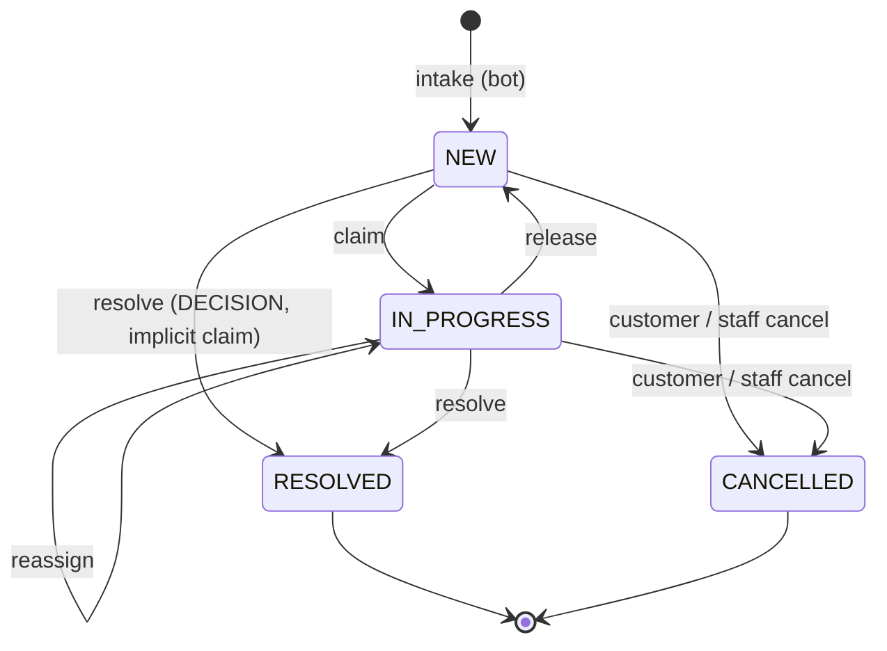

# Chatbot request inbox: data model

Human-intervention unit 2. Contract: `docs/proposals/human-intervention-backend-proposal.md` §2, §6.2, §6.5, §10.1 and §12. Migration: `prisma/migrations/20261110000000_chatbot_requests`. Pure state machine: `src/chatbot-requests/domain/chatbot-request.commands.ts`.

## Tables

| Table | What it holds |
| --- | --- |
| `chatbot_requests` | One row per human request from the bot. It records how the request is handled: inbox status, assignee, deadlines, scheduling and closing. The legacy flows wrap into it through a nullable unique FK: `humanDecisionId` (RESTOCK, EXPIRATION), `deliveryZoneRequestId` (DELIVERY_ZONE) or `receiptEvidenceId` (TRANSFER_RECEIPT). The wrapped table still records *what* was decided. |
| `chatbot_request_events` | Append-only audit (§6.2): type, actor kind/id/copied name, from/to status, the request version after the change, and small `data` that never contains customer text. |
| `chatbot_customer_groups` | One row per `(tenantId, customerKey)` with open requests: `mostUrgentAt`, `openCount`, `hasOverdue`. It is updated in the same transaction as every command, so the grouped inbox needs no `GROUP BY` (§10.1). |
| `chatbot_request_folio_counters` | Per-tenant counter behind `folio`, shown as `S-000123`. |

Actor columns (`assigneeUserId`, `resolvedByActorId`, `actorId`) are plain ids paired with a copied display name. They have no user FK, so the audit survives user deletion and the migration takes no lock on `users`.

## States

- **`displayStatus`** is derived, not stored: `EXPIRED` means an open request whose `overdueAt` is set; otherwise it equals `status`.
- **Commands** (`claim`, `release`, `reassign`, `resolve`, `cancelByStaff`, `cancelByCustomer`) return either the column patch plus the event to append, or a typed error: `VERSION_CONFLICT`, `REQUEST_CLAIMED_BY_OTHER` or `REQUEST_CLOSED` (409); `ALREADY_RESOLVED` (409, customer cancel); `NOT_ASSIGNEE` (403); `ACTION_NOT_ALLOWED` (422); `CANCEL_NOT_ALLOWED`; or `VALIDATION_ERROR` (400). Every error carries `current {version, status, claimedBy}`.
- **Concurrent claims:** a second claimer gets `REQUEST_CLAIMED_BY_OTHER` before the version is compared (§4.3). Re-claiming a request you already hold (a second tab) gets 409 `VERSION_CONFLICT`, whose `current.claimedBy` lets that tab catch up.
- **Staff cancel** (§12.11, §12.14): it is allowed for CLARIFICATION, and for TALK_TO_HUMAN/COMPLAINT while the session is `WAITING`. Otherwise it fails with `CANCEL_NOT_ALLOWED`: 409 while the session is `STARTING`/`ACTIVE`/`ENDING`, 422 once it is `ENDED`/`CANCELLED`, and 422 for wrapped decisions, which close with their negative action instead. `OTHER` requires a note. Cancelling a request held by someone else requires `update:ChatbotRequestAssignment` (`actorCanReassign`), as release does; otherwise 403 `NOT_ASSIGNEE`.
- **Release** of someone else's request without `update:ChatbotRequestAssignment` answers 403 `NOT_ASSIGNEE` before the version is compared. Release of a live conversation (`STARTING`/`ACTIVE`/`ENDING`) is rejected here, because the return-to-bot path belongs to the live-session unit (§4.2).
- **R4:** claim, release and reassign patch only `chatbot_requests` columns. The wrapped row's version (`human_decisions` is fixed at 1 → 2) is never touched by them.

## Invariants (CHECK constraints)

| Constraint | Rule |
| --- | --- |
| `kind_subtype_chk` | DECISION ⇔ RESTOCK/EXPIRATION/DELIVERY_ZONE/TRANSFER_RECEIPT/DISCOUNT; CLARIFICATION ⇔ UNKNOWN_QUESTION; CONVERSATION ⇔ TALK_TO_HUMAN/COMPLAINT |
| `wrapped_link_chk` | Exactly the wrapped FK its subtype requires, so at most one |
| `assignee_state_chk` | IN_PROGRESS has an assignee and `claimedAt`; NEW has neither; the id and the name are set together |
| `assignee_claimed_at_chk` | `assigneeUserId` ⇔ `claimedAt` in every status; every command sets or clears them together |
| `ambiguous_customer_chk` | `ambiguousCustomer` ⇒ `customerId IS NULL`; staff links the customer by hand (R1) |
| `resolved_state_chk` | `status = RESOLVED` ⇔ `resolvedAt`; the resolver id and name are set together |
| `cancelled_state_chk` | `status = CANCELLED` ⇔ `cancelledAt`; `cancelledAt` ⇔ `cancelReason` |
| `staff_cancel_reason_chk` | `cancelReason = STAFF` ⇔ `staffCancelReason` |
| `closed_at_chk` | `closedAt = COALESCE(resolvedAt, cancelledAt)` |
| `sla_sweep_open_chk` | `nextSlaCheckAt` only on open requests |
| `whatsapp_window_chk` | `whatsappWindowClosesAt` and `lastCustomerMessageAt` are both NULL or both set. The window is normally the message + 24 h, but any value Meta reports can be stored (§4.5) |
| `scheduling_chk` | `scheduledFor` only on conversations; `requiresTemplateAtStart`/`needsReschedule` require `scheduledFor` |
| `positive_chk`, `phone_pair_chk` | `version`, `folio` ≥ 1, non-empty `customerKey`; country code and phone set together |
| `chatbot_request_events_actor_chk` | SYSTEM ⇔ no actor id; SYSTEM has no name; USER has a name; `version` ≥ 1 |
| `chatbot_customer_groups_open_count_chk` | `openCount > 0`: the row is deleted when the last open request closes |

Requests are kept forever (D4). The trigger `chatbot_requests_keep_forever` runs `BEFORE DELETE`, for each row, and rejects a direct `DELETE` (`pg_trigger_depth() = 1`). It allows the tenant cascade, which runs inside PostgreSQL's referential-integrity trigger (depth > 1). Rejecting the parent row also protects its audit.

`chatbot_request_events` is append-only in the database (§6.2). The trigger `chatbot_request_events_append_only` runs `BEFORE UPDATE OR DELETE`, for each row:

- **Every `UPDATE`** is rejected.
- **A direct `DELETE`** is rejected. Here the trigger runs at `pg_trigger_depth() = 1`.
- **A `DELETE` from the FK cascade is allowed.** Deleting a tenant cascades to `chatbot_requests` and then to the events, which removes the audit with its tenant. The cascade runs inside PostgreSQL's referential-integrity trigger, so this trigger sees a depth greater than 1.
- **A direct `DELETE` of a `chatbot_requests` row** never reaches the events: `chatbot_requests_keep_forever` rejects it first.
- **`TRUNCATE`** fires no row trigger. The integration test reset (`TRUNCATE tenants CASCADE`) keeps working.

Events reference their request through `(tenantId, requestId)`, so an event cannot point into another tenant.

## Indexes and the query each one serves

| Index | Query |
| --- | --- |
| `chatbot_customer_groups (tenantId, mostUrgentAt, customerKey)` | Grouped inbox page: `ORDER BY mostUrgentAt, customerKey` with the opaque cursor `(mostUrgentAt, customerKey)`. Overdue groups have the oldest deadline, so they sort first |
| `chatbot_requests (tenantId, customerKey, status)` | Up to 10 requests per group, and the flat per-customer list `GET /chatbot-requests?customerKey=` (§12.3) |
| `(nextSlaCheckAt) WHERE nextSlaCheckAt IS NOT NULL` | SLA sweep: `nextSlaCheckAt <= now() FOR UPDATE SKIP LOCKED LIMIT 100`. The `<=` comparison implies `IS NOT NULL`, so the planner uses the index without repeating the predicate. `sla_sweep_open_chk` keeps closed rows out of it |
| `(tenantId, closedAt DESC, id DESC) WHERE status IN (RESOLVED, CANCELLED)` | History list (§3.8), newest first, cursor `(closedAt, id)` |
| `(tenantId, subtype, closedAt DESC)` | History filtered by subtype |
| `(tenantId, resolvedByActorId, closedAt DESC)` | History filtered by `resolvedBy` |
| `(tenantId, status) WHERE open` | Counters `new` and `inProgress` |
| `(tenantId, assigneeUserId) WHERE status = IN_PROGRESS` | Counter `mine` |
| `(tenantId) WHERE open AND overdueAt IS NOT NULL` | Counter `overdue` |
| `(tenantId, whatsappWindowClosesAt) WHERE open` | Counter `windowClosingSoon` (window closes within the warning threshold) |
| `(tenantId, scheduledFor) WHERE open AND scheduledFor IS NOT NULL` | Counter `scheduled` and the "Scheduled" tab |
| `(tenantId) WHERE open AND needsReschedule` | Counter `needsReschedule` |
| unique `(tenantId, customerKey, dedupKey) WHERE open AND dedupKey IS NOT NULL` | Intake merge (§3.5): at most one open request per customer and dedup key |
| unique `(tenantId, source, sourceRequestId)` | Idempotent intake (`X-Idempotency-Key`) |
| unique `(tenantId, folio)` | Folio lookup and uniqueness |
| unique `humanDecisionId` / `deliveryZoneRequestId` / `receiptEvidenceId` | A wrapped row is wrapped once; backfill uses `ON CONFLICT DO NOTHING` |
| `(customerId)` | `ON DELETE SET NULL` from `customers` without a sequential scan |
| `chatbot_request_events (tenantId, requestId, createdAt DESC, id DESC)` | Audit page, newest first (`GET /chatbot-requests/:id/audit`) |

## Deploy safety

The migration is additive: it creates four tables, their indexes and their CHECKs, and it does not alter or rewrite any existing table. Each FK briefly takes a `SHARE ROW EXCLUSIVE` lock on its referenced table (`tenants`, `customers`, `human_decisions`, `delivery_zone_requests`, `receipt_evidences`) until the migration commits. That lock blocks writes to those tables. Validation scans the empty new table, so the lock lasts milliseconds, but it must wait for open transactions on those tables to finish.

`SET LOCAL lock_timeout = '5s'` at the top bounds that wait. Prisma applies the file as one transaction, so a timeout leaves nothing applied.

- **Deploy at low traffic.**
- **If the deploy fails on a lock timeout**, run `prisma migrate resolve --rolled-back 20261110000000_chatbot_requests` and redeploy.

## Known deviations from the contract

- **`conversationRef`** is plain TEXT. The contract's `conversationId` FK to `ChatbotConversation` (§3.6) will be added when the conversation mirror table exists (unit 9).
- **Cross-tenant links** to `customers` and to the wrapped tables use single-column FKs, because those tables have no `(tenantId, id)` unique key and this migration must not alter them. The application checks that a linked customer or wrapped row belongs to the request's tenant (M3). That check comes in slice 2b (repository) and unit 3 (wrapping). Events, by contrast, use a tenant-qualified FK.
