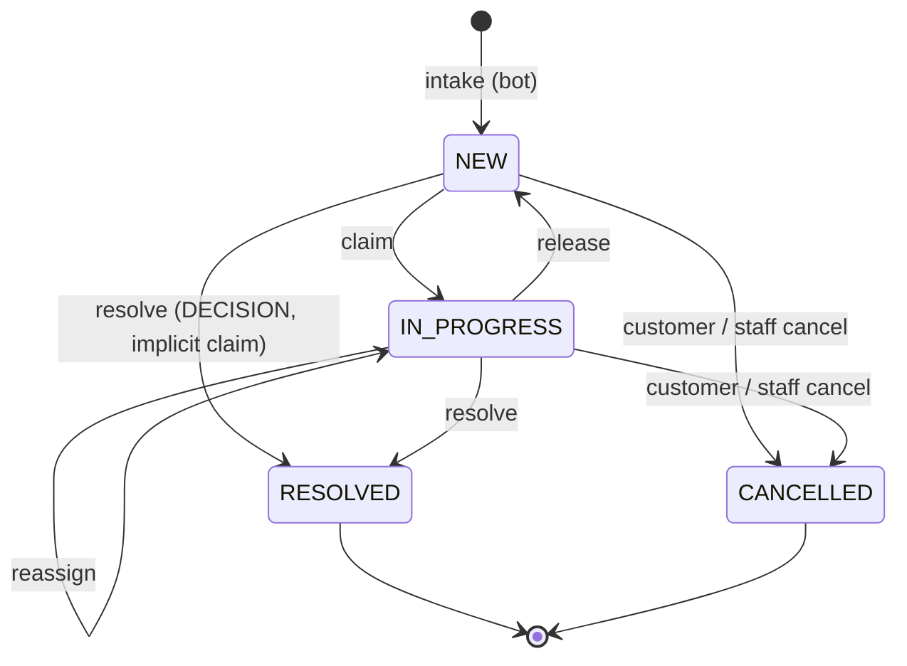

# Chatbot request inbox: data model

Human-intervention unit 2. Contract: `docs/proposals/human-intervention-backend-proposal.md` §2, §6.2, §6.5, §10.1 and §12. Migration: `prisma/migrations/20261110000000_chatbot_requests`. Pure state machine: `src/chatbot-requests/domain/chatbot-request.commands.ts`.

## Tables

| Table | What it holds |
| --- | --- |
| `chatbot_requests` | One row per human request from the bot. It records how the request is handled: inbox status, assignee, deadlines, scheduling and closing. The legacy flows wrap into it through a nullable unique FK: `humanDecisionId` (RESTOCK, EXPIRATION), `deliveryZoneRequestId` (DELIVERY_ZONE) or `receiptEvidenceId` (TRANSFER_RECEIPT). The wrapped table still records *what* was decided. |
| `chatbot_request_events` | Append-only audit (§6.2): type, actor kind/id/copied name, from/to status, the request version after the change, and small `data` that never contains customer text. |
| `chatbot_customer_groups` | One row per `(tenantId, customerKey)` with open requests: `mostUrgentAt`, `openCount`, `hasOverdue`. It is updated in the same transaction as every command, so the grouped inbox needs no `GROUP BY` (§10.1). |
| `chatbot_request_folio_counters` | Per-tenant counter behind `folio`, shown as `S-000123`. |
| `staff_command_receipts` | Staff command idempotency (§6.5, §12.12): one row per `(tenantId, actorId, idempotencyKey)` with `commandHash` and `responseSnapshot`. Migration `20261110010000_chatbot_request_staff_receipts`. |
| `chatbot_bot_receipts` | Bot idempotency for the writes that leave no request row to replay from (§3.1): a create that **merged**, and every customer **cancel**. One row per `(tenantId, kind CREATE\|CANCEL, idempotencyKey)`. Migration `20261110030000_chatbot_request_bot_intake`. |
| `service_rate_buckets` | Bot route budgets (R2): one row per `(credentialId, routeClass)`, no tenant and no FK, reset in place like `auth_rate_buckets`. Same migration; it also adds `service_credentials.rateLimits JSONB` (per-class overrides). |

| `chatbot_feed_items` | The bot feed (slice 5b, §3.3): one row per delivery the chatbot pulls with a cursor (`cursor` bigserial primary key, `deliveryId` uuid unique), plus its last outcome (`outcome`, `attemptId`, `evidenceHash`, `attemptedAt`, `providerMessageId`, `ackedAt`). Migration `20261110050000_chatbot_feed`. |
| `chatbot_feed_retention` | Per tenant, the highest cursor the retention purge removed (`purgedThroughCursor`): a cursor below it answers `410 CURSOR_EXPIRED`. Same migration. |

Actor columns (`assigneeUserId`, `resolvedByActorId`, `actorId`) are plain ids paired with a copied display name. They have no user FK, so the audit survives user deletion and the migration takes no lock on `users`.

## States

- **`displayStatus`** is derived, not stored: `EXPIRED` means an open request whose `overdueAt` is set; otherwise it equals `status`.
- **Commands** (`claim`, `release`, `reassign`, `resolve`, `cancelByStaff`, `cancelByCustomer`) return either the column patch plus the event to append, or a typed error: `VERSION_CONFLICT`, `REQUEST_CLAIMED_BY_OTHER` or `REQUEST_CLOSED` (409); `ALREADY_RESOLVED` (409, customer cancel); `NOT_ASSIGNEE` (403); `ACTION_NOT_ALLOWED` (422); `CANCEL_NOT_ALLOWED`; or `VALIDATION_ERROR` (400). Every error carries `current {version, status, claimedBy}`.
- **Concurrent claims:** a second claimer gets `REQUEST_CLAIMED_BY_OTHER` before the version is compared (§4.3). Re-claiming a request you already hold (a second tab) gets 409 `VERSION_CONFLICT`, whose `current.claimedBy` lets that tab catch up.
- **Staff cancel** (§12.11, §12.14): it is allowed for CLARIFICATION, and for TALK_TO_HUMAN/COMPLAINT while the session is `WAITING`. Otherwise it fails with `CANCEL_NOT_ALLOWED`: 409 while the session is `STARTING`/`ACTIVE`/`ENDING`, 422 once it is `ENDED`/`CANCELLED`, and 422 for wrapped decisions, which close with their negative action instead. `OTHER` requires a note. Cancelling a request held by someone else requires `update:ChatbotRequestAssignment` (`actorCanReassign`), as release does; otherwise 403 `NOT_ASSIGNEE`.
- **Release** of someone else's request without `update:ChatbotRequestAssignment` answers 403 `NOT_ASSIGNEE` before the version is compared. Release of a live conversation (`STARTING`/`ACTIVE`/`ENDING`) is rejected here, because the return-to-bot path belongs to the live-session unit (§4.2).
- **R4:** claim, release and reassign patch only `chatbot_requests` columns. The wrapped row's version (`human_decisions` is fixed at 1 → 2) is never touched by them.

## Staff commands (slice 2b)

Routes: `POST /chatbot-requests/:id/{claim,release,reassign,cancel}` (`src/chatbot-requests/presentation`), FE handoff `docs/frontend-handoff/11-chatbot-request-commands.md`. `ChatbotRequestCommandsService` runs each command in one transaction:

1. `pg_advisory_xact_lock(hashtextextended('chatbot-staff:<tenant>:<actor>:<key>', 0))`, then the receipt. It is one bigint key in its own text namespace, so it cannot collide with the cash `(hashtext(tenant), hashtext(key))` two-int keys. Same hash → the stored response, even if the request changed since. Another hash → 409 `IDEMPOTENCY_CONFLICT`. The advisory lock makes a concurrent retry of the same key wait and replay instead of failing with `VERSION_CONFLICT`.
2. Reassign only: the target must be an active member whose role grants both `read` and `update` on `ChatbotRequest` (a `manage` grant or subject `all` counts, as in CASL), else 422 `USER_NOT_ASSIGNABLE`.
3. `SELECT … FOR UPDATE` on the request, filtered by tenant. A missing or foreign id is 404 `NOT_FOUND`.
4. The pure state machine decides. A rejection throws, so the transaction rolls back and stores no receipt.
5. `UPDATE … WHERE id AND version = expected` (`version + 1`), event insert, customer-group refresh, receipt insert.

`resolve` has its own route since unit 3 (see "Wrapping the legacy flows"). Until the live-session table exists (unit 11), `liveSessionState` is `null` for every request.

**Customer group refresh** (`refreshCustomerGroup`): an `INSERT … ON CONFLICT DO UPDATE` first locks (or creates) the group row; only then does an aggregate over the open requests run. Under READ COMMITTED each statement takes a new snapshot, so the aggregate sees every command that held the group lock before it. Computing the aggregate before the lock loses updates (the 20-parallel integration test fails if the order is swapped). Lock order is always request row, then group row (see "Lock order rules").

**Isolation rule:** this refresh is correct only under READ COMMITTED. `refreshCustomerGroup` runs `SHOW transaction_isolation` first and throws if the level is anything else, so a creator or command wrapped in a REPEATABLE READ or SERIALIZABLE transaction fails instead of writing a stale count (integration test "refuses to run above READ COMMITTED"). Never open these transactions with an explicit isolation level. The row is deleted when no open request remains. `mostUrgentAt` = the nearest current deadline (`claimDeadlineAt` while NEW, `resolveDeadlineAt` while IN_PROGRESS), or NULL while no SLA is set (unit 7). `hasOverdue` = any open request with `overdueAt`.

**Folio** (`allocateFolio`): `INSERT … ON CONFLICT DO UPDATE SET lastNumber + 1 RETURNING`, in the creator's transaction. The counter row lock serializes allocations per tenant.

**Receipts retention:** kept, like `cash_commands` and the editorial receipts; `(tenantId, createdAt)` serves a future purge.

**`canonicalPhone(cc, phone)`** (`domain/canonical-phone.ts`, R1): `customerKey` as E.164 digits without `+`. A country code of `521` or `+521` counts as `52`. For `52`, `521` + 10, `52` + 10 and `1` + 10 reduce to the 10-digit national number; for `1`, a leading `1` is dropped. For both, the national number must be 10 digits not starting with 0 or 1, so `521` + 9 digits is rejected. Other countries keep their digits. Letters, wrong lengths and bad country codes return `null`.

## Lock order rules

Every transaction that touches these tables takes locks in this order, so concurrent commands cannot deadlock. Later units (intake, wrapping, resolve, sweep) must follow it.

1. **Request rows before group rows, and the folio counter last.** Lock the existing `chatbot_requests` rows first, then the `chatbot_customer_groups` row (`refreshCustomerGroup` locks it). Allocate the folio after every lock on an existing row (dedup, open limit, wrapped rows) and as late as possible: the only things a creator does after `allocateFolio` are inserting the new request row and refreshing its group. Commands (claim, release, reassign, cancel, resolve) never touch the counter, so nothing waits on it while holding a group lock, and the counter cannot join a cycle. Never lock a group row and then wait for a request row.
2. **Intake dedup and the open-limit check** lock request rows first (the open dedup lookup and the count of open requests, with `FOR UPDATE` where they need a stable view) and touch the group last.
3. **More than one group in a transaction** (for example link-customer, which moves several requests, or merge): refresh the groups in sorted `customerKey` order, after all request rows are locked. When more than one request row is locked, lock them in `id` order (§12.11).
4. **Wrapped resolve runs in READ COMMITTED**, like every command here. It locks the common request row, calls the wrapped repository, and only then refreshes the group; it must not set an isolation level.
5. **A delivery zone takes the postal-code advisory lock first** (`lockZipCode`, the lock the bot intake and the legacy zone resolve already take), then the request rows, then the validation and zone rows, then the groups. The staff `resolve` therefore locks the zip before its own request row. Every legacy hook (`lockLegacy`) locks the open wrapping requests before the old code touches the wrapped row, so request, wrapped row and group are always locked in that order from both entry points.
   **Zone exception to "request rows in id order".** A zone resolve locks its own request row first and then its siblings in id order. Two such transactions could lock rows in opposite order, so this is safe **only because every multi-row zone locker holds the zip lock first**, which serializes them per postal code. Any future code that locks several requests of one zone (a `link-customer` that moves requests, a merge, the customer cancel of unit 5, the SLA sweep) must call `lockZoneOf` (zip lock) before it locks any of those request rows. A locker that skips it can deadlock with `resolve`.
   **Backfill window (deadlock, 40P01).** A legacy resolve that finds no wrapper cannot lock a request first: `lockLegacy` locks nothing, then the old code waits on the wrapped row. If the backfill (which holds that wrapped row `FOR UPDATE`) commits a `NEW` request R for it, and staff then resolves R through the common route, that route locks R and waits for the wrapped row while the legacy transaction, which now holds the wrapped row, waits for R in `closeLegacy`. PostgreSQL detects the cycle and aborts one of the two with 40P01; the aborted transaction rolls back completely and nothing is corrupted (the caller can retry). The window exists only while wrappers are missing, so **the backfill must run to completion before the inbox is announced or used** (a hard precondition, repeated in `docs/chatbot-requests-backfill.md`); after it, every pending row has its wrapper and the order request, wrapped row, group holds from both entry points.

6. **The feed enqueue** (slice 5b) sits **after the state change and the wrapped-row write, before the group refresh**, inside the same transaction. It takes one more lock, the per-tenant feed advisory lock (`pg_advisory_xact_lock(hashtextextended('chatbot-feed:<tenant>', 0))`), which is held to the commit. Why it cannot deadlock: only enqueuers ever wait for it (claim, release, reassign, customer cancel, intake and the ACK never take it); every enqueuer takes it **before** any group row, so none holds a group lock while waiting for it, and the holder waits for nothing except group rows that a non-enqueuer holds and releases without needing the feed lock. Request rows and wrapped rows are already locked by then (rule 1 and 5), so the order stays request, wrapped row, feed lock, group. The staff `resolve` enqueues after the wrapped use case ran (it reads the answer from the wrapped row), the legacy hooks inside `closeLegacy` after the old code wrote it, and the staff cancel after `applyPatch`. Any new enqueuer must keep that place. See "Bot feed" below.

## Wrapping the legacy flows (unit 3, slice 3a)

Contract §2.1, §2.3, §2.4, R1, R4, R9. Code: `infrastructure/chatbot-request-wrapper.ts` (hooks), `infrastructure/wrapped-request-resolver.ts` (the `resolve` adapter), `presentation/chatbot-request-resolve.body.ts` (flat body parser). No migration: everything fits the tables of slice 2a. Existing routes, payloads and responses are unchanged (S4). Handoff for the FE: `docs/frontend-handoff/12-chatbot-request-resolve.md`.

**Creation hooks.** The existing intake paths call `ChatbotRequestWrapper` right after inserting the wrapped row, on the same transaction, so a rollback of the wrapped insert leaves no request (and no folio gap):

| Wrapped row | Hook (inside) | Customer |
| --- | --- | --- |
| RESTOCK / EXPIRATION `HumanDecision` | `PrismaRestockIntakeRepository.submit`, `PrismaExpirationIntakeRepository.submit` | None (§2.3): `customerKey = unknown:<decisionId>`, one group per decision |
| `DeliveryZoneRequest` waiting for a human | `PrismaDeliveryZoneBotRepository.submit`, only the branch that joins a PENDING validation. A requester born `RESOLVED` by an existing zone is not wrapped | `customerKey = canonicalPhone(cc, phone)` |
| `ReceiptEvidence` | `ReceiptUploadService.createWithReviewRequest` (both the multipart upload and the legacy URL) | `Sale.customerId`; the key comes from that customer's phone, else `unknown:<receiptId>` |

Wrapper rows use `source = WRAP:HUMAN_DECISION | WRAP:DELIVERY_ZONE_REQUEST | WRAP:RECEIPT_EVIDENCE` and the wrapped id as `sourceRequestId`; the backfill (slice 3b, below) writes the same values with `ON CONFLICT DO NOTHING` on the wrapped FK. The summary is a short Spanish label with no customer text (`Stock: <product>`, `Caducidad: <product>`, `Zona de entrega <zip>`, `Comprobante de transferencia <folio>`) and `context` holds ids only. A zone request also stores `conversationRef`, `lastCustomerMessageAt` and the 24 h window. The `CREATED` event is `SYSTEM`. Order inside the transaction: wrapped insert, customer lookup, `assertTenantLinks` (M3), folio, request insert, event, group.

**R1 customer link.** A zone requester links a `Customer` only when its canonical key maps to exactly one customer in the tenant (`phoneLookupVariants` builds an indexed `IN` over the stored forms `52`/`521`, `10`/`11`/`12`/`13` digits, then each hit is compared with `canonicalPhone`). With more than one, the request keeps `customerId = NULL` and `ambiguousCustomer = true`. A receipt uses `Sale.customerId` as is: the sale names its customer, so it is not an inference. Customers stored without a country code are not matched.

**`ChatbotRequestWrapper` is an `@Optional()` constructor dependency of the five flow classes.** Their own specs (and the specs of other modules that provide them) build them without it, which keeps them unchanged; the production modules import `ChatbotRequestWrapperModule` and `chatbot-requests.module.spec.ts` plus `chatbot-requests-wiring.integration.spec.ts` prove the hook is injected in the real graph.

**Legacy routes close the request (§2.4).** `lockLegacy` runs before the old code touches the wrapped row and `closeLegacy` after it succeeded, in the same transaction: `HumanDecision` resolve (`resolveInAmbientTransaction` is the new entry of that use case for the staff command; `resolve` keeps its "outside a transaction" guard), `PrismaDeliveryZoneValidationRepository.resolve` (closes every open request of the validation) and `ReceiptReviewService.confirm/reject`. The request becomes `RESOLVED` with `resolution = {action, via: 'LEGACY_ROUTE', …}`, an implicit claim when it was `NEW`, a `RESOLVED` event `{action, via}` and a refreshed group. It takes no `expectedVersion` and ignores who holds it: the legacy route never knew about claims. A request that is already closed is left alone.

**Resolve permission (owner decision).** Besides `read` + `update:ChatbotRequest` (route guard), `resolve` needs the permission the old route of the subtype always required: RESTOCK/EXPIRATION `update:HumanDecision`, DELIVERY_ZONE `validate:DeliveryZone`, TRANSFER_RECEIPT `update:ReceiptEvidence` (`domain/resolve-permissions.ts`: `legacyResolvePermission`, `canResolveSubtype`, the helper unit 4's `allowedActions` must reuse for `RESOLVE`). The controller hands the service a predicate over the JWT ability (`actorCanResolveSubtype`); the service asks it right after the request row is loaded and before any state check, so a missing permission is `403 INSUFFICIENT_PERMISSIONS` with no write and no request state in the answer, and an unknown id is still 404. A caller that gives no predicate is denied (fail closed).

**Replay writes nothing.** A legacy human-decision resolve that replays an already resolved decision reports it and performs no write, also none on the wrapping request. Only the first resolve closes the request. (A request left open by a decision resolved behind its back is a backfill or data repair matter, not something a replay fixes silently.)

**Actor names.** `User.name` can be empty and the USER-event CHECK needs a name, so the legacy hooks that only know a user id (receipt confirm/reject) copy `actorDisplayName(user)`: the trimmed name, else the email local part, else `Usuario`. Never empty.

**Common `resolve`** (`POST /chatbot-requests/:id/resolve`, §3.8, §12.6). Inside one READ COMMITTED transaction: idempotency receipt, postal-code lock (zones only), `FOR UPDATE` on the request, the subtype permission above, state machine (`REQUEST_CLOSED`, `REQUEST_CLAIMED_BY_OTHER`, `VERSION_CONFLICT`, implicit claim), action/subtype check (`ACTION_NOT_ALLOWED`), for zones the sibling lock and `ZONE_SET_CHANGED` check, request and sibling patches plus events, the existing use case with its own `expectedVersion = 1` (R4) and the staff `Idempotency-Key` as its `resolutionRequestId` (run under `suppressLegacyClose`, because the application already closed the requests), and the group refreshes in sorted `customerKey` order. The old use case's errors become the staff envelope (`ALREADY_RESOLVED` → `REQUEST_CLOSED`, `RECEIPT_NOT_ACTIONABLE` → `REQUEST_CLOSED`, `SALE_NOT_REVIEWABLE` → `ACTION_NOT_ALLOWED`, `FORBIDDEN` → 403). Any failure rolls the request, siblings, events and the wrapped row back together.

**Zone fan-out (R9, D15).** Resolving one `DELIVERY_ZONE` request settles the shared validation, which settles every requester, and closes every other open request of the validation as `RESOLVED` with `resolution = {action: 'SIBLING_RESOLVED', viaRequestId}` and a `RESOLVED` event with the same data, resolved by the staff member who acted. `zoneImpact = {requests, customers, setVersion}` counts the open requests and their distinct customers. `setVersion` needs no column: it is every request that ever joined the validation plus every one that left by cancelling (`count(*) + count(CANCELLED)`), so it only grows and any join or leave after the preview changes it. `expectedZoneSetVersion` is checked after the postal-code lock and the sibling locks, so nothing can join between the check and the write: a mismatch is `409 ZONE_SET_CHANGED` with `current.zoneImpact`. `GET /chatbot-requests/:id/zone-impact` serves the preview.

**Customer cancel of a wrapped decision (unit 5, slice 5a, implemented).** The wrapped tables have no cancelled state, so the cancel closes the common request only (`CANCELLED / CUSTOMER_WITHDREW` or `AUTO_RESOLVED`, state machine `cancelByCustomer`, taking the key lock, `lockZoneOf`, then the request row, then the group) and leave the wrapped row `PENDING`: a RESTOCK/EXPIRATION decision then stays a harmless pending row that a later resolve of the same row (legacy route) still closes with `closeLegacy`, which skips already closed requests; a cancelled zone requester still gets the zone outcome when its validation is resolved, but is no longer part of `zoneImpact.requests` and bumps `setVersion`; a cancelled receipt is not confirmed or rejected by staff. The §2.1 invariant check in the tests therefore excludes `CANCELLED` requests; `checkInvariant` (`--check`) already does (a `PENDING` wrapped row whose request is `CANCELLED` is not a mismatch), and the 5a integration spec runs it after a cancel of a decision and of a zone requester. Any future production check must keep the exclusion.

## Bot intake (unit 5, slice 5a)

Contract §3.1–§3.5, §6.4, §10.1 R2. Handoff for the chatbot: `docs/chatbot-handoff/chatbot-requests-bot-contract.md`. Code: `application/bot-request-intake.service.ts` (idempotency, retries, merge, cancel), `infrastructure/prisma-bot-intake.store.ts` (direct create, merge, cancel writes), `infrastructure/chatbot-request-intake-writes.ts` (shared: customer lock, dedup lookup, limits, the `ON CONFLICT` insert, merge event), `infrastructure/legacy-intake.adapter.ts` (the old intake repositories behind one port), and the envelope mode of `ChatbotRequestWrapper`.

**Two creators, one set of steps.** CLARIFICATION / TALK_TO_HUMAN / COMPLAINT are inserted directly. RESTOCK / EXPIRATION / DELIVERY_ZONE run the old intake repositories inside `wrapper.withEnvelope(...)`; the unit-3 hook then adds the envelope (customer link, summary, `needs`, context, `dedupKey`, the bot's hash and credential) to the wrapper row and runs the same customer lock, dedup and limits. Nothing of those flows is duplicated; their routes and bodies are unchanged (S4).

**Lock order of an intake transaction** (rule 2 made concrete). Two entry orders exist, because a wrapped create runs the old intake code first; from the customer lock on they are identical:

- **Direct create** (CLARIFICATION / TALK_TO_HUMAN / COMPLAINT) and **merge recovery**: (1) idempotency advisory lock, then steps 3-6.
- **Wrapped create**: (2) the legacy intake's own locks first (for a zone, the postal-code lock, then the wrapped row insert), then (1) the idempotency lock, taken by the unit-3 hook (`assertKeyFree`) after the wrapped row exists, then steps 3-6. A legacy replay of the same key never reaches the hook (the old unique `(tenantId, source, sourceRequestId)` and its recovery answer first), so the bot's hash is compared on the wrapper afterwards. No cycle: only creators take the `CREATE` key lock and none of them waits for a postal-code lock while holding it.
- **Cancel**: (1) idempotency lock (`CANCEL` namespace), (2) postal-code lock for a zone, then the request row, then the group.
- **A zone requester resolved by an existing zone** has no request row: after the legacy transaction committed, the service takes (1) and stores the receipt.

1. Idempotency advisory lock `chatbot-bot:<tenant>:CREATE|CANCEL:<key>`, so a concurrent retry waits and replays.
2. For a zone: the postal-code lock (the legacy intake takes it first, before anything else).
3. Customer advisory lock `chatbot-intake:<tenant>:<customerKey>`: creators of one customer queue here, so the open count and the hourly count are exact. Commands, resolve and cancel never take it, so it cannot be part of a cycle. It is taken after the zip lock and before every request row.
4. The open request with the same `(customerKey, dedupKey)`, `FOR UPDATE` (a hit merges; the limits are skipped, so a repeated question works at the limit).
5. Limits (one aggregate over the customer's rows): `CUSTOMER_OPEN_LIMIT` at 20 open requests of any subtype (`{limit, open}`), checked first; `CUSTOMER_RATE_LIMITED` at 10 requests created in the last hour (`createdAt`, so closed and cancelled ones count, merges do not), 429 whose `Retry-After` is the time until the count is back under the limit: the oldest creation of the window when the customer is at the limit, the `(count − limit + 1)`-th oldest when over it (rows created outside this check, or a lowered limit). Both limits are constructor options for tests; the window is `CREATION_WINDOW_MS` in `chatbot-request-intake-writes.ts`.
6. Folio (after every lock on an existing row; a rejected create burns none), then the insert, the `CREATED` event (`SERVICE`, the credential id) and the group refresh last.

**Merge recovery key.** `PrismaBotIntakeStore.mergeOpen` derives the `customerKey` with `linkByPhone`, the call the creators use for the key the partial unique index holds, on the phone the request is inserted under: the envelope customer, or for a zone requester the phone of its own `detail` (the envelope customer is only checked against it). A recovery that derived the key another way could never find the open request and would exhaust its three attempts with `VERSION_CONFLICT`; the phone-format cases (`521`, `+52`, spaced numbers) in `bot-request-intake.integration.spec.ts` guard it.

**Dedup is decided by the partial unique index too.** The insert is `INSERT … ON CONFLICT ("tenantId","customerKey","dedupKey") WHERE "status" IN ('NEW','IN_PROGRESS') AND "dedupKey" IS NOT NULL DO NOTHING RETURNING "id"`; the conflict target repeats the index predicate or PostgreSQL does not infer the index. No row back means a creator skipped the lock and lost the race: the transaction throws `IntakeMergeSignal`, the service retries (at most 3 attempts) and the next attempt finds the open request and merges. Under the customer lock this never happens; the index is the backstop.

**Merge of a wrapped subtype.** The hook finds the open request after the wrapped row was inserted, so it throws `IntakeMergeSignal`. The legacy repositories rethrow anything that is not a unique violation, so the whole legacy transaction (wrapped row, folio) rolls back; the service then merges in its own transaction (key lock, customer lock, dedup row, `MERGED` event) and stores a `chatbot_bot_receipts` row. If the open request closed in between, it delegates again.

**`lastCustomerMessageAt`** is bounded by the parser (at most 5 minutes ahead, at most 30 days old, `400` otherwise); a merge reuses the parsed envelope, so it is bounded too.

**Merge** appends a `MERGED` event (`SERVICE`, `{sourceRequestId, triggerWaMessageId}`) at the request's current version and does **not** bump `version`: a merge is not a staff command and must not fail the CAS of someone about to claim. A newer `lastCustomerMessageAt` moves the window (`+24 h`).

**Idempotent replay.** Every successful create (direct, merged or wrapped) stores a `chatbot_bot_receipts` row `(tenant, CREATE, key)` with the envelope hash, in the same transaction; the wrapped one is written by the hook, which first takes the key lock and refuses (409) when a receipt exists, because a legacy replay of the same key never reaches the hook. So one key reused on the other path, or with another body, is `IDEMPOTENCY_CONFLICT` on both orders, never a second request. A direct create replays from the receipt (same hash → 200 `REPLAYED`; a stored merge answers as it did), falling back to its own row (`source = houndfe-chatbot`, `canonicalRequestHash`) for rows older than the receipts. A merge replays even after the target closed. A wrapped create replays through the legacy identity, then the hash on the wrapper is compared (a wrapper created by the old route has none and is not compared). The cancel replays from its receipt (the response is stored, so a replay answers the same although the request has since changed). Failed attempts store nothing.

**Not wrapped.** A zone requester that an approved zone already answers is born `RESOLVED` and never wrapped (§2.3): the response has `id: null` and carries the legacy answer. There is no request row to hold the bot's hash, so the service stores a `chatbot_bot_receipts` row with `requestId = null` (key lock, then receipt), and the same key with another body is `409 IDEMPOTENCY_CONFLICT` there too. The early receipt check of a wrapped create runs outside any lock only to skip the legacy call for a stored merge; every race is decided under the key lock (the hook, merge recovery, this receipt) or by the hash compared on the replayed wrapper.

**Live sessions.** `cancelByCustomer` already rejects `STARTING`/`ACTIVE`/`ENDING` with `CANCEL_NOT_ALLOWED`, but `liveSessionState` is `null` for every request until unit 11 creates the session table; the rule is proven only in the pure state-machine spec.

**R2 route budgets.** `PostgresRouteRateLimiter` (`src/chatbot-api/presentation/guards/route-rate-limiter.ts`) upserts one `service_rate_buckets` row per `(credentialId, routeClass)` in a single statement that also reads `service_credentials.rateLimits`; the upsert's row lock makes concurrent checks exact across replicas. `ServiceAuthGuard` takes it as an optional dependency and falls back to the per-process limiter only when none is wired (unit specs); `BotRateLimitModule` is `@Global` so every module that uses the guard gets the shared one (proved against the real application graph in `chatbot-requests-wiring.integration.spec.ts`). Routes without `@BotRouteClass` stay in class `default` with the credential's `rateLimit`; the three human-decision bot controllers use class `humanDecisions` (owner decision M1): the same budget (the credential's `rateLimit`) in its own bucket. Every instant is the database's (`now() AT TIME ZONE 'UTC'` inside the upsert, which also computes the time left), so replica clocks never enter a decision. `rateLimits` may override any class, `default` and `humanDecisions` included.

## Bot feed (unit 5, slice 5b)

Contract §3.3, §3.9, §4.5, §6.4, §10.1 R2/R7, §12.14, performance row "Feed del bot". Handoff for the chatbot: `docs/chatbot-handoff/chatbot-requests-bot-contract.md`, "The feed". Code: `domain/chatbot-feed.ts` (pure: cursor, query, outcome parser and hash, `classifyOutcome`, payload builders), `infrastructure/chatbot-feed-writes.ts` (enqueue), `application/chatbot-feed.service.ts` (long-poll, slots, pending, outcome), `infrastructure/prisma-chatbot-feed.store.ts` (reads, outcome transaction, purge), `infrastructure/feed-wakeup.ts` and `src/shared/realtime/pg-notification-listener.ts` (R7), `presentation/bot-feed.controller.ts`.

**Same transaction as the state change.** `enqueueAnswered` (staff `resolve`, every request of a zone fan-out, and the legacy routes through `closeLegacy`) and `enqueueCancelled` (staff cancel) run on the caller's transaction; a rollback leaves no item and no `NOTIFY`. Both resolve paths read the answer from the **wrapped row**, the one record of what staff decided, so the staff command and the old routes (which pass fewer details to `closeLegacy`) produce the same `request.answered`. A wrapped row that is not in the resolved state fails the transaction (fail closed) instead of losing the answer. The backfill creates resolved requests with `createMany`, so it enqueues nothing. A customer cancel enqueues nothing (it has its own receipt; `request.cancel_ack` belongs to a later unit). Both paths exist until unit 13: the legacy bot poll is untouched.

**Cursor order is commit order.** `cursor` is a global sequence, so without care two transactions could take 5 and 6 and commit 6 first; a reader that saw 6 would skip 5 for good. The per-tenant advisory lock above is taken before the insert and held to the commit, which makes cursor order equal commit order within a tenant (the lock is released only after the commit is visible), so `cursor > after` never skips an item. The price is that enqueues of one tenant serialize for the rest of their transaction. The integration test "cursor order is commit order" holds one enqueuer open and shows the second one waiting.

**The feed read is always answered by `(tenantId, cursor)` (slice 5c).** `cursor` is a global sequence and the primary key is `cursor` alone, so for `WHERE tenantId = $1 AND cursor > $2 ORDER BY cursor LIMIT n` the planner may use the primary key as an ordered path, filtered by tenant. It then reads every other tenant's rows between `after` and this tenant's next item. Measured: 77.7 ms and 21 852 buffers for a tenant with 40 000 items idle behind 270 000 foreign rows, and 65 ms and 17 898 buffers for a mid-share tenant (15 % of the table) whose next item is behind a gap of 225 000 foreign rows. A first fix, bounding the range with the tenant's own highest cursor, only helped the caught-up bot (it left the gap case at 65 ms), so it was replaced. `readAfter` now gives the planner no primary-key path: the tenant is not compared with `=` (a constant would drop it from the ordering) and the range is two row comparisons, `("tenantId", "cursor") > ($1, $after) AND ("tenantId", "cursor") <= ($1, 9223372036854775807) ORDER BY "tenantId", "cursor" LIMIT n`, which is exactly `tenantId = $1 AND cursor > $after`. Only the composite index can serve that without sorting the table, and both bounds are index conditions. The same case now reads 7 buffers in 0.03 ms, and the load test's EXPLAIN shows `(tenantId, cursor)` for every tenant shape. A unit test pins the query shape; the load test (`docs/perf/chatbot-feed-load-results.md`) proves the plan. `tenantHeadCursor` (the tenant's highest cursor, also forced onto the composite index) remains for the recovery route's `nextCursor`.

**Long-poll without a pool connection (R7).** `GET /chatbot-api/feed` arms a waiter, **then** reads with one short query (the connection goes back to the pool), and when the page is empty waits on the waiter. Arming first means a `NOTIFY` between the read and the wait is not lost. `pg_notify('chatbot_feed', <tenantId>)` is sent by the enqueue (payload: the tenant id only); one dedicated `pg.Client` per replica (`PgNotificationListener`, outside the Prisma pool, opened on the first long-poll, keepAlive on) fans it out to the waiters of that tenant. It notices a silently dead socket (a partition or a proxy timeout raises no error) two ways: TCP keepalive with the first probe after 10 s (`pgClientConfig`, which also bounds the connect at 10 s) and a heartbeat, a `SELECT 1` every 30 s that must answer within 10 s or the connection is treated as lost. It reconnects with exponential backoff and jitter (200 ms to 10 s); **every (re)connect wakes every waiter**, and a woken poll re-reads from its own cursor, so a `NOTIFY` lost while the connection was down costs nothing. If the listener cannot connect at all, polls still answer on the next bot request (each one reads first); there is no database polling while idle. The integration spec runs the app on a Prisma pool with ONE connection while long-polls wait, kills the listener's backend with `pg_terminate_backend`, and checks the item still arrives. `pg` was already a direct dependency (`package.json`, with `@types/pg`); nothing was added. LISTEN needs a session connection, so `DATABASE_URL` must not go through a transaction-pooling proxy.

**Limits.** At most 2 *waiting* long-polls per credential (R2); the counter is in memory, so it is **per replica** (with R replicas the cap is 2R) and a request answered at once never takes a slot. The `feed` route class budget is spent once when the request opens. Query values out of range are 400, never clamped.

**Shutdown.** `main.ts` calls `app.enableShutdownHooks()`, so SIGTERM runs the destroy hooks instead of killing the process with 25 s long-polls open. Only `PrismaService` (`$disconnect`) and the feed (`PgFeedWakeup`, `PgNotificationListener`) have hooks, so nothing else changes. `PgFeedWakeup.onModuleDestroy` wakes every waiter and marks itself `closing`; a woken poll sees it, answers an empty page and does not arm or read again (the same exit as a client that hung up). Caveat: Nest runs the destroy hooks *before* it stops the HTTP server, so an in-flight request that needs the database at that moment (not the feed's, which return at once) can fail on the Prisma disconnect; before this change those requests were killed outright, so it is not worse.

**Pending deliveries by conversation or by request (L2).** A request created without a `conversationRef` (a stock or expiration request, or one created by the old routes) has no conversation to ask by, and it has no customer phone to derive a `wa:` reference from, so `pending-deliveries` accepts `?requestId=` as the other filter (exactly one of the two). The `(tenantId, requestId)` index serves it.

**Outcome history (L4).** The item row keeps the last attempt only, but every applied attempt wrote a `DELIVERY_OUTCOME` event with its `attemptId`, `evidenceHash` and `ackReceivedAt`. An `attemptId` that differs from the stored one is looked up in those events: found with the same hash it is a replay, answered `200` with that attempt's own state and no write (an old deferral replayed after a later attempt must not overwrite the current state); found with another hash it is `IDEMPOTENCY_CONFLICT`; not found it follows the normal rules. Events are append-only and scoped to the request, so the lookup reads a handful of rows.

**Outcome.** `POST /chatbot-api/deliveries/:id/outcome` locks the item (`SELECT … FOR UPDATE`), classifies it with the pure `classifyOutcome` (same semantics as `HumanDecisionBotOutcome`: same attempt and evidence replays, same attempt other evidence is `IDEMPOTENCY_CONFLICT`, another attempt after a terminal outcome is `OUTCOME_ALREADY_RECORDED`), writes the outcome and appends a `DELIVERY_OUTCOME` event (`SERVICE`, `{deliveryId, feedType, outcome, attemptId, needsReconciliation}`) at the request's current version. A deferral (`DEFERRED_WINDOW_CLOSED`, or `DEFERRED_HUMAN_SESSION` since slice 5c: the conversation is in HUMAN mode and the bot holds the delivery) records `outcome` but leaves `ackedAt` NULL, so the item stays pending for `pending-deliveries` (partial index `(tenantId, conversationRef, cursor) WHERE outcome IN ('DEFERRED_WINDOW_CLOSED', 'DEFERRED_HUMAN_SESSION') AND ackedAt IS NULL`), which names the reason in `deferredReason` (`WINDOW_CLOSED` or `HUMAN_SESSION`); a later attempt ends it or defers again. Both are refused for `request.cancelled` (`422 OUTCOME_NOT_ALLOWED`, §12.14: a cancellation notice that arrives late only annoys the customer, whatever made it wait). The outcome set lives in `domain/chatbot-feed.ts` (`DEFERRED_OUTCOMES`, `deferredReasonOf`) and in two CHECKs of `chatbot_feed_items`, which migration `20261110060000_chatbot_feed_recovery` widened. The event insert's FK takes a share lock on the request row; no command waits for a feed row, so no cycle includes it. `DELIVERY_UNKNOWN` is the "to reconcile" mark (a derived `needsReconciliation` in the event); the staff detail that shows it belongs to unit 4. The enum already has `DELIVERY_OUTCOME`, so no enum change was needed.

**Retention (30 days).** The feed keeps every item 30 days, acknowledged or not. `PrismaChatbotFeedStore.purgeExpired(now, batch = 1000)` deletes one batch (`FOR UPDATE SKIP LOCKED`, oldest first) and raises `chatbot_feed_retention.purgedThroughCursor` for each tenant in the same statement; a cursor below the watermark answers `410 CURSOR_EXPIRED`, a missing cursor starts at the oldest retained item. **Nothing schedules the purge yet**: it needs the sweep infrastructure of unit 7 (R11: `SKIP LOCKED`, no in-memory cursor). Until then the table only grows. Items have no `expiresAt` or `notBefore`: both are served as `null` (§3.3).

## Recovery route (unit 5, slice 5c)

Contract §3.3 (`410 CURSOR_EXPIRED` → `GET /chatbot-api/requests?status=open&updatedSince=`), §3.9. Handoff for the chatbot, with the 410 → recovery → resume procedure: `docs/chatbot-handoff/chatbot-requests-bot-contract.md`, "Recovery after `410 CURSOR_EXPIRED`". Code: `domain/chatbot-recovery.ts` (query and page cursor), `application/chatbot-recovery.service.ts`, `infrastructure/prisma-chatbot-recovery.store.ts`, `presentation/bot-recovery.controller.ts`.

**What it returns.** Every open request of the credential's tenant plus, with `updatedSince`, the requests closed at or after that instant (so the bot can drop them), as the bot-facing projection: id, folio, kind, subtype, status, `conversationRef`, `legacyId`, the window, `cancelReason`, times, and the latest 5 undelivered feed items of each request (`outcome` NULL or a deferral, with `deferredReason`), plus `undeliveredTruncated` and `undeliveredResumeAfter` when a request has more undelivered items than the 5 listed (see below). No customer, phone, assignee or staff data and no free text. Scope `requests:read`, route class `read`, tenant from the credential.

**Keyset pages by `(updatedAt, id)`.** One statement per page: the open branch and the closed branch (only with `updatedSince`) are each an ordered index range scan with `LIMIT`, merged by `Merge Append`; the page asks for `limit + 1` rows to know whether there is a next page. Indexes: partial `chatbot_requests (tenantId, updatedAt, id) WHERE status IN ('NEW', 'IN_PROGRESS')` and partial `chatbot_requests (tenantId, updatedAt, id) WHERE status IN ('RESOLVED', 'CANCELLED')`. Without them the open branch reads all of the tenant's open requests and sorts them on every page, and the closed branch sorts every request closed since `updatedSince`; a bot that comes back from a 30-day gap would read tens of thousands of rows per page. The closed branch ranges on `updatedAt >= since` for the index and filters `closedAt >= since` for the rule (`updatedAt >= closedAt` always holds). Cost: one more index entry per request update on the open index (it already changes `updatedAt` on every command) and one per closure on the closed index. The pending items of the page come from one `LATERAL` probe of `(tenantId, requestId)` per request.

**More than 5 undelivered items.** The list is capped at 5 per request (the latest). One extra grouped probe per page on `(tenantId, requestId)` counts the undelivered items of the page's requests and finds the oldest; when the count exceeds 5 the request carries `undeliveredTruncated: true` and `undeliveredResumeAfter` (its oldest undelivered cursor minus one: the feed `after` that serves it again). The bot resumes the feed from the smallest of those values and `nextCursor`, and dedupes by `deliveryId`. `pending-deliveries` is not the way: it serves deferred items only, not the ones never attempted.

**Clock skew.** `updatedAt` and `closedAt` are stamped by whichever replica writes (the ORM clock, not the database's), and the bot's `updatedSince` comes from its own clock or from an earlier answer. Instead of moving every write to `now()`, the closed branch reaches `RECOVERY_LIMITS.clockSkewMs` (5 s) before `updatedSince`, so a request closed by a replica whose clock runs behind is not missed; the bot dedupes by request id. Open requests are always returned whole, so they are unaffected.

**`nextCursor` is the feed position.** It is the tenant's highest feed cursor (never below the retention watermark), read **before** the first page of requests, and carried inside the page cursor, so every page of one walk answers the same value. Whatever commits during the walk is after that position in the feed; whatever committed before it is in the pages. The feed accepts it (a cursor at the watermark is not expired), so the bot resumes cleanly. A request touched during the walk may be seen twice; none is skipped.

**Validation.** `status` must be `open`; `updatedSince` is a canonical UTC instant with milliseconds; `limit` 1..50; the page cursor is opaque and strictly validated (base64url JSON with exactly the keys `u`, `i`, `f`). Anything else, an unknown key included, is `400 VALIDATION_ERROR`. A page cursor cannot cross tenants: every statement is filtered by the credential's tenant.

**Measured** in `docs/perf/chatbot-feed-load-results.md`: a full walk of 5 000 open requests is 100 pages in about 0.5 s (about 5 ms per page over HTTP, flat along the walk), and 400 pages (20 000 requests) in under 3 s with `updatedSince` = 30 days ago. The plans have no `Sort` node.

## Staff reads (unit 4, slice 4a)

Routes (`src/chatbot-requests/presentation/chatbot-request-reads.controller.ts`), FE handoff `docs/frontend-handoff/14-chatbot-request-inbox.md`: `GET /chatbot-requests/{groups,counts,history}`, `GET /chatbot-requests?customerKey=`, `GET /chatbot-requests/:id` and `:id/{audit,merge-candidates}`. No migration: the indexes of 2a and 2b serve every read (`docs/perf/chatbot-inbox-load-results.md`).

- **Grouped inbox, no `GROUP BY` at read time.** A page of groups is an index range of `chatbot_customer_groups (tenantId, mostUrgentAt, customerKey)` with `LIMIT n+1`; each group's rows (up to 10, plus the matching total through a window count for `moreRequests`) come from one `LATERAL` scan of `(tenantId, customerKey, status)`. Filters (`subtype`, `assignee`, `overdue`, `windowClosingSoon`, the `scheduled` tab) become an `EXISTS` on `chatbot_requests` plus the same predicate on the rows. The keyset cursor is `(mostUrgentAt, customerKey)` with `NULL` last (a group with no deadline sorts after every dated one). Row order inside a group, and in `?customerKey=`: `(CASE status WHEN 'NEW' THEN claimDeadlineAt ELSE resolveDeadlineAt END) ASC NULLS LAST, createdAt, id`; overdue rows come first because their deadline is in the past.
- **Counts** are one statement with a scalar subquery per count, each on its own partial index (`open_status`, `open_assignee`, `open_overdue`, `open_window`, `open_scheduled`, `open_needs_reschedule`). `windowClosingSoon` is `whatsappWindowClosesAt` within the next 2 hours (the technical default of §8; unit 7 makes it a setting).
- **7-day boundary (D17).** One `now` per call: inbox tabs `resolved`/`cancelled` keep `closedAt >= now - 7 days`, `history` takes `closedAt < now - 7 days`. History uses `chatbot_requests_history_idx` (`closedAt DESC, id DESC`, partial on `RESOLVED`/`CANCELLED`), cursor `(closedAt, id)`, with `(tenantId, subtype, closedAt)` and `(tenantId, resolvedByActorId, closedAt)` for the filters. `from`/`to` go together and span at most 92 days (`RANGE_TOO_LARGE`).
- **The one aggregate.** The `resolved`/`cancelled` group tabs have no group table, so they `GROUP BY customerKey` over the bounded 7-day window (single-digit milliseconds in the load test). This is the only documented exception to "no `GROUP BY` at read time"; the open tabs never aggregate.
- **R12: one phone serializer.** `toStaffPhone` (`domain/staff-phone.ts`) is the only place a phone leaves this module: `55 **** 5678` without `read:CustomerPhone`, `+525512345678` with it. **`customerKey` is never returned raw** because it is the E.164 phone: `CustomerKeySealer` (`domain/customer-key-sealer.ts`) returns a deterministic, tenant-bound, authenticated token (`k1.…`, AES-256-GCM with a synthetic IV, keys from HKDF of `JWT_SECRET`) for every caller, and the same token (also inside cursors) is accepted back in `?customerKey=`. Contract §12.4 shows the raw key in the row; the R12 rule (no full number without the permission, proved by a walk of every route) wins, and a role-dependent key would break grouping across roles. Rotating `JWT_SECRET` only turns old tokens into `400`. **Unit 8's SSE rows must be built with the same `CustomerKeySealer`** (`customerKey` and `previousCustomerKey`), recorded as a v1.2 deviation in proposal §3.8 and §12.4. The command responses of 2b and 3a carry neither phone nor `customerKey`.
- **R12 test.** `chatbot-request-reads.integration.spec.ts` enumerates the routes of both staff controllers by reflection and fails if one is missing from its walk, then calls each with roles without `read:CustomerPhone` and asserts no 10-digit or E.164 number appears in any body (success or error); with the permission the full number appears only in `customer.phone`. Mutating `toStaffPhone` to always unmask makes it fail.
- **`allowedActions`** replays the pure state machine (`claim`, `release`, `reassign`, `resolve`, `cancelByStaff`) against the row with the caller's ability, and uses `canResolveSubtype` for `RESOLVE`. Only the actions whose routes exist are offered (`CLAIM`, `RELEASE`, `REASSIGN`, `RESOLVE`, `CANCEL`).
- **Cursors are validated before the store sees them.** `decodeCursor(raw, kinds)` takes the kind of each part (`date`, `date?`, `uuid`, `text`): a well-formed cursor whose date is not a real `toISOString` instant between years 1900 and 9999, or whose id is not a UUID, is a `400 VALIDATION_ERROR`, never a database error. History `from`/`to` get the same year bounds.
- **`zoneImpact`** is `{validationId, requests, customers, setVersion}`; `requests`/`customers` count the open requesters. `decision.requesterCount` of a zone counts every requester of the validation, as the legacy projection does (`statsFor`), including resolved and cancelled ones. A zone request without a validation (only possible for a requester resolved at intake by an existing zone) has no `zoneImpact` and is not offered `RESOLVE`, matching the resolve route's `404`.
- **Detail.** The row is read with raw SQL; the customer card, the last five non-draft sales (`sales (customerId)`), the audit page, the feed deliveries and the wrapped decision are separate short reads run in parallel. `decision.resolution` comes from the request row (`resolution`, `resolvedBy*`, `resolvedAt`), the same for every subtype.

## Backfill of existing rows (unit 3, slice 3b)

Contract §2.4. Runbook: `docs/chatbot-requests-backfill.md`. Code: `infrastructure/chatbot-request-backfill.ts` (core: `runBackfill`, `checkInvariant`) and `scripts/ops/backfill-chatbot-requests.cjs` (CLI: dry run by default, `--apply`, `--check`, `--tenant`, `--batch-size`). It is an ops script, not a SQL migration, because it needs `canonicalPhone`, the R1 linking and the 3a request builder, and it must stay re-runnable.

- **What is wrapped.** Per tenant, rows without a request: PENDING `HumanDecision` (RESTOCK/EXPIRATION), PENDING `DeliveryZoneRequest` that wait on a validation, PENDING `ReceiptEvidence` become `NEW`; rows RESOLVED in the last 7 days become `RESOLVED` with `resolvedAt` (and the actor, when the wrapped row keeps one) copied and `closedAt = resolvedAt`. The request keeps the wrapped row's `createdAt`. A zone requester born resolved by an existing zone (no validation) is never wrapped, as in the 3a hook. SLA columns stay NULL: unit 7 must compute them for the open backfilled rows.
- **Same code as the hooks.** `requestCreateData` (folio, `customerKey`, R1 `ambiguousCustomer`, summary, source `WRAP:<TABLE>`, 24 h window) and `linkByPhone` are shared with `ChatbotRequestWrapper`, so a backfilled request equals a hook-created one.
- **Batches and locks.** One READ COMMITTED transaction per batch of 100 (`--batch-size`), oldest first. Order inside it: the zip advisory locks of the batch (zones only, sorted; rule 5), the wrapped rows `FOR UPDATE` in id order, re-reading their state and re-checking in a new statement that no request wraps them (a 3a hook, a legacy resolve or a second backfill may have got there first), the folio block (`allocateFolios`, one statement for the whole batch, after every read), the request rows with `createMany … skipDuplicates` (`ON CONFLICT DO NOTHING` on the unique wrapped FK), the events, and the customer groups in sorted `customerKey` order last. The groups are refreshed only after the folio block, so a batch never holds a group lock while waiting for the counter (rule 1); a hook takes counter then group, the backfill takes the same order. A row that is wrapped or no longer qualifies under the lock is skipped and counted (`changedUnderLock`).
- **Events.** One `SYSTEM` event per request, `CREATED` with `data.backfilled = true` (and `resolvedAt` for resolved ones). The event enum has no `BACKFILLED` member and adding one needs a migration, so the marker lives in `data` (constant `BACKFILL_EVENT_TYPE`); see "Known deviations".
- **`--check` (§2.1).** Read-only, one REPEATABLE READ snapshot: every PENDING wrapped row has a request (`MISSING_REQUEST`), a row resolved in the last 7 days has one (`RESOLVED_UNWRAPPED`), a wrapped row and its request agree on open/resolved (`STATE_DISAGREES`; a customer-cancelled request is excluded, see "Customer cancel of a wrapped decision"), and every customer group matches the open requests (`GROUP_MISMATCH`, key masked to at most 4 digits like the count script). Only decisions of the chatbot source (`houndfe-chatbot`, as the legacy tray) are wrapped and checked. It exits 1 on any mismatch (2 if the script crashes) and prints counts and ids only, no phone numbers; a crash prints the error class and Prisma/PostgreSQL code, never the raw message. The dry run also reports the age of the oldest pending row per subtype (unit 7 sizes the SLA burst from it).

## Invariants (CHECK constraints)

| Constraint | Rule |
| --- | --- |
| `kind_subtype_chk` | DECISION ⇔ RESTOCK/EXPIRATION/DELIVERY_ZONE/TRANSFER_RECEIPT/DISCOUNT; CLARIFICATION ⇔ UNKNOWN_QUESTION; CONVERSATION ⇔ TALK_TO_HUMAN/COMPLAINT |
| `wrapped_link_chk` | Exactly the wrapped FK its subtype requires, so at most one |
| `assignee_state_chk` | IN_PROGRESS has an assignee and `claimedAt`; NEW has neither; the id and the name are set together |
| `assignee_claimed_at_chk` | `assigneeUserId` ⇔ `claimedAt` in every status; every command sets or clears them together |
| `ambiguous_customer_chk` | `ambiguousCustomer` ⇒ `customerId IS NULL`; staff links the customer by hand (R1) |
| `resolved_state_chk` | `status = RESOLVED` ⇔ `resolvedAt`; the resolver id and name are set together |
| `cancelled_state_chk` | `status = CANCELLED` ⇔ `cancelledAt`; `cancelledAt` ⇔ `cancelReason` |
| `staff_cancel_reason_chk` | `cancelReason = STAFF` ⇔ `staffCancelReason` |
| `closed_at_chk` | `closedAt = COALESCE(resolvedAt, cancelledAt)` |
| `sla_sweep_open_chk` | `nextSlaCheckAt` only on open requests |
| `whatsapp_window_chk` | `whatsappWindowClosesAt` and `lastCustomerMessageAt` are both NULL or both set. The window is normally the message + 24 h, but any value Meta reports can be stored (§4.5) |
| `scheduling_chk` | `scheduledFor` only on conversations; `requiresTemplateAtStart`/`needsReschedule` require `scheduledFor` |
| `positive_chk`, `phone_pair_chk` | `version`, `folio` ≥ 1, non-empty `customerKey`; country code and phone set together |
| `chatbot_request_events_actor_chk` | SYSTEM ⇔ no actor id; SYSTEM has no name; USER has a name; `version` ≥ 1 |
| `chatbot_customer_groups_open_count_chk` | `openCount > 0`: the row is deleted when the last open request closes |

Requests are kept forever (D4). The trigger `chatbot_requests_keep_forever` runs `BEFORE DELETE`, for each row, and rejects a direct `DELETE` (`pg_trigger_depth() = 1`). It allows the tenant cascade, which runs inside PostgreSQL's referential-integrity trigger (depth > 1). Rejecting the parent row also protects its audit.

`chatbot_request_events` is append-only in the database (§6.2). The trigger `chatbot_request_events_append_only` runs `BEFORE UPDATE OR DELETE`, for each row:

- **Every `UPDATE`** is rejected.
- **A direct `DELETE`** is rejected. Here the trigger runs at `pg_trigger_depth() = 1`.
- **A `DELETE` from the FK cascade is allowed.** Deleting a tenant cascades to `chatbot_requests` and then to the events, which removes the audit with its tenant. The cascade runs inside PostgreSQL's referential-integrity trigger, so this trigger sees a depth greater than 1.
- **A direct `DELETE` of a `chatbot_requests` row** never reaches the events: `chatbot_requests_keep_forever` rejects it first.
- **`TRUNCATE`** fires no row trigger. The integration test reset (`TRUNCATE tenants CASCADE`) keeps working.

Events reference their request through `(tenantId, requestId)`, so an event cannot point into another tenant.

## Indexes and the query each one serves

| Index | Query |
| --- | --- |
| `chatbot_customer_groups (tenantId, mostUrgentAt, customerKey)` | Grouped inbox page: `ORDER BY mostUrgentAt, customerKey` with the opaque cursor `(mostUrgentAt, customerKey)`. Overdue groups have the oldest deadline, so they sort first |
| `chatbot_requests (tenantId, customerKey, status)` | Up to 10 requests per group, and the flat per-customer list `GET /chatbot-requests?customerKey=` (§12.3) |
| `(nextSlaCheckAt) WHERE nextSlaCheckAt IS NOT NULL` | SLA sweep: `nextSlaCheckAt <= now() FOR UPDATE SKIP LOCKED LIMIT 100`. The `<=` comparison implies `IS NOT NULL`, so the planner uses the index without repeating the predicate. `sla_sweep_open_chk` keeps closed rows out of it |
| `(tenantId, closedAt DESC, id DESC) WHERE status IN (RESOLVED, CANCELLED)` | History list (§3.8), newest first, cursor `(closedAt, id)` |
| `(tenantId, subtype, closedAt DESC)` | History filtered by subtype |
| `(tenantId, resolvedByActorId, closedAt DESC)` | History filtered by `resolvedBy` |
| `(tenantId, status) WHERE open` | Counters `new` and `inProgress` |
| `(tenantId, assigneeUserId) WHERE status = IN_PROGRESS` | Counter `mine` |
| `(tenantId) WHERE open AND overdueAt IS NOT NULL` | Counter `overdue` |
| `(tenantId, whatsappWindowClosesAt) WHERE open` | Counter `windowClosingSoon` (window closes within the warning threshold) |
| `(tenantId, scheduledFor) WHERE open AND scheduledFor IS NOT NULL` | Counter `scheduled` and the "Scheduled" tab |
| `(tenantId) WHERE open AND needsReschedule` | Counter `needsReschedule` |
| unique `(tenantId, customerKey, dedupKey) WHERE open AND dedupKey IS NOT NULL` | Intake merge (§3.5): at most one open request per customer and dedup key |
| unique `(tenantId, source, sourceRequestId)` | Idempotent intake (`X-Idempotency-Key`) |
| unique `(tenantId, folio)` | Folio lookup and uniqueness |
| unique `humanDecisionId` / `deliveryZoneRequestId` / `receiptEvidenceId` | A wrapped row is wrapped once; backfill uses `ON CONFLICT DO NOTHING` |
| `(customerId)` | `ON DELETE SET NULL` from `customers` without a sequential scan |
| `chatbot_request_events (tenantId, requestId, createdAt DESC, id DESC)` | Audit page, newest first (`GET /chatbot-requests/:id/audit`) |
| `chatbot_feed_items (tenantId, cursor)` | The feed read (row-comparison range ordered by `(tenantId, cursor)`, so no other index can serve it) and the head probe of `currentFeedCursor` (`tenantHeadCursor`) |
| `chatbot_requests (tenantId, updatedAt, id) WHERE status IN ('NEW', 'IN_PROGRESS')` | Recovery pages, open branch (slice 5c) |
| `chatbot_requests (tenantId, updatedAt, id) WHERE status IN ('RESOLVED', 'CANCELLED')` | Recovery pages, closed-since branch (slice 5c) |
| `chatbot_feed_items (tenantId, conversationRef, cursor) WHERE outcome IN ('DEFERRED_WINDOW_CLOSED', 'DEFERRED_HUMAN_SESSION') AND ackedAt IS NULL` | `pending-deliveries` (tiny: only deferred items; replaced by migration `20261110060000_chatbot_feed_recovery`) |
| `chatbot_feed_items (tenantId, requestId)` | The deliveries of a request (staff detail, unit 4) and the composite FK |
| `chatbot_feed_items (createdAt)` | The retention purge |
| unique `chatbot_feed_items (deliveryId)` | The ACK lookup |

## Deploy safety

The migration is additive: it creates four tables, their indexes and their CHECKs, and it does not alter or rewrite any existing table. Each FK briefly takes a `SHARE ROW EXCLUSIVE` lock on its referenced table (`tenants`, `customers`, `human_decisions`, `delivery_zone_requests`, `receipt_evidences`) until the migration commits. That lock blocks writes to those tables. Validation scans the empty new table, so the lock lasts milliseconds, but it must wait for open transactions on those tables to finish.

`SET LOCAL lock_timeout = '5s'` at the top bounds that wait. Prisma applies the file as one transaction, so a timeout leaves nothing applied.

- **Deploy at low traffic.**
- **If the deploy fails on a lock timeout**, run `prisma migrate resolve --rolled-back 20261110000000_chatbot_requests` and redeploy.

`20261110010000_chatbot_request_staff_receipts` is also additive: one new table, its index and one FK to `tenants` (brief `SHARE ROW EXCLUSIVE` on `tenants`), with the same `SET LOCAL lock_timeout = '5s'` and the same recovery (`migrate resolve --rolled-back 20261110010000_chatbot_request_staff_receipts`).

`20261110030000_chatbot_request_bot_intake` is also additive: two new tables (`service_rate_buckets`, `chatbot_bot_receipts`), one FK to `tenants` (brief `SHARE ROW EXCLUSIVE` on `tenants`) and `ALTER TABLE "service_credentials" ADD COLUMN "rateLimits" JSONB` (nullable, no default: catalog-only, but a brief `ACCESS EXCLUSIVE` lock on a table every bot request reads). `SET LOCAL lock_timeout = '5s'` bounds both; on timeout run `prisma migrate resolve --rolled-back 20261110030000_chatbot_request_bot_intake` and redeploy at low traffic.

`20261110050000_chatbot_feed` is also additive: two new tables (`chatbot_feed_items`, `chatbot_feed_retention`), their indexes (one partial), two CHECKs, and three FKs: two to `tenants` and the composite `(tenantId, requestId)` to `chatbot_requests`. Each FK takes a brief `SHARE ROW EXCLUSIVE` lock on its referenced table (`tenants`, `chatbot_requests`) until the migration commits; validation scans empty tables, so it lasts milliseconds, but it waits for open transactions on those tables. `SET LOCAL lock_timeout = '5s'` bounds the wait and Prisma applies the file as one transaction, so a timeout leaves nothing applied. Deploy at low traffic; on timeout run `prisma migrate resolve --rolled-back 20261110050000_chatbot_feed` and redeploy. Each replica also opens one extra PostgreSQL connection for `LISTEN` (outside the Prisma pool); size `max_connections` accordingly.

`20261110060000_chatbot_feed_recovery` changes no table or column, but it is **not a light migration**, and the comments at the top of its `migration.sql` understate it (the file is already applied to the test database and is not edited, because a changed checksum breaks every database that has it; this section is authoritative). Statement by statement, in the order they run, all inside one transaction:

1. `ALTER TABLE chatbot_feed_items` (drop and add the two outcome CHECKs) takes `ACCESS EXCLUSIVE`, **held to the end of the whole migration transaction**. It blocks reads as well as writes of the feed table for that time: the long-polls' reads, every outcome ACK and every enqueue (staff resolve and cancel, the zone fan-out, the legacy routes). The new CHECKs are validated with **one scan of the whole table** (every tenant, up to 30 days of feed; the load test's table has 340 000 rows; the scan time was not measured and grows with the table), not of one tenant's rows. The old CHECKs are a subset of the new ones, so no row fails.
2. `DROP INDEX` and `CREATE INDEX chatbot_feed_items_deferred_idx` (the partial index of pending deliveries) run under the same lock; the build is small (only deferred items).
3. `CREATE INDEX` twice on `chatbot_requests` (the recovery indexes) take `SHARE`, which blocks writes to `chatbot_requests` (every staff command, the intake) while each builds, with one scan of the table each.

**Lock order against the application.** The migration locks `chatbot_feed_items` first and `chatbot_requests` second. The application's transactions do the opposite: they lock request rows first and then insert into `chatbot_feed_items` (and the feed row's FK takes a share lock back on the request row). While the migration waits for the second lock, a transaction that holds a request row and waits for the feed table closes a cycle, so **`40P01` (deadlock) is possible**. PostgreSQL aborts one side: either the migration (then the recovery below applies) or an application transaction (a staff command answers 500 once; retrying it works). `SET LOCAL lock_timeout = '5s'` bounds each wait for a lock but does not prevent a deadlock; both failures leave nothing applied, because Prisma runs the file as one transaction.

- **Deploy at low traffic**, ideally with the bot's feed paused (a 25 s long-poll answers empty and reconnects) and no staff commands running.
- **If the deploy fails on a lock timeout or a deadlock**, run `prisma migrate resolve --rolled-back 20261110060000_chatbot_feed_recovery` and redeploy.
- `CREATE INDEX CONCURRENTLY` cannot run inside Prisma's migration transaction.
- The name differs from the one first reserved for this slice (`…_chatbot_requests_recovery_index`) because the migration also carries the outcome CHECK change.
- Deploy the backend before the bot reports `DEFERRED_HUMAN_SESSION`.

## Known deviations from the contract

- **`conversationRef`** is plain TEXT. The contract's `conversationId` FK to `ChatbotConversation` (§3.6) will be added when the conversation mirror table exists (unit 9).
- **Wrapped zone requests** have no cancelled state, so a customer cancel leaves `delivery_zone_requests` `PENDING`; see "Customer cancel of a wrapped decision".
- **Route budget window.** The shared limiter is a fixed window anchored at the first request; the old per-process limiter was a sliding window. Count and per-minute limit are unchanged; a burst across a window edge can reach up to twice the budget.
- **`businessHours`** in the create answer is `null` until unit 7 (business calendar). **`scheduledFor`** answers `422 SCHEDULING_DISABLED` until unit 14. **`GET /chatbot-api/conversations/:ref/state`** needs the conversation mirror (unit 9/11) and is not implemented.
- **Merge events keep the version.** `MERGED` is appended without bumping `chatbot_requests.version` (see "Bot intake").
- **Cross-tenant links** to `customers` and to the wrapped tables use single-column FKs, because those tables have no `(tenantId, id)` unique key and this migration must not alter them. The application checks that a linked customer or wrapped row belongs to the request's tenant (M3) with `assertTenantLinks` (`infrastructure/chatbot-request-writes.ts`, 404 `NOT_FOUND` for a foreign id). Every creator must call it (units 3 and 5). Events, by contrast, use a tenant-qualified FK.
- **Backfilled audit event.** The backfill writes `CREATED` events with `data.backfilled = true` instead of a `BACKFILLED` type: `ChatbotRequestEventType` has no such member and the enum change is a migration. Switch `BACKFILL_EVENT_TYPE` when it is added.
- **Rejected receipts are not backfilled.** `markRejected` stores no timestamp, so a rejected receipt cannot be placed in the 7-day window and has no `resolvedAt` to copy. The dry run reports how many rejected receipts of the last 7 days were left out; they stay in the old screens. CONFIRMED receipts use `confirmedAt`.
- **Feed item columns.** `chatbot_feed_items` adds `conversationRef`, `attemptId`, `evidenceHash` and `attemptedAt` to the columns the contract lists, because the item shows its conversation, `pending-deliveries` filters by it, and the outcome's idempotency identity is `attemptId` + evidence hash (§3.3). There is no `error` column: no outcome carries an error.
- **Feed answer text.** The contract says an answer carries "texto fijo según la opción" but not the words. The Spanish texts in `domain/chatbot-feed.ts` are a first proposal for the owner to review; the structured fields let the bot ignore them.
- **Long-poll cap per replica.** The 2-per-credential cap is counted in memory, not in PostgreSQL (see "Bot feed").
- **`attemptedAt`, `providerMessageId` and `OUTCOME_NOT_ALLOWED`.** Three clarifications of §3.3 and §12.14 that the contract leaves open: `attemptedAt` is optional only for `STALE`; `providerMessageId` is rejected for the two deferrals and `STALE`; `DEFERRED_WINDOW_CLOSED` and `DEFERRED_HUMAN_SESSION` on a `request.cancelled` item are `422 OUTCOME_NOT_ALLOWED`. Documented in the chatbot handoff as v1 clarifications.
- **`DEFERRED_HUMAN_SESSION`** is a contract addition agreed with the chatbot after §3.3 was written (slice 5c): a fifth outcome, non-terminal like `DEFERRED_WINDOW_CLOSED`, which the bot reports while the conversation is in HUMAN mode and replays after `conversation.ended` (unit 11) or on the next bot-mode turn. The backend does not look at the conversation mode (there is no mode state before unit 11); pending items expose `deferredReason`. §3.3's outcome list and §4.5 need the same line.
- **Recovery route.** §3.3 gives only the URL. The set (every open request, plus those closed at or after `updatedSince`), the keyset by `(updatedAt, id)`, the page cursor carrying the feed position and the response shape (`items`, `nextCursor` = the feed position, `nextPage`) are this slice's reading of it.
- **Answer texts.** Owner decision: the bot composes the wording from the structured fields with each customer's tú/usted register; the backend `text` is an usted fallback. The one exception is the receipt rejection default, which is the legacy route's own text, verbatim (tú), so there is a single default.

## Remainder of unit 4 (for later slices)

- `q` (free-text search) on `groups` and `history`, and `GET /chatbot-requests/assignable-users`.
- The `200 {request}` of the commands is still the small view; the full inbox row (section above) goes with the SSE payload in unit 8.
- `slaPaused`/`slaResumesAt` (unit 7), `unreadCustomerMessages` (unit 9), `liveSession` and `templateCostText` (unit 11) are sent with their final shape and an empty value.
- `MERGE` and `LINK_CUSTOMER` in `allowedActions` need their commands first.

## Remainder of slice 5b (for later units)

- **Purge schedule (unit 7).** `PrismaChatbotFeedStore.purgeExpired` exists and is tested, but nothing calls it; the sweep infrastructure of unit 7 (R11) must schedule it. Until then `chatbot_feed_items` only grows.
- **Recovery route:** built in slice 5c (see "Recovery route"). Load test and `EXPLAIN` of the feed and the recovery route: `docs/perf/chatbot-feed-load-results.md` (**no contract target was missed**; one planner pathology of the feed read was found and fixed, see the "Bot feed" paragraph on the head cursor).
- **Remaining before unit 5 closes** (not part of 5c): the bot consuming the feed end to end against the test backend, the owner's isolated rerun of the human-decisions specs, and scheduling `purgeExpired` (unit 7).
- **Slot cap per replica.** The 2-long-polls-per-credential cap is counted in memory: exact per replica, 2×R across R replicas. A shared cap needs PostgreSQL state and a lease expiry.
- **§4.5 `lastCustomerMessageAt` correction.** §4.5 says that when Meta rejects with the window-closed error and the bot reports `DEFERRED_WINDOW_CLOSED`, the backend corrects the request's `lastCustomerMessageAt` (and the window). The outcome route records the deferral but does not touch the request's window columns yet.
- **Outcome budget class.** The delivery outcome spends from the `write` class (300 per minute by default). §6.4 sizes "salientes y ACKs" at 180 per minute and calls for per-class budgets configurable per credential; a dedicated `ack` class (and `statuses`, `session-ack` with unit 9/11) is not defined yet.
