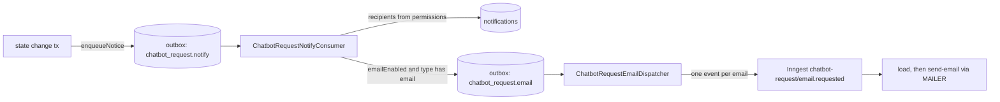

# Notifications: data model and pipeline

Human-intervention unit 6. Contract: `docs/proposals/human-intervention-backend-proposal.md` §5.1, §5.2, §6.3, §8 (D5, D14), §10.1 (R3, R8, R10). Migration: `prisma/migrations/20261111000000_notifications`. Code: `src/notifications/**`.

This module is separate from `notification-config` (`NotificationSettings`, recipients, actions). It does **not** read `NotificationSettings.enabled` (R8): a tenant without that row still gets request notices. `notification-config` keeps serving the emails that already exist.

## Tables

| Table | What it holds |
| --- | --- |
| `notifications` | One in-app notice per `(tenant, user, event)`: `type`, `requestId` (plain column, no FK), `payload` (`{folio, subtype}`, never customer data), `dedupKey`, `createdAt`, `readAt`. Unique `(tenantId, userId, dedupKey)`; list index `(tenantId, userId, createdAt DESC, id DESC)`; partial index `WHERE readAt IS NULL` for the badge and `unread=true` (migration-authoritative). Tenant-scoped (`TENANT_SCOPED_MODELS`). |
| `notification_preferences` | `userId` PK, `emailEnabled`, `soundEnabled`, both default `true`. Per **person**, not per tenant, so it follows them across sucursales. No row means the defaults. Not tenant-scoped; always read by the JWT `userId`. |

There is no email table: email jobs are `outbox_events` rows under the reserved prefix (below).

## Pipeline

### Recipients are resolved by a consumer, not at enqueue time

Decision: the producer writes **one outbox row** in the transaction of the state change; a dedicated consumer resolves recipients later (contract §5.1).

- The hot path (request creation holds the per-tenant folio lock and the customer-group lock) pays one insert, not a permission join plus N inserts. "Avisar nunca bloquea el alta."
- Permissions are evaluated when the notice is delivered, so a role change in the seconds between is honored.
- A rollback leaves no outbox row, so no notification: the consumer only ever sees committed events.
- Cost: in-app notices appear after the consumer tick (1 s), not in the same commit.

The consumer processes **one row per local transaction** (`FOR UPDATE SKIP LOCKED`, no external call inside): resolve recipients, insert notifications (`createManyAndReturn` with `skipDuplicates`, so only new rows return), insert email jobs, call the realtime hook, mark the row `PUBLISHED`. A crash rolls it all back and the row stays `PENDING`. A failing row backs off (2 s, 5 s, 15 s, 60 s, 300 s) and ends `FAILED` after `NOTICE_NOTIFY_MAX_RETRIES` (5) without blocking the rest.

### Who receives what (§5.1)

| Type | Audience | Email | Producer |
| --- | --- | --- | --- |
| `REQUEST_CREATED` | active members with `read` + `update:ChatbotRequest` | batched, or immediate for `TALK_TO_HUMAN` / `COMPLAINT` | bot intake and the wrapped legacy hooks (unit 6) |
| `REQUEST_REASSIGNED` | the new assignee (never the actor) | immediate | staff `reassign` (unit 6) |
| `REQUEST_CANCELLED` | the assignee, if any, when the close was not theirs | none | customer cancel, staff cancel by someone else, zone sibling resolved, legacy-route resolve by someone else (unit 6) |
| `REQUEST_CLAIM_REMINDER` | as `REQUEST_CREATED` | immediate | unit 7 |
| `REQUEST_ESCALATION`, `REQUEST_OVERDUE` | active members with `read:ChatbotEscalation` | immediate | unit 7 |

A grant counts when a role has the action or `manage`, on the subject or `all` (as `CaslAbilityFactory`). Grants are **merged across all of a person's memberships** in the tenant, as CASL flattens every membership's role: someone with `read:ChatbotRequest` from one role and `update:ChatbotRequest` from another qualifies; `read` alone does not. Each grant is its own condition over the user's memberships. Only `User.isActive` members of the notice's tenant qualify.

**Closed notices (`REQUEST_CANCELLED`, §5.1 «el cliente canceló o se resolvió solo → quien la atendía»).** The payload has a `cause` that selects the in-app wording: `CUSTOMER` (also the default for rows written before causes existed), `CANCELLED_BY_OTHER`, `RESOLVED_BY_OTHER`, `SIBLING_RESOLVED`. One hook covers the staff closes: `PrismaChatbotRequestCommandStore.applyPatch` runs for the common resolve, each zone sibling and the staff cancel, and `closeLegacy` covers the legacy routes. The assignee is read from the row as it was **before** the close, the person who closed it is never told (`actorUserId`), and a request nobody held tells nobody. The common `resolve` cannot take over a request held by someone else (the state machine answers `409 REQUEST_CLAIMED_BY_OTHER`), so `RESOLVED_BY_OTHER` only comes from the legacy routes. The dedup key is `closed:<requestId>`. Unit 7 calls `enqueueNotice(tx, tenantId, notice)` from `src/notifications/infrastructure/chatbot-request-notice.writer.ts`; the types, audiences and consumer already exist.

### Email (D5, §6.3)

- Subject `[HoundFe] Nueva solicitud: <tipo> (<sucursal>) · S-000123`; a batch uses `[HoundFe] N solicitudes nuevas (<sucursal>)`. The body has type, branch, folio and one `${APP_WEB_URL}/chatbot/solicitudes/:id` link per request. **No customer name, phone, text or media**: the loader does not select them.
- **Batching:** a `BATCH` job is due at the end of its **fixed 2-minute clock window** (`batchWindowEnd`). All of a person's batched jobs share that instant, so they are due together and leave in one email with no per-user state.
- **Fair claim per person:** the claim takes up to `NOTICE_EMAIL_BATCH_SIZE` (100) due jobs, then adds every other due `BATCH` job of each person already selected (`FOR UPDATE SKIP LOCKED`). The claim size therefore never cuts one person's batch in two: a person's group is whole or not claimed. The claim can exceed 100 rows by the remainder of the last person.
- **Immediate:** the job is due now and leaves alone.
- The Inngest function re-checks at send time (`load` step): an inactive person, a lost membership or `emailEnabled = false` since queueing sends nothing. The in-app notice always exists.
- Delivery is at-least-once; the Inngest idempotency key is derived from the notification ids, so a replay of the same group is one email.

### R3: the generic poller never takes these rows

Every outbox type of this module starts with `chatbot_request.` (`RESERVED_OUTBOX_PREFIX` in `src/shared/outbox/outbox.types.ts`). The generic `OutboxPollerService` excludes it with `AND NOT starts_with("eventType", 'chatbot_request.')`, in the same change that registers `ChatbotRequestNoticeOutboxModule`. A new dedicated type under the prefix needs no edit to the generic poller. Tests: the claim SQL, every type in `NOTICE_OUTBOX_EVENT_TYPES` starts with the prefix, and a PostgreSQL spec shows the generic poller leaves both types `PENDING` and unlocked while a normal type is claimed.

### Realtime hook

`NOTIFICATION_EVENTS` (`notification-events.port.ts`) is a no-op until unit 8. `publishCreated(tx, event)` receives the consumer's transaction on purpose: unit 8 can insert its durable `RealtimeEvent` row and `NOTIFY` in the same commit, so a crash cannot lose the event. `notification.read` events are also unit 8.

## Migration and locks

`20261111000000_notifications` is additive: two new tables (`notifications`, `notification_preferences`) and their indexes, including the partial unread index. It declares three foreign keys: `notifications.tenantId → tenants`, `notifications.userId → users` and `notification_preferences.userId → users`. Each `ADD CONSTRAINT … FOREIGN KEY` takes a brief `SHARE ROW EXCLUSIVE` lock on the **referenced** table (`tenants` once, `users` twice) until the migration commits, and waits behind open transactions on it. `SET LOCAL lock_timeout = '5s'` bounds the wait; the file runs as one transaction, so on timeout nothing is applied. Deploy at low traffic. If it fails on lock timeout, run `prisma migrate resolve --rolled-back 20261111000000_notifications` and redeploy. (The comment inside the committed `migration.sql` says "tenants (twice)"; that is a wording slip, the table above is accurate, and the file is left untouched because it is already applied.)

## Accepted deviations from the contract (v1.2)

Recorded in proposal §5.1 and §5.2 as well.

| Contract text | What shipped | Why |
| --- | --- | --- |
| `Notification (title, body, dedupKey)` and `UserNotificationPref (userId, tenantId, …)` | `Notification` keeps `payload` (`{folio, subtype, cause?}`); `title` and `body` are **computed on read** from type and payload. `NotificationPreference` is per **person** (`userId` only, no `tenantId`) | No stored text to migrate when wording changes; no customer data in a row. One preference across sucursales, as D14 says it follows the person |
| `NotificationEmail` and `NotificationEmailBatch` tables | **No such tables.** Email jobs are `outbox_events` rows of type `chatbot_request.email`, and the batch is a **fixed 2-minute clock window** (`batchWindowEnd`) instead of a `windowStartsAt` row | One durable queue with the existing lease/backoff pattern; fixed windows need no per-user state and group by one shared due instant |
| Email key `<notificationId>` | Inngest idempotency key `chatbot-email:<sha256 hex>` of `"<tenantId>:<userId>:<sorted notificationIds joined by ','>"`; the event data is `{tenantId, userId, mode, notificationIds}` | One event carries a whole batch, so the key must cover the set. A replay of the same group is one email |
| `POST /notifications/:id/read` and `read-all` "idempotentes" (no shape given) | `read` → `{id, readAt}` (a repeat returns the first `readAt`); `read-all` → `{updated}` | Gives the frontend what it needs to update the list and the badge |
| `limit=20` | Default 20, **capped at 50** | Keeps the page small |
| Preferences at `/me/notification-preferences` | Same (GET and partial PATCH). An empty PATCH body is `400` | Matches §5.2, §3.10, §12.12 |

## Configuration

| Variable | Default | Meaning |
| --- | --- | --- |
| `APP_WEB_URL` | — | Origin of the deep links (shared with the other emails); without it the email has no link |
| `NOTICE_NOTIFY_BATCH_SIZE` / `NOTICE_NOTIFY_MAX_RETRIES` | 25 / 5 | Consumer rows per tick, attempts before `FAILED` |
| `NOTICE_EMAIL_BATCH_SIZE` / `NOTICE_EMAIL_LOCK_MS` / `NOTICE_EMAIL_MAX_RETRIES` | 100 / 60000 / 5 | Email jobs claimed per tick, lease, attempts |

## Known limits

- Retention (90 days, §5.2) is not scheduled yet; it joins the daily cron of §3.6.
- `FAILED` rows are only visible in `outbox_events`; the "failed notices" screen is later.
- The email shows no age or time remaining (needs request deadlines; unit 7).
- Both `@Interval` ticks run on every replica; `FOR UPDATE SKIP LOCKED` keeps them disjoint. If two replicas claim at the same instant, a person's group can still split between them (rare; at most two emails).

## R10: the receipt-review email

`receipt.review_requested` no longer carries `customerName` in its outbox payload, and the email has no "Cliente" row. It keeps the order folio, the amounts, the mismatch warning and the link. Rows queued before this change still hold the name in their payload; the function ignores it (covered by a spec).
