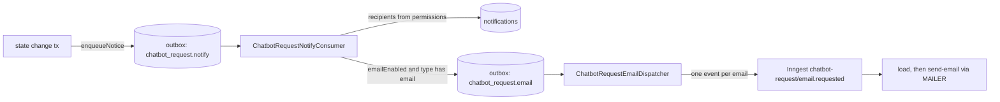

# Notifications: data model and pipeline

Human-intervention unit 6. Contract: `docs/proposals/human-intervention-backend-proposal.md` §5.1, §5.2, §6.3, §8 (D5, D14), §10.1 (R3, R8, R10). Migration: `prisma/migrations/20261111000000_notifications`. Code: `src/notifications/**`.

This module is separate from `notification-config` (`NotificationSettings`, recipients, actions). It does **not** read `NotificationSettings.enabled` (R8): a tenant without that row still gets request notices. `notification-config` keeps serving the emails that already exist.

## Tables

| Table                      | What it holds                                                                                                                                                                                                                                                                                                                                                                                                                               |
| -------------------------- | ------------------------------------------------------------------------------------------------------------------------------------------------------------------------------------------------------------------------------------------------------------------------------------------------------------------------------------------------------------------------------------------------------------------------------------------- |
| `notifications`            | One in-app notice per `(tenant, user, event)`: `type`, `requestId` (plain column, no FK), `payload` (`{folio, subtype, cause?, reason?}`, never customer data), `dedupKey`, `createdAt`, `readAt`. Unique `(tenantId, userId, dedupKey)`; list index `(tenantId, userId, createdAt DESC, id DESC)`; partial index `WHERE readAt IS NULL` for the badge and `unread=true` (migration-authoritative). Tenant-scoped (`TENANT_SCOPED_MODELS`). |
| `notification_preferences` | `userId` PK, `emailEnabled`, `soundEnabled`, both default `true`. Per **person**, not per tenant, so it follows them across sucursales. No row means the defaults. Not tenant-scoped; always read by the JWT `userId`.                                                                                                                                                                                                                      |

There is no email table: email jobs are `outbox_events` rows under the reserved prefix (below).

## Pipeline

### Recipients are resolved by a consumer, not at enqueue time

Decision: the producer writes **one outbox row** in the transaction of the state change; a dedicated consumer resolves recipients later (contract §5.1).

- The hot path (request creation holds the per-tenant folio lock and the customer-group lock) pays one insert, not a permission join plus N inserts. "Avisar nunca bloquea el alta."
- Permissions are evaluated when the notice is delivered, so a role change in the seconds between is honored.
- A rollback leaves no outbox row, so no notification: the consumer only ever sees committed events.
- Cost: in-app notices appear after the consumer tick (1 s), not in the same commit.

The consumer processes **one row per local transaction** (`FOR UPDATE SKIP LOCKED`, no external call inside): resolve recipients, insert notifications (`createManyAndReturn` with `skipDuplicates`, so only new rows return), insert email jobs, call the realtime hook, mark the row `PUBLISHED`. A crash rolls it all back and the row stays `PENDING`. A failing row backs off (2 s, 5 s, 15 s, 60 s, 300 s) and ends `FAILED` after `NOTICE_NOTIFY_MAX_RETRIES` (5) without blocking the rest.

### Who receives what (§5.1)

| Type                                    | Audience                                                                                                                                                                                                                       | Email                                                   | Producer                                                                                                                                                                               |
| --------------------------------------- | ------------------------------------------------------------------------------------------------------------------------------------------------------------------------------------------------------------------------------ | ------------------------------------------------------- | -------------------------------------------------------------------------------------------------------------------------------------------------------------------------------------- |
| `REQUEST_CREATED`                       | active members with `read` + `update:ChatbotRequest`                                                                                                                                                                           | batched, or immediate for `TALK_TO_HUMAN` / `COMPLAINT` | bot intake and the wrapped legacy hooks (unit 6); for a **scheduled** conversation the schedule sweep at `scheduledFor`, held to the next opening while the branch is closed (unit 14) |
| `REQUEST_REASSIGNED`                    | the new assignee (never the actor)                                                                                                                                                                                             | immediate                                               | staff `reassign` (unit 6)                                                                                                                                                              |
| `REQUEST_CANCELLED`                     | the assignee, if any, when the close was not theirs                                                                                                                                                                            | none                                                    | customer cancel, staff cancel by someone else, zone sibling resolved, legacy-route resolve by someone else (unit 6)                                                                    |
| `REQUEST_CLAIM_REMINDER`                | as `REQUEST_CREATED`                                                                                                                                                                                                           | immediate                                               | SLA sweep, 50 % of the claim clock of a `NEW` request (unit 7c)                                                                                                                        |
| `REQUEST_ESCALATION`, `REQUEST_OVERDUE` | active members with `read:ChatbotEscalation`; **plus the assignee** when someone holds the request (the sweep names them in `recipientUserId`, added to the permission-resolved set when still an active member of the tenant) | immediate                                               | SLA sweep, 80 % and 100 % of the active clock (unit 7c)                                                                                                                                |
| `CONVERSATION_CUSTOMER_MESSAGE`         | the assignee of the live session                                                                                                                                                                                               | none                                                    | live session sweep (unit 11, T11d): once per unanswered burst                                                                                                                          |
| `CONVERSATION_UNANSWERED`               | level 5: the assignee; **level 15**: active members with `update:ChatbotRequestAssignment` (`audienceFor`)                                                                                                                     | none                                                    | live session sweep (unit 11, T11d): customer message unanswered 5 / 15 min                                                                                                             |

A grant counts when a role has the action or `manage`, on the subject or `all` (as `CaslAbilityFactory`). Grants are **merged across all of a person's memberships** in the tenant, as CASL flattens every membership's role: someone with `read:ChatbotRequest` from one role and `update:ChatbotRequest` from another qualifies; `read` alone does not. Each grant is its own condition over the user's memberships. Only `User.isActive` members of the notice's tenant qualify.

**Closed notices (`REQUEST_CANCELLED`, §5.1 «el cliente canceló o se resolvió solo → quien la atendía»).** The payload has a `cause` that selects the in-app wording: `CUSTOMER` (also the default wording for rows written before causes existed), `CANCELLED_BY_OTHER`, `RESOLVED_BY_OTHER`, `SIBLING_RESOLVED`, `MERGED` (the source of a merge). One hook covers the staff closes: `PrismaChatbotRequestCommandStore.applyPatch` runs for the common resolve, each zone sibling and the staff cancel, and `closeLegacy` covers the legacy routes. The assignee is read from the row as it was **before** the close, the person who closed it is never told (`actorUserId`), and a request nobody held tells nobody. The common `resolve` cannot take over a request held by someone else (the state machine answers `409 REQUEST_CLAIMED_BY_OTHER`), so `RESOLVED_BY_OTHER` only comes from the legacy routes. The dedup key is `closed:<requestId>`. Unit 7 calls `enqueueNotice(tx, tenantId, notice)` from `src/notifications/infrastructure/chatbot-request-notice.writer.ts`; the types, audiences and consumer already exist.

### Structured item fields and `reason` (S10)

The API item (`NotificationView`, `src/notifications/domain/notification-view.ts`) adds `folio` (`S-000123`), `subtype`, `cause`, `reason` and `requestOpen` to the computed `title`/`body`. **No migration**: `folio`, `subtype` and `cause` are already in `payload`, and `reason` is one more payload key, so older rows simply read with nulls (`toNotificationView` is null-safe: a payload that is empty, not an object or has wrong types gives nulls; an unknown `cause` or `reason` reads as `null`).

- **`reason` is decided when the row is created**, by the notify consumer, per recipient (`resolveRecipients` in `infrastructure/notice-recipients.ts`) and stored in that recipient's `payload`. Only the `ESCALATION_VIEWERS` types (`REQUEST_ESCALATION`, `REQUEST_OVERDUE`) have one: `ASSIGNEE` for the person the sweep names in `recipientUserId`, `ESCALATION` for everyone who gets it through `read:ChatbotEscalation`. **If a person is both, `ASSIGNEE` wins** and they get one notice (the dedup key is per person). It is a snapshot: reassigning later does not rewrite it. Every other type, and rows written before S10, have `reason = null` (the view also forces `null` for non-escalation types).
- **`requestOpen` is a read-time join**, not stored: `notification-rows.ts` runs one statement (`notifications LEFT JOIN chatbot_requests ON tenantId AND id = requestId`, ordered and keyset-paged on the same `(tenantId, userId, createdAt desc, id desc)` index) for the list, `eventView` and the realtime reader. Both sides of the join name the tenant explicitly, so another sucursal's request id yields `null`; there is no per-row query. `null` when `requestId` is `null` or the request is gone; `true` for `NEW`/`IN_PROGRESS`.
- **One mapping for REST and SSE.** The `notification.created` payload is built at delivery time by the realtime reader through the same statement and mapper, so its `requestOpen` is the value at delivery, not at creation, and is not re-sent when the request closes later. `notification-fields.integration.spec.ts` compares list items with the reader and `eventView` output.
- `createdAt` of a notice held until the next opening is the **release time** (the row is created when the held outbox row is consumed); the milestone time is `SLA_MILESTONE.data.dueAt` in the request audit.
- By design there is no mark-unread and no delete route; browser notifications are a client permission with no server field.

### Email (D5, §6.3)

- Subject `[HoundFe] Nueva solicitud: <tipo> (<sucursal>) · S-000123`; a batch uses `[HoundFe] N solicitudes nuevas (<sucursal>)`. The body has type, branch, folio and one `${APP_WEB_URL}/chatbot/solicitudes/:id` link per request. **No customer name, phone, text or media**: the loader does not select them.
- **Batching:** a `BATCH` job is due at the end of its **fixed 2-minute clock window** (`batchWindowEnd`). All of a person's batched jobs share that instant, so they are due together and leave in one email with no per-user state.
- **Fair claim per person:** the claim takes up to `NOTICE_EMAIL_BATCH_SIZE` (100) due jobs, then adds every other due `BATCH` job of each person already selected (`FOR UPDATE SKIP LOCKED`). The claim size therefore never cuts one person's batch in two: a person's group is whole or not claimed. The claim can exceed 100 rows by the remainder of the last person.
- **Immediate:** the job is due now and leaves alone.
- The Inngest function re-checks at send time (`load` step): an inactive person, a lost membership or `emailEnabled = false` since queueing sends nothing. The in-app notice always exists.
- Delivery is at-least-once; the Inngest idempotency key is derived from the notification ids, so a replay of the same group is one email.

### R3: the generic poller never takes these rows

Every outbox type of this module starts with `chatbot_request.` (`RESERVED_OUTBOX_PREFIX` in `src/shared/outbox/outbox.types.ts`). The generic `OutboxPollerService` excludes it with `AND NOT starts_with("eventType", 'chatbot_request.')`, in the same change that registers `ChatbotRequestNoticeOutboxModule`. A new dedicated type under the prefix needs no edit to the generic poller. Tests: the claim SQL, every type in `NOTICE_OUTBOX_EVENT_TYPES` starts with the prefix, and a PostgreSQL spec shows the generic poller leaves both types `PENDING` and unlocked while a normal type is claimed.

### Realtime hook (unit 8)

`NOTIFICATION_EVENTS` (`notification-events.port.ts`) is implemented by `RealtimeNotificationEvents` (`infrastructure/realtime-notification-events.ts`), bound in `ChatbotRequestNoticeOutboxModule`. `publishCreated(tx, event)` receives the consumer's transaction and writes the durable `realtime_events` row (`notification.created`, `userId` = the recipient, payload `{notificationId}`) plus the `NOTIFY`, in the same commit as the notification: a crash cannot lose the event, a rolled-back row sends none, and a duplicate notice (the `dedupKey` skip) creates no row and so no event. The noop adapter remains for specs.

`notification.read` is written by `NotificationsService.markRead` / `markAllRead` through `NOTIFICATION_READ_EVENTS` (`NotificationsModule`): the update and the event are one transaction (the service opens it only when the writer is wired), only when something changed (a repeat read, a foreign id or an empty read-all writes nothing), always addressed to the caller. The stream builds the payloads at delivery time for that person only: `notification.created {notification, unreadCount}` (the `NotificationsService.eventView` shape, same as the list) and `notification.read {ids, all, unreadCount}`. Spec: `src/notifications/notification-realtime.integration.spec.ts`. FE: `docs/frontend-handoff/17-realtime-sse.md`.

## Migration and locks

`20261111000000_notifications` is additive: two new tables (`notifications`, `notification_preferences`) and their indexes, including the partial unread index. It declares three foreign keys: `notifications.tenantId → tenants`, `notifications.userId → users` and `notification_preferences.userId → users`. Each `ADD CONSTRAINT … FOREIGN KEY` takes a brief `SHARE ROW EXCLUSIVE` lock on the **referenced** table (`tenants` once, `users` twice) until the migration commits, and waits behind open transactions on it. `SET LOCAL lock_timeout = '5s'` bounds the wait; the file runs as one transaction, so on timeout nothing is applied. Deploy at low traffic. If it fails on lock timeout, run `prisma migrate resolve --rolled-back 20261111000000_notifications` and redeploy. (The comment inside the committed `migration.sql` says "tenants (twice)"; that is a wording slip, the table above is accurate, and the file is left untouched because it is already applied.)

## Accepted deviations from the contract (v1.2)

Recorded in proposal §5.1 and §5.2 as well.

| Contract text                                                                           | What shipped                                                                                                                                                                                              | Why                                                                                                                                            |
| --------------------------------------------------------------------------------------- | --------------------------------------------------------------------------------------------------------------------------------------------------------------------------------------------------------- | ---------------------------------------------------------------------------------------------------------------------------------------------- |
| `Notification (title, body, dedupKey)` and `UserNotificationPref (userId, tenantId, …)` | `Notification` keeps `payload` (`{folio, subtype, cause?}`); `title` and `body` are **computed on read** from type and payload. `NotificationPreference` is per **person** (`userId` only, no `tenantId`) | No stored text to migrate when wording changes; no customer data in a row. One preference across sucursales, as D14 says it follows the person |
| `NotificationEmail` and `NotificationEmailBatch` tables                                 | **No such tables.** Email jobs are `outbox_events` rows of type `chatbot_request.email`, and the batch is a **fixed 2-minute clock window** (`batchWindowEnd`) instead of a `windowStartsAt` row          | One durable queue with the existing lease/backoff pattern; fixed windows need no per-user state and group by one shared due instant            |
| Email key `<notificationId>`                                                            | Inngest idempotency key `chatbot-email:<sha256 hex>` of `"<tenantId>:<userId>:<sorted notificationIds joined by ','>"`; the event data is `{tenantId, userId, mode, notificationIds}`                     | One event carries a whole batch, so the key must cover the set. A replay of the same group is one email                                        |
| `POST /notifications/:id/read` and `read-all` "idempotentes" (no shape given)           | `read` → `{id, readAt}` (a repeat returns the first `readAt`); `read-all` → `{updated}`                                                                                                                   | Gives the frontend what it needs to update the list and the badge                                                                              |
| `limit=20`                                                                              | Default 20, **capped at 50**                                                                                                                                                                              | Keeps the page small                                                                                                                           |
| Preferences at `/me/notification-preferences`                                           | Same (GET and partial PATCH). An empty PATCH body is `400`                                                                                                                                                | Matches §5.2, §3.10, §12.12                                                                                                                    |

## Configuration

| Variable                                                                        | Default         | Meaning                                                                                   |
| ------------------------------------------------------------------------------- | --------------- | ----------------------------------------------------------------------------------------- |
| `APP_WEB_URL`                                                                   | —               | Origin of the deep links (shared with the other emails); without it the email has no link |
| `NOTICE_NOTIFY_BATCH_SIZE` / `NOTICE_NOTIFY_MAX_RETRIES`                        | 25 / 5          | Consumer rows per tick, attempts before `FAILED`                                          |
| `NOTICE_EMAIL_BATCH_SIZE` / `NOTICE_EMAIL_LOCK_MS` / `NOTICE_EMAIL_MAX_RETRIES` | 100 / 60000 / 5 | Email jobs claimed per tick, lease, attempts                                              |

### SLA sweep producer (unit 7c, §5.4)

Producer: `ChatbotSlaSweepStore` (`src/chatbot-requests/infrastructure/chatbot-sla-sweep.store.ts`), called every 30 s by `ChatbotSlaSweepScheduler`. It writes through the same `enqueueNotice`, on the root transaction client (no request context), so the consumer, recipients, email rules and R3 are unchanged. Per request and milestone:

- **Which notice.** 50 % while `NEW` → `REQUEST_CLAIM_REMINDER`; 80 % → `REQUEST_ESCALATION`; 100 % → `REQUEST_OVERDUE`. The 50 % of a **claimed** request (resolve clock) is recorded but sends nothing: the §5.1 table only has «mitad del tiempo **sin tomar**». After downtime several milestones can be due at once: all are recorded, only the highest sends a notice.
- **`dedupKey`** is `sla:<requestId>:<clock>:<milestone>:<cycleMs>` (`cycle` = the instant the clock started, so a release, which restarts the claim clock, gets its own reminders). It deduplicates per user in `notifications`, but that table is purged at 90 days, so it is **not** the guard.
- **Durable dedup: the request's own events.** Each reached milestone is first inserted as a `SLA_MILESTONE` event (`data: {milestone, clock, cycle, dueAt, notice}`, actor `SYSTEM`) with `ON CONFLICT DO NOTHING` on the unique partial index `chatbot_request_events_sla_milestone_uq` `(tenantId, requestId, data->>'clock', data->>'milestone', data->>'cycle')`. Only a milestone that was actually inserted enqueues its notice. Events are append-only and kept forever, so a purge of old notifications can never cause a re-notify (tested).
- **Hours: staff notices wait for the next opening (owner decision L69, «Guardarlos hasta la próxima apertura»).** Milestone instants are business time, but a milestone can be recorded while the tenant calendar is closed: the one that lands exactly on a close (a receipt due at close), a late sweep, downtime catch-up, a closed date. The `SLA_MILESTONE` event is recorded **at once** (audit, dedup, `overdueAt`), but the in-app notice and the email are released at the **next opening** of the tenant calendar. Mechanism: the sweep writes the `chatbot_request.notify` outbox row with `nextAttemptAt = noticeReleaseAt(calendar, now)` (the next opening, via `addBusinessMinutes(now, 0)`; `null` = now while open). The notify consumer already claims only `status = 'PENDING' AND nextAttemptAt <= NOW()`, so the release is durable, shared by all replicas and needs no in-memory timer; a restart changes nothing. It cannot double-send: the row is claimed once (`FOR UPDATE SKIP LOCKED`, one transaction), and the per-user `dedupKey` plus the durable event still guard it. Email: the email job is created **when the notify row is consumed**, so it is also due at the opening and follows the existing batching (immediate for these types, unchanged). The event's `data.noticeNotBefore` records the release instant. A calendar with no next opening inside its horizon (every open weekday closed by `closedDates` for 800+ days) releases **immediately**: there is nothing to wait for. Examples (injected clock, tested): deadline = Saturday 19:00 close → released Monday 09:00; a closed Monday → Tuesday 09:00; across a DST change the opening is the local 09:00 (EDT 13:00Z, not 14:00Z). The customer's `request.overdue_notice` is **not** held (it is created at the deadline; see the bot contract).

**A held notice that no longer applies is dropped at consume time.** A staff notice held over a weekend can describe a request that changed meanwhile, so the notify consumer judges every SLA type (`REQUEST_CLAIM_REMINDER`, `REQUEST_ESCALATION`, `REQUEST_OVERDUE`) against the request **as it is when the row is consumed** (`slaNoticeDropReason`, pure; one primary-key lookup of the request plus the last `RELEASED`/`AUTO_RELEASED` event, inside the consume transaction):

| Request at consume time                                                                                                                                            | Reminder (50 %, "sin tomar")   | Escalation (80 %) / overdue                                     |
| ------------------------------------------------------------------------------------------------------------------------------------------------------------------ | ------------------------------ | --------------------------------------------------------------- |
| `RESOLVED` or `CANCELLED`                                                                                                                                          | dropped, `REQUEST_CLOSED`      | dropped, `REQUEST_CLOSED`                                       |
| claimed since (`IN_PROGRESS`)                                                                                                                                      | dropped, `CLAIMED_SINCE`       | delivered (the assignee and the viewers should know it is late) |
| released and restarted (claim cycle changed; the reminder carries `claimCycle`, the cycle start in ms, compared with `max(createdAt, scheduledFor, last release)`) | dropped, `CLAIM_CYCLE_CHANGED` | delivered                                                       |
| still `NEW`, same cycle / still open                                                                                                                               | delivered once                 | delivered once                                                  |
| request row missing (cannot happen: requests are kept forever)                                                                                                     | dropped, `REQUEST_MISSING`     | dropped, `REQUEST_MISSING`                                      |

A dropped row is **done, not failed**: `status = PUBLISHED`, `retryCount` unchanged, `lastError = 'DROPPED:<REASON>'` (the outbox model has no skipped status and no reason column; `lastError` is the only free text, and a PUBLISHED row never otherwise carries one). No notification, no email job and no realtime event are created. The log line carries ids only (`row id, tenant, request, type, reason`), never customer data. Other types (`REQUEST_CREATED`, `REQUEST_REASSIGNED`, `REQUEST_CANCELLED`) are never judged and behave as before (the existing specs are unchanged). The check also applies to a notice that is not held (consumed within seconds), where it is a no-op. A notice written by an older build without `claimCycle` is judged on status only.

The claim-cycle start is derived twice, on purpose: the sweep in JS (`computeClocks`, with `LAST_RELEASED`) and the consumer in SQL (`dropReason`). `src/notifications/sla-claim-reminder.integration.spec.ts` ties them together by running the real sweep and the real consumer end to end (fresh request, `RELEASED` and `AUTO_RELEASED` restarts, `scheduledFor`, scheduled then released) and asserting the reminder is delivered, never dropped as `CLAIM_CYCLE_CHANGED`. Change either derivation and that spec must stay green.

## Live conversation notices (unit 11, T11d; proposal §4.6, §5.1)

Two types, **in-app only** (`emailModeOf` → `NONE`; no `chatbot_request.email` row is ever written), producer `LiveSessionSweepStore.runNoticeBatch` (`src/chatbot-requests/infrastructure/live-session-sweep.store.ts`), run by the 10-second `LiveSessionSweepScheduler` after the timeout phase. They go through the same `enqueueNotice` → notify consumer → `Notification` path, so recipients, dedupe and realtime are unchanged. `payload` is `{folio, subtype}` plus `level` (5 | 15) for `CONVERSATION_UNANSWERED`; no customer data.

- **Audience by notice, not only by type.** `audienceFor(notice)`: `CONVERSATION_UNANSWERED` with `level: 15` is `REASSIGNERS` (grants `update:ChatbotRequestAssignment`, merged across memberships like the others); every other notice uses the fixed audience of its type (`audienceOf`). The level-15 notice has no `recipientUserId`.
- **Unanswered** means: the chat's `lastCustomerMessageAt` is later than the session's `lastStaffActivityAt` (set at the claim, at activation and at every attendee message or template). The wait is measured from that newest customer message, so a new customer message restarts it. At 5 min the attendee is told, at 15 min the reassigners; only the **highest level due** is sent.
- **"El cliente escribió"** goes once per unanswered burst: it is written for the first customer message after the attendee last spoke, not for the following ones until the attendee replies.
- **Durable state, no timers.** `chatbot_live_sessions."customerNoticeAt"` (the customer message the notices were issued for) and `"unansweredLevel"` (0, 5, 15; CHECK) are written only by the sweep, in the same transaction as the outbox rows, under the request lock (`FOR UPDATE SKIP LOCKED`) then the session and chat rows (the existing lock order). `dedupKey`s are `wrote:<sessionId>:<ms>` and `unanswered:<level>:<sessionId>:<ms>`, so a replica, a retry or a restart never repeats a notice. Migration `20261113030000_live_conversation_notices`.
- **Never held.** §4.6: the clocks of a live conversation do not pause outside business hours (a claim at night means someone is attending), so these notices do not use the unit 7c `releaseAt` hold and `slaNoticeDropReason` does not judge them.
- **Latency.** The notice is produced by the sweep (the mirror store belongs to unit 9 and is not hooked), so "el cliente escribió" appears up to ~10 s after the message, plus the consumer's 1 s tick.
- **No notice for START_TIMEOUT.** §12.15 only requires the bot to be told (the feed item `conversation.ended START_TIMEOUT`); staff see `request.released` + `session.ended`. No persistent notification type exists for the revert (decision of the unit 11 notes, unchanged).

## Known limits

- Notifications reach the open tabs through the realtime stream (unit 8); `unreadCount` in the events is read at delivery, and the 90-day retention announces nothing (clients refetch `unread-count` on connect and `resync`).
- Retention (90 days, §5.2) is scheduled (unit 7b): hourly, batch 1000, at most 20 batches per tick, `FOR UPDATE SKIP LOCKED`, served by the `notifications_createdAt_idx` index. The chatbot feed keeps 30 days; notifications keep 90.
- `FAILED` rows are only visible in `outbox_events`; the "failed notices" screen is later.
- The email shows no age or time remaining (the deadlines now exist, but the template does not render them yet).
- A burst of overdue notices is possible when unit 7c ships (old open requests past their deadline): one in-app notice and one email per person and request. The sweep writes at most 10 batches × 100 requests per phase per 30 s tick, per replica (about 1 000 requests per tick with one replica, more with more replicas), so a backlog of N requests spreads over about N / 1 000 ticks; the notices are held to the next opening while the calendar is closed, and the consumer's own batching applies on top.
- Both `@Interval` ticks run on every replica; `FOR UPDATE SKIP LOCKED` keeps them disjoint. If two replicas claim at the same instant, a person's group can still split between them (rare; at most two emails).

## R10: the receipt-review email

`receipt.review_requested` no longer carries `customerName` in its outbox payload, and the email has no "Cliente" row. It keeps the order folio, the amounts, the mismatch warning and the link. Rows queued before this change still hold the name in their payload; the function ignores it (covered by a spec).
