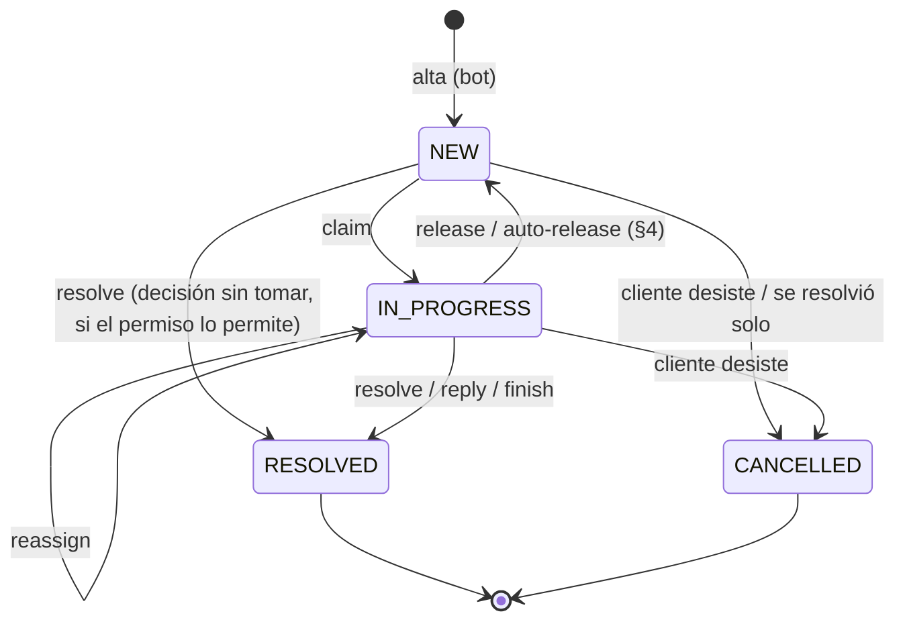

# Intervención humana: contrato v1 del backend (2026-11-10)

**Estado: contrato v1, cerrado con el dueño; v1.1 agrega las aclaraciones del frontend (§12) y corrige el cuerpo para que coincida.** La implementación empieza cuando el coordinador del chatbot confirme que concilió su lado (§11). Este documento responde al diseño `houndfe-chatbot/docs/intervencion-humana-diseno.md` (commits `29c2b6f` y `7e298b4`; sus decisiones de §7 mandan sobre cualquier texto anterior) y a la propuesta del frontend `frontend-houndfe/docs/redesign/human-intervention-frontend-proposal.md` (§6, alineada). **Solo es diseño:** no hay código ni migraciones. Las citas `ruta:línea` apuntan al `main` actual. Lo que no se pudo comprobar en el código está marcado **[supuesto]**.

## Resumen

1. **Una tabla nueva `ChatbotRequest` envuelve los flujos actuales sin tocarlos.** Stock, caducidad, zona y comprobantes conservan sus tablas, reglas y rutas del bot. La solicitud común guarda el estado de bandeja (tomar, liberar, tiempos, avisos) y, al resolver, llama en la misma transacción al repositorio que ya existe.
2. **Respuestas al bot: un feed con cursor y long-poll** (`GET /chatbot-api/feed`), con confirmación (ACK) por cada entrega. No es un webhook push. Ese mismo feed lleva los mensajes del personal en la conversación en vivo.
3. **El backend manda sobre la conversación en vivo**: quién la atiende, si el bot está callado (con una época, `handoffEpoch`) y el orden de los mensajes (`seq` por conversación). El bot aplica esas órdenes de forma idempotente y lo confirma.
4. **Tiempo real hacia el navegador: SSE sobre `fetch`** (header `Authorization`, se retoma con `Last-Event-ID`), apoyado en una tabla de eventos por usuario y en `LISTEN/NOTIFY` de PostgreSQL para repartir entre réplicas. El frontend la aceptó en lugar de WebSocket (§5.3).
5. **Permisos sin verbos nuevos**: sujetos nuevos con las acciones que ya existen (`read`/`update`), igual que se hizo con la caja. El frontend la aceptó (§2.5).
6. **Los tiempos límite se recalculan desde la base de datos** con un barrido periódico (`FOR UPDATE SKIP LOCKED`), no con esperas programadas en Inngest. Inngest queda solo para mandar los correos (outbox → Inngest → Resend), como hoy.
7. **Conversaciones agendadas fuera de horario** (§4.9): el bot ofrece un horario y la conversación queda agendada en el sistema. El reloj para tomarla arranca a la hora agendada.
8. **Antes y durante la implementación hay requisitos obligatorios de rendimiento y corrección** (§10.1), que salen de los riesgos del código actual.

**Las decisiones del dueño están cerradas** y su lista completa está en §8. El frontend aceptó las dos contrapropuestas: SSE sobre `fetch` y acciones CASL existentes sobre sujetos nuevos. Los endpoints consolidados están en §3.9 (chatbot ↔ backend) y §3.10 (frontend ↔ backend). Lo que queda fuera de v1 está en §7.1.

---

## 1. Mapa del código actual

### 1.1 Solicitudes humanas que ya existen

| Flujo | Persistencia | Rutas del bot | Rutas del personal | Permiso |
| --- | --- | --- | --- | --- |
| Stock (RESTOCK) y caducidad (EXPIRATION) | `HumanDecision` `prisma/schema.prisma:3031`, tipos `:2973`, estados `PENDING/RESOLVED` `:2982` | `POST /chatbot-api/human-decisions` `src/human-decisions/presentation/bot-restock-intake.controller.ts:140` (scope `human-decisions:create` `:155`); `GET .../:id` `bot-restock-poll.controller.ts:134` (`human-decisions:read`); `POST .../:id/application-outcome` `bot-application-outcome.controller.ts:137` (`human-decisions:ack`) | `GET/POST /human-decisions[...]/resolve` `human-decision-review.controller.ts:158-262` | `read`/`update` sobre `HumanDecision` `src/auth/authorization/domain/permission.ts:746-760` |
| Zona de entrega | `DeliveryZoneValidation` (una por código postal) `schema.prisma:3423` + `DeliveryZoneRequest` (una por cliente que preguntó) `:3451` | Mismas rutas del bot, discriminante `type: "DELIVERY_ZONE"` (`bot-restock-intake.controller.ts:36-42`) | `/delivery-zone-validations` `src/delivery-zones/presentation/delivery-zone-validations.controller.ts:76-129` | `validate:DeliveryZone` `permission.ts:764-785` |
| Comprobante de transferencia | `ReceiptEvidence` `schema.prisma:1724` (`PENDING/CONFIRMED/REJECTED` `:184`) | `POST /chatbot-api/sales/:saleId/receipts`, `GET /chatbot-api/receipts/:id` `src/chatbot-api/presentation/chatbot-api.controller.ts:184,245` | `GET /sales/receipts/pending`, confirm/reject `src/sales/review/receipt-review.controller.ts:36,51,76` | `read`/`update` sobre `ReceiptEvidence` `permission.ts:303-318` |

Patrones que ya existen y conviene conservar:
- **Idempotencia de alta:** `unique(tenantId, source, sourceRequestId)`, con `X-Idempotency-Key` igual al `sourceRequestId` y un `canonicalRequestHash`. Mismo id con otro hash → `409 IDEMPOTENCY_CONFLICT` (`schema.prisma:3031` y comentarios del modelo).
- **CAS optimista con `version`**. Ojo: en `HumanDecision` la versión vale 1 al crear y **exactamente 2** al resolver, y hay un CHECK que lo obliga (`schema.prisma`, comentario de `version` en `HumanDecision`). **No sirve para tomar y liberar**, así que la solicitud común necesita su propia versión.
- **ACK terminal del bot por entrega** (`HumanDecisionBotOutcome` `schema.prisma:3012`), con `providerMessageId` y una ventana de aplicación de 24 h (`prisma-delivery-zone-bot.repository.ts:425`).
- **Errores saneados** `{statusCode, code, message}` con `HumanDecisionHttpFilter`.
- **Guard de revisor activo:** `HumanDecisionActiveReviewerGuard` vuelve a comprobar `User.isActive`, porque `JwtStrategy` no lo hace (`src/human-decisions/presentation/guards/human-decision-active-reviewer.guard.ts:1-30`).

Diferencias que importan para el modelo común:
- **Stock y caducidad no guardan cliente.** El body prohíbe a propósito cualquier dato personal (`src/human-decisions/presentation/dto/restock-intake.request.ts:10`). **Zona sí** guarda `customerPhone`, `conversationRef` y `lastCustomerMessageAt` (`src/delivery-zones/domain/delivery-zone-intake.request.ts:11-14`). El **comprobante** llega al cliente solo a través de `Sale.customerId`.
- **La zona es compartida:** una validación por código postal resuelve a todos los clientes que preguntaron por ese código postal (`delivery-zone-bot.repository.ts:1-16`). No encaja tal cual en una bandeja "agrupada por cliente" (§2.3).
- **La bandeja actual muestra las resueltas durante 7 días** (`prisma-human-decision-review-read.repository.ts:181`).

### 1.2 Comprobantes y el handoff 08

- `docs/frontend-handoff/08-transfer-receipts-review.md` todavía dice "Backend implemented on `feat/transfer-receipts`, not merged", pero el código **ya está en `main`** (`receipt-review.controller.ts:36`, la lista de pendientes). El estado del documento está desactualizado.
- **Confirmado:** el frontend no tiene esa pantalla, y `ReceiptEvidence` no está en `APP_SUBJECTS` (`frontend-houndfe/src/features/auth/authorization/ability.ts:7-66`; solo aparece en la traducción `admin/roles/i18n/permissions.ts:56`). Por eso el permiso se descarta en silencio.
- **Qué implica:** ningún usuario depende hoy de una pantalla de comprobantes, así que envolverlos no rompe ninguna interfaz. Se puede construir directo sobre la bandeja común sin compatibilidad hacia atrás en el frontend. Las rutas del personal `/sales/:id/receipts/*` se quedan, porque las usan el visor de archivos y la integración actual. Lo que sí falta es el vínculo con el cliente y la conversación: hay que derivarlo de `Sale.customerId` y del teléfono del cliente al envolver.

### 1.3 Permisos (CASL)

- Las acciones son una **lista cerrada** en el backend (`permission.ts:17-26`: `create, read, update, publish, delete, batch_delete, validate, manage`) y también en el frontend (`ability.ts:6`, sin `publish`).
- Precedente: en caja se crearon **sujetos que no son tablas** (`CashIn`, `CashVerification`, ...) para no inventar verbos. Está explicado en el comentario de `permission.ts` en el bloque cash-register.
- `PermissionSeeder` hace upsert del registro en cada arranque (`src/auth/authorization/infrastructure/permission.seeder.ts:33`). Los roles se asignan a mano por tenant.

### 1.4 Autenticación del bot

- Usa `Authorization: Bearer svc_…`. Se guarda el hash SHA-256 en `ServiceCredential` (`schema.prisma:530`) y los scopes son texto libre. `X-Branch-Id` tiene que ser igual al `tenantId` (`src/chatbot-api/presentation/guards/service-auth.guard.ts:123-136`). El tenant y `userId = service:<id>` se guardan en CLS (`:102-104`).
- El **rate limit vive en memoria y es por proceso** (`service-auth.guard.ts:36-41`, "Single-node deployment assumption"), con 60 por minuto por defecto (`schema.prisma:538`, `credential-rate-limiter.ts:16`).
- Hay auditoría del bot en `BotAuditLog` (`schema.prisma:549`) mediante un interceptor con un mapa de rutas (`bot-audit.interceptor.ts`).
- En el chatbot, el cliente HTTP manda `Authorization` y `X-Branch-Id` en cada llamada (`houndfe-chatbot/src/chatbot-api/infrastructure/chatbot-api-http.client.ts:1048-1065`). Hoy la intervención humana usa `OPS_CHANNEL_PHONE` (`houndfe-chatbot/src/human-handoff/domain/human-handoff.types.ts:1-20`).

### 1.5 Notificaciones, correo y outbox

- **Correo:** `ResendMailer` (`src/notifications/email/resend.mailer.ts`) con plantillas React (`src/notifications/email/templates/*`). Las variables `RESEND_API_KEY`, `MAIL_FROM` y `APP_WEB_URL` son obligatorias en producción (`src/shared/config/env.validation.ts:199-223`).
- **Configuración actual:** `NotificationSettings` (interruptor maestro, apagado por defecto), `NotificationRecipient` (lista de usuarios) y `NotificationAction` (enum `NotificationActionKey` `schema.prisma:285`), en `schema.prisma:2773-2815`. Es una lista de destinatarios **por tenant**, no una preferencia por persona. **No hay notificaciones dentro del sistema** (no existe tabla ni campana).
- **Outbox:** `OutboxEvent` (`schema.prisma:1768`). El poller genérico `OutboxPollerService` (`src/shared/outbox/outbox-poller.service.ts:30`) publica *fire-and-forget* todo lo que **no** esté en una lista `NOT IN (...)` escrita a mano (`:89`). Cada tipo con entrega garantizada tiene su poller y su dispatcher, que esperan a `InngestService.send` con clave idempotente (por ejemplo `src/receipts/outbox/receipt-review-outbox.dispatcher.ts`). La función de Inngest manda el correo en pasos (`src/receipts/inngest/receipt-review-notification.functions.ts`).
- **Inngest** se usa para eventos y para un cron de retención (`src/receipts/inngest/receipt-retention.functions.ts:45`, purga de comprobantes a 5 años). **No** se usan `step.sleep`, `cancelOn` ni `waitForEvent` en ninguna parte.

### 1.6 Tiempo real, horarios, clientes y retención

- **Tiempo real:** no hay ningún gateway WebSocket ni SSE (búsqueda sin resultados en `src/`), ni `LISTEN/NOTIFY`. Sí están `EventEmitterModule` y `ScheduleModule` (`src/app.module.ts:118-119`).
- **Horario:** `TenantOpeningHours` (`schema.prisma:3620`), con dominio `src/shipping/pickup/domain/opening-hours.ts` (zona IANA, siete días, rangos `HH:mm`, por defecto `America/Mexico_City` `:16`). Se expone en `GET/PUT /tenants/:tenantId/opening-hours` con permiso de `ShippingSettings` (`src/shipping/pickup/presentation/opening-hours.controller.ts:36-53`). El frontend ya tiene `OpeningHoursBody {timeZone, days}` (`frontend-houndfe/src/features/shipping/shipping-settings/interfaces/shipping-settings.types.ts:75`) y su editor. **No existe ningún concepto de SLA.**
- **Clientes:** el teléfono solo se normaliza quitando lo que no es dígito (`src/chatbot-api/application/chatbot-api.service.ts:1014`). El índice `(tenantId, phoneCountryCode, phone)` **no es único** (`schema.prisma:2053`) y `findByPhone` se queda con el más reciente (`src/customers/infrastructure/prisma-customer.repository.ts:17-30`). `isTrusted` existe (`schema.prisma:2021`).
- **Medios privados:** el almacenamiento privado de comprobantes en Spaces (`src/receipts/infrastructure/spaces-receipt-storage.adapter.ts`) se sirve con streaming autenticado y `no-store` (handoff 08 §5). Existe `PrivateMediaAsset`, pero está ligado a `Product` (`schema.prisma:655`), así que no sirve para la conversación.
- **Autenticación del personal:** JWT solo en el header `Authorization` (`src/auth/infrastructure/strategies/jwt.strategy.ts:40`). El access token dura 15 minutos (`env.validation.ts:57`).
- **Despliegue:** Dokploy sobre Docker Swarm con Traefik (skill `houndfe-deploy`). **[supuesto]** Hoy corre una sola réplica del backend, porque así lo asume el guard del bot. El diseño tiene que aguantar más de una.

---

## 2. Modelo común de solicitud

### 2.1 Recomendación: envolver, no migrar

Se crea una tabla nueva `chatbot_requests` (modelo `ChatbotRequest`). Las tablas actuales **no cambian de forma** y siguen siendo la fuente de verdad de *qué* se decidió. La solicitud común es la fuente de verdad de *cómo se atiende*: estado de bandeja, quién la tiene, tiempos, avisos y auditoría.

```text
ChatbotRequest
  id, tenantId, folio (S-000123, contador por tenant), version (CAS propio; sube en cada comando)
  kind        DECISION | CLARIFICATION | CONVERSATION
  subtype     RESTOCK | EXPIRATION | DELIVERY_ZONE | TRANSFER_RECEIPT
              | TALK_TO_HUMAN | COMPLAINT | UNKNOWN_QUESTION | DISCOUNT (fuera de v1, §7.1)
  status      NEW | IN_PROGRESS | RESOLVED | CANCELLED
  -- dueño
  customerId?  (FK, SetNull)   phoneCountryCode, phone (normalizados, siempre)
  customerKey  = "<cc><phone>"  (agrupación; existe aunque no haya Customer)
  conversationId (FK a ChatbotConversation, §3.6)
  -- atención
  assigneeUserId?, assigneeDisplayName?, claimedAt?
  -- tiempos (instantes absolutos, recalculables, §5.4)
  claimDeadlineAt?, resolveDeadlineAt?, overdueAt?, slaPolicyVersion
  lastCustomerMessageAt   -- para la ventana de 24 h
  scheduledFor?, requiresTemplateAtStart, needsReschedule   -- agenda, §4.9
  nextSlaCheckAt?         -- barrido, §5.4
  -- contenido escrito por el bot (texto plano, acotado)
  summary (<=140), needs (<=1000), context Json (carrito/pedido, allowlist)
  dedupKey?  -- §3.5
  -- envoltura (exactamente una no nula según subtype; CHECK)
  humanDecisionId? @unique, deliveryZoneRequestId? @unique, receiptEvidenceId? @unique
  -- resultado común
  resolution Json?  (opción elegida / texto / nota + clasificación)
  resolvedAt?, resolvedByActorId?, resolvedByDisplayName?
  cancelledAt?, cancelReason  CUSTOMER_WITHDREW | SUPERSEDED | AUTO_RESOLVED | STAFF
  staffCancelReason?  DUPLICATE | NOT_ACTIONABLE | CUSTOMER_UNREACHABLE | OTHER  (§12.11)
  closedAt?               -- resolvedAt o cancelledAt; historial, §3.8
  -- alta idempotente (patrón actual)
  source, sourceRequestId, canonicalRequestHash, submittedCredentialId
  @@unique([tenantId, source, sourceRequestId])
  @@index([tenantId, status, customerKey])
  @@index([tenantId, status, claimDeadlineAt])
```

Por qué así:
- **No se rompe nada.** Las rutas del bot que existen (`/chatbot-api/human-decisions`, `/chatbot-api/sales/:id/receipts`) y sus ACK siguen tal cual. El bot puede pasarse a la API nueva por fases.
- **`HumanDecision.version` tiene semántica fija** (1 → 2 con CHECK). Tomar, liberar y reasignar necesitan otra versión, y vive en `ChatbotRequest.version`.
- **Resolver es una sola transacción**: se bloquea la `ChatbotRequest` (`expectedVersion`), se llama al repositorio de resolución que ya existe (`HumanDecisionReviewResolve`, `DeliveryZoneValidation.resolve`, `ReceiptReviewService.confirm/reject`), se marca `RESOLVED`, se escribe el evento de auditoría y la fila de outbox. Si el repositorio de abajo rechaza el cambio, se revierte todo.
- **Se mantiene un solo estado, sin duplicados que se desincronicen**: un trigger o una prueba de integración verifica que `ChatbotRequest.status = RESOLVED` si y solo si la tabla envuelta está resuelta.

### 2.2 Estados



**"Vencida" no es un estado** (acordado con el frontend). El diseño y el frontend piden `EXPIRED` como estado, pero una solicitud vencida "sigue abierta y se puede responder", y puede estar tomada o sin tomar. Si fuera un estado, se perdería quién la atiende. Propuesta: `overdueAt` persistido (la marca el barrido de §5.4) y, en la API, un campo derivado `displayStatus: NEW | IN_PROGRESS | EXPIRED | RESOLVED | CANCELLED`, donde `EXPIRED` significa abierta con `overdueAt` no nulo. El frontend conserva sus pestañas y además recibe `status` y `assignee` reales.

**Decisiones sin tomar:** en stock, caducidad, zona y comprobante, obligar a "Atender" antes de pulsar un botón es un paso de más. Propuesta: resolver una solicitud en `NEW` hace un *claim* implícito en la misma transacción. Si otra persona ya la tomó, se responde `409 REQUEST_CLAIMED_BY_OTHER`.

### 2.3 Cómo se envuelve cada flujo

| Flujo | Qué se envuelve | Cliente | Notas |
| --- | --- | --- | --- |
| RESTOCK / EXPIRATION | 1 `HumanDecision` → 1 `ChatbotRequest` | **No viene en el alta actual.** El alta nueva lo agrega en el sobre común (§3.2). Las filas viejas quedan sin cliente (`customerKey = "unknown:<id>"`) | La resolución sigue con `resolutionAction` y `restockDays` / `expirationText` |
| DELIVERY_ZONE | 1 `DeliveryZoneRequest` (por cliente) → 1 `ChatbotRequest` | Sí (`customerPhone`) | **Decisión del dueño: "Aprobar una zona resuelve a la vez las solicitudes de todos los clientes que preguntaron por ese código postal".** Una decisión liquida la `DeliveryZoneValidation` y todas sus `ChatbotRequest` (las hermanas quedan `RESOLVED` con `SIBLING_RESOLVED`), con una entrega en el feed por cliente. Antes de confirmar, el frontend pide la vista previa (§3.8) |
| TRANSFER_RECEIPT | 1 `ReceiptEvidence` → 1 `ChatbotRequest` | Desde `Sale.customerId` y su teléfono | Vence al cierre del día hábil; si llega cerca del cierre o en día cerrado, al cierre del siguiente día hábil (§5.4). Los archivos se siguen sirviendo por `/sales/:id/receipts/:rid/file` |
| Nuevos (aclaración, conversación, queja; descuento queda fuera de v1, §7.1) | Solo `ChatbotRequest` y sus tablas hijas (§3.6, §4) | Sí | — |

### 2.4 Migración de las filas que ya existen

1. Una migración aditiva crea las tablas. No se altera ninguna tabla existente.
2. Un *backfill* idempotente (script con `ON CONFLICT DO NOTHING` sobre las FK únicas de envoltura) crea una `ChatbotRequest` para cada fila **PENDING** y para las **RESOLVED de los últimos 7 días** (la misma ventana que muestra la bandeja hoy, `prisma-human-decision-review-read.repository.ts:181`). Las resueltas más viejas no se envuelven y se consultan en las pantallas de siempre.
3. **Durante la transición, las altas por las rutas viejas también crean la envoltura** en la misma transacción. Se agrega una llamada a un `ChatbotRequestWrapper` dentro de cada repositorio de alta; es el único cambio en el código de esos flujos.
4. Las resoluciones por las rutas viejas del personal (`/human-decisions/:id/resolve`, `/delivery-zone-validations/:id/resolve`, receipts confirm/reject) **también cierran la envoltura**, con el mismo gancho. Cuando el frontend apunte a la bandeja nueva, esas rutas quedan obsoletas, pero se mantienen hasta retirar la pantalla anterior.
5. **Aliases de permisos para no dejar a nadie sin acceso** (frontend §3.9): durante la transición, `read:HumanDecision`, `validate:DeliveryZone` y `read:ReceiptEvidence` **no** dan acceso a la bandeja nueva. Un script de datos de una sola vez da los permisos nuevos (§2.5) a los roles que tenían los viejos. Hay que listar cuáles son antes de correrlo **[supuesto: los roles se pueden enumerar por tenant con `RolePermission`]**.

### 2.5 Permisos (acordados con el frontend)

Se usan sujetos nuevos con las acciones que ya existen; no se amplía `AppActions` en ningún repositorio (precedente de caja, `permission.ts:790`). **El frontend lo aceptó** (su §6) y registra estos códigos en `ability.ts`, en la pantalla de roles y en sus pruebas. Lista exacta, una fila por capacidad:

| Capacidad | Sujeto | Acción | Qué habilita |
| --- | --- | --- | --- |
| Ver | `ChatbotRequest` | `read` | Bandeja, historial, detalle sin conversación, contadores, solo lectura de las tomadas por otros |
| Atender | `ChatbotRequest` | `update` | Tomar, liberar las propias, resolver, responder, chatear, mandar medios, plantilla, finalizar, reagendar. El backend exige también `read` |
| Reasignar | `ChatbotRequestAssignment` | `update` | Reasignar o liberar las de otra persona, forzar "devolver al bot" |
| Historial (conversación) | `ChatbotConversation` | `read` | Conversación con el bot, medios y audios. Sin este permiso, quien atiende en vivo ve solo los mensajes de su sesión |
| Escalamientos | `ChatbotEscalation` | `read` | Recibir "por vencer", "venció" y "sin contestar 15 min" (§5.1) |
| Teléfono completo | `CustomerPhone` | `read` | Ver el teléfono sin máscara en toda respuesta y evento (§6.3) |
| Configuración | `ChatbotSettings` | `read` / `update` | Leer y editar horario, días cerrados, tiempos y agenda del tenant activo |
| Aplicar a todas | `ChatbotSettingsAllBranches` | `update` | Copiar la configuración a todas las sucursales donde la persona tenga este mismo permiso (§5.5) |

- **Nunca se siembra `manage`** sobre estos sujetos, porque en CASL `manage` es comodín. Solo aplica el `manage:all` del super admin.
- Las rutas del personal usan `JwtAuthGuard → TenantContextGuard → ActiveUserGuard → PermissionsGuard`. `HumanDecisionActiveReviewerGuard` se generaliza en `ActiveUserGuard`.
- **De paso:** el frontend agrega `ReceiptEvidence` a `APP_SUBJECTS`.

---

## 3. Contrato chatbot ↔ backend

### 3.1 Autenticación, scopes y reglas comunes

- Se usa la misma credencial `svc_` con `X-Branch-Id`, igual que hoy (§1.4). Scopes nuevos, uno por capacidad: `requests:create`, `requests:read`, `requests:cancel`, `feed:read`, `feed:ack`, `conversation:write` (espejo y mensajes entrantes), `media:write`.
- **Rate limit por ruta.** El long-poll del feed no debe consumir el presupuesto de 60 por minuto de la credencial (§6.4).
- **Errores** con el sobre saneado de siempre: `{statusCode, code, message}`. Todas las respuestas llevan `Cache-Control: no-store`.
- **Idempotencia:** toda escritura del bot lleva `X-Idempotency-Key` (UUID v4, minúsculas), igual que hoy. Si el body tiene un id propio (`sourceRequestId`, `waMessageId`), la clave tiene que coincidir con él. Misma clave y mismo hash canónico → mismo resultado (`200`). Misma clave con otro hash → `409 IDEMPOTENCY_CONFLICT`.
- **El tenant, el origen y la credencial nunca vienen en el body.**

### 3.2 Crear solicitud

`POST /chatbot-api/requests` (scope `requests:create`). Es un **sobre común más el detalle según el subtipo**. Para RESTOCK, EXPIRATION y DELIVERY_ZONE, el `detail` es exactamente el body que se acepta hoy, validado por los parsers actuales (`parseExpirationIntakeRequest`, `parseDeliveryZoneIntakeRequest`, `RestockIntakeRequestDto`).

```json
{
  "sourceRequestId": "5d0c…",
  "subtype": "UNKNOWN_QUESTION",
  "customer": { "phoneCountryCode": "52", "phone": "5512345678", "displayName": "Juan" },
  "conversationRef": "wa:5215512345678",
  "lastCustomerMessageAt": "2026-11-09T16:02:11Z",
  "summary": "¿El shampoo X sirve para cachorros de 2 meses?",
  "needs": "El cliente pregunta si el producto es apto para cachorros.",
  "context": { "cartRef": "…", "productIds": ["…"] },
  "dedupKey": "UNKNOWN_QUESTION:product:7f3e…",
  "triggerWaMessageId": "wamid.HBg…",
  "detail": {}
}
```

Respuesta `201` (creada) o `200` (repetición idéntica, o fusionada con otra, §3.5):

```json
{ "id": "…", "status": "NEW", "outcome": "CREATED | REPLAYED | MERGED",
  "mergedIntoId": null, "businessHours": { "openNow": false, "nextOpenAt": "2026-11-10T15:00:00Z" } }
```

- Con `businessHours`, el bot elige el mensaje "fuera de horario" del diseño (§4 del diseño) sin calcular el horario por su cuenta.
- Errores: `400 VALIDATION_ERROR`, `409 IDEMPOTENCY_CONFLICT`, `409 CUSTOMER_OPEN_LIMIT` (más de 20 solicitudes abiertas para el cliente, §6.4), `422 SUBTYPE_DISABLED` (por ejemplo, descuentos antes de la segunda etapa).
- El comprobante **no** se crea por esta ruta. Sigue entrando por `POST /chatbot-api/sales/:id/receipts` y la envoltura se crea sola (§2.4).

### 3.3 Entregar respuestas al bot: feed con cursor (recomendado)

| Opción | A favor | En contra |
| --- | --- | --- |
| Webhook push (backend → bot) | Latencia mínima | Hay que exponer y firmar un endpoint del bot, el backend necesita su propio outbox de salida con reintentos, y el orden y los huecos quedan a cargo del bot. Si el bot está caído, se acumulan reintentos en el backend |
| Polling por solicitud (`GET /…/:id`, como hoy) | Ya existe | N solicitudes = N consultas. No sirve para el chat en vivo |
| **Feed con cursor + long-poll** | Una sola conexión. El orden total viene del cursor. At-least-once con ACK. Si el bot está caído, el feed acumula y no se pierde nada. No hace falta exponer nada nuevo del bot | Una conexión abierta de hasta 25 s. Hay que dar un presupuesto de rate limit aparte |

**Recomendación: el feed.** Un webhook se puede agregar después **solo como aviso sin contenido** ("hay novedades"), sin cambiar la semántica.

`GET /chatbot-api/feed?after=<cursor>&limit=50&waitSeconds=25` (scope `feed:read`):

```json
{ "items": [
    { "cursor": "000000001842", "deliveryId": "b1…", "type": "request.answered",
      "requestId": "…", "conversationRef": "wa:52155…",
      "payload": { "kind": "CLARIFICATION", "text": "Sí, es apto desde las 8 semanas.",
                   "prefix": "Le comparto la respuesta del equipo:" },
      "notBefore": null, "expiresAt": null },
    { "cursor": "000000001843", "deliveryId": "b2…", "type": "conversation.staff_message",
      "requestId": "…", "payload": { "handoffEpoch": 3, "seq": 17, "messageId": "…", "text": "…" } }
  ],
  "nextCursor": "000000001843" }
```

- **Tipos de entrega:** `request.answered` (decisión con texto fijo según la opción, aclaración tal cual, rechazo de comprobante con `customerReason`), `request.overdue_notice` (una sola vez, §4 del diseño), `request.cancel_ack`, `conversation.started`, `conversation.staff_message`, `conversation.ended`, `conversation.scheduled_reminder`, `conversation.rescheduled` (§4.9), `request.cancelled` (cancelación por el personal, sin mensaje al cliente, §12.11) y `template.requested`. **Este último solo lo crea el comando del personal `POST /chatbot-requests/:id/template`, nunca el sistema por su cuenta** (§4.5). El bot manda la plantilla y responde con el ACK de siempre (`providerMessageId` o error).
- **[v1.2, 2026-11-11] Tipo `request.merged`** (acordado con el chatbot, unidad 4b): informativo, `{requestId, intoRequestId, conversationRef}`, lo crea el comando `merge` del personal en su misma transacción (§12.11). Solo admite el resultado `STALE`; `PROVIDER_ACCEPTED`, `DELIVERY_UNKNOWN` y los `DEFERRED_*` responden `422 OUTCOME_NOT_ALLOWED` (mismo patrón que `request.cancelled`). Detalle: `docs/chatbot-handoff/chatbot-requests-bot-contract.md`.
- **El cursor sirve para leer; el ACK sirve para entregar.** Cada ítem tiene un `deliveryId` y el bot reporta el resultado con:
  `POST /chatbot-api/deliveries/:deliveryId/outcome` con body `{attemptId, outcome: PROVIDER_ACCEPTED | DELIVERY_UNKNOWN | DEFERRED_WINDOW_CLOSED | DEFERRED_HUMAN_SESSION | STALE, providerMessageId?, attemptedAt}`. Es la misma semántica que `HumanDecisionBotOutcome` (`schema.prisma:3012`): un ACK terminal por entrega y el `409` si llega un segundo resultado distinto. `DEFERRED_WINDOW_CLOSED` deja la entrega pendiente hasta que el cliente vuelva a escribir (§4.5).
- **[v1.2, 2026-11-10] Quinto resultado `DEFERRED_HUMAN_SESSION`** (acordado con el chatbot, unidad 5c): la conversación está en modo `HUMAN`, así que el bot retiene la entrega. Es **no terminal**, igual que `DEFERRED_WINDOW_CLOSED`: `ackedAt` queda vacío, la entrega sigue pendiente, un intento posterior (con otro `attemptId`) puede terminarla o volver a diferirla por cualquiera de los dos motivos, y el bot la reenvía al terminar la sesión (`conversation.ended`) o en el siguiente turno en modo bot. Pide `attemptedAt` y rechaza `providerMessageId`. Para `request.cancelled` responde `422 OUTCOME_NOT_ALLOWED`, igual que `DEFERRED_WINDOW_CLOSED` (§12.14). `pending-deliveries` devuelve ambas entregas con `deferredReason: WINDOW_CLOSED | HUMAN_SESSION`.
- **[v1.2] Recuperación tras `410`:** `GET /chatbot-api/requests?status=open&updatedSince=&cursor=&limit=50` devuelve **todas** las solicitudes abiertas y, con `updatedSince`, las cerradas desde 5 s antes de ese instante (tolerancia de reloj entre réplicas), paginadas por `(updatedAt, id)`. Respuesta: `{items[], nextCursor, nextPage}`. `nextCursor` es la posición del feed (la del primer paso; igual en todas las páginas) desde la que el bot reanuda `GET /chatbot-api/feed`. Cada `item` es la vista del bot (id, folio, kind, subtype, status, `conversationRef`, `legacyId`, ventana, `cancelReason`, fechas), sus últimas 5 entregas sin resultado terminal (`pendingDeliveries`, con `deferredReason`) y `undeliveredTruncated` / `undeliveredResumeAfter` cuando hay más de 5 (el bot reanuda el feed desde el menor `undeliveredResumeAfter` y `nextCursor`). `conversationRef` contiene el teléfono del cliente (es la clave del propio bot). Detalle: `docs/chatbot-handoff/chatbot-requests-bot-contract.md`.
- **El cliente no recibe dos veces:** el bot guarda `deliveryId` como clave única antes de llamar a Meta. Si no sabe si se envió, reporta `DELIVERY_UNKNOWN` y no reintenta (es la regla actual). El backend marca la entrega como "por reconciliar" y la muestra en el detalle.
- **Retención del feed:** 30 días. Un cursor más viejo que eso responde `410 CURSOR_EXPIRED`, y el bot se recupera con `GET /chatbot-api/requests?status=open&updatedSince=`.

### 3.4 Cancelación por el cliente

`POST /chatbot-api/requests/:id/cancel` (scope `requests:cancel`), con body `{reason: "CUSTOMER_WITHDREW" | "AUTO_RESOLVED", triggerWaMessageId}` e `X-Idempotency-Key`.
- Si ya está `RESOLVED`, responde `409 ALREADY_RESOLVED` e incluye la respuesta. Así el bot entrega la respuesta en lugar de decir "cancelado".
- Para una **conversación en vivo**, el cliente no cancela con esta ruta: lo que escribe va a quien atiende (§4).
- Si el cliente tiene varias solicitudes abiertas y dice "ya no", **el bot decide cuál cancelar** (o todas). El backend solo valida que todas sean del mismo `customerKey`. Para eso existe `POST /chatbot-api/requests/cancel-batch` con `{ids[], reason}`.

### 3.5 Preguntas repetidas: deduplicar y fusionar

- El bot manda un `dedupKey` estable (por ejemplo `RESTOCK:variant:<id>` o `UNKNOWN_QUESTION:<hash normalizado>`). Si hay una solicitud **abierta** con el mismo `(tenantId, customerKey, dedupKey)`, el alta responde `200 outcome: MERGED` con el `mergedIntoId` y anexa a esa solicitud el mensaje nuevo (en `needs` o en la línea de tiempo). Para garantizarlo hay un índice único parcial `WHERE status IN ('NEW','IN_PROGRESS') AND dedupKey IS NOT NULL`.
- **El backend no trata de adivinar con texto libre si dos preguntas son la misma.** Eso lo decide el bot con su modelo. El personal también puede fusionar a mano ("Unir con…", `update:ChatbotRequest`, con las reglas de §12.11): la secundaria queda `CANCELLED/SUPERSEDED`, y cuando se resuelve la principal, salen entregas para las dos. **[v1.2, 2026-11-11] Desviación (acordada con el chatbot): no hay entregas para las dos.** Al unir sale **un** ítem informativo `request.merged {requestId, intoRequestId, conversationRef}` para la secundaria (solo admite el resultado `STALE`; cualquier otro es `422 OUTCOME_NOT_ALLOWED`), y al resolverse la principal sale **solo** su `request.answered`, sin copia para la secundaria. Unir exige además que las dos tengan la **misma** `conversationRef` (no nula): si difiere o falta, `409 MERGE_NOT_ALLOWED` antes de bloquear nada.

### 3.6 Espejo de la conversación (12 meses) y medios

```text
ChatbotConversation  id, tenantId, conversationRef @unique(tenantId), customerKey, customerId?,
                     lastCustomerMessageAt, mode BOT|HUMAN, handoffEpoch, activeRequestId?, nextSeq
ConversationMessage  id, tenantId, conversationId, seq (único por conversación),
                     direction IN|OUT, author CUSTOMER|BOT|STAFF|SYSTEM, staffUserId?,
                     waMessageId? @unique(tenantId), clientMessageId? @unique(tenantId),
                     type TEXT|IMAGE|STICKER|DOCUMENT|AUDIO|TEMPLATE|SYSTEM|UNSUPPORTED, text (<=4096),
                     mediaId?, sentAt (reloj del bot), receivedAt (reloj del backend),
                     deliveryStatus QUEUED|DEFERRED|SENT|DELIVERED|READ|FAILED|UNKNOWN, purgeAfter
                     (forma que ve el frontend: §12.5)
ConversationMedia    id, tenantId, storageKey, mimeType, sizeBytes, sha256, purgedAt?
```

- **Ingesta por lotes:** `POST /chatbot-api/conversations/:conversationRef/messages:batch` (scope `conversation:write`), hasta 50 mensajes, cada uno con su `waMessageId` (entrantes y salientes del bot). Es idempotente por `waMessageId`: los que ya estaban se ignoran y se informan en `duplicates[]`. El backend asigna `seq` en orden de llegada y **no** según el reloj del bot, porque el reloj del bot solo sirve para mostrar.
- **Medios:** `POST /chatbot-api/media` (multipart, scope `media:write`), aceptando `image/jpeg|png|webp` (incluye stickers), `application/pdf` y audio (`audio/ogg|mpeg|mp4|aac|amr`), hasta 10 MB, con el tipo detectado por los bytes mágicos (como en receipts). Devuelve `mediaId`. Se guardan en Spaces privado reutilizando el adaptador de receipts con otro prefijo. **Decisión del dueño: "Los audios del cliente se guardan para escucharlos en la bandeja: tope de 10 MB, se borran a los 12 meses con la conversación. Si llega un audio y no hay una persona atendiendo, el bot le pide al cliente que lo escriba."** El video y la ubicación no se guardan en v1 (decisión técnica): el espejo registra "video recibido" o "ubicación recibida", sin archivo. El bot sube el medio **antes** de espejar el mensaje (§11).
- **Retención:** `purgeAfter = receivedAt + 12 meses`. Un cron de Inngest diario (mismo patrón que `receipt-retention.functions.ts:45`) borra por lotes los mensajes, los objetos de media y las filas de `ChatbotConversation` sin mensajes. **Decidido por el dueño: a los 12 meses se borra solo la conversación** (mensajes replicados y medios). Las solicitudes, su `resolution` (por ejemplo, el texto de una aclaración o la nota de cierre) y la auditoría se conservan. La auditoría no guarda el texto de los mensajes (§6.2). La copia de esa respuesta que quedó como mensaje saliente en el espejo sí se borra con la conversación.
- **Lectura para el personal:** `GET /chatbot-requests/:id/conversation?before=<seq>&limit=50` (o `after=<seq>`), que requiere `read:ChatbotConversation`; quien atiende sin ese permiso ve solo los mensajes de su sesión (§2.5). Los medios se sirven por proxy autenticado `GET /chatbot-media/:id` y `?variant=thumb` (`private, no-store`, miniatura generada al subir), como el visor de comprobantes. No hay URL firmadas (§12.5).

### 3.7 Cambios para el bot frente a hoy

- `OPS_CHANNEL_PHONE` y `human_handoff_requests` del bot se retiran al final (paso 6 del diseño).
- Las rutas de `human-decisions` siguen disponibles, así que el bot puede mudarse al feed por subtipo.
- **Estados de Meta:** hoy el bot los descarta (§11). Agregará un normalizador que los manda por su outbox con `POST /chatbot-api/messages/statuses:batch`, por `providerMessageId`.
- **No hay backfill del espejo:** el bot no guarda una transcripción durable (§11), así que el espejo arranca con los mensajes nuevos desde la activación.
- **Identidad:** `conversationRef = "wa:<wa_id crudo>"` (México llega como `521` + 10 dígitos), más `phoneCountryCode: "52"` y `phone` de 10 dígitos por separado. El backend calcula su `customerKey` con `canonicalPhone` (R1) y nunca usa la forma normalizada como `conversationRef`.

### 3.8 API del personal (acordada con el frontend)

Autenticación: JWT + tenant + `ActiveUserGuard` + CASL. Los errores usan el sobre saneado.

**Máscara del teléfono, solo en el backend.** Toda respuesta del personal y todo evento SSE llevan `phone` ya enmascarado (`55 **** 5678`: código de área y los últimos 4 dígitos) salvo que quien llama tenga `read:CustomerPhone`; en ese caso va completo. El frontend muestra lo que recibe y nunca enmascara por su cuenta. La máscara se aplica en un único serializador `toStaffPhone(phone, ability)`, usado por las respuestas REST y por el armado de eventos SSE **por destinatario**. Una prueba recorre todas las rutas y eventos del módulo y verifica que no salga ningún número completo sin el permiso.

**Lista agrupada por cliente.** Recomiendo que **la API devuelva los grupos ya armados**. Si el frontend agrupara cada página por su cuenta, un cliente con muchas solicitudes quedaría partido entre dos páginas.

`GET /chatbot-requests/groups?status=open|resolved|cancelled|scheduled&subtype=…&assignee=me|unassigned|<id>&overdue=true&windowClosingSoon=true&q=&cursor=&limit=25`

```json
{ "items": [ {
    "customerKey": "525512345678",
    "customer": { "id": "…", "displayName": "Juan Pérez", "phone": "55 **** 5678", "isTrusted": false },
    "mostUrgentAt": "2026-11-09T17:00:00Z", "openCount": 3,
    "requests": [ {
      "id": "…", "folio": "S-000123", "customerKey": "525512345678",
      "kind": "DECISION", "subtype": "RESTOCK",
      "status": "IN_PROGRESS", "displayStatus": "EXPIRED", "summary": "…",
      "assignee": { "id": "…", "displayName": "Ana" },
      "createdAt": "…", "claimDeadlineAt": "…", "resolveDeadlineAt": "…",
      "overdueAt": "…", "slaPaused": true, "slaResumesAt": "2026-11-10T15:00:00Z",
      "whatsappWindowClosesAt": "…", "unreadCustomerMessages": 0,
      "scheduledFor": null, "requiresTemplateAtStart": false, "needsReschedule": false,
      "liveSession": null, "version": 4 } ],
    "moreRequests": 0 } ],
  "nextCursor": "…" }
```

- **Orden de los grupos:** primero la solicitud más urgente del grupo (`mostUrgentAt` = el plazo vigente más cercano; las vencidas van primero) y después el id. El cursor es opaco y lleva `(mostUrgentAt, customerKey)`. Cada grupo trae hasta 10 solicitudes y avisa cuántas más hay en `moreRequests`; el resto se pide con `GET /chatbot-requests?customerKey=` (§12.3).
- **[v1.2, 2026-11-11] `customerKey` en las respuestas del personal es un token opaco, no la clave E.164.** El ejemplo de arriba muestra `"525512345678"`, pero esa clave **es** el teléfono, y la regla D11/R12 prohíbe que salga completo sin `read:CustomerPhone`. Por eso toda respuesta del personal (filas, grupos, cursores, `?customerKey=`) lleva un token `k1.…` para **todos** los que llaman, también para quien tiene el permiso, así el frontend agrupa y guarda en caché por la misma clave sea cual sea el rol. Ver §12.4. El teléfono completo, con el permiso, va solo en `customer.phone`.
- **`liveSession`** es `null` fuera de una conversación, o `{state, handoffEpoch, lastStaffActivityAt, lastCustomerMessageAt}` (§12.4, §12.10). El nombre de quien atiende es `assignee.displayName`. Esta misma fila es el payload de los eventos SSE de solicitud (§5.3).
- `slaPaused` y `slaResumesAt` sirven para mostrar "En pausa hasta las 9:00" (hueco 7 del frontend).
- **Las resueltas no salen en la vista abierta.** Por decisión del dueño, `status=resolved` muestra solo los últimos 7 días (también las canceladas con `status=cancelled`). `status=scheduled` es la pestaña "Agendadas" (§4.9).
- **Historial (después de 7 días):** `GET /chatbot-requests/history?subtype=&resolvedBy=<userId>&from=&to=&customerKey=&q=&cursor=&limit=25` (`read:ChatbotRequest`). Es una lista plana sin agrupar y sin acciones: solicitudes `RESOLVED` o `CANCELLED` con `closedAt` anterior a ahora menos 7 días, en orden `closedAt DESC, id DESC` con cursor opaco `(closedAt, id)`. `closedAt` = `resolvedAt` o `cancelledAt`. Índice `(tenantId, closedAt DESC, id DESC) WHERE status IN ('RESOLVED','CANCELLED')`, más `(tenantId, subtype, closedAt DESC)` y `(tenantId, resolvedByActorId, closedAt DESC)` para los filtros. El rango `from/to` es como máximo de 92 días por consulta. El detalle se abre con el mismo `GET /chatbot-requests/:id`.
- **Contadores:** `GET /chatbot-requests/counts` devuelve `{new, inProgress, mine, overdue, windowClosingSoon, scheduled, needsReschedule}` para las pestañas y el badge del menú. Se actualiza por SSE (`counts.changed`).

**Detalle:** `GET /chatbot-requests/:id` devuelve lo mismo que una fila, más:
- `needs` y `context`;
- `customer {id?, displayName, phone, customerSince, isTrusted, priceList{id,name}, recentOrders[≤5]}` (forma de `recentOrders` en §12.6); si no hay cliente, `customer.id = null` y `allowedActions` incluye `LINK_CUSTOMER`;
- `otherOpenRequests[]` del mismo `customerKey`;
- `decision`: la vista de la tabla envuelta (la misma proyección de hoy: producto y variante, código postal y colonias, archivo y `mismatch` del comprobante);
- en zona, `zoneImpact {validationId, requests, customers, setVersion}`: lo que resolvería aprobar o rechazar (ver abajo);
- `liveSession`, la misma de la fila (§12.4), y `templateCostText` cuando se puede mandar la plantilla (§12.7);
- `deliveries[]` con su resultado (incluye "entrega dudosa"; forma en §12.6);
- `audit[]`: las 20 más recientes y `auditNextCursor`; el resto con `GET /chatbot-requests/:id/audit` (forma en §12.6);
- `allowedActions[]`, **calculado en el servidor** según los permisos, el estado y si la persona es el asignado: `CLAIM, RELEASE, REASSIGN, RESOLVE, REPLY, SEND_MESSAGE, SEND_TEMPLATE, FINISH, FINISH_IDLE, MERGE, LINK_CUSTOMER, CANCEL`.

La conversación **no viene en el detalle**. Se pide aparte (§3.6) con `read:ChatbotConversation`. Quien atiende sin ese permiso recibe solo los mensajes de su sesión; cualquier otra persona sin el permiso recibe `403` y el frontend no muestra el bloque.

**Comandos (regla única, §12.12).** Todo `POST` de comando del personal lleva el header `Idempotency-Key: <uuid>`, el mismo nombre que ya usan las ventas del POS (`src/sales/sales-query.controller.ts:77`, `src/cash-register/presentation/decorators/idempotency-key.decorator.ts:16`), y `{expectedVersion}` en el body. Dos excepciones fijas: `messages` lleva `expectedEpoch` en lugar de `expectedVersion` (y `Idempotency-Key = clientMessageId`), y la subida `media` no lleva versión. Responden `200 {request}` con la versión nueva.

| Ruta `POST /chatbot-requests/:id/...` | Body extra |
| --- | --- |
| `claim` / `release` | — |
| `reassign` | `{toUserId, note?}`. Las personas candidatas salen de `GET /chatbot-requests/assignable-users`: miembros activos con `update:ChatbotRequest` (mismo patrón que `GET /users/assignable`, `src/users/users.controller.ts:14`) |
| `resolve` | `{action, ...}`: la unión discriminada de cada subtipo, con los parsers que ya existen. **En zona** lleva además `expectedZoneSetVersion` (ver abajo) |
| `reply` (aclaración) | `{text ≤ 1500}` |
| `messages` | §4.4. Con medios: `{clientMessageId, mediaId, caption?}`, donde el `mediaId` sale de `POST /chatbot-requests/:id/media` (multipart; imagen o PDF, 10 MB, bytes mágicos, la misma validación que los medios del bot) |
| `reschedule` | `{scheduledFor}` (§4.9) |
| `template` / `finish` | §4.5 / §4.8 |
| `merge` | `{intoRequestId}`. Candidatas en `GET /chatbot-requests/:id/merge-candidates` (§12.11) |
| `cancel` | `{reason: DUPLICATE \| NOT_ACTIONABLE \| CUSTOMER_UNREACHABLE \| OTHER, note?}` (§12.11) |
| `link-customer` | `{customerId}`. Vincula también las demás solicitudes del mismo `customerKey` |

**`409` con tipo**, siempre con la versión actual para que el frontend se ponga al día sin volver a pedir el detalle:

```json
{ "statusCode": 409, "code": "REQUEST_CLAIMED_BY_OTHER", "message": "…",
  "current": { "version": 5, "status": "IN_PROGRESS", "claimedBy": { "id": "…", "displayName": "Juan" } } }
```

**Vista previa de la aprobación de zona.** Aprobar una zona resuelve todas las solicitudes de ese código postal. Antes de confirmar, el frontend lee `zoneImpact` del detalle (o `GET /chatbot-requests/:id/zone-impact`): `{"validationId": "…", "requests": 4, "customers": 3, "setVersion": 7}`. `setVersion` es la versión de la `DeliveryZoneValidation`, y sube cada vez que una solicitud se une a ese código postal o sale de él. El comando `resolve` manda `expectedVersion` (de la solicitud) y `expectedZoneSetVersion`. Si el conjunto cambió, responde `409 ZONE_SET_CHANGED` con el `zoneImpact` nuevo. Si no cambió, resuelve **exactamente** ese conjunto en una transacción.

Códigos: `ZONE_SET_CHANGED` (`current.zoneImpact`), `SLOT_UNAVAILABLE`, `REQUEST_CLAIMED_BY_OTHER`, `VERSION_CONFLICT` (incluye `current.status`), `REQUEST_CLOSED`, `NOT_ASSIGNEE` (403), `SESSION_NOT_ACTIVE`, `STALE_EPOCH`, `WINDOW_CLOSED` (`templateAllowed`), `TEMPLATE_ALREADY_SENT`, `IDEMPOTENCY_CONFLICT`, `RATE_LIMITED` (429). Un nombre en la respuesta no es un dato personal del cliente: es el nombre visible de un compañero.

### 3.9 Endpoints chatbot ↔ backend (consolidado)

Todas usan `Authorization: Bearer svc_…` y `X-Branch-Id`, y responden con `Cache-Control: no-store`. Errores comunes a todas: `401`, `403 INSUFFICIENT_SCOPE`, `429 RATE_LIMITED` (con `Retry-After`; clase de presupuesto en R2) y `400 VALIDATION_ERROR`.

| Método y ruta | Scope | Idempotencia | Payload principal | Errores con tipo |
| --- | --- | --- | --- | --- |
| `POST /chatbot-api/requests` | `requests:create` | `X-Idempotency-Key` = `sourceRequestId` + hash | Sobre común (§3.2) + `scheduledFor?` + `detail` | `409 IDEMPOTENCY_CONFLICT`, `409 CUSTOMER_OPEN_LIMIT`, `409 SLOT_UNAVAILABLE`, `422 SUBTYPE_DISABLED` |
| `POST /chatbot-api/requests/:id/cancel` | `requests:cancel` | `X-Idempotency-Key` | `{reason, triggerWaMessageId}` | `404`, `409 ALREADY_RESOLVED` (incluye la respuesta), `409 IDEMPOTENCY_CONFLICT` |
| `POST /chatbot-api/requests/cancel-batch` (opcional) | `requests:cancel` | `X-Idempotency-Key` | `{ids[], reason}` | `409 MIXED_CUSTOMERS` |
| `POST /chatbot-api/requests/:id/reschedule` | `requests:create` | `X-Idempotency-Key` | `{scheduledFor}` | `409 SLOT_UNAVAILABLE`, `409 REQUEST_CLOSED` |
| `GET /chatbot-api/scheduling/slots?conversationRef=` | `requests:read` | — | → `{timeZone, whatsappWindowClosesAt, slots[]}` (§4.9) | `422 SCHEDULING_DISABLED` |
| `GET /chatbot-api/requests?status=open&updatedSince=&cursor=&limit=50` | `requests:read` | — | Recuperación después de `410 CURSOR_EXPIRED` → `{items[], nextCursor, nextPage}` (v1.2, §3.3) | `400 VALIDATION_ERROR` |
| `GET /chatbot-api/requests/pending-deliveries?conversationRef=` (o `?requestId=`) | `feed:read` | — | Entregas en `DEFERRED_WINDOW_CLOSED` o `DEFERRED_HUMAN_SESSION` (v1.2), con `deferredReason` (§4.5) | — |
| `GET /chatbot-api/feed?after=&limit=50&waitSeconds=25` | `feed:read` | Cursor | → `{items[], nextCursor}` (§3.3) | `410 CURSOR_EXPIRED` |
| `POST /chatbot-api/deliveries/:deliveryId/outcome` | `feed:ack` | `attemptId` + hash de evidencia | `{attemptId, outcome, providerMessageId?, attemptedAt}` | `404`, `409 OUTCOME_ALREADY_RECORDED`, `409 IDEMPOTENCY_CONFLICT` |
| `POST /chatbot-api/conversations/:ref/messages:batch` | `conversation:write` | Por `waMessageId` | `{messages:[{waMessageId, direction, type, text?, mediaId?, providerTimestamp, observedAt}]}` (≤ 50) | `413 BATCH_TOO_LARGE` |
| `POST /chatbot-api/messages/statuses:batch` | `conversation:write` | Por `(providerMessageId, status)` | `{statuses:[{providerMessageId, status, occurredAt, errorCode?}]}` | — |
| `POST /chatbot-api/conversations/:ref/session-ack` | `conversation:write` | Por `(epoch, state)` | `{epoch, state: STARTED\|ENDED, providerMessageId?}` | `409 STALE_EPOCH` |
| `GET /chatbot-api/conversations/:ref/state` | `requests:read` | — | → `{mode, handoffEpoch, requestId, assigneeFirstName}` | `404` |
| `POST /chatbot-api/media` | `media:write` | `X-Idempotency-Key` (+ `sha256`) | multipart: imagen, PDF o audio de hasta 10 MB → `{mediaId}` | `413 MEDIA_TOO_LARGE`, `415 MEDIA_TYPE_NOT_ALLOWED` |

Se mantienen sin cambios, durante la migración por subtipo: `POST/GET /chatbot-api/human-decisions[/:id]`, `POST …/:id/application-outcome`, `POST /chatbot-api/sales/:id/receipts` y `GET /chatbot-api/receipts/:id`.

### 3.10 Endpoints frontend ↔ backend (consolidado)

Todas usan JWT + `TenantContextGuard` + `ActiveUserGuard`. Todo `POST` de comando lleva `Idempotency-Key: <uuid>` y `expectedVersion` (excepciones: `messages` usa `expectedEpoch`; `media` no lleva versión; §12.12). Errores comunes: `401`, `403 INSUFFICIENT_PERMISSIONS`, `404`, `400`, `429 RATE_LIMITED`. El teléfono va enmascarado salvo con `read:CustomerPhone`.

| Método y ruta | Permiso | Payload / respuesta | Errores con tipo |
| --- | --- | --- | --- |
| `GET /chatbot-requests/groups` | `read:ChatbotRequest` | Filtros y grupos (§3.8) | — |
| `GET /chatbot-requests?customerKey=&status=&cursor=&limit=25` | `read:ChatbotRequest` | Filas planas de un cliente (§12.3) | `400 VALIDATION_ERROR` sin `customerKey` |
| `GET /chatbot-requests/counts` | `read:ChatbotRequest` | `{new, inProgress, mine, overdue, windowClosingSoon, scheduled, needsReschedule}` | — |
| `GET /chatbot-requests/history` | `read:ChatbotRequest` | Lista plana con cursor, después de 7 días (§3.8) | `400 RANGE_TOO_LARGE` |
| `GET /chatbot-requests/:id`, `GET …/:id/audit` | `read:ChatbotRequest` | Detalle con `allowedActions` y `zoneImpact`; auditoría paginada | — |
| `GET /chatbot-requests/:id/zone-impact` | `read:ChatbotRequest` | `{requests, customers, setVersion}` | — |
| `GET /chatbot-requests/:id/merge-candidates` | `update:ChatbotRequest` | `{items: Row[]}` (§12.11) | — |
| `GET /chatbot-requests/:id/conversation?before=&after=` | `read:ChatbotConversation` (o ser el asignado, solo para su sesión) | `{items: Message[], hasMoreBefore}` por `seq` (§12.5) | — |
| `GET /chatbot-media/:id[?variant=thumb]` | Igual que la conversación | Proxy autenticado, `private, no-store` (§12.5) | `404 THUMB_UNAVAILABLE`, `410 MEDIA_PURGED` |
| `GET /chatbot-requests/assignable-users` | `update:ChatbotRequestAssignment` | Miembros activos con `update:ChatbotRequest` | — |
| `POST /chatbot-requests/:id/claim` \| `release` | `update:ChatbotRequest` (liberar la de otra persona pide `update:ChatbotRequestAssignment`) | `{expectedVersion}` | `409 REQUEST_CLAIMED_BY_OTHER`, `409 VERSION_CONFLICT`, `409 REQUEST_CLOSED` |
| `POST …/:id/reassign` | `update:ChatbotRequestAssignment` | `{expectedVersion, toUserId, note?}` | `409 VERSION_CONFLICT`, `422 USER_NOT_ASSIGNABLE` |
| `POST …/:id/resolve` | `update:ChatbotRequest` | `{expectedVersion, action, …, expectedZoneSetVersion?}`; solo `kind = DECISION` (§12.6) | `409 ZONE_SET_CHANGED`, `409 REQUEST_CLAIMED_BY_OTHER`, `409 VERSION_CONFLICT`, `422 ACTION_NOT_ALLOWED` |
| `POST …/:id/reply` | `update:ChatbotRequest` (asignado) | `{expectedVersion, text}` | `403 NOT_ASSIGNEE` |
| `POST …/:id/media` | `update:ChatbotRequest` (asignado) | multipart con imagen o PDF de hasta 10 MB → `{mediaId}` | `413`, `415` |
| `POST …/:id/messages` | `update:ChatbotRequest` (asignado) | `{clientMessageId, expectedEpoch, text? \| mediaId + caption?}` | `403 NOT_ASSIGNEE`, `409 SESSION_NOT_ACTIVE`, `409 STALE_EPOCH`, `409 WINDOW_CLOSED` |
| `POST …/:id/template` | `update:ChatbotRequest` (asignado) | `{expectedVersion}` | `409 TEMPLATE_ALREADY_SENT`, `422 TEMPLATE_NOT_CONFIGURED` |
| `POST …/:id/finish` | `update:ChatbotRequest` (asignado) o `update:ChatbotRequestAssignment` | `{expectedVersion, note, complaintOutcome?}` | `409 VERSION_CONFLICT` |
| `POST …/:id/reschedule` | `update:ChatbotRequest` | `{expectedVersion, scheduledFor}` | `409 SLOT_UNAVAILABLE` |
| `POST …/:id/merge` \| `link-customer` \| `cancel` | `update:ChatbotRequest` | `{expectedVersion, intoRequestId \| customerId \| reason + note?}` | `409 VERSION_CONFLICT`, `422 MERGE_NOT_ALLOWED`, `422 CANCEL_NOT_ALLOWED` |
| `GET /notifications`, `GET /notifications/unread-count` | Autenticado (solo las propias) | §5.2 | — |
| `POST /notifications/:id/read`, `POST /notifications/read-all` | Autenticado | Idempotentes | — |
| `GET` / `PATCH /me/notification-preferences` | Autenticado | `{emailEnabled, soundEnabled}` | — |
| `GET` / `PUT /chatbot-settings` | `read` / `update:ChatbotSettings` | §5.5; el `GET` incluye `branchOpeningHours` para "Copiar el horario de la sucursal" (§12.9) | `400 OPENING_HOURS_INVALID`, `409 VERSION_CONFLICT` |
| `POST /chatbot-settings/apply-to-all-tenants` | `update:ChatbotSettingsAllBranches` | `{expectedVersion, dryRun?}` → `{tenantsUpdated, tenantsSkipped}` (con `dryRun: true` solo cuenta, para la confirmación) | `409 VERSION_CONFLICT` |
| `GET /realtime/stream` | Autenticado; los eventos se filtran por permiso | SSE (§5.3) | `401` al conectar |

---

## 4. Conversación en vivo

Esta es la parte que el dueño pidió diseñar "muy bien para que aguante y sea seguro". Los principios:

1. **El backend manda:** decide quién atiende, si el bot está callado y en qué orden van los mensajes. El bot no puede decidir por su cuenta que una conversación terminó, salvo en el caso de seguridad de §4.7.
2. **Toda orden lleva una época** (`handoffEpoch`, un entero que sube cada vez que la conversación pasa a humano). El bot ignora cualquier orden de una época vieja, y así una orden repetida o que llega tarde no hace daño.
3. **Todo es at-least-once y se aplica de forma idempotente**, en los dos sentidos.
4. **Nada de lo que se envía se edita ni se borra.** Una corrección es un mensaje nuevo.

### 4.1 Quién puede hacer qué

| Actor | Puede | No puede |
| --- | --- | --- |
| Bot (`svc_`, scope `conversation:write`) | Reenviar lo que escribe el cliente, reportar estados de entrega, confirmar inicio y fin | Mandar mensajes "del personal", cambiar quién atiende, terminar la sesión (salvo §4.7) |
| Quien atiende (`update:ChatbotRequest`, y es el asignado) | Enviar texto, foto o PDF (D12), finalizar con nota, pedir la plantilla | Escribir en una sesión que no es suya, editar o borrar lo enviado |
| Quien reasigna (`update:ChatbotRequestAssignment`) | Reasignar, liberar, forzar "devolver al bot" con nota | Escribir sin tomar la conversación antes |
| Quien solo lee (`read:ChatbotRequest` + `read:ChatbotConversation`) | Ver en solo lectura | Escribir |

**Toda escritura del personal se comprueba en el servidor, dentro de la transacción:** `request.assigneeUserId = actor`, `conversation.mode = HUMAN`, `handoffEpoch` vigente y ventana de 24 h abierta (o plantilla, §4.5).

### 4.2 Máquina de estados de la sesión

`ChatbotConversation.mode` junto con una tabla `LiveSession` (una por cada vez que la conversación pasa a humano).

```mermaid
stateDiagram-v2
  [*] --> WAITING: alta TALK_TO_HUMAN / COMPLAINT (bot sigue hablando, sin prometer)
  WAITING --> STARTING: claim (epoch++ ; feed: conversation.started)
  STARTING --> ACTIVE: bot confirma mute (ACK started, epoch)
  STARTING --> WAITING: sin ACK en 60 s -> claim revertido, aviso al que atiende
  ACTIVE --> ACTIVE: mensajes; reassign (misma epoch, cambia asignado)
  ACTIVE --> ENDING: finish / auto-return 2 h / forzado por reasignador
  ENDING --> ENDED: bot confirma unmute (ACK ended, epoch)
  ENDING --> ENDED: sin ACK en 10 min -> se marca, el bot lo aplica al volver
  WAITING --> CANCELLED: cliente desiste antes de ser tomado
  ENDED --> [*]
  CANCELLED --> [*]
```



- **¿Por qué hace falta `STARTING`?** El personal no puede escribir hasta que el bot confirme que se calló. Si no, el bot y la persona podrían contestar al mismo tiempo. Durante `STARTING`, el compositor del frontend se ve como "Conectando…". Si el bot no responde, se libera sola y se avisa, porque es mejor que el cliente siga con el bot que dejarlo hablando solo.
- **¿Por qué hace falta `ENDING`?** Hasta que el bot confirma que volvió, quien atendía ya no puede escribir, y el mensaje de despedida ("vuelve a hablar con el bot") lo manda el bot cuando aplica el fin.
- La **liberación** de una conversación `ACTIVE` sin reasignarla equivale a "devolver al bot con nota automática". Una conversación en vivo nunca vuelve a `NEW` mientras el bot está callado.
- **Mientras está `WAITING`, el bot sigue ayudando** (es la regla del diseño). Que el bot se calle empieza en `ACTIVE`, no al crear la solicitud. **Confirmado por el dueño:** el bot se calla solo cuando una persona toma la conversación.
- Una conversación **agendada** (§4.9) sigue esta misma máquina: está en `WAITING` con `scheduledFor`, y no se puede tomar antes de esa hora menos un margen.

### 4.3 Tomar la conversación (secuencia)

```text
Personal      Backend                                   Bot
  | POST claim {expectedVersion} + Idempotency-Key
  |------------>| tx: lock request (CAS version)
  |             |     request IN_PROGRESS, assignee=U
  |             |     conversation.mode=HUMAN, epoch=N+1, session STARTING
  |             |     feed += conversation.started{epoch, staffFirstName}
  |             |     realtime += request.claimed
  |<-- 200 {version, session:STARTING}
  |             |<-------- GET /feed (long-poll vuelve con el ítem)
  |             |                                         | mute(epoch) persistido
  |             |                                         | envía "Le atiende <nombre>…"
  |             |<-------- POST /conversations/:ref/session-ack {epoch, state:STARTED, providerMessageId}
  |             | session ACTIVE; realtime += session.active
  |<== SSE session.active (compositor habilitado)
```

Si dos personas toman al mismo tiempo, la segunda recibe `409 REQUEST_CLAIMED_BY_OTHER` con `claimedBy: {id, displayName}` y la `version` actual. **La toma es un CAS sobre una fila**, así que el resultado no depende de que haya tiempo real.

### 4.4 Mensajes del cliente y del personal

**Cliente → personal:**
1. El bot recibe el webhook de Meta con `waMessageId`. Si `mode=HUMAN` en su copia local, **no** llama al modelo de lenguaje.
2. `POST /chatbot-api/conversations/:ref/messages:batch` con `{epoch, messages:[{waMessageId, type, text?, mediaId?, sentAt}]}`.
3. El backend deduplica por `waMessageId`, asigna `seq`, actualiza `lastCustomerMessageAt` (y con eso la ventana de 24 h), registra la notificación "el cliente escribió" para quien atiende y arranca el reloj de "sin contestar" (§4.6).
4. Si la llamada falla, el bot la reintenta desde **su** outbox (§4.7). Repetirla no tiene efecto, porque se deduplica por `waMessageId`.

**Personal → cliente:**
1. `POST /chatbot-requests/:id/messages` con `{clientMessageId (UUID), text, expectedEpoch}` y `Idempotency-Key = clientMessageId`.
2. En la transacción, el backend comprueba asignado, modo, época, ventana y límites (§6.4), inserta `ConversationMessage{author: STAFF, deliveryStatus: QUEUED, seq}` y agrega `conversation.staff_message{epoch, seq, messageId}` al feed.
3. El bot recibe el ítem del feed, **rechaza las épocas viejas** y deduplica por `messageId`. Manda los mensajes **en orden de `seq`**: si le llega el 18 antes que el 17, guarda el 18 hasta tener el 17, con un tope de 30 s. Después reporta `POST /chatbot-api/deliveries/:deliveryId/outcome` con el `providerMessageId`.
4. El backend pasa el mensaje a `SENT` y lo empuja por SSE (`message.status`). Más tarde, los `statuses` de Meta (entregado, leído, fallido) que reenvía el bot lo pasan a `DELIVERED/READ/FAILED`, y se deduplican por `(providerMessageId, status)`.
5. **El texto se manda tal cual.** El bot no lo reescribe ni le pasa el modelo por encima, y tampoco agrega prefijo a cada mensaje. El prefijo solo se usa en las aclaraciones.

**Orden:** el `seq` lo asigna el backend con `UPDATE chatbot_conversations SET "nextSeq" = "nextSeq" + 1 … RETURNING`, dentro de la transacción de inserción. Así es monótono por conversación aunque haya varias réplicas. El frontend ordena por `seq` y nunca por la hora.

### 4.5 Ventana de 24 h y plantilla

- **Cálculo:** `whatsappWindowClosesAt = conversation.lastCustomerMessageAt + 24 h`. El valor sale de los mensajes entrantes del espejo y del `lastCustomerMessageAt` que manda el bot al crear la solicitud. Se envía en la lista, en el detalle y por SSE. La bandeja marca "ventana por cerrar" cuando faltan menos de 2 h **[propuesta de umbral]**.
- **Con la ventana cerrada, el personal no puede escribir.** El backend responde `409 WINDOW_CLOSED` con `templateAllowed: true|false`, y el compositor del frontend lo muestra bloqueado (es la respuesta al hueco 4 del frontend).
- **Plantilla. Decisión del dueño: "La plantilla pagada la manda la persona que atiende, con un botón. El sistema no la manda solo."** La única forma de crearla es el comando `POST /chatbot-requests/:id/template` (asignado, `Idempotency-Key`). Ningún barrido ni regla automática agrega `template.requested` al feed. Se permite para `TALK_TO_HUMAN` y `COMPLAINT` (también para las agendadas con `requiresTemplateAtStart`), y **una vez por ventana cerrada** (índice único `(requestId, windowClosedAt)`), porque cuesta dinero. El comando agrega `template.requested{templateName, deliveryId}` al feed. El bot manda la plantilla y responde con el ACK (`providerMessageId` o error) y después con su status (§11). El nombre de la plantilla aprobada vive en la configuración (§5.5) y no se elige libremente. Su texto lo redacta el dueño y lo aprueba Meta **por cuenta de WhatsApp (WABA)**, así que se configura después de dar de alta el número real. Sin plantilla configurada, el comando responde `422 TEMPLATE_NOT_CONFIGURED`.
- **[v1.2] Sesión humana:** si la conversación está en modo `HUMAN`, el bot reporta `DEFERRED_HUMAN_SESSION` (no terminal, como `DEFERRED_WINDOW_CLOSED`) y la reenvía al terminar la sesión o en el siguiente turno en modo bot; `pending-deliveries` la devuelve con `deferredReason: HUMAN_SESSION` (§3.3).
- **Respuestas guardadas:** cuando la ventana está cerrada, la entrega de aclaraciones y decisiones queda pendiente. El bot reporta `DEFERRED_WINDOW_CLOSED` y la vuelve a pedir con `GET /chatbot-api/requests/pending-deliveries?conversationRef=` en cuanto el cliente escribe. Así se evita volver a recorrer el feed.
- **Fuente de verdad:** la regla de Meta la aplica el bot cuando envía. El backend solo **anticipa** el cierre para avisar. Si se contradicen (Meta rechaza con el error de ventana cerrada), el bot reporta `DEFERRED_WINDOW_CLOSED` y el backend corrige su `lastCustomerMessageAt`.

### 4.6 Tiempos y conversación colgada

Lo mueve el barrido de §5.4, no un temporizador en memoria:

| Situación (diseño §4) | Qué hace el backend |
| --- | --- |
| Último mensaje del cliente sin contestar en 5 min | Notificación insistente a quien atiende (dentro del sistema, con sonido) |
| … sin contestar en 15 min | Notificación a quienes tienen `update:ChatbotRequestAssignment` |
| El cliente no contesta hace 30 min | El frontend habilita "Finalizar" sin confirmación extra (`allowedActions` incluye `FINISH_IDLE`) |
| … hace 2 h | Pasa sola a `ENDING`, con nota automática; el bot avisa y vuelve |
| Quien atiende se fue | Nada automático (lo pide el diseño). La fila trae `liveSession.lastStaffActivityAt` (último mensaje o comando de quien atiende en esta sesión) y el frontend calcula cuánto lleva inactiva (§12.10) |

**Estos relojes de la conversación no se pausan fuera de horario [supuesto: consecuencia de "el bot se calla solo cuando una persona la toma"].** Una conversación tomada fuera de horario significa que alguien está atendiendo.

### 4.7 Fallas: qué pasa si se cae una de las partes

**Outbox en los dos sentidos:**
- **Backend → bot:** el feed *es* el outbox. Cada ítem queda guardado hasta que el bot lo confirma y no depende de que el bot esté arriba.
- **Bot → backend:** el bot necesita una tabla outbox propia (mensajes entrantes reenviados, confirmaciones de inicio y fin, estados de entrega, altas y cancelaciones) y la vacía en orden por conversación, con reintentos y backoff. Toda llamada es idempotente (`waMessageId`, `deliveryId` + `attemptId`, `sourceRequestId`), así que reintentar siempre es seguro.

| Falla | Comportamiento |
| --- | --- |
| Backend caído al crear la solicitud | El bot guarda el alta en su outbox y le dice al cliente algo neutral ("Estoy registrando su consulta"), **sin prometer**. Solo cuando recibe `201/200` dice "Ya le pregunté al equipo" (diseño §4) |
| Backend caído durante `ACTIVE` | El personal tampoco puede escribir (todo pasa por el backend), así que no hay riesgo de que hablen dos. El bot sigue callado y guarda los mensajes del cliente en su outbox. **Seguridad:** si el feed falla durante más de 10 min, el bot manda **una vez** "Tenemos una falla técnica, en cuanto se resuelva le respondemos" y sigue callado. No vuelve a hablar por su cuenta mientras la época sea `HUMAN` **[propuesta; pregunta al chatbot en §9]** |
| Bot caído durante `ACTIVE` | Los mensajes del personal se acumulan en el feed en estado `QUEUED`. El frontend muestra "Pendiente de envío" después de 30 s sin `SENT`. Al volver, el bot los manda en orden de `seq` si siguen dentro de la ventana; si no, reporta `DEFERRED_WINDOW_CLOSED` |
| Bot caído durante `STARTING` | Sin confirmación en 60 s, la toma se revierte (§4.2). El cliente sigue con el bot cuando este vuelve |
| Bot caído durante `ENDING` | La sesión queda `ENDED` del lado del backend a los 10 min. El bot aplica el fin cuando lee `conversation.ended{epoch}` y entonces manda la despedida |
| Entrega dudosa (timeout con Meta) | `DELIVERY_UNKNOWN` y sin reintento automático. El detalle muestra "Entrega dudosa" y el personal decide si reenvía, lo que genera un mensaje **nuevo** |
| Las dos copias del modo no coinciden | El bot puede pedir `GET /chatbot-api/conversations/:ref/state` → `{mode, handoffEpoch, assigneeFirstName}`, y lo hace al arrancar y cada 5 min mientras está callado. Siempre gana el backend |

### 4.8 Cerrar la conversación

`POST /chatbot-requests/:id/finish` con `{expectedVersion, note (<=1000, interna), complaintOutcome?: RETURN | REPLACEMENT | REFUND | NO_ACTION}` e `Idempotency-Key`. `complaintOutcome` es obligatorio cuando el subtipo es `COMPLAINT`.
- La sesión pasa a `ENDING`, la solicitud a `RESOLVED`, y se agrega `conversation.ended{epoch, farewell: true}` al feed.
- **La clasificación de la queja no dispara nada automático** (ni devolución ni reembolso). Solo queda registrada para las métricas, porque cancelar o cambiar pedidos está fuera de esta versión según el diseño.

### 4.9 Conversaciones agendadas fuera de horario (decisión del dueño)

Es viable y aprovecha la misma máquina de §4.2: una conversación agendada es una `TALK_TO_HUMAN` (o `COMPLAINT`) en estado `NEW`, con sesión `WAITING` y un campo `scheduledFor`.

**Flujo:**
1. Fuera de horario, el bot dice que en ese momento no hay una persona disponible, da el horario y ofrece agendar. Le muestra los horarios disponibles, que pide al backend.
2. `GET /chatbot-api/scheduling/slots?conversationRef=` devuelve:
   ```json
   { "timeZone": "America/Mexico_City",
     "whatsappWindowClosesAt": "2026-11-10T03:10:00Z",
     "slots": [ { "startsAt": "2026-11-10T15:00:00Z", "withinWindow": true, "available": true },
                { "startsAt": "2026-11-10T16:30:00Z", "withinWindow": true, "available": true } ] }
   ```
   `timeZone` es la zona IANA de la sucursal y siempre viene. No hay campo `label`: el bot arma el texto desde `startsAt` y `timeZone`, con el tuteo o ustedeo del cliente (§11.1).
3. El cliente elige y el bot llama a `POST /chatbot-api/requests` con `subtype: TALK_TO_HUMAN` y `scheduledFor` igual a un `startsAt` que ofreció el backend. El backend vuelve a validar el horario dentro de la transacción (que siga libre y que el cupo no esté lleno); si no, responde `409 SLOT_UNAVAILABLE` y la lista nueva.
4. **Los tiempos arrancan en `scheduledFor`, no al crear la solicitud.** `claimDeadlineAt` se calcula desde `scheduledFor` con los minutos de "para tomarla" del subtipo (§5.4), y el barrido no la marca como vencida antes de esa hora.
5. **Avisos:** el aviso "solicitud nueva" sale **a la hora `scheduledFor`**, no al agendar. Opcionalmente sale un resumen al abrir ("Hoy hay 3 conversaciones agendadas"). En la bandeja aparece la pestaña **"Agendadas"**, y la fila muestra la hora y si va a necesitar plantilla.
6. **Unos 10 minutos antes**, el barrido agrega al feed `conversation.scheduled_reminder`. El bot lo manda **solo si la ventana de 24 h sigue abierta** ("En 10 minutos le atiende una persona del equipo"). Desde 5 min antes se puede tomar (decisión técnica), y al tomarla corre el saludo y el protocolo de silencio normal (§4.3).
7. **Inasistencia:** son los tiempos de §4.6 contados desde el saludo. Si el cliente no contesta en 15 min, el personal puede finalizar; a las 2 h vuelve sola al bot.

**Horarios que se ofrecen (decisión del dueño):** "Bloques de 30 minutos. Se ofrecen 3 horarios: la próxima apertura y 2 más." y "Tope de 3 conversaciones por bloque y sucursal, configurable desde el sistema."
- Se ofrecen la próxima apertura y los 2 bloques libres siguientes dentro del horario. Un bloque con el cupo lleno se salta.
- No hay calendario por persona. El tope por bloque y sucursal es `maxScheduledPerSlot` (valor inicial 3, configurable). El tope se hace cumplir contando en la misma transacción, con `SELECT … FOR UPDATE` sobre una fila `ScheduledSlotCounter (tenantId, startsAt)`.
- Zona `America/Mexico_City`. **Feriados (decisión del dueño):** "se cargan como días cerrados en la configuración y se pueden cambiar en cualquier momento". Se agrega `closedDates` a la configuración, porque hoy no existe en `OpeningHours`. Cambiarlos recalcula los plazos abiertos (§5.4). Una cita ya agendada en un día que pasa a cerrado no se mueve sola: se marca `needsReschedule` y aparece en la bandeja para que el personal la reagende. México no tiene horario de verano desde 2022 **[supuesto, hay que verificarlo]**. Igual se calcula siempre con la zona IANA, nunca con un desfase fijo.

**Ventana de 24 h y costo:**
- `withinWindow = startsAt + 15 min < lastCustomerMessageAt + 24 h`, para que el saludo sea gratis. El bot ofrece primero los horarios dentro de la ventana.
- Decisión del dueño: "Primero se ofrecen los horarios dentro de la ventana gratis de 24 h. Si no hay ninguno, se acepta igual con plantilla pagada." Si no hay ninguno (por ejemplo, de sábado en la noche al lunes), se ofrece igual, pero la solicitud queda con `requiresTemplateAtStart = true`. Al tomarla, el compositor ofrece "Enviar plantilla" (§4.5) en lugar de escribir libre. **Cada caso así cuesta una plantilla pagada**, y se registra en la auditoría para medirlo.
- El bot le pide al cliente que conteste cuando la persona lo salude. La respuesta del cliente vuelve a abrir la ventana.

**Cambios y cancelaciones:**
- El cliente cancela o cambia la hora hablando con el bot antes del horario: `POST /chatbot-api/requests/:id/cancel` o `POST /chatbot-api/requests/:id/reschedule {scheduledFor}`, ambas con `X-Idempotency-Key`. Al cambiar, se recalculan los plazos y se libera el cupo anterior.
- El personal puede cambiar la hora con `POST /chatbot-requests/:id/reschedule {expectedVersion, scheduledFor}` (`update:ChatbotRequest`). El backend agrega al feed `conversation.rescheduled` y el bot le avisa al cliente, solo si la ventana está abierta.
- Lo que el cliente escribe mientras espera la cita lo contesta el bot normalmente (sigue en `WAITING`), y se replica en el espejo.

---

## 5. Notificaciones y tiempos

### 5.1 Módulo común `notifications` (nuevo, separado de `notification-config`)

La configuración que ya existe (`NotificationSettings`, `Recipient` y `Action`, en `schema.prisma:2773-2815`) es una **lista de destinatarios por tenant con el interruptor maestro apagado**. Si la reutilizara, los avisos de solicitudes quedarían mudos por defecto y no respetarían los permisos. Propuesta: un módulo nuevo en el que **los destinatarios salen de los permisos** (como pide el diseño), con la preferencia de correo de cada persona. `notification-config` sigue igual para los correos que ya existen.

```text
Notification          id, tenantId, userId, type, requestId?, title (<=120), body (<=200),
                      createdAt, readAt?, dedupKey @unique(tenantId,userId,dedupKey)
UserNotificationPref  userId, tenantId, emailEnabled (default true), soundEnabled (default true), updatedAt
NotificationEmail     id, notificationId, status (vía OutboxEvent, eventType propio)
```

- **Producción:** cada transición de una solicitud escribe en **la misma transacción** una fila `OutboxEvent{eventType: 'chatbot_request.notify'}`. Un poller dedicado (el mismo patrón que `receipt-review-outbox`) resuelve los destinatarios con CASL, crea las filas `Notification` (idempotentes por `dedupKey`, por ejemplo `req:<id>:half_claim`), publica el evento de tiempo real (§5.3) y, para los tipos con correo y las personas con `emailEnabled`, manda a Inngest `chatbot-request/email.requested` con clave idempotente `<notificationId>`. La función de Inngest lo envía con Resend en pasos (`load → render → send`), igual que `receipt-review-notification.functions.ts`.
- **Avisar nunca bloquea el alta** (es una regla del diseño): crear la solicitud solo escribe la fila de outbox. Los fallos quedan en `OutboxEvent.lastError` y en un estado `FAILED` visible para el administrador **[propuesta: una pantalla de "avisos fallidos" en una etapa posterior]**.
- **Hay que actualizar la lista `NOT IN` del poller genérico** (`outbox-poller.service.ts:89`) con el tipo nuevo **en el mismo cambio** que registra el poller dedicado. Si no, el poller genérico lo publica sin garantía de entrega. Recomiendo además una mejora: cambiar esa lista negra por un prefijo reservado (`aggregateType LIKE 'chatbot_%'`), para no depender de acordarse (§6.6).

| Evento (diseño §3) | Tipo | Destinatarios | Correo |
| --- | --- | --- | --- |
| Solicitud nueva | `REQUEST_CREATED` | `update:ChatbotRequest` | Sí |
| Mitad del tiempo sin tomar | `REQUEST_CLAIM_REMINDER` | `update:ChatbotRequest` | Sí |
| Por vencer sin tomar (80 % **[supuesto de umbral]**) | `REQUEST_ESCALATION` | `read:ChatbotEscalation` | Sí |
| Venció | `REQUEST_OVERDUE` | `read:ChatbotEscalation` | Sí |
| El cliente escribió | `CONVERSATION_CUSTOMER_MESSAGE` | Solo quien atiende | No |
| Sin contestar en 5 / 15 min | `CONVERSATION_UNANSWERED` | Quien atiende / quienes reasignan | No |
| Me reasignaron | `REQUEST_REASSIGNED` | La persona nueva | Sí |
| Canceló o se resolvió solo | `REQUEST_CANCELLED` | Quien la atendía | No |

**Correos (decisión del dueño):** "Sin nombre ni teléfono del cliente: solo tipo, sucursal y folio. El correo trae un link que abre directo la solicitud en el sistema" y "Los avisos de 'solicitud nueva' se juntan en un correo cada 2 minutos. Las conversaciones en vivo son la excepción: su correo sale solo e inmediato."
- **Agrupación:** `REQUEST_CREATED` de cualquier subtipo menos conversación se acumula por persona en `NotificationEmailBatch (tenantId, userId, windowStartsAt)`. El barrido de §5.4 cierra la ventana a los 2 min y manda un solo correo ("3 solicitudes nuevas"), con un link por solicitud. Los demás tipos con correo (recordatorio, escalamiento, vencida, reasignada) salen uno por evento.
- **Excepción:** `REQUEST_CREATED` de `TALK_TO_HUMAN` y `COMPLAINT` (también la agendada, al llegar `scheduledFor`) sale sola e inmediata.
- **Link directo:** `${APP_WEB_URL}/chatbot/solicitudes/:id`. Es la ruta de detalle del frontend; si la sesión venció, el login vuelve a esa ruta. El link no lleva datos del cliente ni tokens.
- **Asunto:** `[HoundFe] Nueva solicitud: <tipo> (<sucursal>) · S-000123`. El cuerpo lleva tipo, antigüedad, tiempo restante y el botón (§6.3).
- Los avisos dentro del sistema siguen siendo uno por evento.
- **[v1.2, 2026-11-11] Lo que se construyó en la unidad 6 y se apartó del texto de arriba** (detalle y razones en `docs/notifications-model.md`):
  - **Sin tablas `NotificationEmail` ni `NotificationEmailBatch`.** Cada correo es una fila de `outbox_events` del tipo `chatbot_request.email`, y el lote es una **ventana fija de 2 min del reloj** (`batchWindowEnd`), no un `windowStartsAt` por persona: todas las filas de una ventana vencen en el mismo instante y salen en un solo correo por persona. La reclamación entrega siempre completo el lote de cada persona.
  - **Preferencia por persona, sin `tenantId`** (`NotificationPreference(userId, emailEnabled, soundEnabled)`): sigue a la persona entre sucursales.
  - **`title` y `body` no se guardan:** se calculan al leer desde el tipo y el `payload` (`{folio, subtype, cause?}`), sin datos del cliente.
  - **Clave idempotente de Inngest:** `chatbot-email:<sha256 hex>` de `"<tenantId>:<userId>:<ids de notificación ordenados, separados por ','>"`, porque un evento lleva un lote entero. Datos del evento: `{tenantId, userId, mode, notificationIds}`.
  - **Destinatarios:** los permisos se **suman entre todas las membresías** de la persona en el tenant, como `CaslAbilityFactory` (`read` de un rol y `update` de otro cuentan). `REQUEST_CANCELLED` avisa a quien la atendía cuando la solicitud se cierra sin su acción (el cliente canceló, otra persona la canceló o la resolvió, o se resolvió junto con las demás de su código postal); nunca a quien la cerró. El correo no existe para ese tipo.
  - Tipos con prefijo reservado `chatbot_request.` (R3): `chatbot_request.notify` y `chatbot_request.email`.

### 5.2 API de notificaciones (frontend)

- `GET /notifications?cursor=&limit=20&unread=true` → `{items:[{id, type, title, body, requestId, createdAt, readAt}], nextCursor}`
- `GET /notifications/unread-count` → `{count}`
- `POST /notifications/:id/read`, `POST /notifications/read-all` (idempotentes; avisan a las otras pestañas y equipos con SSE `notification.read`, §12.8)
- `GET /me/notification-preferences` → `{emailEnabled, soundEnabled}` y `PATCH` con el mismo shape. **Decisión del dueño: "El sonido viene activado por defecto y cada persona lo puede apagar."** `soundEnabled` se guarda en el servidor junto al correo, para que siga a la persona entre equipos; el frontend lo usa y lo respeta entre pestañas. **Los avisos dentro del sistema no se pueden apagar** (diseño §3). El permiso de notificaciones del navegador sigue siendo local.
- **Retención** de `Notification`: 90 días (decisión técnica), con el cron diario de §3.6.
- **[v1.2, 2026-11-11] Formas que se fijaron en la unidad 6** (`docs/frontend-handoff/13-notifications.md`):
  - `POST /notifications/:id/read` → `{id, readAt}` (repetirlo devuelve el primer `readAt`; `404` si no es de la persona, de su sucursal o no existe); `POST /notifications/read-all` → `{updated}`.
  - `limit`: por defecto 20, **máximo 50**; `cursor` opaco, uno malformado es `400`.
  - Preferencias: `GET` y `PATCH /me/notification-preferences` con `{emailEnabled, soundEnabled}`; el `PATCH` es parcial y un cuerpo vacío es `400`.
  - Los eventos SSE `notification.created` / `notification.read` llegan con la unidad 8; mientras tanto el frontend consulta `unread-count`.

### 5.3 Tiempo real: SSE sobre `fetch` (aceptado por el frontend)

El frontend pidió WebSocket o socket.io porque `EventSource` no manda `Authorization`. Esa razón se resuelve sin WebSocket: se usa **SSE leído con `fetch`** (por ejemplo `@microsoft/fetch-event-source` **[supuesto: la librería la elige el frontend]**), que sí manda el header y deja retomar con `Last-Event-ID`.

| Criterio | SSE con `fetch` | WebSocket / socket.io |
| --- | --- | --- |
| Sentido | Servidor → navegador, que es lo único que se necesita. Los comandos van por REST con versión, idempotencia y auditoría, y eso hace falta igual | Bidireccional. Los comandos por socket duplicarían la validación, la idempotencia y la auditoría que ya tiene REST |
| Autenticación | `Authorization` en cada conexión. Cuando expira el JWT (15 min, `env.validation.ts:57`), el servidor corta la conexión y el cliente reconecta con el token nuevo | El token va en el handshake. Si expira durante la conexión, hace falta un mecanismo propio para renovarlo o cortar |
| Retomar | `Last-Event-ID` es parte del estándar | Hay que implementarlo |
| Traefik / Swarm | HTTP normal. Hay que mandar un latido cada 15 s y `X-Accel-Buffering: no`, y excluir `text/event-stream` de la compresión **[supuesto: hoy no hay middleware de compresión en `main.ts`; hay que verificar Traefik]** | Funciona con Traefik, pero socket.io con fallback de polling necesita sesiones pegajosas (*sticky*) entre réplicas |
| Repartir entre réplicas | Hace falta un bus en los dos casos. Propuesta: `LISTEN/NOTIFY` de PostgreSQL (sin infraestructura nueva) | socket.io pide Redis o un adaptador equivalente |
| Dependencias | Ninguna en el backend (`@Sse()` de Nest con un `Observable`) | `@nestjs/websockets` + `socket.io` y un adaptador |

**Diseño:**
- `GET /realtime/stream` (`text/event-stream`) con JWT + tenant + `ActiveUserGuard`. Es **un canal por usuario y tenant**.
- **Eventos guardados** en `RealtimeEvent {id bigserial, tenantId, userId|null (null = todos los que tienen read:ChatbotRequest), type, payload, createdAt}` con retención de 24 h. La conexión manda primero lo que hay después de `Last-Event-ID` y luego lo que entra en vivo. Si el id ya pasó la retención, manda `event: resync` y el frontend vuelve a pedir la lista. Así no se pierde nada aunque se caiga la red.
- **Reparto:** después de insertar, `NOTIFY chatbot_rt, '<tenantId>'`. Cada réplica escucha (`LISTEN`) con **una conexión dedicada** y lee de la tabla los eventos nuevos para sus conexiones abiertas. El `NOTIFY` solo avisa que hay algo; el contenido sale de la tabla, filtrado por permisos.
- **Permisos en vivo:** cada 5 min y en cada reconexión se vuelve a comprobar `User.isActive` y los permisos (`JwtStrategy` no lo hace, §1.1). Un evento solo se manda si quien lo recibe puede ver la solicitud. Los mensajes de la conversación solo van a quien atiende o tiene `read:ChatbotConversation`.
- **Eventos:** `request.created|claimed|released|reassigned|resolved|cancelled|overdue|updated`, `session.starting|active|ending|ended`, `conversation.message` (cliente o personal, con `seq`), `message.status`, `notification.created`, `notification.read`, `counts.changed`, `connection-replaced`, `resync`. Los eventos de solicitud llevan la fila completa de la lista con su `version`; `counts.changed` lleva el objeto de contadores completo (forma exacta en §12.8). El frontend no necesita volver a pedir la lista salvo con `resync`.
- **Latido:** cada **15 s** el servidor manda `event: heartbeat` con `data: {"serverTime": "…"}` y sin `id`, para que no mueva `Last-Event-ID`. El valor queda muy por debajo de los timeouts de inactividad habituales de los proxies (30–60 s) **[supuesto: hay que verificar el de Traefik en la prueba R6]**. Si el frontend no recibe nada en 45 s (tres latidos), da la conexión por cortada y reconecta con `Last-Event-ID`.
- **Cierre por autenticación:** con un token vencido o inválido, o un usuario desactivado, la conexión se rechaza con `401` al conectar. Si eso pasa a mitad del stream (expira el JWT, el barrido de 5 min ve `isActive = false` o pierde `read:ChatbotRequest`), el servidor manda `event: auth-expired` (o `event: access-revoked`) y cierra. El frontend refresca el token y reconecta con `Last-Event-ID`. Si el refresh falla, cierra la sesión. El servidor guarda la expiración del JWT al conectar y programa el cierre para esa hora.
- **Mientras no exista:** polling, como propone el frontend (lista cada 30 s, conversación abierta cada 3–5 s con `GET …/conversation?after=<seq>`). El contrato REST no cambia cuando entra SSE.

### 5.4 Tiempos límite con horario de atención

- **Configuración** (§5.5): por cada subtipo, `claimMinutes` y `resolveMinutes`, en minutos *hábiles*.
- **Cálculo:** al crear la solicitud o al cambiar de estado, `claimDeadlineAt` y `resolveDeadlineAt` se calculan **recorriendo el calendario hábil** (función pura, con zona IANA, reusando `OpeningHours`). Se guardan como instantes absolutos junto con `slaPolicyVersion`. `slaPaused` se deriva: ahora está fuera de horario y la solicitud está abierta.
- **Comprobante (decisión del dueño):** "Un comprobante que llega cerca del cierre o en día cerrado vence al cierre del siguiente día hábil." Regla exacta: si llega en horario y faltan más de 60 min para el cierre, vence al cierre de ese día. Si faltan 60 min o menos, o llega fuera de horario o en un día cerrado, vence al cierre del siguiente día hábil. El margen de 60 min (`receiptCloseMarginMinutes`) es configurable; el valor es una decisión técnica.
- **Si cambian el horario o los tiempos:** se recalculan los plazos de las solicitudes **abiertas** con la versión nueva de la política. Las cerradas no se tocan.
- **Barrido** (`@Interval` cada 30 s, con el mismo patrón acotado que `promotion-expiry.scanner.ts`): `SELECT … WHERE status IN (open) AND next_sla_check_at <= now() FOR UPDATE SKIP LOCKED LIMIT 100`. Funciona con varias réplicas y no lleva cursor en memoria. Por cada fila, decide qué hito alcanzó (mitad, 80 %, vencida; en conversaciones, 5, 15, 30 min y 2 h), escribe la notificación en el outbox **con `dedupKey` por hito** (nunca avisa dos veces) y calcula el siguiente `next_sla_check_at`.
- **¿Por qué no `step.sleepUntil` + `cancelOn` de Inngest?** Los plazos se mueven cuando cambia el horario, y cada cambio obligaría a cancelar y volver a programar todas las funciones dormidas. Además, el repositorio no usa esas primitivas todavía (§1.5). Con el barrido, la base de datos sigue siendo la única fuente de verdad, y se puede probar con el reloj inyectado.
- **El bot avisa al cliente del vencimiento una sola vez:** el barrido agrega `request.overdue_notice` al feed, con índice único por solicitud.

### 5.5 Configuración de horario y tiempos

- `GET/PUT /chatbot-settings` (`read/update:ChatbotSettings`):
  `{ openingHours: OpeningHoursBody, closedDates: ["2026-12-25"], slas: [{subtype, claimMinutes|null, resolveMinutes|null}], windowWarningMinutes, templateName, templateCostText, enabledSubtypes[], receiptCloseMarginMinutes: 60, scheduling: { enabled, slotMinutes: 30, slotsOffered: 3, maxScheduledPerSlot: 3 }, version }` (`closedDates` y `scheduling` vienen de §4.9; `templateCostText` de §12.7). El `GET` agrega `branchOpeningHours: OpeningHoursBody | null`, solo lectura (§12.9). El `PUT` lleva `expectedVersion`.
- **Se reutiliza tal cual el `OpeningHoursBody` del frontend** (`shipping-settings.types.ts:75`, `{timeZone, days}`) y el dominio de `src/shipping/pickup/domain/opening-hours.ts`, con las mismas validaciones (sin solapes y sin cruzar medianoche). Así el frontend reutiliza su `OpeningHoursEditor` sin cambios.
- **Pero el horario se guarda aparte** (`ChatbotAttentionSettings`), no en `TenantOpeningHours`. Recoger en tienda y atender el chat son horarios distintos (por ejemplo, el chat podría cerrar antes). Hay un botón "Copiar el horario de la sucursal": el frontend carga `branchOpeningHours` en el editor y se guarda con el `PUT` normal (§12.9). Valor inicial: lunes a sábado de 9 a 19 h, zona `America/Mexico_City`, tiempos de la tabla del diseño (§4).
- **Decidido por el dueño: un horario por sucursal, con la acción "aplicar a todas".** En este backend cada sucursal es un tenant (`X-Branch-Id` = `tenantId`, `service-auth.guard.ts:123-136`) y no hay ninguna entidad por encima. "Aplicar a todas" es `POST /chatbot-settings/apply-to-all-tenants`, con el permiso `update:ChatbotSettingsAllBranches`. Se aplica solo a las sucursales donde quien lo ejecuta tiene ese mismo permiso (las demás cuentan en `tenantsSkipped`); el super admin las alcanza todas. Antes de confirmar, el frontend llama con `dryRun: true` y muestra cuántas sucursales cambian. Copia horario, días cerrados, tiempos y configuración de agenda a cada tenant en su propia transacción, y deja un evento de auditoría por tenant. Las solicitudes abiertas de cada tenant se recalculan como en §5.4.

---

## 6. Seguridad y auditoría

### 6.1 Límites de confianza

- **Todo lo que viene del bot o del cliente se trata como dato no confiable**, incluido lo que escribió el modelo de lenguaje (`summary`, `needs`, `context`). Se valida con parsers exactos (claves en lista permitida, longitudes, sin HTML) y el frontend lo muestra como texto, nunca como HTML. `context` acepta solo ids y cantidades de una lista permitida; nunca precios "acordados" por el bot.
- **La autoridad nunca viene del cliente:** el tenant, el actor y el asignado salen del JWT o de la credencial. `toUserId` en `reassign` se valida contra los miembros activos del tenant con permiso.
- **Contra cruces entre tenants:** todas las tablas nuevas llevan `tenantId` y FK compuestas `(tenantId, id)`, como en caja (`schema.prisma`, bloque cash-register). Un id de otro tenant responde `404` igual que uno que no existe.
- **El texto del personal sale tal cual por el número del bot.** El backend no interpreta ni expande plantillas en ese texto; solo lo limita en longitud y quita caracteres de control.

### 6.2 Auditoría e inmutabilidad

- **`ChatbotRequestEvent`** es una tabla solo de inserción: `{id, tenantId, requestId, type, actorKind USER|SERVICE|SYSTEM, actorId, actorDisplayName (copia), fromStatus, toStatus, version, data Json (sin texto del cliente), createdAt}`. Registra el alta, la fusión, la toma, la liberación, la reasignación (de y a quién), la resolución (la opción), la respuesta (el id del mensaje, no el texto), la plantilla, el cierre (nota y clasificación), la cancelación, los hitos de tiempo y los resultados de entrega.
- **Inmutable en la base de datos:** un trigger rechaza `UPDATE` y `DELETE` en `chatbot_request_events`. En `conversation_messages` también, salvo dos casos: `deliveryStatus` solo puede avanzar (`QUEUED → [DEFERRED →] SENT → DELIVERED → READ`, o `→ FAILED/UNKNOWN`) y el borrado solo lo hace el rol de retención con `purgeAfter < now()`. Una corrección es un mensaje nuevo; el frontend no tendrá editar ni borrar.
- **Nombres copiados:** como en `HumanDecision.resolvedByDisplayName`, la auditoría sobrevive aunque se borre el usuario (sin FK con cascade).
- **Retención (decidida por el dueño):** a los 12 meses se borra solo la conversación (mensajes replicados y medios, §3.6). Las solicitudes, su `resolution` y su auditoría se conservan sin vencimiento, porque no contienen el texto de la conversación.

### 6.3 Datos personales en logs y correo

- **Logs:** nunca se registran el teléfono, el nombre, el texto de los mensajes ni las URL de medios; solo ids. Los filtros saneados actuales (`HumanDecisionHttpFilter`) son el modelo a seguir. `BotAuditLog` guarda la ruta y el `resourceId`, no el body.
- **Correo (decisión del dueño):** ni el nombre ni el teléfono del cliente aparecen en el asunto ni en el cuerpo. Solo van el tipo, la sucursal, el folio (`S-000123`, un contador por tenant como `SaleFolioCounter`, `schema.prisma:1702`) y el link directo `/chatbot/solicitudes/:id` (§5.1). Nunca van el texto del cliente ni las fotos. **El correo de comprobantes que ya existe incluye `customerName`** (`receipt-review-notification.functions.ts:98`) y se alinea a esta regla (R10).
- **Teléfono (decisión del dueño):** "Ver el teléfono completo requiere un permiso aparte. Sin él se ve parcial (`55 **** 5678`)." La máscara la pone solo el backend, con el serializador único de §3.8, en toda respuesta y en todo evento SSE (los eventos se arman por destinatario). Tampoco se registra el teléfono en logs ni en la auditoría.

### 6.4 Límites contra abuso y errores

| Límite | Valor propuesto | Dónde |
| --- | --- | --- |
| Solicitudes abiertas por cliente | 20; luego `409 CUSTOMER_OPEN_LIMIT` (el bot fusiona o avisa) | Alta |
| Altas por cliente por hora | 10 (decisión técnica) | Alta (cuenta en DB, no en memoria) |
| Mensajes del personal | 30 por minuto por persona, 4096 caracteres (el límite de WhatsApp) | `messages` |
| Respuesta de aclaración | 1500 caracteres | `reply` |
| Medios | 10 MB, tipo por bytes mágicos, 20 por conversación por hora | `media` |
| Lote de espejo | 50 mensajes por llamada | `messages:batch` |
| Feed | long-poll de 25 s como máximo, con su propio presupuesto (no el de 60 por minuto) | `feed` |
| Tráfico del bot por sucursal | Dimensionado para 60 entrantes por minuto por sucursal con margen: espejo y statuses 300 por minuto, salientes y ACKs 180 por minuto, todo configurable por credencial y por clase de presupuesto (§11.1) | `messages:batch`, `statuses`, `ack`, `session-ack` |
| Conexiones SSE | 5 por usuario; la más vieja recibe `event: connection-replaced` y se cierra. Es protección: el frontend usa una sola conexión por navegador (§12.2) | `realtime` |

**El rate limit del bot vive en memoria** (`service-auth.guard.ts:36-41`). Con más de una réplica, cada réplica cuenta por separado. Para las rutas nuevas propongo contar en PostgreSQL (`AuthRateBucket` ya existe para el login, `schema.prisma:1936`) o aceptar el límite por réplica de forma explícita.

### 6.5 Concurrencia

- **Todo comando es un CAS** sobre `chatbot_requests.version`, dentro de una transacción con `SELECT … FOR UPDATE`. La sesión en vivo y `nextSeq` se bloquean en el mismo orden (primero la solicitud, después la conversación) para evitar deadlocks.
- **Idempotencia del personal:** `StaffCommandReceipt {tenantId, actorId, idempotencyKey, commandHash, responseSnapshot}` con unique `(tenantId, actorId, idempotencyKey)`, el mismo patrón que `CashCommand` (`schema.prisma:3337`). Si se repite el comando con la misma clave, devuelve la misma respuesta aunque la versión ya haya cambiado.
- **Tomar con varias pestañas o personas a la vez:** gana una sola; las demás reciben `409` con `claimedBy`.

### 6.6 Riesgos operativos del código actual que este programa amplifica

Cada riesgo de esta lista y de §1 tiene su corrección obligatoria y su etapa en **§10.1, Requisitos previos y de rendimiento**.

- **La lista `NOT IN` del poller genérico** (`outbox-poller.service.ts:89`): si se olvida agregar un tipo nuevo, el poller genérico lo publica sin garantía. Mitigación: incluirlo en el mismo cambio y agregar una prueba que falle si existe un tipo dedicado no excluido.
- **Varias réplicas:** los `@Interval` corren en cada réplica. Los pollers usan `SKIP LOCKED` y no hay problema, pero el rate limit y cualquier cursor en memoria no aguantan más de una réplica.
- **Inngest Cloud** se tiene que volver a sincronizar después de cada deploy que agregue funciones (`docs/deploy/production-launch-checklist.md:20`).

---

## 7. Huecos del diseño y cómo quedaron

Todos los huecos que planteó el backend quedaron cerrados con el dueño (§8) o resueltos por el diseño técnico:

| Hueco | Cómo quedó |
| --- | --- |
| "Vencida" como estado | Es una marca (`overdueAt`) más un `displayStatus` derivado (§2.2) |
| Horario genérico | Uno por sucursal, con "aplicar a todas" (§5.5) |
| Datos del cliente en el correo | Sin nombre ni teléfono: tipo, sucursal, folio y link (§5.1, §6.3) |
| Zona compartida por código postal | Una aprobación resuelve todo el conjunto, con vista previa y `ZONE_SET_CHANGED` (§3.8) |
| Stock y caducidad sin cliente | El sobre nuevo manda el teléfono; las filas viejas quedan sin cliente (§2.3) |
| Desde cuándo se calla el bot | Desde que una persona la toma y el bot lo confirma (§4.2) |
| Conversación fuera de horario | Se agenda (§4.9) |
| "Ya no" con varias solicitudes abiertas | Decide el bot (lista interactiva); el backend acepta cancelación por id o por lote (§3.4, §11) |
| Volumen de correos | Agrupados cada 2 min, salvo las conversaciones en vivo (§5.1) |
| Clasificación de quejas | Solo se registra (§4.8) |
| Alcance de la retención | Se borra solo la conversación (§3.6) |
| Audios | Se guardan (10 MB, 12 meses). Sin una persona atendiendo, el bot pide que lo escriban (§3.6) |
| Comprobante cerca del cierre | Vence al cierre del siguiente día hábil (§5.4) |
| Medios del personal | Foto o PDF (§3.8) |
| Handoff 08 sin frontend | Envolver los comprobantes no rompe ninguna pantalla; hay que actualizar ese documento, que dice "not merged" |

### 7.1 Fuera de v1 (no se construye ahora)

Está en el backlog del diseño, `intervencion-humana-diseno.md` §8: descuentos, pago parcial, cancelar o cambiar un pedido, estado o retraso de un pedido, mayoreo, quejas que disparan acciones, respuestas rápidas, transcripción de audios, conversaciones iniciadas por el personal y tablero de métricas.

Lo que v1 deja preparado sin construirlo:
- `DISCOUNT` existe en el enum `subtype`, pero el alta responde `422 SUBTYPE_DISABLED`.
- **Los datos de métricas se guardan desde el primer día:** `ChatbotRequestEvent` registra cada transición con su hora, y `ChatbotRequest` guarda `createdAt`, `claimedAt`, `resolvedAt`, plazos y `overdueAt`. También se guardan `complaintOutcome`, el conteo de plantillas enviadas y el de audios recibidos (que sirve para decidir la transcripción). El tablero se arma sin migrar datos.

---

## 8. Decisiones del dueño (cerradas)

Las fuentes son el diseño (§7, commit `7e298b4`) y las respuestas directas a la sesión del backend del 2026-11-09. No queda ninguna pregunta abierta para el dueño.

| # | Decisión | Dónde se aplica |
| --- | --- | --- |
| D1 | Horario por sucursal, con "aplicar a todas" para quien tenga el permiso | §2.5, §5.5 |
| D2 | El bot se calla solo cuando una persona toma la conversación | §4.2 |
| D3 | Fuera de horario, "quiero hablar con una persona" se agenda | §4.9 |
| D4 | A los 12 meses se borra solo la conversación (mensajes y medios); las solicitudes y la auditoría se conservan | §3.6, §6.2 |
| D5 | Correo sin nombre ni teléfono: tipo, sucursal y folio, con un link que abre directo la solicitud | §5.1, §6.3 |
| D6 | "Solicitud nueva" se agrupa cada 2 min; las conversaciones en vivo salen solas e inmediatas | §5.1 |
| D7 | Bloques de 30 min; se ofrecen 3 horarios (la próxima apertura y 2 más) | §4.9 |
| D8 | Tope de 3 conversaciones por bloque y sucursal, configurable | §4.9, §5.5 |
| D9 | Primero los horarios dentro de la ventana gratis de 24 h; si no hay, se acepta con plantilla pagada | §4.9 |
| D10 | Feriados como días cerrados en la configuración, editables en cualquier momento | §4.9, §5.5 |
| D11 | El teléfono completo requiere un permiso aparte; sin él se ve `55 **** 5678` | §2.5, §3.8, §6.3 |
| D12 | El personal puede mandar fotos o PDF | §3.8 |
| D13 | Los audios del cliente se guardan (10 MB, se borran a los 12 meses); sin una persona atendiendo, el bot pide que lo escriban | §3.6 |
| D14 | Sonido activado por defecto; cada persona lo apaga | §5.2 |
| D15 | Aprobar una zona resuelve a la vez a todos los clientes de ese código postal | §2.3, §3.8 |
| D16 | Un comprobante que llega cerca del cierre o en día cerrado vence al cierre del siguiente día hábil | §5.4 |
| D17 | Las resueltas quedan 7 días en la bandeja; después, historial aparte | §3.8 |
| D18 | La plantilla pagada la manda la persona que atiende, con un botón; el texto lo aprueba Meta por cuenta de WhatsApp | §4.5 |
| D19 | La clasificación de quejas solo se registra | §4.8 |
| D20 | La cola de validación de zonas de "Sistema" se retira cuando la bandeja común esté lista | §10 (unidad 14) |
| D21 | Lo que queda para la segunda versión está en el diseño §8 | §7.1 |

**Pendiente técnico** (lo resuelve el equipo en la implementación y no necesita al dueño):
- **Texto y nombre de la plantilla:** se redactan y se mandan a Meta cuando el número real esté dado de alta (D18). Hasta entonces, el botón responde `422 TEMPLATE_NOT_CONFIGURED`.
- **Fechas de feriados:** las carga cada sucursal desde la configuración (D10); no hay fechas fijas.
- **Medir el timeout de inactividad de Traefik** para confirmar el latido de 15 s (R6).
- **Umbrales técnicos ya fijados**, ajustables en la configuración o en la etapa: "ventana por cerrar" a 2 h, escalamiento al 80 % del plazo, margen de 60 min del comprobante, retención de las notificaciones a 90 días.

---

## 9. Preguntas técnicas para el chatbot

Las 15 preguntas de la versión anterior quedaron contestadas en §11 (feed, outbox, statuses, modo y época, identidad, wamid, medios, sin backfill, `dedupKey`, cancelación, migración, plantilla, textos, hora y agenda), y lo que contestaron ya está incorporado en §3, §4 y §10. Las cuatro preguntas de la segunda ronda (cuándo se manda `session-ack STARTED`, audio sin nadie atendiendo, volumen pico y texto de los horarios) quedaron cerradas en §11.1. No quedan preguntas técnicas abiertas.

---

## 10. Etapas del backend

Tamaños: S ≈ 1–2 días, M ≈ 3–5, L ≈ 6–10 **[estimación]**. Cada unidad trae sus pruebas (unitarias, de integración contra PostgreSQL y de concurrencia cuando hay CAS) y su documento de handoff para el frontend o el chatbot.

| # | Unidad | Depende de | Tamaño | Riesgo principal |
| --- | --- | --- | --- | --- |
| 0 | **Conciliación:** el coordinador del chatbot confirma §3.9 y §9; el frontend confirma §3.10. Este contrato v1 ya está cerrado con el dueño | — | S | Empezar a implementar sin la conciliación del chatbot |
| 1 | Permisos nuevos (§2.5) + `ActiveUserGuard` + script que asigna los permisos a los roles actuales | 0 | S | Dejar a alguien sin acceso en la transición |
| 2 | `ChatbotRequest` + `ChatbotRequestEvent` + máquina de estados + comandos claim/release/reassign/resolve con CAS e idempotencia del personal | 1 | L | Concurrencia y deadlocks; probar con carreras reales en PostgreSQL |
| 3 | Envoltura de stock, caducidad, zona y comprobante + backfill + ganchos en las rutas viejas (§2.3–2.4) | 2 | M | Que el estado envuelto y el común no coincidan (el invariante de §2.1 lo detecta) |
| 4 | API del personal: grupos, contadores, detalle con `allowedActions` y auditoría (§3.8) | 2–3 | M | Rendimiento de la consulta agrupada (índices `(tenantId, status, customerKey)`) |
| 5 | Contrato del bot: alta con sobre común, fusión, cancelación, feed y ACK de entregas (§3.2–3.5) | 2 | L | Semántica at-least-once; replicar el rigor de los ACK actuales |
| 6 | Notificaciones: tablas, poller dedicado, Inngest → Resend, preferencias y API (§5.1–5.2) | 2 | M | La lista `NOT IN` del poller genérico (§6.6) |
| 7 | Configuración y tiempos: settings, calendario hábil, barrido, hitos (§5.4–5.5) | 2, 6 | M | Zonas horarias y cambios de horario a mitad de una solicitud; probar con reloj inyectado |
| 8 | Tiempo real: `RealtimeEvent`, SSE, `LISTEN/NOTIFY`, revalidación de permisos (§5.3) | 4, 6 | M | Buffering en Traefik y conexiones colgadas; probarlo en el Swarm real antes de prometerlo |
| 9 | Espejo de conversación + medios + retención a 12 meses (§3.6) | 5 | M | Volumen y costo de almacenamiento; borrado correcto de objetos en Spaces |
| 10 | Aclaraciones de punta a punta (`reply`, entrega pendiente por ventana) | 5, 9 | S | Ventana de 24 h mal estimada (Meta es la fuente de verdad) |
| 11 | Conversación en vivo: sesión, épocas, `seq`, mensajes, plantilla, cierre, conversaciones colgadas (§4) | 5, 8, 9 | L | El protocolo de silencio del bot; necesita prueba de punta a punta con el chatbot |
| 12 | Quejas (clasificación al cerrar) | 11 | S | — |
| 13 | **Retiro** (D20): la cola de validación de zonas de "Sistema" (sus rutas `/delivery-zone-validations` quedan solo para lectura y la ruta del frontend redirige a la bandeja filtrada por zona), las rutas viejas de resolución del personal, y `OPS_CHANNEL_PHONE` en el bot. Corre cuando la bandeja común está en producción | 4, 11 | S | Quitar algo que todavía se usa; medir el uso antes de borrar |
| 14 | Conversaciones agendadas: horarios disponibles, cupo por bloque, `scheduledFor`, recordatorio, cambios de hora y cancelación, días cerrados (§4.9) | 7, 11 | M | Calcular la ventana de 24 h y el cupo con concurrencia; probar con reloj inyectado |

**Orden final:** 0 → 1 → 2 → (3, 5, 6 en paralelo) → 4 → 7 → 8 → 9 → 10 → 11 → 12 → 13 (retiro de la cola de zonas y del canal de operaciones) → 14 (agenda, al final, como pidió el chatbot en §11). Los descuentos y todo lo de §7.1 quedan fuera de v1. Los requisitos de §10.1 se cumplen en la etapa indicada y son condición para cerrarla. El frontend puede trabajar contra las unidades 2–4 con polling desde que terminen, sin esperar a la unidad 8.

**Tamaño de las entregas:** las unidades 2, 5 y 11 superan las 400 líneas de diff cada una. Conviene partirlas en PR encadenados (modelo y migración → dominio → HTTP).

### 10.1 Requisitos previos y de rendimiento (obligatorios)

El dueño pidió tener estos riesgos "bien en cuenta y muy presentes", porque el resultado tiene que ser óptimo y rendir bien. **Una etapa no se da por terminada si no cumple sus requisitos de esta tabla**, con la prueba que lo demuestre.

| # | Riesgo en el código actual | Corrección obligatoria | Etapa |
| --- | --- | --- | --- |
| R1 | Teléfono sin unicidad (`schema.prisma:2053`), `findByPhone` se queda con el más reciente (`prisma-customer.repository.ts:17-30`), y la normalización solo quita lo que no es dígito (`chatbot-api.service.ts:1014`) | Una función pura `canonicalPhone(cc, phone)` → `customerKey` en E.164. Para `52`: un número nacional de 11 dígitos que empieza con `1` (formato `521…` de WhatsApp) se reduce a 10. Se usa en todas las altas y búsquedas nuevas. **No** se agrega un unique a `Customer` (hay duplicados). Si un `customerKey` coincide con más de un cliente, la solicitud queda con `customerId = null` y la marca `AMBIGUOUS_CUSTOMER`, y el personal la vincula a mano (`link-customer`). Antes de la etapa 3 se corre una consulta de solo lectura que cuenta los duplicados por tenant | 2 (función y pruebas), 3 (consulta de duplicados) |
| R2 | El rate limit del bot vive en memoria, por proceso (`service-auth.guard.ts:36-41`), con 60 por minuto | Contadores en PostgreSQL por `(credentialId, routeClass, window)` (como `AuthRateBucket`, `schema.prisma:1936`), o Redis si algún día llega. Clases: `write`, `read`, `feed`. **El long-poll cuenta una vez al abrir y tiene su propio presupuesto**: como máximo 2 long-polls simultáneos por credencial, y no consume de `write` ni de `read` | 5 |
| R3 | Lista `NOT IN` escrita a mano en el poller genérico (`outbox-poller.service.ts:89`) | Los tipos nuevos usan el prefijo `chatbot_request.` y el poller genérico excluye ese prefijo por patrón, en el mismo cambio que registra el poller dedicado. Una prueba falla si existe un tipo dedicado que el poller genérico pueda tomar | 6 |
| R4 | `HumanDecision.version` es exactamente 1 → 2, con CHECK | Tomar, liberar y reasignar usan solo `ChatbotRequest.version`. Resolver llama al repositorio de abajo con su propio `expectedVersion = 1`. Una prueba verifica que tomar y liberar no tocan `human_decisions` | 2–3 |
| R5 | `JwtStrategy` no vuelve a comprobar `User.isActive` (`human-decision-active-reviewer.guard.ts:1-30`), y los access tokens duran 15 min | `ActiveUserGuard` en todas las rutas nuevas. En SSE, además, se vuelve a comprobar cada 5 min y en cada reconexión, y la conexión se corta cuando expira el JWT. Los permisos se cachean por conexión y se invalidan con el evento `permissions.changed` | 1 (guard), 8 (streams) |
| R6 | SSE a través de Traefik (buffering y timeouts) sin verificar | Latido cada 15 s, `X-Accel-Buffering: no`, `Cache-Control: no-store`, sin compresión para `text/event-stream`. Una prueba en el Swarm real mide que un evento llegue en menos de 1 s y que la conexión sobreviva 30 min. Si Traefik corta, se ajusta su timeout de lectura. **Hasta que esa prueba pase, el frontend sigue con polling** | 8 |
| R7 | No hay `LISTEN/NOTIFY` | Una conexión dedicada de `pg` por réplica (fuera del pool de Prisma) con reconexión. Al reconectar se leen los eventos desde el último id visto, así que si se pierde un `NOTIFY` no se pierde un evento. El mismo canal despierta el long-poll del feed del bot | 5 (feed), 8 (SSE) |
| R8 | `NotificationSettings.enabled` viene apagado por defecto (`schema.prisma:2773`) | El módulo nuevo **no** depende de ese interruptor. Los avisos dentro del sistema siempre están encendidos y el correo depende solo de la preferencia de cada persona. Una prueba verifica que un tenant sin `NotificationSettings` recibe los avisos de solicitudes | 6 |
| R9 | La zona de entrega es compartida por código postal (`delivery-zone-bot.repository.ts:1-16`) | Una `ChatbotRequest` por cada `DeliveryZoneRequest`. Resolver liquida la validación y cierra las hermanas con `SIBLING_RESOLVED` en la misma transacción. La vista previa `zoneImpact` y `expectedZoneSetVersion` hacen que se resuelva exactamente el conjunto confirmado (si cambió, `409 ZONE_SET_CHANGED`). Se crea una entrega en el feed por cliente. Prueba de concurrencia: dos personas resuelven dos hermanas a la vez y el resultado es una sola decisión; otra prueba verifica que un requester que llega entre la vista previa y la confirmación provoque el 409 | 3 |
| R10 | El correo de comprobantes incluye `customerName` (`receipt-review-notification.functions.ts:98`) | Se alinea a la regla de §6.3 (sin nombre ni teléfono, con folio y link; D5) | 6 |
| R11 | Los `@Interval` corren en cada réplica | Todo barrido nuevo usa `FOR UPDATE SKIP LOCKED` y no lleva cursor en memoria. Una prueba con dos instancias del barrido verifica que no se dupliquen avisos | 7 |
| R12 | No existe la máscara de teléfono (D11) | Un serializador único `toStaffPhone` para REST y SSE (los eventos se arman por destinatario). Una prueba recorre todas las rutas y eventos del módulo y falla si sale un número completo sin `read:CustomerPhone` | 4, 8 |

**Requisitos previos del lado del bot** (§11, los resuelve el chatbot y son condición para las unidades 5, 9 y 11): transcripción durable, compuertas de conversación durables, reemplazo del índice de una sola reserva activa por remitente, arreglo de `processed_webhook_messages` (purga y escritura antes de responder), `backend_outbox` con `seq` por conversación y normalizador de statuses. **La unidad 5 no se da por terminada hasta que el bot consuma el feed contra el backend de pruebas, de punta a punta.**

**Metas de rendimiento e índices de los caminos calientes [propuesta]** (para 5 000 solicitudes abiertas y 200 000 mensajes por tenant):

| Camino | Meta | Diseño e índices |
| --- | --- | --- |
| Bandeja agrupada por cliente | p95 < 200 ms por página de 25 grupos | Una tabla desnormalizada `ChatbotCustomerGroup (tenantId, customerKey, mostUrgentAt, openCount, hasOverdue)` que se actualiza en la misma transacción de cada comando, así que no hay `GROUP BY` al leer. Índices `(tenantId, mostUrgentAt, customerKey)` y, en `chatbot_requests`, `(tenantId, customerKey, status)`. Los contadores salen de índices parciales `WHERE status IN ('NEW','IN_PROGRESS')` |
| Feed del bot (long-poll) | Menos de 1 s p95 desde el commit hasta que el bot recibe el ítem; una consulta inactiva no gasta CPU | `ChatbotFeedItem (tenantId, cursor bigserial, …)` con índice `(tenantId, cursor)`. Cuando no hay ítems, la petición espera un `NOTIFY` (R7), no hace polling a la base de datos. **Ninguna conexión del pool queda tomada mientras espera** |
| Barrido de tiempos | Menos de 50 ms por tick con 5 000 abiertas | Columna `nextSlaCheckAt` con índice parcial `(nextSlaCheckAt) WHERE status IN ('NEW','IN_PROGRESS')`. Lotes de 100 con `SKIP LOCKED`. Cada hito se deduplica con `dedupKey` único |
| Reparto SSE | Menos de 1 s p95 del commit al navegador; 200 conexiones por réplica | `RealtimeEvent` con índices `(tenantId, id)` y `(userId, id)`, y retención de 24 h. Una sola conexión `LISTEN` por réplica. Las conexiones abiertas no ocupan conexiones de la base de datos y leen por lotes cuando llega un aviso |
| Conversación paginada | p95 < 100 ms por 50 mensajes | `unique (conversationId, seq)`, que también sirve para paginar hacia atrás. `waMessageId` y `clientMessageId` con unique parcial |
| Purga de 12 meses | Lotes de 1 000 sin bloquear las escrituras | Índice `(purgeAfter)` en `conversation_messages` y `conversation_media` |
| Agenda | p95 < 100 ms para los horarios disponibles | `ScheduledSlotCounter (tenantId, startsAt)` como PK, y una función pura de calendario con caché de la configuración por tenant |

**Cómo se demuestra:** cada etapa con metas trae una prueba de carga reproducible (script con datos sintéticos en la base de pruebas) y el `EXPLAIN ANALYZE` de sus consultas en el PR. Si no se alcanza una meta, se informa con los números medidos; no se da por cumplida.

## 11. Respuestas del chatbot a §9 (2026-11-10) y conciliación

Respuestas del coordinador del chatbot, basadas en su código. Ninguna parte implementó nada.

**Hechos del bot que cambian el diseño**

- No guarda una transcripción durable: los últimos 12 turnos viven en memoria y se pierden al reiniciar. El espejo arranca con los mensajes nuevos; no hay backfill posible.
- Los `statuses` de Meta se leen y se descartan. También se descartan audio, video, stickers y ubicación.
- El bot asume una sola instancia. Solo los workers de medios de comprobantes usan `SKIP LOCKED` con lease.
- Un índice único parcial permite una sola reserva humana ACTIVE por remitente. Hay que reemplazarlo para tener varias solicitudes abiertas por cliente.

**Lo que acuerdan (sin cambios a este diseño)**

| Tema | Postura del chatbot |
| --- | --- |
| Feed (§3.3) | Pull con long-poll de 25 s, timeout de 35 s. Un solo consumidor con `pg_try_advisory_lock`, cursor en una tabla del bot y ACK por `deliveryId` después del efecto local. No quieren push. |
| Outbox del bot | Nueva `backend_outbox` con `seq` por conversación, reclamo del menor `seq` pendiente con `SKIP LOCKED`, clave de idempotencia por fila y reintentos indefinidos con backoff. Lleva el espejo, los wamid salientes, statuses, creaciones, cancelaciones y ACKs de sesión. |
| Statuses | Se agrega un normalizador que los manda por el outbox, por wamid. |
| Modo y `handoffEpoch` | `conversation_state.data.handoff = {mode, epoch, requestId}` con escrituras CAS. El chequeo corre en el dispatcher, antes del LLM. Aceptan la regla de seguridad: tras 10 min sin feed, un aviso y siguen callados. |
| `conversationRef` | `wa:<wa_id crudo>` (México llega como 521 + 10 dígitos), igual que el intake de zonas. Además mandan `phoneCountryCode` "52" y `phone` de 10 dígitos por separado. Nunca se usa la forma normalizada como clave. |
| wamid | Entrante siempre presente; los salientes se van a persistir en el outbox y en el espejo. |
| Medios | Amplían a audio, video y sticker (audio: **resuelto, D13**; video, no en v1, §3.6). Suben por `POST /chatbot-api/media` antes de espejar el mensaje, con tope de 10 MB. **Endpoint nuevo del backend.** |
| `dedupKey` | `RESTOCK:variant:<id>`, `EXPIRATION:...` por tema; `sourceRequestId` (UUIDv5 por mensaje entrante) como clave por intento. |
| Cancelación | `POST cancel` por `requestId`. Con varias abiertas, el bot muestra una lista interactiva. `cancel-batch` es opcional. |
| Migración | Subtipo por subtipo, manteniendo las rutas de human-decisions. Las filas abiertas de `human_handoff_requests` se cierran localmente en el corte; `OPS_CHANNEL_PHONE` se retira al final. |
| Plantillas | El backend manda el nombre, el bot la envía y responde `{deliveryId, wamid \| error}` y después el status. Las plantillas se aprueban por WABA, así que primero va el número real. |
| Textos | El bot los arma con `staffFirstName`, porque ya aplica el tuteo o ustedeo del cliente. |
| Hora | ISO-8601 UTC con ms y Z; el timestamp de Meta va separado de la hora de observación del bot. |
| Agendadas (§4.9) | No existe nada hoy; lo construyen completo, pero proponen dejarlo para **después** de feed + outbox + modo en vivo. El backend está de acuerdo: la unidad 11b pasa al final del orden. |

**Requisitos previos del lado del bot** (se suman a §10.1): transcripción durable, compuertas de conversación durables (hoy las de 5 min viven en memoria), reemplazo del índice de una sola reserva activa, y arreglo de `processed_webhook_messages`, que nunca se purga y se escribe recién después de responder.

**Nuevo para el dueño:** si el bot acepta mensajes de audio del cliente. **Resuelto (D13):** se guardan y el personal los escucha; sin una persona atendiendo, el bot pide que los escriban.

### 11.1 Segunda ronda del chatbot (2026-11-10): preguntas cerradas

| Pregunta | Respuesta del chatbot | Efecto en el contrato |
| --- | --- | --- |
| Cuándo manda `session-ack STARTED` | En cuanto guarda de forma durable el modo callado, sin esperar a Meta. Un saludo que falla se reporta aparte (fila saliente y status `failed` de Meta), nunca reteniendo el ACK. | Queda como §4.3. |
| Audio sin nadie atendiendo | Se sube y se espeja igual, y el bot además le pide al cliente que lo escriba. | §3.6: el audio se espeja siempre. |
| Volumen pico | No hay tráfico real todavía (un negocio, número de prueba, piloto pendiente). Estimado por sucursal: 10 a 20 entrantes por minuto, salientes igual, statuses 2 a 3 veces los salientes. Piden dimensionar para 60 entrantes por minuto por sucursal con margen y que sea configurable; se mide en el piloto. | §6.4: presupuestos por clase, configurables. |
| Texto de los horarios | El bot lo arma desde `startsAt` con su tuteo o ustedeo. | §4.9: se quita `label`; `timeZone` IANA de la sucursal siempre viene. |
| Video y ubicación | Aceptan no guardarlos en v1: el bot le pide al cliente que lo describa por texto. Lo suman a su segunda versión. | Sin cambios. |
| "Cerca del cierre" = 60 min configurables | Aceptado. | Sin cambios. |

No quedan preguntas técnicas abiertas entre chatbot y backend. Falta solo la confirmación final de conciliación del chatbot.

### 11.2 Conciliación confirmada por el chatbot (2026-11-10)

El chatbot confirmó que §3.9, §4, §10, §10.1, §11 y §11.1 encajan con su lado. La unidad 0 queda cerrada y se puede abrir la implementación. Aclaraciones respondidas:

1. **`409 CUSTOMER_OPEN_LIMIT`:** el tope es de 20 solicitudes abiertas por cliente **en total**, sumando todos los subtipos (§6.4). La respuesta trae `{limit, open}` para que el bot arme el texto.
2. **Alcance del espejo:** se espeja todo el tráfico en las dos direcciones desde el corte, también los turnos en modo bot. `messages:batch` acepta los salientes del bot como `direction: OUT` + `author: BOT` (no hay un valor `OUTBOUND_BOT`). El lote **no lleva `epoch`**: la época solo viaja en `session-ack` y en los eventos del feed.
3. **Scopes nuevos de la credencial de producción:** `requests:create`, `requests:read`, `requests:cancel`, `feed:read`, `feed:ack`, `conversation:write` y `media:write`, además de los que ya tiene. Van en el handoff de despliegue.
4. **Detalle de payloads:** §3.2 a §3.5 son finales en v1. Se mandan ahora y se repiten en el handoff cuando empiece la unidad 5.

---

## 12. Aclaraciones para el frontend (v1.1, 2026-11-10)

Respuestas a las 13 preguntas del frontend sobre el contrato v1. Cada una es una decisión; el cuerpo del documento ya está corregido para que diga lo mismo (se indica dónde). Todo es aditivo sobre v1 salvo el latido (§12.1) y la regla de comandos (§12.12), que unifican textos que se contradecían.

### 12.1 Latido SSE: 15 s

El latido es **cada 15 s** en todo el documento (§5.3, R6 y el pendiente técnico de §8). Queda por debajo de los timeouts de inactividad habituales de proxies y balanceadores (30–60 s). El frontend da la conexión por cortada si no recibe nada en **45 s** (tres latidos) y reconecta con `Last-Event-ID`. El latido no lleva `id`. La prueba R6 mide el timeout real de Traefik; si fuera menor de 30 s, se ajusta Traefik, no el latido.

### 12.2 Una conexión SSE por navegador (pestaña líder)

**Sí.** El frontend mantiene una sola conexión en una pestaña líder (por ejemplo con Web Locks o un lock en `BroadcastChannel`) y reparte los eventos a las demás pestañas por `BroadcastChannel`. Reglas:
- Los eventos se arman por usuario y tenant, así que el canal de `BroadcastChannel` se nombra con `userId` y `tenantId`; al cambiar de sesión o de sucursal se cierra y se abre otro.
- Si la líder se cierra, la nueva líder reconecta con el último `Last-Event-ID` que se compartió por el canal. No se pierde nada (§5.3, retención de 24 h).
- El tope de **5 conexiones por usuario** se queda como protección (varios equipos o un error del frontend). Cuando se supera, el servidor manda `event: connection-replaced` a la conexión más vieja y la cierra. Con ese evento el frontend **no** reconecta automáticamente: muestra "Abierto en otra ventana" con un botón para reconectar. Así se evita un bucle entre dos pestañas que se expulsan.

### 12.3 Grupos con más de 10 solicitudes: lista por cliente

Se agrega una lista plana filtrada por cliente. `otherOpenRequests` del detalle no sirve para esto: no pagina y solo trae las abiertas.

`GET /chatbot-requests?customerKey=<key>&status=open|resolved|cancelled|scheduled&cursor=&limit=25` (`read:ChatbotRequest`)

```json
{ "items": [ /* filas iguales a las de /groups (§3.8) */ ], "nextCursor": "…" }
```

- `customerKey` es **obligatorio** en v1 (sin él, `400 VALIDATION_ERROR`). No es una segunda bandeja; para eso está `/groups`.
- `status` usa los mismos valores y ventanas que `/groups` (resueltas y canceladas: últimos 7 días). Por defecto, `open`.
- Orden igual al de dentro de un grupo: el plazo vigente más cercano primero (vencidas antes), luego `createdAt` y `id`. Cursor opaco `(urgencyAt, id)`. `limit` máximo 50.
- El frontend la usa en "Ver las N restantes" de un grupo con `moreRequests > 0`. Usa el índice `(tenantId, customerKey, status)` que ya está en §10.1.

### 12.4 Campos nuevos en la fila y en el SSE

La fila de la lista (§3.8) agrega estos campos. Como la fila es el payload de los eventos de solicitud (§12.8), aparecen también en SSE sin nada extra:

```json
{ "folio": "S-000123", "customerKey": "525512345678",
  "scheduledFor": "2026-11-10T15:00:00Z", "requiresTemplateAtStart": true, "needsReschedule": false,
  "liveSession": { "state": "ACTIVE", "handoffEpoch": 3,
                   "lastStaffActivityAt": "…", "lastCustomerMessageAt": "…" } }
```

- `scheduledFor`, `requiresTemplateAtStart` y `needsReschedule` existen en todas las filas (`null` / `false` fuera de la agenda, §4.9).
- `liveSession` es `null` si la solicitud no es una conversación o todavía no hubo sesión; `state` es `WAITING | STARTING | ACTIVE | ENDING | ENDED | CANCELLED` (§4.2).
- **El nombre de quien atiende es `assignee.displayName`** (el nombre visible del compañero, copiado al tomar). No se duplica dentro de `liveSession`.
- `counts` agrega `needsReschedule` para el aviso de citas por reagendar (§3.8, §3.10).

**[v1.2, 2026-11-11] Desviación: `customerKey` es un token opaco sellado (`k1.…`), no el E.164.** Los ejemplos de §3.8 y de este apartado muestran `"525512345678"`; en la API del personal ese valor **nunca** sale tal cual, porque es el teléfono completo (D11, R12). Reglas, probadas en `chatbot-request-reads.integration.spec.ts`:
- El token es el mismo para **todo** el que llama (también con `read:CustomerPhone`), determinista (un cliente, un token por sucursal) y atado a la sucursal; el frontend lo trata como una cadena opaca y lo manda igual en `GET /chatbot-requests?customerKey=`. Los cursores de las listas tampoco llevan la clave cruda ni el teléfono.
- Un token alterado, de otra sucursal o emitido antes de rotar el secreto responde `400 VALIDATION_ERROR`; el frontend recarga la lista (no reintenta con el mismo valor).
- **Rotar `JWT_SECRET` invalida todos los tokens** (de ahí se derivan las llaves con HKDF): solo provoca esos `400` y la recarga, nunca una fuga.
- **La unidad 8 (SSE) debe usar el mismo sellador** (`CustomerKeySealer`) al armar cada fila por destinatario, y `previousCustomerKey` también va sellado. El teléfono sigue saliendo solo por `toStaffPhone`.
- Las respuestas de los comandos del personal (unidades 2b y 3a) no llevan teléfono ni `customerKey`.
- `zoneImpact` lleva además `validationId` (§3.8): `{validationId, requests, customers, setVersion}`.

### 12.5 Mensajes de la conversación y medios

`GET /chatbot-requests/:id/conversation` devuelve `{items: Message[], hasMoreBefore}` ordenado por `seq` ascendente. Los valores de enum van en mayúsculas, como en todo el contrato (§3.6 ya está alineado):

```json
{ "id": "…", "seq": 17, "direction": "OUT", "author": "STAFF",
  "staff": { "id": "…", "displayName": "Ana" },
  "type": "IMAGE", "text": "Le comparto la foto",
  "media": { "id": "…", "mimeType": "image/jpeg", "sizeBytes": 182344,
             "durationSec": null, "hasThumb": true, "purged": false },
  "deliveryStatus": "DELIVERED", "clientMessageId": "…",
  "providerTimestamp": "2026-11-09T16:02:11.000Z", "createdAt": "2026-11-09T16:02:11.420Z" }
```

- `direction`: `IN | OUT`. `author`: `CUSTOMER | BOT | STAFF | SYSTEM`. `staff` solo con `author = STAFF` (si no, `null`).
- `type`: `TEXT | IMAGE | STICKER | DOCUMENT | AUDIO | TEMPLATE | SYSTEM | UNSUPPORTED`. `DOCUMENT` es el PDF. `UNSUPPORTED` es "video recibido" o "ubicación recibida" (sin archivo, §3.6) y trae `text` fijo del backend. `SYSTEM` son marcas de la línea de tiempo ("Ana tomó la conversación", "Plantilla enviada").
- `text`: el texto o el pie de foto; `null` si no hay. Siempre se muestra como texto, nunca como HTML (§6.1).
- `media`: `null` si no hay archivo. `durationSec` solo en audio (puede ser `null` si no se pudo leer). `purged: true` después de la retención de 12 meses (la ruta responde `410`).
- `deliveryStatus`: solo en mensajes `OUT`; en `IN` es `null`. Valores: `QUEUED | DEFERRED | SENT | DELIVERED | READ | FAILED | UNKNOWN`. `DEFERRED` = ventana cerrada, queda guardado hasta que el cliente escriba; `UNKNOWN` = "entrega dudosa" (§4.7). El cambio llega por SSE `message.status {messageId, seq, deliveryStatus}`.
- `providerTimestamp` es la hora de Meta (puede ser `null` en salientes todavía no enviados); `createdAt` es la hora del backend. **El orden es siempre `seq`**, nunca una de las dos horas.
- `clientMessageId` solo en los del personal, para que el frontend reconcilie su envío optimista.

**Medios: proxy autenticado, sin URL firmadas.** `GET /chatbot-media/:id` sirve el original y `GET /chatbot-media/:id?variant=thumb` la miniatura (imagen y sticker; PDF y audio no tienen, `404 THUMB_UNAVAILABLE`). Responde con `Content-Type` real, `Cache-Control: private, no-store` y `Content-Disposition: inline` (PDF con nombre genérico). Permiso: el mismo que la conversación (`read:ChatbotConversation`, o ser quien atiende y el medio es de su sesión), comprobado **en cada petición**.
- Por qué no URL firmadas de Spaces: una URL firmada sigue valiendo si a la persona le quitan el permiso o la desactivan, y se puede compartir o quedar en el historial. El proxy aplica permisos y `isActive` en cada lectura, como el visor de comprobantes (handoff 08 §5). El volumen es bajo (10 MB máximo por archivo).
- Como el JWT va en `Authorization`, el frontend no puede usar la URL en `` ni en `<audio src>`: la pide con `fetch`, crea un `blob:` con `URL.createObjectURL` y lo libera al desmontar. El audio se descarga completo antes de reproducirse (10 MB como máximo).

### 12.6 `resolve`, `decision`, `audit[]`, `recentOrders` y `deliveries[]`

**Quién usa `resolve`.** Solo `kind = DECISION` (RESTOCK, EXPIRATION, DELIVERY_ZONE, TRANSFER_RECEIPT). Los demás se cierran con su propio comando y `resolve` responde `422 ACTION_NOT_ALLOWED`: la aclaración (`kind = CLARIFICATION`, subtipo `UNKNOWN_QUESTION`) con `reply {text}`, y `TALK_TO_HUMAN` y `COMPLAINT` con `finish` (§4.8). "CLARIFICATION" es un `kind`, no un subtipo.

**Unión de `resolve.action` por subtipo.** Es exactamente el body que validan hoy los parsers, con dos cambios fijos para todos: `expectedVersion` es la de `ChatbotRequest` (R4; el backend llama al repositorio de abajo con su propia versión) y **no se manda `resolutionRequestId`**, que el backend deriva del `Idempotency-Key`. Cualquier clave de más se rechaza con `400`, como hoy.

| Subtipo | `action` y campos | Fuente |
| --- | --- | --- |
| RESTOCK | `PROVIDE_RESTOCK_ESTIMATE {restockDays: 1..365}` \| `REPORT_RESTOCK_ESTIMATE_UNAVAILABLE {}` (sin `restockDays`, ni siquiera `null`) | `src/human-decisions/presentation/dto/resolve-human-decision.request.ts:57-100` |
| EXPIRATION | `PROVIDE_EXPIRATION_TEXT {expirationText: 1..500}` \| `REPORT_EXPIRATION_UNAVAILABLE {}` | mismo archivo `:306-329` |
| DELIVERY_ZONE | `APPROVE_DELIVERY_ZONE {zoneType: FREE \| SURCHARGE \| CARRIER_ONLY, surchargeCents?, etaDays?, expectedZoneSetVersion}` \| `REJECT_DELIVERY_ZONE {expectedZoneSetVersion}` | `src/delivery-zones/domain/delivery-zone-resolve.request.ts:5-7,26-46` (forma de la zona: `normalizeZoneSettings`) |
| TRANSFER_RECEIPT | `CONFIRM_RECEIPT {amountCents: entero ≥ 1}` \| `REJECT_RECEIPT {reason, customerReason: 1..300}` | `src/sales/review/dto/confirm-receipt.dto.ts:3-6`, `reject-receipt.dto.ts:17-35` |

En la API nueva, `customerReason` es **obligatorio** al rechazar (hoy es opcional solo por compatibilidad, `reject-receipt.dto.ts:23-27`), porque es el texto que el bot le manda al cliente. `reason` es interno. Los nombres `CONFIRM_RECEIPT` y `REJECT_RECEIPT` son nuevos (hoy son dos rutas, no un discriminante).

**`decision` por subtipo** (discriminada por `subtype`; `null` en los kinds que no son `DECISION`). Es la proyección que ya sirven las pantallas de hoy, sin campos nuevos:

| Subtipo | Forma | Fuente |
| --- | --- | --- |
| RESTOCK | `{subtype, snapshot {branchName, productId, productName, variantId, sku, requestedQuantity, observedStockAtRequest, stockObservedAt}, resolution}` | `src/human-decisions/presentation/dto/human-decision-review.response.ts:92-104,115` |
| EXPIRATION | `{subtype, snapshot {productId, productName, unit, variantId, variantName, variantOption, variantValue, …}, resolution}` | mismo archivo `:176-190` |
| DELIVERY_ZONE | `{subtype, validationId, zipCode, state, municipality, neighborhood, requesterCount, lastCustomerMessageAt, resolution}` | `src/delivery-zones/presentation/dto/delivery-zone-validation.dto.ts:41-54` |
| TRANSFER_RECEIPT | `{subtype, receiptId, saleId, saleFolio, declaredAmountCents, declaredAmountProvided, declaredDate, declaredReference, saleTotalCents, salePaidCents, saleDebtCents, file {mimeType, sizeBytes, previewStatus, originalUrl, previewUrl}, extracted, mismatch}` | `src/sales/review/dto/receipt-review-queue.dto.ts:6-44` (sin `customerName`, que ya va en `customer`) |

`resolution` es `null` mientras está abierta; después, la opción elegida con sus campos y `resolvedBy {id, displayName}`, `resolvedAt`.

**`audit[]`** (fila de `ChatbotRequestEvent`, §6.2), más reciente primero:

```json
{ "id": "…", "type": "CLAIMED", "createdAt": "…",
  "actor": { "kind": "USER", "id": "…", "displayName": "Ana" },
  "fromStatus": "NEW", "toStatus": "IN_PROGRESS", "version": 2, "data": {} }
```

`type`: `CREATED | MERGED | CLAIMED | RELEASED | AUTO_RELEASED | REASSIGNED | RESOLVED | REPLIED | TEMPLATE_SENT | FINISHED | CANCELLED | RESCHEDULED | CUSTOMER_LINKED | SLA_MILESTONE | DELIVERY_OUTCOME`. `actor.kind`: `USER | SERVICE | SYSTEM` (con `SYSTEM`, `id` y `displayName` son `null`). `data` es chico y sin texto del cliente: `{toUser {id, displayName}, note?}` en `REASSIGNED`, `{action}` en `RESOLVED`, `{reason, note?}` en `CANCELLED`, `{milestone: HALF | ESCALATION | OVERDUE}` en `SLA_MILESTONE`, `{deliveryId, outcome}` en `DELIVERY_OUTCOME`, `{note, complaintOutcome?}` en `FINISHED`. `GET /chatbot-requests/:id/audit?cursor=&limit=50` devuelve `{items, nextCursor}`.

**`customer.recentOrders[]`** (hasta 5, más reciente primero): `{saleId, folio, createdAt, totalCents, status, paymentStatus}`. Vacío si no hay `customer.id`.

**`deliveries[]`** (entregas del feed de esta solicitud, §3.3):

```json
{ "deliveryId": "…", "type": "request.answered", "createdAt": "…",
  "outcome": "PENDING", "attemptedAt": null, "providerStatus": null, "needsReconciliation": false }
```

`outcome`: `PENDING | PROVIDER_ACCEPTED | DELIVERY_UNKNOWN | DEFERRED_WINDOW_CLOSED | STALE`. `providerStatus`: `null | SENT | DELIVERED | READ | FAILED` (de los statuses de Meta). `needsReconciliation = true` con `DELIVERY_UNKNOWN`: es la "entrega dudosa" que el frontend resalta.

### 12.7 Texto del costo de la plantilla: en la configuración

El texto que avisa que la plantilla cuesta dinero vive en la configuración, no en el frontend: `templateCostText` (texto plano, 1..200) en `GET/PUT /chatbot-settings` (§5.5). Valor inicial: "Enviar la plantilla tiene un costo para el negocio." Así se cambia (por ejemplo, con el precio real que cobre Meta) sin desplegar. El frontend lo muestra tal cual en la confirmación del botón "Enviar plantilla" y no lo traduce ni lo arma. Como quien atiende puede no tener `read:ChatbotSettings`, el detalle de la solicitud trae también `templateCostText` cuando `allowedActions` incluye `SEND_TEMPLATE`. No hace falta una ruta nueva.

### 12.8 Payload de los eventos SSE

**Eventos de solicitud con la fila completa, no con un aviso para refetch.** Todos los eventos `request.*` y `session.*` llevan:

```json
{ "request": { /* fila de §3.8 con version */ }, "previousCustomerKey": null }
```

- El frontend reemplaza la fila en su caché **solo si `request.version` es mayor** que la que tiene; si es igual o menor, ignora el evento (puede llegar repetido al reconectar).
- Como la fila viene completa, un salto de versión (de 4 a 7) no obliga a pedir la lista. Sí obliga a volver a pedir el **detalle** si está abierto, porque `audit[]` y `deliveries[]` no viajan en el evento.
- El frontend recoloca la fila en su grupo con `customerKey` y `mostUrgentAt`. Si la fila deja de cumplir los filtros de la vista (por ejemplo, se resolvió y la vista es `open`), la quita. `previousCustomerKey` solo viene en `link-customer`, cuando la fila cambia de grupo.
- La fila va enmascarada por destinatario (§3.8) y solo se manda a quien puede ver la solicitud.

**`counts.changed` lleva el objeto completo** `{new, inProgress, mine, overdue, windowClosingSoon, scheduled, needsReschedule}`. Es chico, y `mine` es distinto para cada persona, así que el evento es por usuario. Se agrupa: como máximo uno cada 2 s por usuario.

**Notificaciones:**
- `notification.created {notification: {id, type, title, body, requestId, createdAt, readAt}, unreadCount}`.
- `notification.read {ids: ["…"] | null, all: boolean, unreadCount}`: sale al marcar como leída (una o todas) desde cualquier pestaña o equipo de la misma persona.
- `unreadCount` cambia **solo** con esos dos eventos (y con la retención de 90 días, que no avisa: el frontend vuelve a pedir `GET /notifications/unread-count` al reconectar o con `resync`).

**Mensajes:** `conversation.message {requestId, message}` (la forma de §12.5) y `message.status {requestId, messageId, seq, deliveryStatus}`. Van solo a quien atiende o tiene `read:ChatbotConversation` **y** `read:ChatbotRequest` (el mismo par que exigen la lectura REST y el proxy de medios; §5.3).

### 12.9 "Copiar el horario de la sucursal": viene en el `GET` de la configuración

La ruta `GET /tenants/:tenantId/opening-hours` existe (`src/shipping/pickup/presentation/opening-hours.controller.ts:41-42`), pero pide `read:ShippingSettings`, y quien configura el chatbot puede no tenerlo. Por eso el frontend **no** la llama. En su lugar, `GET /chatbot-settings` agrega un campo de solo lectura:

```json
{ "branchOpeningHours": { "timeZone": "America/Mexico_City", "days": [ … ] } }
```

Es el `OpeningHoursBody` de recoger en tienda del mismo tenant, o `null` si la sucursal no lo configuró (el botón se deshabilita). El botón solo carga esos valores en el editor; se guarda con el `PUT /chatbot-settings` normal (con `expectedVersion`). El `PUT` ignora `branchOpeningHours` si viene. No hay ruta nueva ni comando con `dryRun`: el editor ya es la vista previa.

### 12.10 Inactividad de quien atiende

Se expone en `liveSession` (fila, detalle y SSE): `lastStaffActivityAt` (último mensaje, plantilla o comando de quien atiende en esta sesión; al tomar, es la hora de la toma) y `lastCustomerMessageAt`. El frontend calcula el tiempo transcurrido con su reloj, corregido con el `serverTime` del latido. **No** se usa la conexión SSE para medir actividad (§4.6 ya está corregido): una pestaña abierta no significa que la persona esté atendiendo. Sigue sin haber ninguna acción automática por inactividad del personal; quien reasigna decide.

### 12.11 Cancelar y unir (personal)

**Cancelar:** `POST /chatbot-requests/:id/cancel {expectedVersion, reason, note?}` (`update:ChatbotRequest`).
- `reason`: `DUPLICATE` (ya se atiende en otra), `NOT_ACTIONABLE` (no es algo que el equipo pueda responder), `CUSTOMER_UNREACHABLE` (el cliente dejó de contestar antes de tomarla) u `OTHER`. Con `OTHER`, `note` (1..500) es obligatoria; en los demás es opcional. Se guarda como `cancelReason = STAFF` + `staffCancelReason` (§2.1) y en la auditoría.
- **Solo se permite** en `kind = CLARIFICATION`, y en `TALK_TO_HUMAN` / `COMPLAINT` mientras la sesión no empezó (`WAITING`, incluidas las agendadas, que liberan su cupo). Una decisión envuelta se cierra con su acción negativa (§12.6), no se cancela, porque su tabla de abajo quedaría pendiente para siempre. Una conversación empezada se cierra con `finish`. Fuera de esos casos: `422 CANCEL_NOT_ALLOWED`. `allowedActions` incluye `CANCEL` solo cuando se puede.
- El bot recibe `request.cancelled {reason}` en el feed para dejar de esperar la respuesta. **No le manda nada al cliente**; si hay que avisarle, se responde antes con `reply`. Es un tipo de entrega aditivo, avisado al chatbot (§3.3).

**Unir:** `POST /chatbot-requests/:id/merge {expectedVersion, intoRequestId}` (`update:ChatbotRequest`). La solicitud `:id` queda `CANCELLED/SUPERSEDED` y, al resolverse la principal, salen entregas para las dos (§3.5).
- **[v1.2, 2026-11-11] Desviaciones de la unidad 4b** (documentadas en `docs/chatbot-requests-model.md`):
  1. **`intoExpectedVersion` es obligatorio:** el body es `{expectedVersion, intoRequestId, intoExpectedVersion}`. §12.11 solo lista `expectedVersion`; se agrega la versión de la principal para que el frontend no una sobre una solicitud que cambió (por ejemplo, ya tomada). El `409 VERSION_CONFLICT` de ese lado trae el `current` de la principal más `intoRequestId`. La versión de la principal **no sube** al unir.
  2. **Quien une una solicitud tomada por otra persona necesita `update:ChatbotRequestAssignment`**, igual que cancelar (decisión del dueño, «Sí, la misma regla que cancelar»): sin él, `403 NOT_ASSIGNEE` con el mismo orden de revisión que `cancel` (cerrada, luego `NOT_ASSIGNEE`, luego versión, luego reglas). Quien la tiene, o quien no la tiene pero es el asignado, une. `allowedActions` ofrece `MERGE` con la misma regla. Quién tiene la principal no importa.
  3. **Misma conversación:** además de las reglas de arriba, las dos deben compartir `conversationRef` no nula, o `409 MERGE_NOT_ALLOWED` (se revisa antes de bloquear y otra vez con el bloqueo). `merge-candidates` ya filtra por ella.
  4. **Entregas:** un ítem `request.merged` para la secundaria y **ninguna** copia de la respuesta (ver §3.5).
- **Reglas:** mismo `customerKey`, mismo `subtype`, las dos abiertas, solo subtipos sin tabla envuelta (`UNKNOWN_QUESTION`, `TALK_TO_HUMAN`, `COMPLAINT`) y ninguna con sesión empezada. Las decisiones repetidas ya se fusionan solas por `dedupKey`. Si no se cumple: `422 MERGE_NOT_ALLOWED`. El backend bloquea las dos filas en orden de `id` para evitar deadlocks.
- **Candidatas:** `GET /chatbot-requests/:id/merge-candidates` → `{items: Row[]}`, las solicitudes que cumplen las reglas (hasta 20, la más urgente primero). Lista vacía: el frontend oculta "Unir con…". `allowedActions` incluye `MERGE` solo si hay al menos una.

### 12.12 Idempotencia: una sola regla para todos los comandos

**Todo `POST` de comando del personal lleva `Idempotency-Key: <uuid>` y `expectedVersion`.** Incluye `claim`, `release`, `reassign`, `resolve`, `reply`, `template`, `finish`, `reschedule`, `merge`, `link-customer` y `cancel`, y también `apply-to-all-tenants`. Solo hay dos excepciones, fijas:
- `messages`: `expectedEpoch` en lugar de `expectedVersion` (un mensaje no cambia la versión de la solicitud) e `Idempotency-Key = clientMessageId`.
- `media` (subida): `Idempotency-Key`, sin versión; el archivo no cambia la solicitud hasta que se manda en `messages`.

Sin el header, `400 VALIDATION_ERROR`. Misma clave y mismo body → la misma respuesta guardada, aunque la versión ya haya cambiado; misma clave con otro body → `409 IDEMPOTENCY_CONFLICT` (`StaffCommandReceipt`, §6.5). El frontend genera una clave por **intento del usuario** y la reutiliza en los reintentos de red de ese intento. Fuera de esta regla quedan `PUT /chatbot-settings` y `PATCH /me/notification-preferences` (solo `expectedVersion` o ninguna, porque son idempotentes por naturaleza) y `POST /notifications/:id/read` y `read-all` (idempotentes sin clave). §3.8 y §3.10 ya dicen lo mismo.

### 12.13 Entrega de las unidades 1 a 4

No damos fecha. Cada unidad se entrega con su documento de handoff en `docs/frontend-handoff/` en el mismo cambio que la implementa (la numeración sigue la actual, que termina en `10-shipping-settings-screens.md`). El documento trae rutas, payloads reales, códigos de error y lo que todavía no está. La unidad 1 (permisos) es la primera; el frontend puede trabajar con polling contra las unidades 2 a 4 en cuanto cada una tenga su handoff (§10).

### 12.14 Cancelación por el personal: acuerdo con el chatbot (2026-11-10)

- El chatbot aceptó el ítem de feed `request.cancelled` `{requestId, reason, cancelledBy: STAFF, customerNote?}`, con ACK como cualquier entrega.
- **Qué hace el bot:**
  - borra el estado pendiente de esa solicitud;
  - con `DUPLICATE`: no manda nada y responde ACK `STALE`;
  - con `NOT_ACTIONABLE`, `CUSTOMER_UNREACHABLE` u `OTHER`: manda un aviso corto con el estilo del cliente y responde `PROVIDER_ACCEPTED` con el `providerMessageId`;
  - con la ventana de 24 h cerrada: no manda nada y responde `STALE`. Nunca usa `DEFERRED_WINDOW_CLOSED`, porque un aviso de cierre días después solo molesta.
- **`customerNote`:**
  - es opcional en el comando de cancelación del personal: `POST /chatbot-requests/:id/cancel {expectedVersion, reason, note?, customerNote?}`, de hasta 500 caracteres;
  - si viene y la ventana está abierta, el bot la manda tal cual con el prefijo de respuestas del equipo, en lugar del aviso genérico;
  - `note` es interna; `customerNote` es lo que lee el cliente y queda en la auditoría.
- **El servidor exige `WAITING`:** cancelar una `TALK_TO_HUMAN` o `COMPLAINT` con la sesión en `STARTING`, `ACTIVE` o `ENDING` responde `409 CANCEL_NOT_ALLOWED`. El chequeo corre dentro de la misma transacción que bloquea la solicitud (`FOR UPDATE`), así que una carrera con «Atender» no puede colarse.

### 12.15 Época y reversión de `STARTING` (acuerdo con el chatbot, 2026-11-10)

- **Cada toma sube la época.** Toda transición `WAITING → STARTING` incrementa `handoffEpoch` (N → N+1), también un nuevo intento después de una reversión, de una liberación o de un fin. Nunca se reusa una época: el bot rechaza `HUMAN` en una época que ya terminó.
- **Fin y reversión mantienen la época.** `HUMAN → BOT` ocurre en la misma época N, tanto al finalizar como al revertir.
- **La reversión avisa al bot.** Si `STARTING` no recibe `session-ack STARTED` en 60 s, el backend vuelve a `WAITING`. En la misma transacción agrega al feed `conversation.ended {requestId, handoffEpoch: N, reason: START_TIMEOUT}`. Así, si el bot sí vio `conversation.started` en N pero su ACK se perdió, sale del modo callado sin esperar la conciliación de 5 min.
- **ACK tardío.** Si después llega `session-ack STARTED` de la época N, responde `409 STALE_EPOCH`. El bot ya recibió el `conversation.ended` de N y queda en `BOT`.

## 13. Nota v1.2 (2026-11-11): desviaciones de la unidad 7

Lo implementado en la unidad 7 (7a ajustes y reloj, 7b retención) se aparta del texto del contrato en estos puntos. Ninguna cambia el contrato hacia el chatbot ni hacia el frontend, salvo la forma de la respuesta de «aplicar a todas».

- **Purgas cada hora, no «cron diario».** La purga del feed (30 días) y la de notificaciones (90 días) corren cada hora, lotes de 1000, máximo 20 lotes por tick, con `FOR UPDATE SKIP LOCKED`. Sigue cumpliendo «al menos diaria».
- **Aplicar a todas (S7).** La respuesta lista `tenantsApplied`, `tenantsUnchanged`, `tenantsSkipped` y `tenantsFailed`. No lista las sucursales donde quien llama no tiene membresía, así que no hay fuga entre tenants.
- **Relojes.** Al liberar, el reloj de toma (claim) se reinicia; el reloj de resolución cuenta desde la creación.
- **`enabledSubtypes`** se guarda pero todavía no se aplica.
- **Valores por defecto:** `windowWarningMinutes` 120 y `templateName` null.
- **`slaPaused`** sigue siendo un marcador hasta la unidad 7c.
- **Comprobante antes de abrir o en el descanso.** Un comprobante que llega antes de la primera apertura de un día hábil, o durante el descanso del mediodía, vence al cierre de ese mismo día si al día le quedan más minutos hábiles que el margen; si no, al cierre del siguiente día hábil (decisiones del dueño 2026-11-11, ambas «Al cierre de ese mismo día (Recomendado)»). El resto de §5.4 queda igual.

## 14. Nota v1.3 (2026-11-11): unidad 7c, barrido de tiempos

Lo implementado en la unidad 7c completa §5.1 y §5.4 con estos detalles, que el texto del contrato no fijaba.

- **Hitos durables.** Cada hito (50 %, 80 %, vencida) de cada reloj (toma o resolución) queda como evento `SLA_MILESTONE` en la auditoría, que nunca se borra: `data` lleva `clock`, `cycle` (el inicio de ese ciclo del reloj; al liberar, el reloj de toma empieza un ciclo nuevo con sus propios avisos), `dueAt`, `notice`, `noticeNotBefore` y, en la vencida, `customerNotice`. Un índice único por solicitud, reloj, hito y ciclo impide avisar dos veces, aunque la notificación se haya purgado a los 90 días.
- **`slaPaused`** se calcula al leer, con el calendario de la sucursal: está en pausa cuando la sucursal está cerrada y la solicitud abierta.
- **Política vieja.** El barrido también recalcula las solicitudes abiertas que quedaron con una versión de la política anterior (recálculo parcial o fallido al guardar ajustes).
- **Mitad del tiempo de una solicitud ya tomada:** se registra, pero no se avisa (decisión del dueño: «No, solo 80 % y vencida (Recomendado)»). Al 80 % y al vencer se avisa a quien la tiene y a quienes tienen `read:ChatbotEscalation`.
- **Avisos fuera de horario:** el hito se registra en el momento, pero la notificación y el correo al personal salen en la próxima apertura de la sucursal (decisión del dueño: «Guardarlos hasta la próxima apertura (Recomendado)»). Un aviso retenido que ya no aplica al salir (la solicitud se cerró, o un recordatorio de toma de una solicitud ya tomada) se descarta.
- **`request.overdue_notice` para el bot:** una sola vez por solicitud, en la primera vencida. Payload `{requestId, folio, kind, subtype, clock, overdueAt, assigned}`. ACK admitidos: `PROVIDER_ACCEPTED`, `DELIVERY_UNKNOWN` y `STALE`; los `DEFERRED_*` responden `422 OUTCOME_NOT_ALLOWED`, como `request.cancelled`. **Solo si venció hace menos de 24 h** (decisión del dueño: «Solo si venció hace menos de 24 h (Recomendado)»): si no, se registra `customerNotice: "SKIPPED_STALE"` y no se le escribe al cliente.
- **Hitos de conversación** (5, 15, 30 min y 2 h de §4) quedan para la unidad 11, que crea las sesiones.
- **Adiciones de la bandeja pedidas por el frontend (S8, 2026-11-11; todas aditivas, ningún campo ni ruta existente cambió; detalle en `docs/frontend-handoff/14-chatbot-request-inbox.md` §14):**
  - **Acciones por fila.** Cada fila (`groups`, `?customerKey=`, `history`, `otherOpenRequests`, `merge-candidates`) lleva `allowedActions`, calculado con las mismas reglas que el detalle (una sola función sobre la máquina de estados, sin consulta por fila). `MERGE` y `LINK_CUSTOMER` solo aparecen en el detalle; una acción de la fila todavía puede fallar al ejecutar el comando.
  - **Conteos.** `GET /chatbot-requests/counts` agrega `resolved7d`, `cancelled7d` (`closedAt >= ahora − 7 días`, la misma ventana de D17 que las pestañas) y `openGroups` (clientes con solicitudes abiertas). Mismo permiso y misma visibilidad que los demás conteos, con índices existentes (sin migración).
  - **Causa del cierre.** Filas y detalle llevan `cancelReason` (`CUSTOMER_WITHDREW | SUPERSEDED | AUTO_RESOLVED | STAFF`), `staffCancelReason` y `mergedInto {id, folio}` (de los datos del evento `MERGED` del origen, en la misma consulta). Nulos si la solicitud está abierta; las notas internas nunca salen en una fila.
  - **Motivo cuando falta una acción.** `deniedActions: [{action, code}]` con los mismos códigos que devuelven los comandos (`INSUFFICIENT_PERMISSIONS`, `REQUEST_CLAIMED_BY_OTHER`, `NOT_ASSIGNEE`, `CANCEL_NOT_ALLOWED`), de la misma evaluación que `allowedActions`; solo acciones que aplican al estado, a lo sumo una entrada por acción, solo el código (sin nombres ni datos que la fila no muestre).
  - **Semáforo.** `slaLevel` (`OK` < 50 %, `HALF` 50–80 %, `ESCALATION` ≥ 80 %, `OVERDUE`) calculado al leer, en tiempo hábil, con el reloj activo y los mismos instantes que usa el barrido para sus hitos. **Una solicitud abierta con `overdueAt` marcado siempre es `OVERDUE`** (decisión técnica del backend, 2026-11-11, para ser coherente con la decisión del dueño de alinear el semáforo a los avisos), aunque su reloj activo vaya temprano (p. ej. se tomó tarde y el reloj de resolución apenas empieza): coincide con `displayStatus: EXPIRED` y con el aviso `REQUEST_OVERDUE` que ya recibió quien la tomó; la marca no se borra y no necesita calendario. Sin `overdueAt`, `null` si la solicitud está cerrada, el reloj activo no tiene límite o el calendario falla (se registra una vez por respuesta, igual que `slaPaused`). Los límites de tiempo ya incluyen el tiempo en pausa: el frontend muestra `slaResumesAt` mientras `slaPaused`. Una solicitud agendada cuyo `scheduledFor` todavía no llegó se ve `OK` (sus hitos están todos por delante).
  - **Auditoría.** La lista oficial de tipos de evento y la forma de `data` de cada uno queda en el handoff 14 §14.6 (`CREATED`, `MERGED`, `CLAIMED`, `RELEASED`, `AUTO_RELEASED`, `REASSIGNED`, `RESOLVED`, `REPLIED`, `TEMPLATE_SENT`, `FINISHED`, `CANCELLED`, `RESCHEDULED`, `CUSTOMER_LINKED`, `SLA_MILESTONE`, `DELIVERY_OUTCOME`); los que dependen de unidades futuras figuran como reservados.

## 15. Nota v1.4 (2026-11-12): unidad 8, tiempo real (SSE)

Lo implementado en la unidad 8 completa §5.3 y §12.8 con estas precisiones y desviaciones. Detalle técnico en `docs/chatbot-requests-model.md` («Realtime stream»), el handoff para el frontend en `docs/frontend-handoff/17-realtime-sse.md` y las mediciones en `docs/perf/realtime-sse-load-results.md`.

- **R6 sigue sin probarse en el despliegue real.** El código manda `Content-Type: text/event-stream`, `Cache-Control: no-store`, `X-Accel-Buffering: no`, `Connection: keep-alive`, `Content-Encoding: identity` (para que un proxy que comprime por defecto, Traefik incluido, lo deje pasar; `main.ts` no tiene compresión) y un latido cada 15 s. **Falta la prueba del dueño en el Swarm** (evento en menos de 1 s y conexión viva 30 min). **Hasta que pase, el frontend sigue con polling**; el contrato REST no cambia.
- **`RealtimeEvent` guarda ids, no filas.** `payload` lleva solo ids y números (`{version, cause}`, `{notificationId}`, `{ids, all}`); la fila de cada destinatario se arma **al entregar**, con el estado actual y sus permisos (R12). Efecto para el frontend: una fila llega con su último estado aunque el evento sea más viejo, y el evento puede repetirse con la misma fila.
- **Los eventos de solicitud los escribe un trigger diferido** sobre `chatbot_request_events` (se dispara en el COMMIT), no cada productor: así cubre comandos, alta del bot, envolturas, relaciones y el barrido sin tocarlos, y el candado por tenant que ordena los ids es el último que toma la transacción (no puede formar un ciclo). Los eventos de notificación los escribe el código de notificaciones (consumidor y `read` / `read-all`) en la transacción del cambio. `id` crece en el orden de commit dentro de un tenant.
- **Eventos construidos:** `request.created|claimed|released|reassigned|resolved|cancelled|overdue|updated`, `notification.created|read`, y de control `ready`, `heartbeat`, `resync`, `auth-expired`, `access-revoked`, `connection-replaced`. **Añadidos al contrato:** `ready` (primer mensaje de una conexión sin cursor; lleva el cursor actual para poder retomar), `slow-consumer {reason: BUFFER_FULL|WRITE_BLOCKED|BACKLOG}` (contrapresión: se corta al cliente lento y reconecta con `Last-Event-ID`) y `server-shutdown {reason: SHUTDOWN|ERROR|RESYNC_FAILED}` (reinicio del servidor; `RESYNC_FAILED`: no se pudo avisar el `resync` tras omitir un lote, se cierra para que la reconexión con `Last-Event-ID` reproduzca el log) y `server-unavailable {reason: REALTIME_UNAVAILABLE}` (el servidor perdió realtime tras aceptar la conexión; solo ocurre por una carrera, lo normal es el `503` previo). `resync` lleva `reason: CURSOR_EXPIRED|REPLAY_TOO_LARGE|DELIVERY_FAILED` (este último: el servidor no pudo entregar un lote tras 5 intentos y lo omitió) y **no cierra** la conexión. **No construidos todavía:** `counts.changed` (el frontend vuelve a pedir `GET /chatbot-requests/counts`, con debounce), `session.*`, `conversation.message`, `message.status` (unidades 9 y 11) y `permissions.changed` (la revalidación lo reemplaza: R5).
- **Qué cambia en cada evento:** `CANCELLED` y `MERGED` (origen de la fusión) salen como `request.cancelled`; el destino de una fusión no cambia su fila y no se anuncia; los hitos de tiempo salen como `request.overdue` (el vencido) o `request.updated`; `link-customer` como `request.updated`. Respuestas, plantillas, cierre, reagenda y resultados de entrega no se anuncian (unidades 9 a 11). Los eventos del backfill no se anuncian.
- **El frontend aplica la fila si `version` es mayor o IGUAL** (§12.8 decía «solo si es mayor»). Es necesario: el barrido de tiempos y `link-customer` cambian la fila **sin** cambiar `version`, así que `request.overdue` y `request.updated` llegan con la misma versión. Aplicar una fila igual es inocuo porque la fila siempre es el estado actual.
- **`customer` junto a `request`** (aditivo a §12.8): `{id, displayName, phone, isTrusted}` con el teléfono por `toStaffPhone` (enmascarado sin `read:CustomerPhone`), para que el frontend arme el encabezado de un grupo nuevo sin pedir la lista. `previousCustomerKey` va sellado como `customerKey` (§12.4) y hoy siempre es `null`: ningún comando cambia el `customerKey` de una solicitud.
- **Revalidación (R5):** en cada entrega se comprueba que el usuario siga activo, miembro del tenant y con `read:ChatbotRequest` (la comprobación se comparte 1 s por usuario, así que una ráfaga cuesta una por persona), y además cada 5 min aunque no haya eventos. Al fallar se manda `access-revoked {reason: USER_INACTIVE|MEMBERSHIP_REMOVED|PERMISSION_REVOKED}` y nada más. Las filas se arman con los permisos vigentes (quitar `read:CustomerPhone` enmascara el siguiente evento). Un fallo de la base **no** se toma como revocación. `JwtStrategy` no copia `exp`: el controlador lo lee del bearer ya verificado y a esa hora manda `auth-expired`.
- **Límites:** 5 conexiones por usuario **y tenant** (la sexta reemplaza a la más vieja con `connection-replaced`); 1 000 por réplica (`503 STREAM_CAPACITY` con `Retry-After`); `503 REALTIME_UNAVAILABLE` con `Retry-After` si el listener de base de datos no arrancó (antes de enviar cabeceras SSE; se reintenta solo en la siguiente conexión); reenvío máximo de 1 000 eventos por reconexión (más allá: `resync REPLAY_TOO_LARGE`); cliente lento: más de 512 KiB en cola, 10 s bloqueado o 1 000 eventos pendientes.
- **Retención:** 24 h con una purga cada 10 min (`@Interval` de 60 s que decide por reloj; lotes de 1 000, máximo 20 por tick, `SKIP LOCKED`), más la tabla `realtime_event_retention` con la marca de agua que dispara `resync`. Es **el décimo quinto `@Interval`** del sistema: el inventario que fija `scheduler-gate.integration.spec.ts` pasa de 14 a 15.
- **Rendimiento (§10.1):** con 200 conexiones HTTP reales en un mismo proceso, p95 de commit a cliente 50 ms (meta < 1 s), ráfaga de 20 commits entregada a las 200 en 254 ms, 0 lecturas a la base con las conexiones ocioso, ninguna conexión de base por conexión SSE, repetición tras una brecha corta 0,73 ms p95 con 50 000 eventos en el tenant. Las mediciones encontraron y corrigieron dos problemas (una lectura que recorría las filas de otros tenants y un `slaLevel` recalculado por destinatario): `docs/perf/realtime-sse-load-results.md`. No se midió detrás de Traefik ni con dos réplicas en procesos separados.
- **`RealtimeEvent` y `RealtimeEventRetention` sí están en `TENANT_SCOPED_MODELS`** (defensa en profundidad): se leen y escriben con SQL que nombra `tenantId` y el cliente raíz (flujos del sistema), y una lectura accidental por `TenantPrismaService` queda filtrada por tenant en lugar de fallar abierta.

## 16. Nota v1.5 (2026-11-12): S9, seguimientos de la bandeja pedidos por el frontend

Decisiones del dueño del 2026-11-12 sobre las notas del frontend (§3.8, §12.3). Todo es **aditivo**: ningún campo, ruta ni código de estado existente cambia de forma. Detalle para el frontend en `docs/frontend-handoff/14-chatbot-request-inbox.md` §15.

- **Filtros en la lista por cliente.** `GET /chatbot-requests?customerKey=` acepta `q`, `assignee`, `overdue`, `windowClosingSoon` y `subtype` con la misma declaración, el mismo análisis (`parseInboxSearch`, `parseAssignee`) y los mismos fragmentos SQL que `/groups`: para los mismos datos devuelve las mismas solicitudes que el grupo cuenta. La regla R12 no cambia: un `q` de solo dígitos sin `read:CustomerPhone` no busca nada (`200` vacío), de modo que la ruta no es un oráculo de teléfonos.
- **`counts.unassigned`.** Solicitudes abiertas sin responsable, en la misma sentencia de `counts` y sobre el índice parcial de abiertas (`chatbot_requests_open_status_idx`); misma visibilidad que los demás conteos. «Mías» y «Sin responsable» siguen siendo excluyentes (un solo filtro `assignee`, intencional).
- **`overdueCount` por grupo.** Cantidad exacta de solicitudes abiertas del cliente con `overdueAt`, no limitada a las 10 filas cargadas ni afectada por los filtros (igual que `openCount`); `0` en las pestañas cerradas. Se calcula en la misma sentencia de `/groups` con una subconsulta correlacionada por grupo de la página (a lo sumo `limit + 1`) sobre `(tenantId, customerKey, status)`: sin N+1 y sin `GROUP BY`. **Decisión técnica del backend:** no se agregó un contador a `ChatbotCustomerGroup`. La tabla solo tiene `hasOverdue` (un booleano que sirve de pista); un contador desnormalizado obligaría a una migración y a mantenerlo en cada escritor del barrido, para ahorrar una lectura por índice sobre las pocas filas abiertas de un cliente.
- **Nombre del cliente en el historial.** Cada fila de `/history` lleva `customer {id, displayName, phone, isTrusted}` con las reglas de un grupo (`toStaffPhone`: teléfono enmascarado sin `read:CustomerPhone`); una búsqueda de clientes por página. `customerKey` sigue sellado.
- **Tiempo real.** Sin tipos de evento nuevos. La fila `request` del stream es la misma de las listas (no ganó campos); la tarjeta `customer` que ya viajaba a su lado tiene ahora la misma forma que la del historial.
- **[S10, 2026-11-12] Panel de avisos: campos estructurados (aditivo).** Cada aviso de `GET /notifications` y de `notification.created` lleva además `folio` (`S-000123`), `subtype`, `cause` (`CUSTOMER`, `RESOLVED_BY_OTHER`, `CANCELLED_BY_OTHER`, `SIBLING_RESOLVED`, `MERGED` o `null`), `reason` (`ASSIGNEE` | `ESCALATION` | `null`, solo en `REQUEST_ESCALATION` y `REQUEST_OVERDUE`: lo decide el consumidor al crear la fila, queda en `payload`, y si la persona es responsable y además tiene `read:ChatbotEscalation` gana `ASSIGNEE`) y `requestOpen` (`true` si la solicitud está `NEW`/`IN_PROGRESS` al leer, `null` sin solicitud o si ya no existe; un `LEFT JOIN` en la misma sentencia, sin N+1 y por tenant; el stream lo calcula al entregar, no al crear). Sin migración: los datos ya estaban en `payload` y las filas viejas dan `null`. Un aviso retenido hasta la siguiente apertura tiene `createdAt` = hora de liberación (la hora del hito está en `SLA_MILESTONE.dueAt`). No hay marcar como no leído ni borrar (intencional), y las notificaciones del navegador son un permiso por dispositivo sin campo en el servidor. Detalle: `docs/frontend-handoff/13-notifications.md`, `docs/notifications-model.md`.

## 17. Nota v1.6 (2026-11-12): unidad 9, espejo de la conversación y medios

Lo implementado en la unidad 9 completa §3.6, §3.9, §6.2, §6.3 y §12.5 con estas precisiones y desviaciones. Detalle técnico en `docs/chatbot-requests-model.md` («Conversation mirror and media»), el handoff para el frontend en `docs/frontend-handoff/18-conversation.md`, el del bot en `docs/chatbot-handoff/chatbot-requests-bot-contract.md` y las mediciones en `docs/perf/conversation-load-results.md`.

- **El «rol de retención» es una marca de transacción.** §6.2 dice que solo el rol de retención borra mensajes. La aplicación tiene un único usuario de base de datos, así que el trigger de `conversation_messages` permite el `DELETE` solo si la transacción puso `houndfe.conversation_retention = 'on'` (lo hace únicamente la purga) **y** `purgeAfter < now()`, o si corre dentro de la cascada de borrado del tenant. Protege de un error de código o de una sentencia suelta; no es una frontera de seguridad contra quien ejecute SQL arbitrario con ese usuario. Un rol real sería una tarea de despliegue (crear el rol y darle su propia conexión a la purga), no un cambio de esquema. Un segundo trigger impide borrar a mano una conversación que todavía tiene mensajes (la cascada se saltaría la regla).
- **Estados de entrega.** `QUEUED → [DEFERRED →] SENT → DELIVERED → READ`; `FAILED` y `UNKNOWN` solo desde antes de la entrega (`QUEUED`, `DEFERRED`, `SENT`: un mensaje entregado ya no puede fallar); nada sale de `FAILED`, `UNKNOWN` ni `READ`. La misma regla está en Postgres y en `delivery-status.ts`, y una prueba las compara par por par. Un mensaje del bot entra ya como `SENT` (el bot lo espeja después de enviarlo).
- **`POST /chatbot-api/messages/statuses:batch` se construyó en esta unidad** (§3.7 lo pedía al bot): 100 por llamada (el contrato no fija tope), solo `SENT`/`DELIVERED`/`READ`/`FAILED`, `errorCode` se acepta y no se guarda, los ids desconocidos se informan en `unknown[]` (el estado puede llegar antes que la fila del espejo). Emite `message.status`.
- **Quién escribe qué.** El bot solo espeja al cliente (`IN`, autor `CUSTOMER`) y a sí mismo (`OUT`, autor `BOT`); `STAFF` y `SYSTEM` los escribe el backend (unidad 11, §4.1), por eso el lote los rechaza con `400`. `TEMPLATE` solo `OUT`. `UNSUPPORTED` lleva un `kind` (`VIDEO`, `LOCATION`, `OTHER`, **adición a §3.9**) y el backend guarda el texto fijo «Video recibido» / «Ubicación recibida» / «Mensaje no compatible recibido»: nunca las palabras del cliente ni un archivo. El orden es el del arreglo y el `seq` lo asigna el backend; el reloj del bot es solo para mostrar. `providerTimestamp` (Meta) y `observedAt` (bot) reemplazan al `sentAt` del modelo, como piden §3.9 y §11.
- **Texto no confiable.** Se guarda tal cual menos caracteres de control y marcas bidi; hasta 4 096 **caracteres**; sin interpretar HTML. Nada del cuerpo se repite en un error; los logs llevan ids, conteos y clases de error, nunca un teléfono, un texto ni una clave de almacenamiento.
- **Medios.** Tipo por bytes mágicos: JPEG, PNG, WebP, PDF y audio Ogg, MPEG, AAC (ADTS), MPEG-4 audio (solo marcas `M4A `/`M4B `: las marcas `isom`/`mp42` son también de video, que v1 no guarda), AMR. 10 MiB, `413 MEDIA_TOO_LARGE` / `415 MEDIA_TYPE_NOT_ALLOWED`; idempotente por `X-Idempotency-Key` (UUID en minúsculas) + `sha256`. Objeto privado en `conversation-media/<tenantId>/` con el adaptador de recibos (mismas variables `SPACES_*`, bucket `RECEIPTS_SPACES_BUCKET` o `SPACES_BUCKET`). Lectura del personal solo por el proxy `GET /chatbot-media/:id` (sin URL firmadas, §12.5), con el permiso comprobado en cada petición, `410` si ya se purgó y, además, `Content-Security-Policy: sandbox` y `nosniff`. **Sin miniaturas ni duración de audio**: el backend no tiene librería de imágenes ni de audio y esta unidad no agrega dependencias; `hasThumb` es siempre `false` (`?variant=thumb` → `404 THUMB_UNAVAILABLE`) y `durationSec` siempre `null`. El tope de 20 medios por conversación por hora (§6.4) es de la subida del personal (unidad 11); la del bot gasta del presupuesto `write` de la credencial.
- **Lectura del personal.** `GET /chatbot-requests/:id/conversation?before|after&limit` (1 a 100, por defecto 50), `items` siempre en `seq` ascendente. La respuesta **no incluye** `conversationRef` (lleva el teléfono), ni `customerKey`, ni clave de almacenamiento: R12 se cumple porque ninguna ruta de la unidad devuelve un teléfono. Quien atiende **sin** `read:ChatbotConversation` ve solo su sesión: como las sesiones son de la unidad 11, hoy recibe una página vacía; cualquier otra persona sin el permiso, `403`.
- **Tiempo real.** `conversation.message {requestId, message}` y `message.status {requestId, messageId, seq, deliveryStatus}`, escritos en la misma transacción, **uno por solicitud abierta** del chat (hasta 20), solo para quien tiene `read:ChatbotConversation` **y** `read:ChatbotRequest` (ver §17.2). El log guarda ids; el mensaje se arma al entregar (y `message.status` lleva el estado vigente). No cambian `version` ni la fila de la bandeja.
- **Esquema.** `ChatbotConversation` no trae `customerId` ni `activeRequestId`: nada de la unidad 9 los usa y la unidad 11 los agrega con su migración. La liga con las solicitudes es por `conversationRef`, sin FK. Índice parcial nuevo en `chatbot_requests (tenantId, conversationRef)`. Los modelos están en `TENANT_SCOPED_MODELS`.
- **Retención.** Purga cada hora (`@Interval`, el decimosexto del sistema; `scheduler-gate.integration.spec.ts` pasa de 15 a 16), lotes de 1 000 mensajes y 100 archivos, máximo 20 llamadas por tick, `FOR UPDATE SKIP LOCKED`. Los archivos se reclaman con un arrendamiento (sin transacción abierta durante los borrados de red) y el objeto se borra **antes** de marcar la fila; un borrado fallido conserva la clave y se reintenta como en la retención de comprobantes. Se borran los mensajes, los archivos y las conversaciones vacías y ociosas en modo `BOT`; las solicitudes, su `resolution` y su auditoría no se tocan.
- **No hecho en la unidad 9.** La ventana de 24 h de la **solicitud** (`lastCustomerMessageAt`, `whatsappWindowClosesAt`) no se mueve con el espejo: §4.4 paso 3 es de la sesión en vivo (unidad 11) y exige `version` y auditoría. `unreadCustomerMessages` **resuelto con la decisión del dueño S12 (2026-11-12, «Compartido por solicitud (Recomendado)»)**: cuenta los mensajes del **cliente** de la conversación de la solicitud desde la última vez que **cualquier** persona del staff abrió la conversación (`GET /chatbot-requests/:id/conversation` con `read:ChatbotConversation`) y vuelve a `0` para todos al abrir; el responsable sin ese permiso que recibe la página vacía no cuenta como apertura. La marca es **por conversación** (`chatbot_conversations.lastStaffReadSeq` / `lastStaffReadAt`, migración `20261112030000`): las solicitudes de un mismo chat comparten línea de tiempo, así que abrir por una limpia todas; las cerradas muestran `0`. Se calcula en la misma sentencia de la bandeja (subconsulta correlacionada sobre un índice parcial, sin N+1) y se avisa por tiempo real con un `request.updated` por solicitud abierta del chat al llegar un mensaje del cliente y al abrir. Responsable sin `read:ChatbotConversation`: página vacía hasta la unidad 11. Mensajes del bot: visibles para todos los que tienen `read:ChatbotConversation`. `GET /chatbot-api/conversations/:ref/state` y `session-ack` son de la unidad 11.
- **Tamaño del cuerpo.** El límite JSON por defecto de Express es 100 KB; un lote lleno pesa unos 200 KB en UTF-8 crudo y hasta ~2.5 MB si cada carácter va escapado como `\uXXXX` (50 × 4 096 puntos de código × 12 bytes por emoji). `installConversationBatchBodyParser` **ya está montado en `src/main.ts`** y da a esa ruta (solo a ella) **3 MiB (3 145 728 bytes)**, cota que el bot conoce; los errores del parser en esa ruta usan el sobre del bot (`413 BODY_TOO_LARGE`, `400 VALIDATION_ERROR`, textos fijos, sin eco del cuerpo). Ya no hay tope de 90 KB para el bot.


### 17.1 Correcciones tras la verificación independiente de la unidad 9 (2026-11-12)

- **PII, objetos huérfanos (S2).** Todo objeto de `conversation-media/` termina purgado dentro de los 12 meses: intención durable (`conversation_media_intents`) antes de subir, reconciliada por la retención; el borrado de limpieza usa `remove` (informa el fallo) y ya no el `delete` del adaptador (que lo traga y registra la llave); un trigger deja una intención `ROW_DELETED` si se borra una fila que aún posee un objeto (borrado de tenant en cascada); un barrido del bucket (`conversation-media/` solamente, acotado, reanudable, solo objetos de más de 24 h que ninguna fila ni intención posee). Sin nuevo `@Interval`: corre dentro de la purga horaria existente.
- **Un archivo se purga con su última referencia (N4)** y no se puede referenciar uno que ya venció o que una purga reclamó; la referencia bloquea la fila contra la purga.
- **N1** el mismo `wamid` en dos chats a la vez es `409 MESSAGE_ID_CONFLICT`, nunca un 500. **N3** un chat vacío al que apunta alguna solicitud conserva su fila (y `nextSeq`): `seq` no reinicia bajo un cursor del frontend. **N5** la excepción de borrado de los triggers pasó de «cualquier trigger anidado» a «anidado y el tenant ya no existe». **N6** los errores del parser (JSON mal formado, cuerpo demasiado grande) en la ruta de lotes usan el sobre del bot y no devuelven el cuerpo. **N2** la ruta de conversaciones ya no registra llaves de almacenamiento (usa `remove`, no el `delete` del adaptador compartido).

### 17.2 Ajustes tras las revisiones nativas de la unidad 9 (2026-11-12)

- **Barrido de chats vacíos (resiliencia).** La limpieza de chats vacíos solo miraba los chats de los mensajes que el `DELETE` acababa de confirmar; si fallaba después del commit, si `SKIP LOCKED` saltaba el chat o si aún no llevaba un día ocioso, nadie lo volvía a ver (sin mensajes) y `chatbot_conversations` conservaba `conversationRef` y `customerKey` más allá de los 12 meses. Ahora `sweepEmptyChats` corre una vez por ejecución de la purga horaria (sin nuevo `@Interval`), acotado (hasta 4 lotes de 500 por ejecución, `FOR UPDATE SKIP LOCKED`, un fallo no rompe la ejecución) sobre los chats mismos: modo `BOT`, ociosos un día, sin mensajes y sin solicitud que los referencie (regla N3 intacta).
- **Inserción ambigua de medios (resiliencia).** Si `insert` rechaza (p. ej. reinicio de conexión después del `INSERT` confirmado) la subida ya no borra el objeto, porque la fila puede poseerlo y el reintento del bot con la misma clave de idempotencia reproduciría una fila sin archivo (404 permanente). El objeto y su intención quedan para la retención, que borra el objeto solo si no existe fila para ese id.
- **Eventos de conversación (riesgo).** `conversation.message` y `message.status` exigen `read:ChatbotConversation` **y** `read:ChatbotRequest`, igual que la ruta REST y el proxy de medios.
